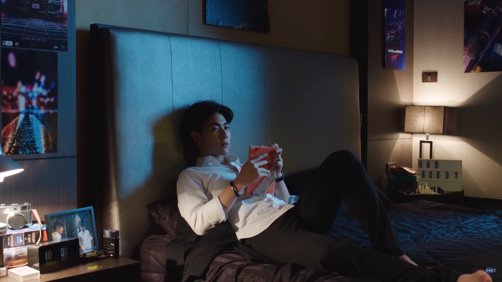
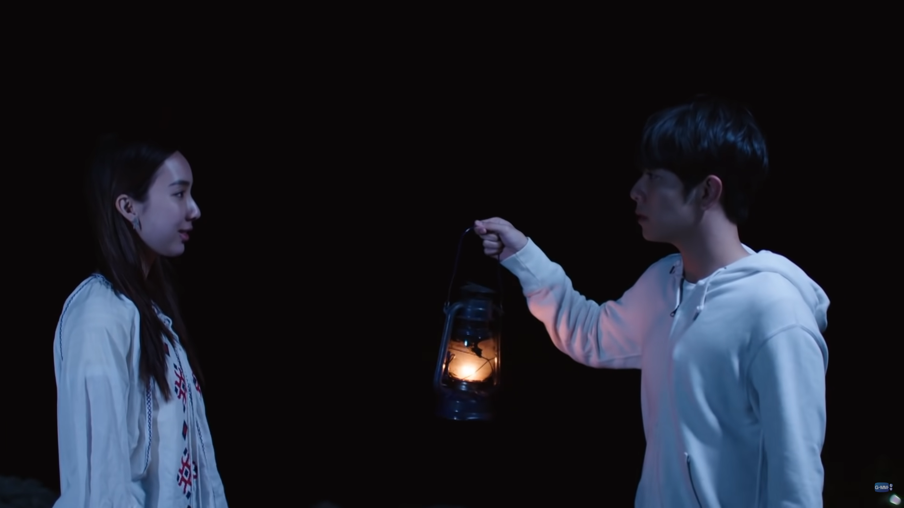
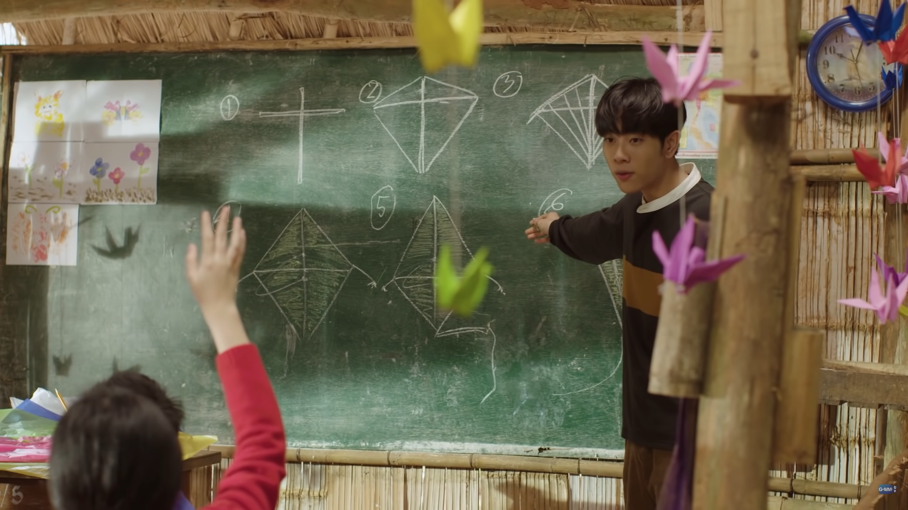
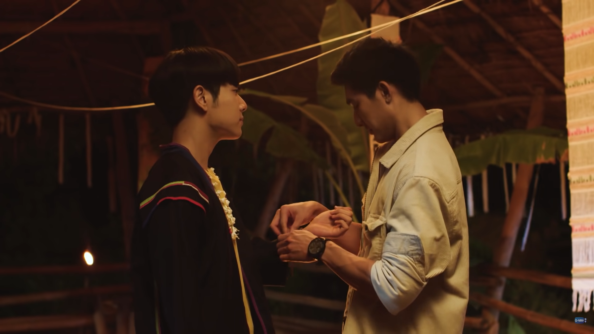
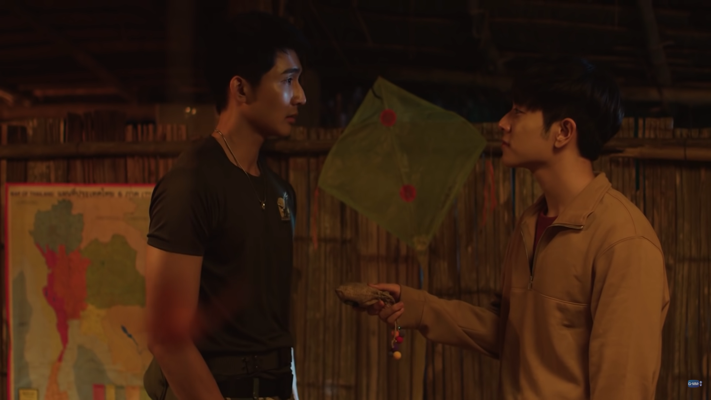

## 覺醒的旅程 Tian

> 「適合你的地方，會讓你成長。」

Tian 原本是個衣食無憂、凡事遵照父母意見的少爺，突然得知自己因為心臟病將不久於人世，從那之後他開始揮霍人生，用刺激的活動來麻痺自己對死亡的恐懼。某次病發，他幸運接受心臟移植手術得以存活，這段瀕臨死亡的經驗和「接受了他人的幫助才得以活下去」的念頭改變了他，成為他生命轉變的契機。他想報答給他心臟的 Torfun，也想向她贖罪，或許還有一點對 Torfun 日記中幸福感和價值感的嚮往。無論如何，這促使他做出改變人生的重要決定——前往 Torfun 教書的班星崖村，代替 Torfun 成為志工老師。
<!-- more -->

**_Warning 📢 觀影筆記和讀書筆記都會涉及劇情，請斟酌閱讀。_**

©️ [GMMTV OFFICIAL](https://www.youtube.com/c/gmmtv/featured​​)

雖然 Tian 的家人很愛他，但父母都只想讓他照著自己的意思去做，沒有考慮到 Tian 真正想要的是什麼，或許就連他自己也不知道。但在班星崖村，除了要自力更生、面對自己闖的禍（短短幾天可以闖那麼多禍，真的是闖禍王XD）、學習和村民孩子相處，他也必須自己決定很多事情，像是思考怎樣的教學對村莊孩子有意義，要如何幫助村民解決生計上的困難。**在過程中 Tian 發現自己原來可以做到很多事，甚至能夠為他人付出**；在幫助別人的過程中，自己也有所成長。這些領悟永遠改變了他的人生，他開始有了自己的目標，知道什麼對他而言是重要的，也知道自己有能力做出選擇。

透過自己的雙手，他在班星崖村建立起和孩子、村民、隊長等人的連結，大家都真心把他視為村莊的一份子——他在那裡找到了歸屬感，而這種透過努力換得他人重視的感覺，是他在家裡感受不到的。

## 內心的陰影 Tian & Torfun

> 「也許，是 Torfun 選擇了要把這顆心交給你，所以她才帶你來到這裡。」

Torfun 給了 Tian 一顆心延續他的生命，**但真正讓 Tian 踏出腳步前往班星崖村的，還是他自己想要幫助人的心**。這個信念在他遇到挫折時一直支撐著他，他的真心付出也被大家認可，但內心懷抱巨大罪惡感的 Tian 始終認為自己現在得到的一切，是他奪走了原本屬於 Torfun 的生活；他沒有辦法真正原諒自己，肯定自己的努力。當村民把他視為家人，就像他們把 Torfun 也視為家人時，Tian 反而覺得罪惡感更深。對 Torfun 的自責成為他內心沉重的枷鎖。

©️ [GMMTV OFFICIAL](https://www.youtube.com/c/gmmtv/featured​​)

**班星崖學校是 Tian 建立起自信和與其他人信任關係的起點，但這裡也充滿許多 Torfun 的影子**，孩子的畫作和言語之間對 Torfun 的想念，一再提醒 Tian 他的過錯。學校的燒毀對村民、孩子和 Tian 自己來說都是毀滅性的打擊；但是儘管喪氣，村民並沒有停滯不前，他們為 Tian 和孩子又建了一所新的學校。Tian 最終也選擇面對自己的心魔，向所有人說出藏在心底的秘密，儘管這會摧毀他和大家好不容易建立起來的信任——就像學校被燒毀一樣，可是也唯有這樣他才能掙脫枷鎖，真正開始走自己的路。**新的自己也才能像學校一樣，從那個毀壞的地方再重新長出來。**

©️ [GMMTV OFFICIAL](https://www.youtube.com/c/gmmtv/featured​​)

一開始，Tian 把 Torfun 的「心」帶回班星崖村，只是因為他想替 Torfun 實現心願。故事最後 Tian 仍然選擇回到班星崖村，但這次不是因為 Torfun 或別人，**是因為他知道這個地方是他真正的心之所向**。他把 Torfun 的日記埋在班星崖，換了一本新的筆記本——他自己版本的「千星傳說」。從現在開始，他不再為 Torfun 而活了，他要記錄屬於他自己的回憶。Torfun 給 Tian 最珍貴的不只是新生命，還有引領他走上這段使他成長和了解自己的旅程，讓他從對生命感到消極，變得有使命感而且積極去幫助別人。

## 回憶的重量 Tian & Phupha

> 「也許我們相隔的距離，沒有遠到我能夠把你忘記。」

隊長一開始是受人之託才特別關照 Tian，也因為他對 Tian 有先入為主的印象，認為一個富家少爺無法忍受班星崖村的生活太久，很快就會離開，最初的針鋒相對確實有點像在搞他。讓隊長改變看法的契機可能是 Tian 在溺水事件後，設法開導溺水的孩子吃藥，也嘗試走入村莊了解孩子們的生活，和孩子跟村民們逐漸打成一片。雖然 Tian 一直闖禍，但大家也知道他的本意是想幫助別人，並沒有惡意，這也讓隊長開始真心幫助他和鼓勵他。在村子為 Tian 舉辦的迎元神儀式上，隊長不再問 Tian 是不是要逃回家，而是希望 Tian 把班星崖村當成自己的家，和大家待在這裡久一點，沒有說出口的是他自己也很希望 Tian 能留下來。

©️ [GMMTV OFFICIAL](https://www.youtube.com/c/gmmtv/featured​​)

即使彼此都有意思，但是都沒有把話說開，Tian 對於 Torfun 的事還耿耿於懷，隊長則認為 Tian 總有一天還是要離開。即便如此兩人還是忍不住在意對方：在和 Tian 一起上班星崖約會踏青那天，平時只有護林隊制服跟護林隊T恤的隊長特意打扮，平時嚴肅的他也和 Tian 說了很多關於自己的事；Tian 平常總跟隊長頂嘴，私底下卻不自覺一直問醫生隊長的事情。一次隊長載 Tian 去兜風回來，在 Tian 的宿舍外兩人離別依依，想說什麼又說不出口，最後是 Tian 先開口邀請隊長隔天一起做風箏。

隔天在教室裡，Tian 跟隊長要了一個風箏，小孩看到也跑過來要，一向照顧孩子的隊長卻說「不行，這個有人預訂了。」**風箏是隊長第一次親手做給 Tian 的東西，就像是他的心意，既然已經心有所屬就不能再給別人了**。隨後兩人和孩子們到外面放風箏，風箏在天空中翱翔的景象好像他們的情感也可以美夢成真…但就在這時 Tian 心臟病發暈倒了。

©️ [GMMTV OFFICIAL](https://www.youtube.com/c/gmmtv/featured​​)

儘管兩人都想守護這段情感——隊長帶著孩子把風箏裝飾在教室裡，讓 Tian 每天上課都能看見；學校失火的時候，Tian 第一個想的也不是要賣的茶香包，他一心想保護的只有那個隊長做給他的風箏。但就像風箏停滯在 Tian 倒下的那一刻，他們最終還是分開了。

**也許就是分隔兩地才看得出情長，在村子裡的回憶有多深刻，分別時思念就有多濃烈**，每一次吃泰北料理，每一次泡咖啡，沒有什麼時候心裡不想起和對方的回憶。在醫生的婚禮上隊長還是忍不住偷偷去看了 Tian 一眼，Tian 給隊長的信上有多努力說要忘記就代表他有多放不下這段感情——其實他根本沒有放下，去美國的那一天，他依然穿著隊長給他的外套，還有寫著 Phupha 之心的戒指。別人或許看不出什麼，但是隊長一看到就明白了，因為他自己也是同樣的心情。

> 「隊長，你好難搞，這樣我要怎麼忘記你？」
> 
> 「你覺得我就有辦法嗎？」

Tian 在跟村民一起做茶香包的時候，醫生也幫不好意思開口的隊長跟 Tian 要了一個，但是 Tian 調皮地說都是要賣的商品不能給他。大家都離開教室後，**Tian 才在隊長送給他的風箏前面，拿出他特地做給隊長的茶香包（好喜歡這一幕的細節），一前一後就像他們交換的小小誓言**。Tian 在過了兩年學成歸國並回到班星崖的時候，也發現隊長還一直留著自己送的香包，Tian 調侃地說「你一定非常想我吧」。

©️ [GMMTV OFFICIAL](https://www.youtube.com/c/gmmtv/featured​​)

Tian 倒下的時候，手裡始終沒有放開那個風箏。風箏飛得再遠，還是能回到隊長的手上。**他們心裡一直都有彼此，並不是距離沒有遠到可以忘記，而是他們都知道，就像風箏一樣，就像犀鳥一樣，在心之所向的地方，有一個人在等著自己。**

* * *

看花絮和訪談，選角的過程也有一段浪漫（？）的小插曲。當初導演很快就選定 [Earth](https://zh.wikipedia.org/wiki/%E7%9A%AE%E6%8B%89%E5%B8%95%C2%B7%E7%93%A6%E5%A1%94%E7%B4%8D%E6%B1%95%E8%A5%BF%E7%91%9E) 來飾演隊長，但 Tian 的角色則試鏡了很多個人都覺得不適合。某天 Earth 突然想到認識多年的 [Mix](https://zh.wikipedia.org/wiki/%E8%96%A9%E5%93%88%E5%B8%95%C2%B7%E7%BF%81%E6%8B%89%E9%BD%8A)，詢問他是否有意願嘗試；同一天導演竟然也傳了 Mix 的資料問 Earth 是不是認識他。最後 Mix 去試鏡，才確定了由他飾演 Tian 這個角色。可能因為兩個人本來就很熟，對戲起來的感覺也很不錯。

戲外兩人是非常要好的朋友，如果看完《[千星傳說](https://youtube.com/playlist?list=PLszepnkojZI4DTG4wQ60bVOgIkN6ZjW2s)》覺得糖分不足，可以看他們一起主持的《[E.M.S EARTH - MIX SPACE](https://youtube.com/playlist?list=PLszepnkojZI7k09KeLBJJen3cHke3_z5R)》補充一下，雖然戲外的兩人和戲裡形象不太一樣（超級愛搞笑），但看著他們約約會逗逗貓吃吃飯業業配（？）也是蠻開心的，有一集還拍了偽婚紗照，真的是公費約會＋粉絲圓夢節目。

可以在 YouTube GMMTV 官方頻道收看《千星傳說》：


