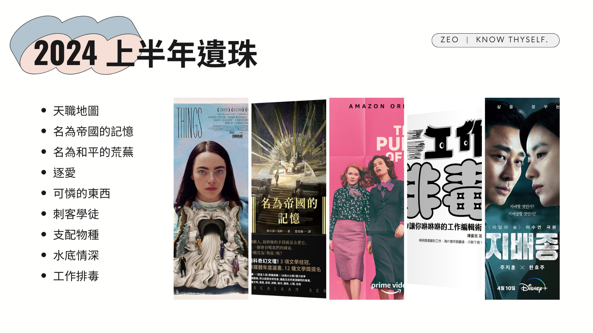

不敢相信 2024 年已經 8 月了，我還沒寫完上半年的遺珠。這篇主要想紀錄一下上半年看過但沒有獨立寫心得的書、電影跟影集，包括：

*   天職地圖（實體書）
*   名為帝國的記憶＆名為和平的荒蕪（實體書）
*   逐愛（LINE TV）
*   可憐的東西（Disney+）
*   刺客學徒（實體書）
*   支配物種（Disney+）
*   水底情深（Disney+）
*   工作排毒：讓你咻咻咻的工作編輯術（實體書）
<!-- more -->

**_Warning 📢 觀影筆記和讀書筆記都會涉及劇情，請斟酌閱讀。_**

### 天職地圖（實體書）

可能因為我已經讀過《讓每一次的離職都加分》，會覺得這本概念很相似但比較簡化一點，不過神奇的是邊寫邊翻的同時我又興起了再讀一次的衝動。

滿有趣的是，作者認為自己身上的特質也是一種職場加分項（如體型、聲音、外表等），原本我有點 get 不太到，畢竟現代社會強調多元包容，身體特質好像不常在職場被特別提出；但適逢巴黎奧運，比賽看著看著我突然醒悟：對耶，對於某些職業像是運動員，體型的確可能是加分項呀！

《天職地圖》的另一個特性，是以遊戲化的方式探索自己的目標和資源，所以能比較沒有壓力地閱讀和進行書中練習，適合想讀讀看挖掘自己優勢類的工具書，同時希望以輕鬆的步調開始的人。

### 名為帝國的記憶＆名為和平的荒蕪（實體書）

是同一世界觀、同一主角的系列作品，但兩集各自有完整的主線。雖然世界觀宏大，但讀起來不會很有疏離感，會這麼說並不是因為書中小太空站在大帝國迫近下掙扎求生的政治局勢聽來熟悉，而是作者將鏡頭集中在主角身上，細節呈現出主角的所思所想和情感變化，尤其是她緊張、猶疑、自卑等不那麼正面的情緒，讓她更貼近現實、讀的時候更容易代入。加上主角是以太空站人的身份接觸帝國，讓對帝國同樣陌生的讀者得以用她的眼睛同步認識帝國這個「世界」。另外帝國特殊的取名方式（數字 + 名詞），讓帝國人對讀者而言更像外星人，也讓讀者更容易和主角站在同一邊。

書中用文化的興盛程度來凸顯帝國和太空站的強盛差異，這點讓滿特別的；而擅於用文化滲透其他星球及種族的泰斯凱蘭帝國，在續集卻遇上了無法用熟悉的語言溝通的外星種族（= 無法以文化滲透）也是個巧妙的設定。

續集主要聚焦情報部和戰爭部的政治角力，分別代表外交手段解決問題／武力手段解決問題的立場，最後由主角等人與皇儲強力支持的外交手段占了上風，回歸到語言的主場，呼應了文化、語言和溝通交流在書中的重要性。

但主角在書中也不斷提醒自己（或被提醒），就算自己再怎樣熟悉帝國的語言文化，她都很難達到和帝國人一樣的水準；無論她如何嘗試融入帝國，她的外貌及出生地將使她對於帝國而言永遠是外邦人。該怎麼面對一個擁有妳愛的文化、卻總是想侵吞妳故鄉的帝國？沒有絕對正確的答案，但書中不斷強調的溝通交流或許是作者提供的解方。

### 逐愛（LINE TV）

LINE TV 上意外挖到的好片，改編自[米特福德六姊妹](https://youtu.be/AtoOxnSVL5s)的大姊南西的同名作品，劇中許多人物和設定感覺都有米特福德家族姊妹的影子。

敘述一對個性迥異的英國上流家族表姊妹從小到大的故事，經歷了對未來的嚮往、探索、嘗試、感受到快樂或心碎，探討了親情、愛情、友情等多樣的關係。原以為會是像《傲慢與偏見》或《唐頓莊園》那種有點嚴肅（？）的古典劇，但其實呈現手法還滿幽默的，且敘述節奏明快，整體讓人看得很舒服，我個人非常喜歡。



### 可憐的東西（Disney+）

看完有些零星想法但沒辦法很有條理地整合，姑且讓 AI 幫我摘要一下：

*   Godwin 創造 Bella，就像上帝創造人：
    *   他從母親體內拿出胎兒的腦「創造」出另一個生命，就像用亞當的肋骨製造夏娃，但這次夏娃是以自己的骨血製造
    *   暗喻沒有男人也可以創造／活得很好、象徵自力更生和獨立的力量
*   Bella 的成長過程中，遇到不同類型的男性，他們都想以某種方式囚禁或控制她，且這控制愈來愈具攻擊性
    *   Godwin：把 Bella 鎖在屋內
    *   律師 Wedderburn：從想囚禁她的肉體，進一步想囚禁她的思想、獨佔她
    *   船上的男性朋友 Astley：想扭轉她的想法、讓她感到受傷
    *   「前夫」 Blessington 將軍：不能接受她有任何自由，身體也不能作除了傳宗接代以外的事情
    *   只有 Godwin 的助理 McCandles 沒什麼主見，所以活到最後（男子無才便是德？）
*   儘管如此，Bella 也接觸不同的女性，逐漸成長，進行內在的探索並找到真正的自己
    *   Godwin 的管家：服從主人行事，守舊沒有自己想法
    *   里斯本彈樂器的女子：啟發 Bella 認識精神世界的歡愉？
    *   船上的女性朋友 Martha：欣賞 Bella，與她分享知識
    *   妓院的老鴇：給予 Bella 人生建議實則想剝削她為自己工作，但並沒有限制 Bella 或違反她意願
    *   妓院的同事：和 Bella 一起參加讀書會、帶給她真正身體和智性上的歡愉、幫助她發現真正的自己
*   故事呈現出 Bella 持續探索、成長；男性則大多留在原地、固守自己擁有的一切，只能透過控制才有辦法生活
*   Godwin 不能人道／既是父親也是母親，諷刺的是他是故事中唯一形象相對較正面的男性（也許正是因為他沒有傳統的男性性徵）
*   Bella 明知 Blessington 將軍並非善類還是願意跟他回去，因為她想知道「母親」發生了什麼事；讓我聯想到《綠野仙蹤故事集：奧茲大地的神奇巫師》中，女性英雄的旅程與男性英雄不同之處，是在打完怪之後還要回歸自我、接通女性能量

不過看了[影評](https://youtu.be/LApcc7JBfi4)覺得我眼界還是太小了，把這部電影限縮在性別之間，實際上它蘊含了更大的向度：

*   人之所以為人：
    *   感受到羞恥心
    *   想要改進自我
*   什麼是自由：人性中的超越性，開始想要反抗造物主、超越自身的限制（Bella 沒有重複母親的行徑）知道自己能且願意對現實做出選擇並為之負責。
*   男性對女性的控制及掠奪，隱喻強權對殖民地的控制及掠奪（Bella 在亞歷山大港所見／「沒有階梯連接富人和窮人的世界」）

### 刺客學徒（實體書）

第 N 次重讀突然很疑問…所以博瑞屈到底有沒有喜歡駿騎？（勿以腐女之心度君子之腹）

我一度覺得他和耐辛小時候曾經互相喜歡，但當博瑞屈看到蜚滋戴著他給駿騎耳環時，反應之大又讓我覺得博瑞屈對蜚滋付出的情感和他跟耐辛的互看不順眼，是否其實沒那麼單純XD

即便已經重看好多次，切德和蜚滋的師徒之情、博瑞屈數度肉身救主又再次讓我鼻酸，也還是會再次愛上率真又可愛的耐辛。

### 支配物種（Disney+）

非常微妙的一部劇，在開頭把我的好奇心高高吊起，但中間一度覺得你們到底是要談戀愛呢，還是要查案呢，還是要搞人體實驗呢，甚至想著看完這一季就要來棄劇的時候，結尾卻來了個毫無徵兆（至少對我而言）的驚天大翻轉，一方面使我的好奇心再次被吊起，一方面疑惑著我到底都看了什麼？！



### 水底情深（Disney+）

設定很新奇，喜歡劇中營造的復古氛圍，但劇情對我來說說教意味好像還是有點太重了。

### 工作排毒：讓你咻咻咻的工作編輯術（實體書）

沒辦法寫筆記跟心得，因為幾乎每一句都想畫重點（流淚）

完美主義、工作到看到相關的東西就不舒服、永遠有可以為了工作犧牲其他事物的藉口…太多地方讓人感到膝蓋中箭了。

這本書風格親民，作者邊分享自己工作中毒的血淚史邊傳授排毒方法，是部容易入口的小書，推薦工作到需要心靈排毒的人都來讀讀看。

<iframe data-testid="embed-iframe" style="border-radius:12px" src="https://open.spotify.com/embed/episode/4nySdoO3QRO9wPL0X9zbn2?utm_source=generator&si=3087b31a53e54476" width="100%" height="152" frameBorder="0" allowfullscreen="" allow="autoplay; clipboard-write; encrypted-media; fullscreen; picture-in-picture" loading="lazy"></iframe>

* * *

寫完發現…怎麼還是寫那麼長😂
