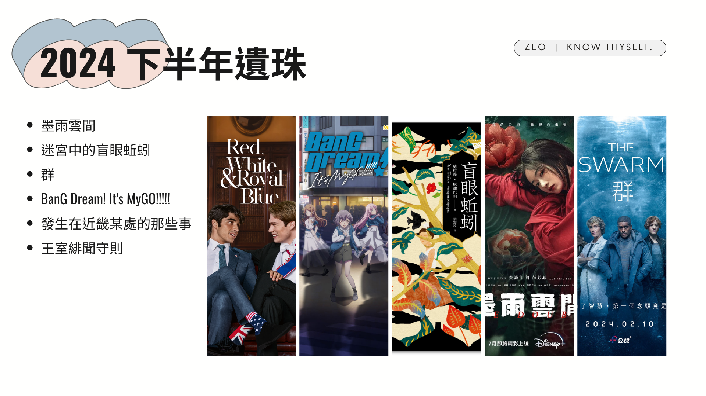
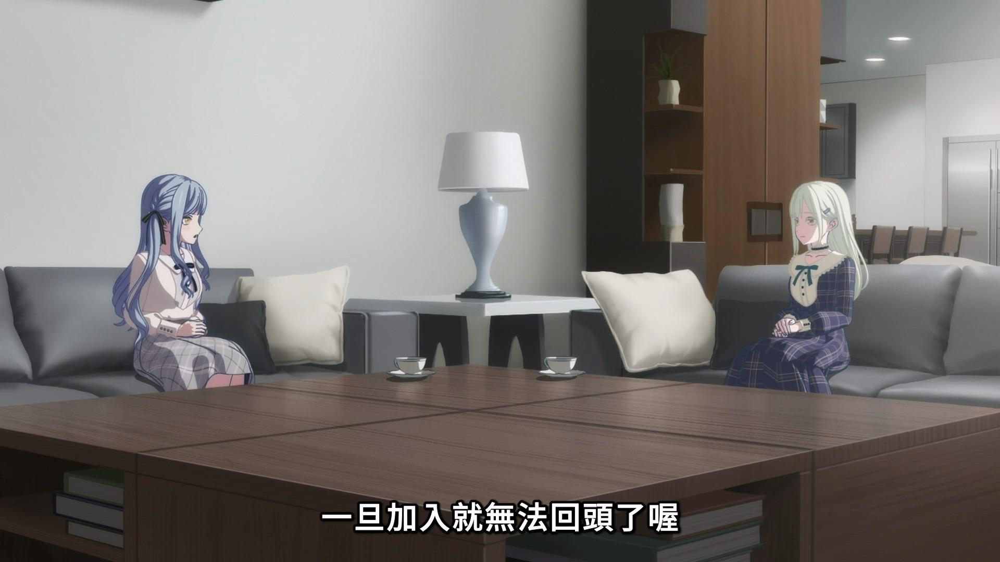

沒想到上半年心得才寫完沒多久，緊接著就是下半年心得了。同樣紀錄 2024 下半年看過但沒有獨立寫心得的書、電影跟影集，包括：

*   墨雨雲間（Disney+）
*   迷宮中的盲眼蚯蚓（實體書）
*   群 The Swarm（公視+）
*   BanG Dream! It's MyGO!!!!!（Muse木棉花）
*   發生在近畿某處的那些事（實體書）
*   王室緋聞守則 Red, White & Royal Blue（Amazon Prime Video）
<!-- more -->

**_Warning 📢 觀影筆記和讀書筆記都會涉及劇情，請斟酌閱讀。_**

### 墨雨雲間（Disney+）

對於《墨雨雲間》最大的心得就是「娛樂性很高」，高到我在看完之後好一陣子找不到這麼好配飯的劇。與其說劇情燒腦或神轉折，**更像是想看女主角接下來還要表演什麼**。主線是女主角薛芳菲為被夫家陷害的自己及借她身份的相國之女報仇，順便跟肅國公談戀愛，談到最後報仇還能報在一起也是絕了。雖然主軸是報仇不過劇情半嚴肅半輕鬆，不會讓人看得壓力很大。這部剛看完一度非常劇荒，還去看了有薛芳菲煮飯的《尚食》跟有肅國公吃飯的《珍饈記》，然後都棄劇了。

### 迷宮中的盲眼蚯蚓（實體書）

在 [Podcast](https://youtu.be/VWYMJLTZgv4?si=Kk2VSx3pTZ3ed7Oj) 聽到譯者介紹這本書後就買來看，雖然譯者提過這本書的寫作背景其實和泰國政治及歷史有關聯，在書中也簡單地幫讀者梳理泰國歷史甚至劃出重點，但可能我對泰國史真的太不了解或是敏感度不夠，實際上在讀小說時還是很難跟歷史聯想在一起。

不過，讀完《迷宮中的盲眼蚯蚓》之後我也不會說它是一個灑狗血的八點檔愛情故事，第一是故事情節跟大部分泰國 BL、GL 劇或是台灣八點檔相比，根本算不上灑狗血，頂多就是「可以稍微猜到人物關係走向」；第二是我感受到比起描述一個愛情故事，它更像是傳達一種集體上疏離的情感狀態。

> ……那他自己呢？他自己又怎麼了？班回想著生活留給他什麼，心裡有些苦澀。每天在充滿陌生人的世界裡睜開雙眼，只為了在寂寞黑夜裡強迫自己再次閉上眼睛，勉強遺忘破碎的夢，用別人包裝好的廉價夢想填滿自己，不斷和沒有回憶價值的光陰糾纏，然後崩塌，麻木而緩慢。
> 
> p.132

幾乎所有人在都在不斷尋找、對抗著什麼，或是追尋著虛無的幻象，也幾乎所有人都把自己理想投射在其他人身上。爸爸身在家中卻心繫愛不到的情人，媽媽傾盡餘生對抗不被愛的恨，班把對家的追尋投射在不同的「家人」身上，查麗卡在男性身上找書中小說男主角的影子，塔納和那堤則在浪漫關係中試圖重現自己對革命的理想和對刺激生活的幻想。**大家都像蚯蚓一樣在生活中盲目地前進，卻不知道自己到底要去哪裡。**

所有人都互有關聯又各為孤島。除了書中不時強調兩姊妹、塔尼舅舅和班的四人組是「四個孤兒」，姊妹和父母、父母彼此之間、班和爸爸…，每個人明明住在一起，彼此之間感覺卻都很疏離。姊妹曾經的心靈相通似乎也在查日雅離開後便斷絕了，班跟查日雅一牆之隔卻無法抵達彼此的內心、查日雅在情人們之間游移不決，但始終無法和他們建立穩固的關係、那堤死前「差一點」就想起查日雅、查日雅讀著父親寫給情人的信，卻不知道自己和父親的情人曾住在一街之隔，兩人曾經有短暫的交會，卻沒有任何實際的交集。凡此種種對關係的描寫，都給人不穩固和疏離的感覺。

> 查麗，在這個破碎清冷的世界，連幸福都不是為了讓我們感受而存在。妳的思緒、夢想，妳做過的事情，妳是什麼人，妳所理解的一切，妳想抓住的東西，妳追尋的目標。我們付出的代價，一次又一次死去的內心，不斷崩塌的夢，無止境的孤獨，瘋狂。我怎麼會不懂，查麗，我怎麼會不知道生活是怎麼背叛我們的……我怎麼可能會不懂？
> 
> p.220

比較特別的是《迷宮中的盲眼蚯蚓》中有很多將情緒化為意象的描述，像是查日雅房間牆上的黑樹，在她哭泣時葉子會飄落，在她和班相擁時燕子會飛來，讓敘述帶有強烈的畫面感。

而印象最深刻的段落應該是塔尼舅舅出家，帶有很強烈的宿命感和浪漫感。舅舅和那堤也是有趣的對照，他沒有甚麼大抱負（不像那堤總「想像」著自己出生入死），僅是出於對外甥女離去的傷心，便將生活的重心轉向尋找布料，進而離開原本生活踏上陌生國度和艱辛旅途，最終發現其實他會踏上旅途是宿命，而查日雅姊妹和班的結局也是宿命。不過我沒有參透舅舅的旅途意義，也許是想表達戰爭報復沒有盡頭，唯有參透人生的智者有智慧能終止這樣的輪迴、得到平靜（最後看到的意象是小孩出生，也是希望的意象）。

### 群 The Swarm（公視+）

記得這部劇的原著小說曾經紅極一時，不過當時借來只翻了幾頁並沒有看完。前陣子發現《群》被德國改編成電視劇而且公視+上有，就想說挑戰看看電視劇版應該比較容易看完。劇情跟印象中小說的開頭差不多，世界各地從沿岸開始發生異變，像是有毒海鮮汙染水源導致民眾感染死亡、平時溫和的鯨魚突然開始攻擊船隻、數量異常龐大的螃蟹衝上岸等，於是來自不同國家、不同領域的專家開始合作找出原因，最後推測出這可能是某種有智慧的新物種「有意為之」，目的在於警告人類對海洋造成的汙染，甚至是向人類復仇（對又要復仇）。電視劇翻拍得滿精緻的，場景呈現跟演員表現都很不錯，木村拓哉還有出演後期一個重要角色。《群》的整體劇情偏沉重，讓人感受到在自然力量下人類的渺小。如果《墨雨雲間》的復仇想說的是人的意志感動天降下五月雪，《群》的復仇想傳達的則是人應該要對自然心存敬畏。

### BanG Dream! It's MyGO!!!!!（Muse木棉花）

在《BanG Dream! Ave Mujica》開演前有幸趕上《BanG Dream! It's MyGO!!!!!》的末班車，原本想說會不會已經被梗圖劇透得差不多了，但實際看完覺得娛樂性還是很足。角色背後的慾望跟弱點多少能引起人共感，也讓整體劇情和主要人物沒有流於樣板。小燈希望愛音和爽世回到樂團的吶喊（就算迷惘也想和你一起前進）讓人看得很感動，就算已經脫離青春期的迷惘轉而進入社會人士的迷惘，還是覺得從這部作品獲得了一點點勇氣。

### 發生在近畿某處的那些事（實體書）

整本書由不同形式的短篇組成，主線是化名背筋的作者說明他尋找失蹤朋友小澤的始末。書中除主線外的其他短篇是小澤和作者蒐羅的素材，包含了雜誌投稿、讀者投書、網路論壇擷取文章、採訪錄音檔甚至圖片等各種形式。雖然這些短篇之間並沒有連貫性，例如有些是學校的靈異事件調查，有些是讀者敘述自己與神祕團體接觸的經驗，有些是論壇關於靈異景點的討論，但讀著讀著或多或少也會和作者及小澤一樣發現，這些事件都有某種共通性。

覺得比較可惜的是，雖然最後書裡解釋了造成這些靈異現象的原因，但會覺得這些好像讀到中間就可以猜到，只是最後稍微補足了一下背後的人性因素，但除此之外好像就沒有更多了。

倒是看[其他人的解析](https://www.plurk.com/p/3g3edwz7bt)提到，《發生在近畿某處的那些事》書中很多故事其實是有所本的，看完覺得毛度（？）直接上升。不過對於像我這樣其實很怕恐怖故事又有點好奇的讀者來說我覺得恐怖度算是剛剛好，留有一定程度的懸疑感，有點毛毛的但又不至於太可怕。

### 王室緋聞守則 Red, White & Royal Blue（Amazon Prime Video）

可能因為先看了《副人之仁》才來看《王室緋聞守則》，導致我一直覺得這電影裡總統辦公室的良好氣氛跟高效率，不真實的程度遠勝第一公子跟王子殿下談戀愛（總統演講前幕僚竟然已經改好講稿了簡直不可思議）XD

這部我有買英文版小說但只看不到一半，記得前面 Alex 跟 Henry 花了一點時間才從互相有意見進展到曖昧，好像還有提到 Henry 的妹妹 Beatrice 公主有些狀況，不過電影把焦點更集中在兩位男主角身上，省略了一些劇情讓節奏更適合影劇呈現，整體來說是一部可以放鬆心情觀看的電影。


