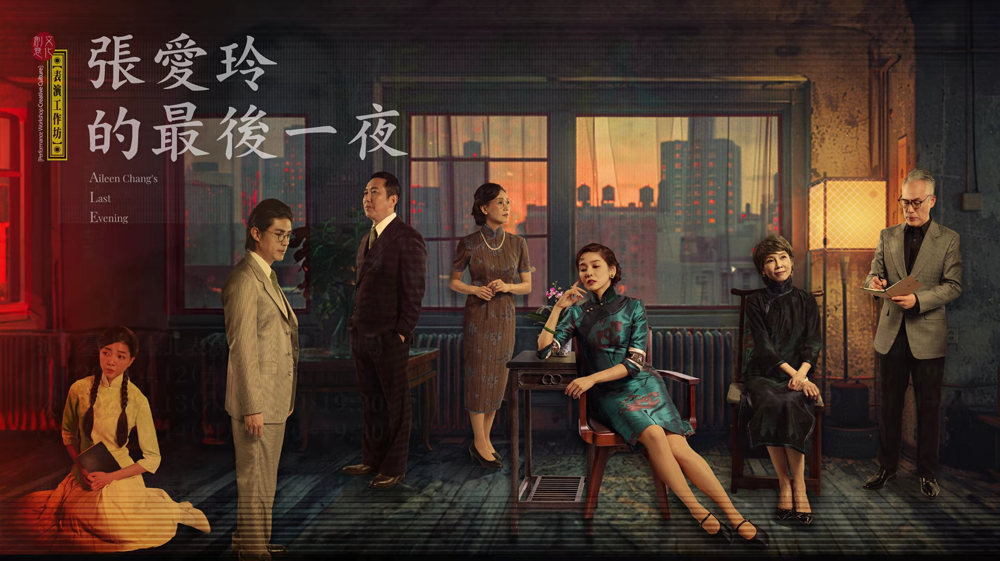

上一次讀張愛玲的作品已經是好久以前，但對於她的生平僅略知大概。正巧前陣子看了 [Youtube 頻道上對於張愛玲生平的介紹](https://youtu.be/Va0dW9kce_8?si=f6EfnxXRwHwE6LyK)，才知道她晚年是這樣平實地逝世的（覺得劇裡的「淡出」形容得很好）。因此朋友邀請去看《張愛玲的最後一夜》時，立刻覺得是一個很好的機會，能複習一下她的生平和經典作品。
<!-- more -->

**_Warning 📢 觀影筆記和讀書筆記都會涉及劇情，請斟酌閱讀。_**

> 以「誦讀劇場」（Readers Theatre）的表演形式，呈現一場感性且超現實的戲劇體驗，劇中以三男四女七位演員搬演二十幾個人物，細述張愛玲作品《紅玫瑰與白玫瑰》、《傾城之戀》、《金鎖記》等作品精彩的人物及片段，呈現一場跨越現實與虛構之間的戲劇饗宴。在張愛玲情感豐沛的歲月中，每一段情感都是她生命的一部分。
> 
> 劇中，觀眾將進入一場穿越魔幻、虛實交錯的時空。張愛玲將和她筆下的角色開啟一場場的心靈對話。每一個角色創作的都是張愛玲潛在的心靈投影。透過與他們之間的對話，觀眾被帶入她的迷宮，探索張愛玲她對內在自我的反覆挖掘，進入一場佛洛伊德式的自我解析，感受到張愛玲的情愛、失落、歡笑，以及潛在的湧動，從時光深處的回聲到繁華落盡的詩意。
> 
> [【表演工作坊】《張愛玲的最後一夜》：給一代才女的微薄獻禮](https://www.opentix.life/event/1747444769562173440)

  

印象中張愛玲是一個性格很強烈、（以她的家世背景和她努力在文壇掙得的地位）也完全有資格這麼特立獨行甚至是自傲的人，因此當她默默接受胡蘭成另有情人的事實，反而讓當初旁觀者如我覺得很不能接受，天才怎可以如此委屈？但在《張愛玲的最後一夜》中，老年的張愛玲只是淡淡地告訴她的幻想朋友（劇中的解說者），她並沒有後悔也沒有覺得委屈，這是她自己的選擇，她也甘願接受結果。就如同她的財產足以讓她過得小康，她卻選擇在晚年過著簡樸的生活，這都是她出於個人意願的決定，並沒有屈從他人，就像她一直沒有屈從時代或自己的命運。這讓我又更尊敬她能坦然接受自己選擇、放下逝去情感的精神（但胡蘭成的確還是渣男啦）。

除此之外，令人感到最惋惜的就是她晚年並沒有留下更多創作了吧。但在觀看《張愛玲的最後一夜》，重溫了她名作中的經典片段後，還是很感謝她願意寫作，刻劃一個時代下平凡人物的悲歡喜樂，也把這些精采的作品留給我們。

© [表演工作坊 Performance Workshop](https://www.youtube.com/@PWvideo)

---

**《張愛玲的最後一夜》**

*   導演：楊世彭
*   編劇：楊世彭
*   場地：臺北表演藝術中心 球劇場
*   觀看時間：2024-04
