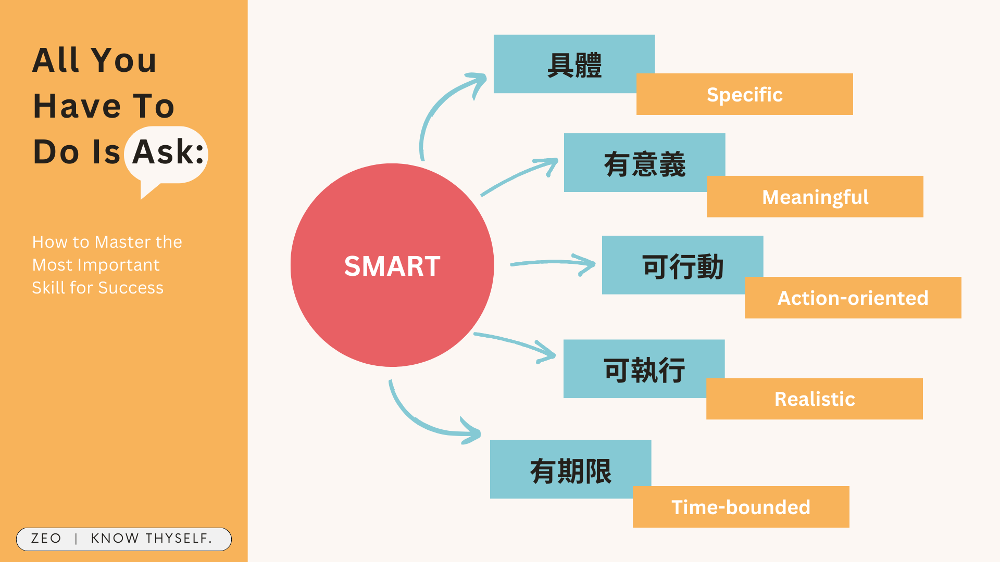

## 為什麼讀《開口問，全世界都會幫你》

觀察自己在工作上的狀況，發現自己很難開口對主管或同事求助，容易導致自己不停內耗；搜尋到[別人心得](https://prioritizemyself.wordpress.com/2021/01/05/%E9%96%B1%E8%AE%80%E5%BF%83%E5%BE%97-%E9%96%8B%E5%8F%A3%E5%95%8F%EF%BC%8C%E5%85%A8%E4%B8%96%E7%95%8C%E9%83%BD%E6%9C%83%E5%B9%AB%E4%BD%A0112-365/)之後決定讀讀看這本書。

## 《開口問，全世界都會幫你》重點筆記

### 1 為何要求助

*   **求助困難的原因（第二章）**
    *   人們常低估他人願意幫忙的程度
    *   求助是一種拉近距離的方式
    *   如果擔心求助令人覺得自己沒有能力 → 可以先釐清自己的求助動機
        *   依賴型 Dependent help-seeking
        *   自我成長型 Autonomous help-seeking → 勇敢求助
    *   不是先幫助過人才有資格求助，而是先有人求助，才能有人給予，重點是要讓求助／給予成為正向循環
<!-- more -->

**_Warning 📢 觀影筆記和讀書筆記都會涉及劇情，請斟酌閱讀。_**

*   **影響團隊效能的關鍵（第二章）**
    *   心理安全感：在團隊中承擔人際風險是安全的：不害怕指出問題、提問題、面對棘手議題、犯錯、求助等——最為重要
    *   可靠度：以卓越的高標準準時完成工作
    *   結構與清晰度：明確的角色、計畫與目標
    *   意義感：工作具有私人重要性
    *   影響力：團隊的工作很重要，而且帶來正向改變

*   **對我而言求助最大的障礙是什麼（第二章）**
    1.  過度堅持靠自己：既然我被賦予任務就要有能力解決問題
    2.  缺乏心理安全感：不覺得有人能協助我、擔心被認為小題大作
    3.  求助得付出社會成本：擔心索求太多幫助

*   **我的求助／助人種類（第三章）**
    *   我測出來是孤狼型＝求助／助人分數都很低，自己感到非常震驚。我本來就預期求助分數會很低（所以才來看這本書XD），沒想到助人分數竟然也這麼低；自認為在職場上算蠻樂意提供幫助，這點也受到多位主管認可。不過看了一下題目，覺得亞洲職場文化普遍要拿到 4 分應該不容易吧，畢竟誰會隨時詢問職缺資訊跟互相介紹朋友同事認識（難道大家都會）
    *   但我也反思了一下為什麼求助分數這麼低（書裡說助人平均分數是2.5，理想分數是4以上，我只有1.3），可能因為我潛意識認為不求助獨立完成工作比較有成就感，而且是有能力的象徵（相較於頻繁求助），所以會覺得如果自己能完成就盡量不要求助 → 但讀完這本書我暫時也還是想不到什麼很具體的解決辦法

### 2 如何求助

#### (1) 先了解自己的目標與需求

觀念建立：

*   區分最可能帶給你幸福感的目標，應符合：
    *   本質的 Intrinsic：本身有趣、激勵人心、讓人振奮
    *   真實的 Authentic：代表你的熱情、興趣、價值觀，而非來自父母或同儕壓力
*   當你必須執行不樂意承擔的目標時，將最終目標牢記在心，能幫助你從新的角度看待這項目標

工具：

1.  快速啟動
    *   我遇到的挑戰是 ，而我需要 
    *   我正在 ，而我可以從 得到幫助
    *   我希望 ，而我需要 
2.  清楚闡述目標
    *   目標名稱：例為知識協作發展出衡量標準
    *   描述：例我們想發展一套衡量標準，衡量知識協作在個人、小組、組織層級的強度。這能讓客戶改善組織內的知識協作，也能展現我們公司的價值
    *   期限：例 12 週內
    *   衡量標準：例創造一套可以 A. 適用不同組織 B. 讓客戶進行比較 的評量系統
    *   為了完成目標，我需要 資訊、建議、推薦、引薦、財務資源、人力資源、參與、有形資源等 
3.  勾勒願景
    *   定義：
        *   無關如何達成某個目標，而是成功看起來像是什麼樣
        *   不是期望某件事會發生，而是弄清楚打算讓什麼事情發生
    *   好處：避免一頭鑽進辨認問題、討論對策，導致迅速失去幹勁、無法取得太多進展。
    *   願景應該是
        *   能激勵人心
        *   在策略上合理
        *   有憑有據
        *   經過溝通的
        *   範例：作者對曾經任職系所五年後的期望包含卓越的研究、出色的教學、絕佳的工作環境、積極參與所屬社群這4大願景

#### (2) 把目標／需求轉換成聰明的請求

SMART（具體、有意義、可行動、可執行、有期限）

*   Specific：具體的請求才能讓對方立刻聯想到他所擁有的資源或人脈
    *   我需要「資訊」⚠️
    *   我需要 資訊⭕
*   Meaningful：說出「為什麼」能引起他人的同理——覺得自己較常忽略
    *   我需要門票⚠️
    *   我需要門票慶祝和妻子的結婚紀念日⭕
*   Action-oriented：明確表達希望對方以怎樣的行動協助，能讓對方更清楚怎樣能幫助你——覺得自己可以更進步
    *   我要轉職成企劃人員⚠️
    *   我需要和企劃人員聊聊以了解這份工作⭕
*   Realistic：請求必須是策略上有可能達成的
    *   我要去月球的門票⚠️
    *   我需要兩張演唱會門票⭕
*   Time-bounded：讓對方能評估時間內是否能提供協助
    *   如果說「明年才要」，對方可能根本就忘記⚠️

#### (3) 考慮可能的求助對象

*   朋友圈
*   公司的人事檔案或知識資料庫
*   休眠人脈（久未連絡的朋友等）
*   二級人脈（可能接觸到所需資源的人）

#### (4) 如何看待被拒絕

*   問「為什麼」能將「拒絕」轉變成「可以」，或得到導向「可以」的資訊（「我能問為什麼嗎？」）
*   拒絕只是一種意見，並非針對個人；拒絕通常只是關於拒絕者而非請求者的資訊（你並不知道背後的原因）

### 3 如何創造能安心求助和助人的團隊

《開口問，全世界都會幫你》在這部分著墨滿多，大概佔了一半篇幅；但因為我不是團隊主管，所以只筆記一些我覺得有趣的內容。

#### (1) 創造團隊安全感的工具

**IDEO 的航程專案流程（flights）（p.110）**

*   preflight
    *   專案準備階段
    *   討論希望和恐懼
    *   建立表揚求助和助人的規則
    *   釐清團隊和個人需要什麼來取得成功
    *   範例：我不太了解這個主題，因此我會處在學習模式，請大家對我保持耐性，在我學習時帶著我。我會問很多問題，需要各位的鼎力相助！
*   midflight
    *   目的是讓團隊在專案中途報平安
    *   檢查進度、弄清楚是否需要額外資源
    *   重申對求助和助人的規範和期望
    *   檢視哪些行得通哪些不行，若有需要則進行調整
*   post-flight
    *   在團隊完成工作後
    *   情感宣洩、慶祝的時光，而不只是事後檢討
    *   討論學習所得、提供回饋與接受意見
    *   檢視是否重視及表揚求助和助人的人

**互惠圈（p.122）**

*   每個人都要在白紙上半部寫下請求，認為自己能提供協助的話就在下半部寫上名字

**白板上的一週一問（p.127）**

*   輪流週一在白板上寫下問題，週間大家都可以寫下答案，但是週五才能進行討論

#### (2) 關於讚賞

*   想被讚揚是人類需求：受到讚賞是一種基本的人類需求。讚賞告訴我們，我們受人重視，我們有所歸屬，我們被包括在內、被接納、被賞識。我們受到肯定的鼓舞，相對也因為缺乏肯定而失去熱情。（p.168）
*   外部獎賞（例獎金）增多並不會因而減緩內部動機（例個人滿足感）：研究激勵的心理學家過去曾擔憂，提供表揚和獎勵等外部激勵因素會逐漸損害或「排擠」內在激勵因素，像是我們從工作中獲得的個人滿足感。其實，一項針對這個主題近四十年研究進行大型統合分析得到的結果是，就算有金錢獎勵的存在，內在動機仍舊是中等到強度的績效預測指標。（p.171）

這讓我想到之前讀[《夠好的工作》]()，書裡提到人很容易追逐職場上的外部獎賞（獎金、位階、掌聲等）而不自覺陷入過勞迴圈。但《開口問，全世界都會幫你》這本書中的例子有個顯著差異：員工是本來就發自內心喜歡做這件事，不是為了外部獎賞才去做這件事；所以無論有沒有外在獎賞都不影響他做這件事，也就不會為了追逐獎賞陷入過勞迴圈。

## 《開口問，全世界都會幫你》給我的收穫？

### 我覺得最有幫助的

1.  我滿喜歡「勾勒願景」這個工具，由於是想著成功的願景而寫下目標，會讓人在設定目標時充滿正向的感受。
2.  書中有提供某間公司工作守則的範本，我覺得這份守則讓我很有安全感，像是「我們雇用你是因為你的才華與潛能，而非期待你無所不知。」、「你會犯錯，那是學習的最佳方法」、「我總是看起來很忙——那只是我的行事風格。別讓那打消了你想打擾我工作的念頭。如果你需要我的關注，只管給我打信號」等。

### 是否解決我的問題

讀到一半就有發現，這本書好像跟我想解決的方向有點不同，但更可能一開始我就沒有問對問題

1.  我的問題不是出在「怎麼問」環節，而是更前面的「開口問」（不敢求助），也許是對於團隊很難有足夠安全感
2.  對我來說這本書的內容還是有點 high level，我會想知道更多細節的操作方式，例如書中 IDEO 的航程專案流程提供的發問範例我就覺得很不錯
3.  覺得這本書更適合「想學習透過求助／給予增進效能的團隊」多於「想學習往外去求助的個人」

---

**開口問，全世界都會幫你：人生、職場必修的求助溝通學**

*   作者：Wayne Baker
*   譯者：陳筱宛
*   出版年份：2020
*   出版社：商業周刊
*   閱讀平台：實體書
*   閱讀時間：2024-06
