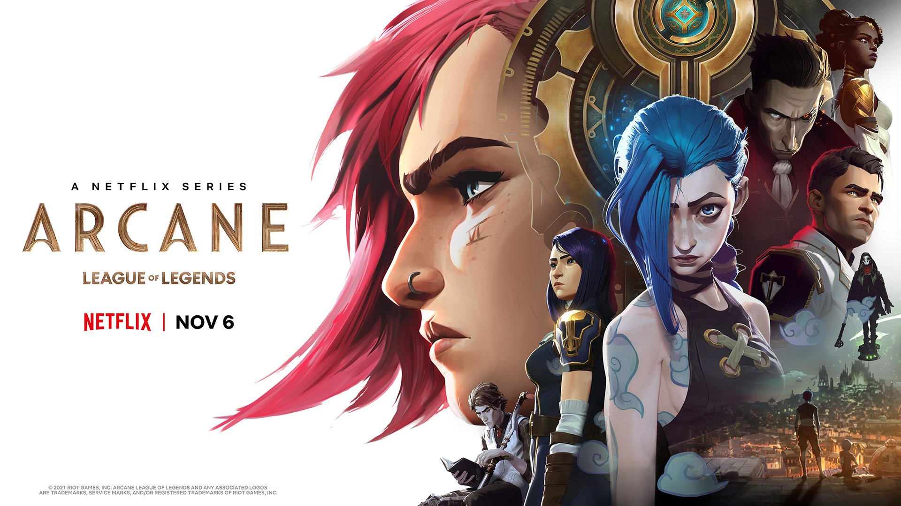
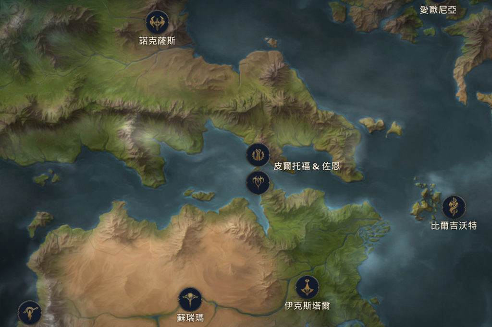

我沒玩過 LOL，所以這篇純粹說說針對《奧術》影集 aka LOL 版傾城之戀 aka 怪物與她的產地的感想。



## 一對姊妹，兩座城市

> 我從小就知道我比他們低賤，我的家被他們踩在腳底下，我希望爆爆 (Powder) 能過得比我好，我願意不惜一切去爭取。

主角 Powder 和姊姊 Violet 的父母在一場上城 Piltover 與底城 Zaun 的衝突中被上城的執法者殺害，領導這場行動的 Vander，也是底城的首領，收留了 Powder 姊妹與其他的孩子。

隨著孩子們一次於上城的行竊引發爆炸意外，兩座城市的衝突日益升高。 上城的執法者要 Vander 交出主謀 Vi 好向議會交代，底城的人也逐漸不滿 Vander 對於執法者的侵門踏戶默不作聲；與此同時，Vander 曾經的兄弟 Silco 正暗中研發能大幅增強生物能力卻會影響心智甚至使之變得殘暴的藥水 Shimmer，而上城的兩名科學家也正在研究即將改變世界的科技 Hextech…

一連串出於善意的決定，最後卻讓這對姊妹走上完全不同的道路，也改寫了 Piltover 和 Zaun 這兩座城市的命運…

## 從 Powder 到 Jinx

《奧術》的故事以三條主線輔以其他支線交織而成，一條是 Vi 和 Powder 的故事（在第一幕結束後分岔），一條是 Jayce 和 Viktor 的研究（上城發生的事 & Hextech），一條是 Vander/Silco（下城發生的事 & Shimmer）。故事裡有非常多對稱的角色和結構設計，像是 Vi/Jinx (Powder)、Vander/Silco、Piltover/Zaun、Hextech/Shimmer，既互相呼應又能彼此關聯。

而隨著三幕的推進，Jinx 的身分也有了從 Powder → Jinx/Powder → Jinx 這樣的轉變。
<!-- more -->

**_Warning 📢 觀影筆記和讀書筆記都會涉及劇情，請斟酌閱讀。_**

### 01 Powder

> 有她在幹什麼都倒楣！(She jinxes every job!)

#### Jinx 與 Vi 弱與強的明顯對比

Vi 總是團體中的頭頭，有膽識又擅長打架；與之相反，年紀最小也最瘦弱的 Powder 常常在行動中拖後腿，其他夥伴對此頗有微詞。但是 Vi 總會在行動時帶著 Powder 一起，也總是維護和鼓勵著 Powder。

Vi 看出是兩座城市的貧富不均及不平等讓底城的人只能苟且偷生，用拳頭證明自己，因此 Vi 想要的是改變環境，而不是要弱小者變強（這是 Vi/Vander 和 Silco 不同的出發點，Silco 信仰的是個人要變得強大）。Vi 追求的是一個無論擅長動手還是動腦，大家都能平等生存的環境。

但底城為了生存而演化出的尚武精神、夥伴的冷言冷語、自己內心的懷疑，讓 Powder 認定是因為自己太過沒用，在第 3 集 Vi 才不讓她參與營救 Vander 的行動，最終造成悲劇——即使 Vi 的本意只是希望保護僅有的家人。但這個念頭已經被 Powder 刻在心裡，將追求強大/扼殺弱小的自己內化成自己的目標，而這也完美符合 Silco 的信條。

此外，我認為早在 Vi 離去以前，Powder 的心理狀況就已經不太穩定。Powder 對自己的質疑，對於增加自信並沒有幫助，反而讓她在面對危險時更加緊張，在行動中表現不佳，而這又反過來加劇自己的懷疑。在伙伴去營救 Vander 時，認為自己因為沒用被拋下的 Powder 情緒化地崩潰大哭，並把在關鍵時刻不能發揮作用（這不也暗示了她對自己的看法嗎？）的小道具砸爛，從這裡已經可以看到日後情緒激動時 Jinx 的雛型。而她的精神狀況在不小心害死夥伴加上姊姊離去後，隨著在內心不斷地自責更加惡化。

#### Caitlyn 與 Vi 上下城對話的可能

_Originally tweeted by Arcane ([@arcaneshow](https://twitter.com/arcaneshow)) on [2021-09-21](https://twitter.com/arcaneshow/status/1440331318705868806)._

Jinx (Powder) 跟 Caitlyn 是一組明顯的對照，相近的年齡、同樣的髮色，一個出身上城富裕家庭，一個出身汙水巷——不知道 Vi 是否有那麼一瞬間，在 Caitlyn 身上看到夢想中妹妹幸福長大的樣子？

故事的最初，在 Vi 帶頭偷竊的行動中有個有趣的伏筆：當時 Cait 也在現場，和 Vi 她們只有一牆之隔。但 Vi 和 Powder 他們得從屋頂偷偷摸摸溜進房子，而 Cait 當時之所以在那棟建築裡，是因為那是她父母投資讓 Jayce 做研究的地方。屋裡富麗堂皇，放著各種令人目眩神迷的精巧器具，令孩子們不禁驚呼「一個人怎麼能擁有這麼多東西？」，上城和底城生活的雲泥之別，從一開始就烙印在 Vi 的心中。

> 我妹七歲時就能這樣跑了。我們底城人都辦得到，難道妳不想入境隨俗嗎？

後來 Vi 和 Cait 一起去底城，場景對調了，現在 Vi 是主 Cait 是客。Vi 驕傲地對 Cait 說 Powder 小時候就可以在高處跳來跳去，但底城人學這些技能明明是為了偷東西或逃命，是為了生存而不得不為，並非什麼值得炫耀的事——但除了這種小小的苦中作樂，底城還有什麼能拿出來讓人見識的呢？沒有，只有「看起來就像地下室會埋屍體的地方」，而這就是 Vi 和 Powder 長大的環境。

對 Cait 來說，沒必要為了生存強迫自己學習打架和逃命，她和警長學槍術或當執法者，都是出於個人意志和想讓城市變得更好的信念。儘管長大後也是一樣，她失蹤未歸會有媽媽擔心她，腳受傷了有爸爸幫她處理；而 Jinx 受傷回家後還要在那裡用釘書機釘自己的腳XDD。所以後來 Vi 到上城走了一遭，有感而發地說上城人跟底城人、她跟 Cait 就像油和水，從成長環境到生活條件都天差地遠，她們根本不是同一種人，要怎麼了解和融入彼此？

但如同 Cait 總是提醒 Vi 的，「我們並不是怪物。我們也是人，和妳一樣的人」，上城人帶著偏見看待底城人，但底城人又何嘗不是如此？Cait 是除了 Heimerdinger 之外，少數真正去接觸和接納底城的上城人（Jayce 只是去工廠參觀一下所以暫時沒有把他算進來），從認識 Vi 到親眼見到 Ekko 建造的社區，Cait 認知到底城也有各式各樣的人，就和上城一樣，大家都努力地生活著。Cait 一直相信自己可以為所有人做些什麼，不管是上城或是底城的人，她的信念和 Vi 的願景方向是一致的。她們願意開啟對話和嘗試理解彼此其實是上下城和解的開端，這也是為什麼她們發展情誼這麼重要。並不是因為很香才這麼說的。

#### Viktor 與 Jayce 上下城攜手的象徵

_Originally tweeted by Netflix Geeked ([@NetflixGeeked](https://twitter.com/NetflixGeeked)) on [2021-11-24](https://twitter.com/NetflixGeeked/status/1463627989531480069)._

如果說 Powder 的心靈因為底層的生活受到影響，Viktor 則是肉體被底層環境毒害的極端案例。而 Viktor 和 Jayce 是另一組對照，他們是研究夥伴；但出身上城、白手起家、相貌英俊、體態陽剛的 Jayce 是大家心中的 golden boy，鎂光燈下的焦點，愛情事業兩得意；Viktor 則為自己的跛腳（也許還有這背後一直提醒他的，來自下城的身分）而有些自卑，他不求出頭，只想用有限的生命完成研究。他們的合作關係也展現上下城攜手的可能性，只是 Viktor 時日無多，Jayce 也前景堪慮（還是會有奇蹟發生呢？）。

### 02 Jinx/Powder

> 他們會後悔的，我們會讓全部人後悔的。(We'll show them. Will will show them all.)

#### Jinx 的新身分

_Originally tweeted by Arcane ([@arcaneshow](https://twitter.com/arcaneshow)) on [2021-11-13](https://twitter.com/arcaneshow/status/1459450329930481674)._

Silco 和 Jinx 彼此需要。Silco 的信條就是「真正的力量不是屬於生來就是最強壯的人，而是屬於願意不惜一切取得力量的人」，所以他不喜歡 Vi，Vi 令他想到 Vander，屬於生來強大的那種人（相對於 Silco 或 Jinx 而言）；而如同 Vander 在 Vi 身上看到過去充滿抱負的自己，Silco 則在 Jinx 身上看到曾經弱小的自己，或許也想到了受制於人的底城 Zaun。他幫助 Jinx 變得強大就是幫助自己向這個世界證明「他們」並不弱小——Zaun 是他夢想中的 legacy，Jinx 卻是他活生生的女兒，Jinx 就是他想要拯救的 Zaun 兒女。

但也或許他想拯救的其實不是 Zaun，而是那些弱小的人。比起創造平等的環境，他似乎更執著於向那些生來「強大」的人證明我們也可以。如同 Jinx 說 Silco 好像還停留在 Vander 背叛他那一天——他始終沒能逃脫自己的心魔，而 Jinx 最終是不是也繼承了這個循環呢？

Jinx 說 Silco 一直以為是他造就了 Jinx，這話其實也不完全錯：Vi 的離去在 Jinx 心中種下瘋狂的種子，但卻是 Silco 使這顆種子成長茁壯。

對於 Jinx 而言，她想要的不是保護而是參與其中，證明自己。Silco 給予她過去最缺乏的信任，讓她研發武器，執行任務，讓她在自己的辦公室來去自如，甚至讓 Jinx 拿著注射器在自己臉上戳來戳去也無所謂，他和 Jinx 分享復興 Zaun 的大計。如同 Sevika 所說，Jinx 是自己選擇為 Silco 工作，因為 Silco 給 Jinx 的正向情感還是大於負向情感（唯一會像老媽一樣碎念她，也會像老爸一樣疼她的人QQ），他並沒有用武力脅迫 Jinx。Powder 和 Vi 有手足間的親密和依賴，但是 Jinx 和 Silco 有共同的信仰和追求：他們都曾經弱小，被拋下或背叛，渴求力量。Silco 理解她。Jinx 或許沒有過人的武力，但 Silco 重視她製造武器的能力；就像 Silco 也沒有拳頭，但他懂得用 Shimmer 來控制底城的人。

#### Powder 的鬼魂

當你不小心害死夥伴，導致手足離去，一夕之間擁有的一切分崩離析，擁抱全新的身分和歸屬是多麼誘惑的提議？但儘管換了名字，換了身分，過去仍然沒有輕易放過 Jinx，她內心深處的 Powder 仍然為自己過去造成的傷害自責不已，她的實驗室放著長得像死去夥伴的娃娃，他們還會不時扮演內心的惡魔干擾她的思緒。而當 Jinx 研究 Gemstone 時引發的強光和震波將她和坐在一旁的娃娃震得彈開，讓她回想起鑄下大錯的那一天，她少見地顯露出害怕，一邊哭喊著「我只是犯了個錯」一邊逃開。Vander 的背叛成為 Silco 一生的心魔；她害死同伴、Vi 離去的那一天則成為她永遠的詛咒。

但 Jinx 不愧是 Silco 的完美女兒，一旦展露脆弱就要趕快對抗它。在被 Gemstone 引發的創傷回憶驚嚇後，Jinx 回到小時候和 Vi 及伙伴們常去的遊樂場，一邊回想過去和姊姊或美好或痛苦的回憶一邊和拳擊機器對打（好自虐）。「Powder」這個名字從不在榜上，一下飆升到第二名——Jinx 已今非昔比，她已經超越了當時那個什麼都做不到的自己——但仍然超越不了當時 Vi 留下的成績。Powder 仍然在 Vi 的陰影之下。被背叛專家 Silco 立刻點醒她：

> 妳也得殺死爆爆 (Powder)，這樣妳才能擺脫對這種痛苦的恐懼。妳現在變強了，妳原本就注定會變強。吉茵珂絲 (Jinx) 是完美的。

然而拋棄過去代表的不僅是擺脫被背叛的恐懼，也代表要將往日的快樂回憶一併抹去。

### 03 Jinx

> 我根本沒打算把妳交給他們，給我什麼都不換。別哭，妳是完美的。(I never would have given you to them. Not for anything. Don't cry. You're perfect.)

在第三幕的 Jinx 一方面經歷了肉體的轉變，在瀕死之際被注射 Shimmer；心理狀態也在感到數度被 Vi 拋下和 Shimmer 的作用下變得更加不穩定，而以為 Silco 也要背叛自己則成為壓垮她的最後一根稻草。但最後 Jinx 發現 Silco 的 murmur 只是感嘆自己對女兒的溺愛，是出於不想用女兒作為交換籌碼的為難，Silco 並沒有背叛她，是她辜負了 Silco（還失手把他打死XD）。Silco 毫無保留的愛讓她下定決心，她是 Jinx，她不再是 Powder 了。

_Originally tweeted by Netflix Geeked ([@NetflixGeeked](https://twitter.com/NetflixGeeked)) on [2021-11-28](https://twitter.com/NetflixGeeked/status/1465072004525080583)._

很喜歡最後一集選椅子場景的設計，桌子兩端分別坐著代表 Powder 的 Vi，代表 Jinx 的 Silco。Jinx 原本給了 Vi 決定權，如果殺死 Caitlyn 她就回去當 Powder（我猜除了 Cait 是執法者，更因為以前 Powder 是 Vi 最在乎的人，曾經她們只有彼此，而現在 Vi 有了其他想保護的人，甚至為了她再度拋下妹妹，這讓 Jinx 認為 Cait 取代了她的位置，是她阻擋在中間，讓她們姊妹無法重聚）。而 Silco 在天秤的兩端，在夢想和女兒之間，他選擇了女兒。

不過 Silco 一方面說的是不會把 Jinx 交給上城，一方面也是不想讓她回到 Vi 那邊——他最無法忍受的就是再次變回過去弱小的自己，他們現在已經變強大了，再也不需要保護，也不需要受制於人。「妳跟她頂多相處一天，她就會發現妳早已不是當年的女孩了，然後她就會棄妳而去」，這是 Silco 對 Vander 始終沒有說出口的控訴，也是 Jinx 內心最害怕面對的恐懼——再一次被拋下。

在 Silco 的真情告白後，Jinx 走到寫著「Jinx」的椅子前慎重地看了一會，然後才緩慢地坐下。至此，Silco 已經不在，而她也明白自己和 Vi 回不到從前了。她自己殺死 Powder 的身分，選擇了 Jinx。她再也不需要對抗過去的自己了，因為 Jinx 本身就是完美的。

> 我以為，妳或許還能像以前那樣愛我，哪怕我…不一樣了。
> 
> 但妳也變了。

被 Shimmer 延續生命時，並不是 Jinx 的新生；接受她們已經回不到從前，接受自己已經不再一樣，接受 Jinx 這個身分，才是她重生的日子。

### 最初與最後 What Could Have Been

看著結尾回想開頭，當時 Vi 和 Powder 在牆外，Jayce 和 Cait 在牆內，Powder 不小心掉落的 Gemstone 將房子炸掉了大半。

如今 Vi 和 Cait 一起，Jinx 離開了 Vi，她選擇將 Gemstone 驅動的武器射向 Piltover，Jayce 所在的地方。

還是原來的四個人，還是 Gemstone。

但是所有人都變了，一切都不再一樣了。

_Originally tweeted by Netflix Geeked ([@NetflixGeeked](https://twitter.com/NetflixGeeked)) on [2021-11-15](https://twitter.com/NetflixGeeked/status/1460053435806535683)._

Powder 知道自己犯了錯，她也付出了沉痛的代價，失去愛她的姊姊；但她要讓 Vi 知道她也犯了錯，她不該離開的…。而 Jinx 就是她要付出的代價。

## 由細節堆疊而成的故事



只是想努力表達，我為何喜歡這個故事本身，還有它呈現的方式。不僅畫面、運鏡、節奏、配樂都很棒，而且每一次回頭看片段，都能發現更多的細節。

除了姊妹和小蛋糕，最喜歡的人物就是可愛的教授跟優雅的 Mel 了。教授閃亮亮的眼睛和快步走路的樣子真的好～迷人呀。

說到 Mel 看了一下遊戲官方地圖，本來想說為了雙子城姊妹倆是不是應該快點和好，但《奧術》官方預告片的資訊欄都已經說會被摧毀了，看來是沒救了（姊妹派已絕望）。

長在這個位置…不就是生來被打的命嗎