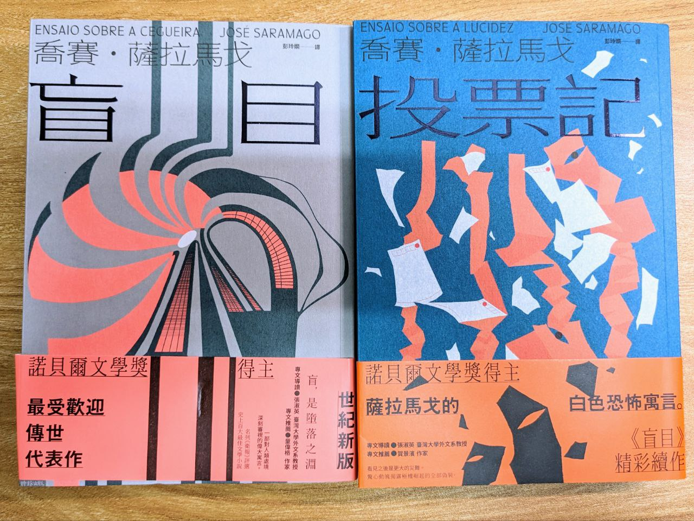

**_Warning 📢 觀影筆記和讀書筆記都會涉及劇情，請斟酌閱讀。_**

## 《盲目》

### 書中象徵

*   為什麼書中的盲症患者看到的是一片白，而不像一般盲人看到的是一片黑？
    *   混濁的白——可能是為了彰顯這種盲目無知的狀態
    *   為了和一般盲人的黑有所區別

*   書中天降的水有什麼意涵
    *   是天賜的而非人造的
    *   有淨化的意象
        *   在病院洗身體
        *   三名女性洗澡
    *   唯一神聖的時刻
    *   醫生太太的淚水或許也算是一種天降的水

*   為何特別描述醫生太太把剪刀掛起來
    *   不敢面對自己不得不殺人、暴力的一面

*   拭淚狗的角色
    *   狗因為看到人的眼淚，反而變得有人性（和失去人性的盲人對比）
    *   狗舔眼淚代替醫生角色安慰了醫生娘

*   醫生太太目睹女孩和醫生交媾的情節
    *   看到了女孩的脆弱，由於自己無法幫忙，交出自己的丈夫撫慰她（女孩也有性的需求＆女孩是自己選擇跟誰上床），所以她也坦白自己內心的脆弱（她其實看得見）
    *   婚姻、性交易罪的框架被鬆動

*   第一位盲人和太太的關係
    *   從屬關係

*   《盲目》一書為什麼選擇醫生太太作為主角
    *   不只是一般印象中的英雄，正義、良善等特質可以發生在平凡人身上（相比醫生，在大家未盲的時候，她不會是特別受到關注的人）
    *   但她醫生太太的身分還是代表著有受過教育、有知識的社會階層
    *   女性做為主角是鋪陳後面發生的權力重置（盲眼太太殺了盲流氓後，女性重新掌權）

### 探討議題

*   人是什麼？
    *   盲人不被當人對待，但最後大家都成了盲人
    *   強暴女人的盲流氓，可以算是人嗎？（在《投票記》裡，大家都認為他是禽獸）
    *   怎樣是維持人的尊嚴？（即使大家看不到彼此，也要維持體面、互相幫助）
    *   埋葬等儀式是只有人類才有的行為（儀式感）

*   家／家人是什麼？
    *   無條件互相關心和幫助
    *   彼此信任
    *   願意為了彼此付出
        *   第一個瞎眼者不願太太出賣身體，但太太為了讓大家都有食物願意犧牲
        *   醫生太太為了食物願意犧牲　也為了陪伴醫生假裝眼盲

## 《投票記》

### 書中象徵

*   盲人討厭狗的嚎叫
    *   對比殺了人的政府討厭人民的聲音

*   狗的大叫
    *   對比寧靜抗爭的人們（默默投票、打開燈光、和平示威）

*   《投票記》盛大莊嚴的葬禮儀式
    *   對比《盲目》中隨手挖的葬禮儀式（四年前被隔離當不了人，現在一樣被隔離但人民想要當人）

*   角色沒有名字
    *   表示他可能是任何一個人

### 探討議題

*   政府全面抹消盲目事件，但是大家都記得
    *   人民要記憶，因為政府希望大家遺忘（所以人民把報紙文章＝真相從天撒下）
    *   投票記的希望在一個一個沒有名字的人身上
    *   政府把在場的人（醫生太太）殺死，但發生過的事情會有人記下來

*   結局還是隱含希望
    *   書中民眾自發的行為（掃地、印報紙）其實還是有帶來希望
    *   暴露政府的惡到了極點；但是光譜的另一邊，人民的善也到了極點
    *   爆炸後人民沒有情緒和仇恨的和平示威遊行
    *   前面市民的秩序帶來信心

*   為什麼醫生太太必須被殺死
    *   醫生太太目睹政府把人關到精神病院（見證者），所以他要被殺掉
    *   政府殺死人門口中的上帝（聖賢、女英雄）

