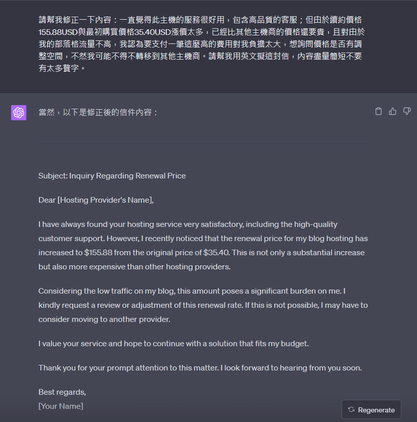
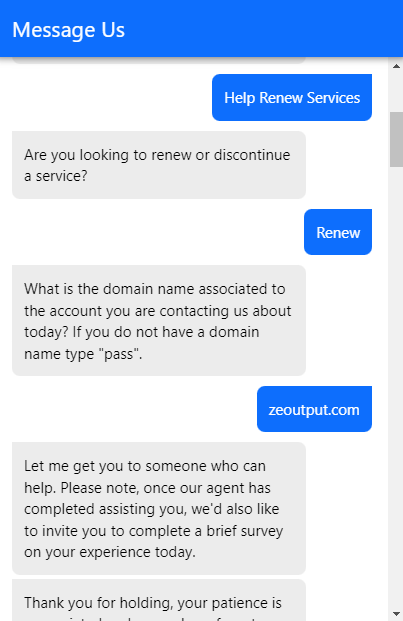
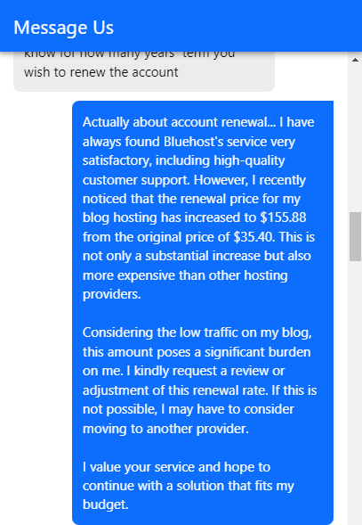
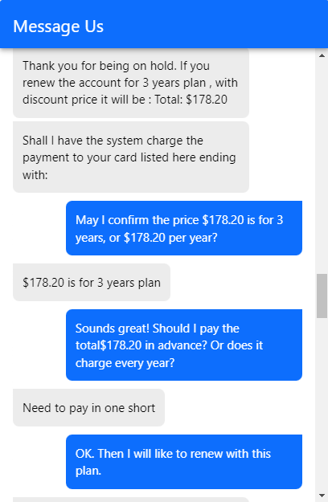

不久前收到 Bluehost 系統通知第一年合約要到期了，看到續約的高額費用令不禁我思考人生，思考著就拖延沒去管它，一直到我想起來應該要備份部落格的時候我的後台已經登不進去了（請大家平時要記得備份），[查了別人的分享之後](https://skinnyezra.com/%E3%80%90wordpress%E9%83%A8%E8%90%BD%E6%A0%BC%E3%80%91bluehost%E4%B8%BB%E6%A9%9F%E4%BD%BF%E7%94%A8%E8%A9%95%E5%83%B9%EF%BD%9C%E7%BA%8C%E7%B4%84%E4%B9%8B%E5%89%8D%E4%B8%80%E5%AE%9A%E8%A6%81%E6%AE%BA/)，還是硬著頭皮去跟客服議價，最後也拿到了可以接受的價格。分享一下過程跟最後拿到的方案。

[Copyright 2022 Katerina](https://undraw.co/illustrations)

首先準備議價說詞，可以直接讓 ChatGPT 用英文擬一段。

登入 Bluehost 按右下角開啟客服視窗，一開始系統會要你用輸入的方式選擇是哪類客服問題，因為是續約就依序選 Help Renew Services > Renew，然後輸入域名，接下來就會轉到線上客服。

前面會需要輸入驗證碼，就輸入客服給你那串網址打開後看到的數字。當對方開始詢問是不是要直接扣款續約，就把（剛剛用ChatGPT產生的）議價說詞貼給他。

客服最後提供我的方案是三年 $178.2 USD，換算下來一年 $59.4 USD 覺得還可以接受（每年比原方案貴 $760 TWD）。主要是在 Bluehost 用習慣了，搬家也得花點時間現在暫時還不想；加上覺得 Bluehost 客服品質還不錯，之前有問題找客服也很快解決。

沒問題就請他扣款了，扣款完後他會提供一個 Invoice 網頁先給你預覽，之後信箱也會再收到一封 Invoice。

## 方案比較

| 方案 | 第一年價格 (USD) | 原始續約價格 (USD) | 客服提供價格 (USD) |
| :--- | :--- | :--- | :--- |
| **價格** | 35.4 / 每年 | 155.88 / 每年 | 178.2 / 三年 |
| **換算每月價格** | 2.95 | 12.99 | 4.95 |
