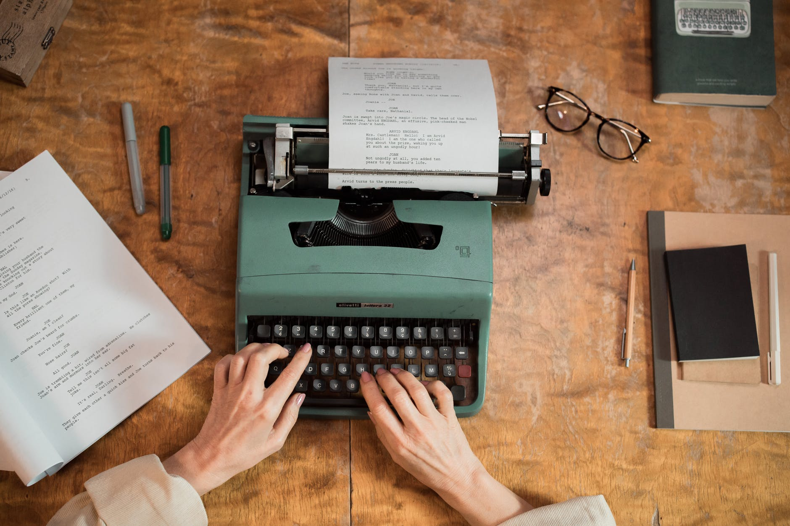

剛開始很像平淡的日常番，不是走熱血路線，不過看到結尾覺得平淡中的真誠讓人滿感動的，記錄一下感想。



快變成全職家庭主夫的兼職編劇吉丸圭佑，與小說家妻子、繼女和兒子過著平凡的生活。某日圭佑接到電視劇劇本的委託，便開始了每天煩惱著如何寫出劇本、應付臨時改稿、在有限的時間內完成修稿的生活，還要和內心自我懷疑的力量拉拉扯扯。與此同時，一家人各自的煩惱與秘密也悄悄地在生活中醞釀著…
<!-- more -->

**_Warning 📢 觀影筆記和讀書筆記都會涉及劇情，請斟酌閱讀。_**

## 自我懷疑

Photo by Ismael Sanchez on [Pexels.com](https://www.pexels.com/zh-tw/photo/2282000/)

劇中滿有趣的議題之一是如何面對和別人比較的心態以及對自己的質疑。圭佑因為從沒接過卡司這麼強大的劇本，幾乎從頭到尾沒有停止過自我懷疑：質疑自己能不能獨自將整部劇寫完，一旦出現了其他編劇來幫忙又開始質疑自己會不會被取代，這份恐懼甚至具象化成「禿頭男」陰魂不散地跟著他，讓他困擾不已。但隨著圭佑完成了一集集的劇本，他也終於能和「禿頭男」和解——雖然「禿頭男」並不會完全消失，這份質疑還是存在圭佑內心深處，但是他面對並接納了這一部分的自己，選擇與他共存。

另一方面，實際身分為小說家「香坂理理子」的妻子吉丸奈美，因為著作等身而原本對自己的寫作能力非常有自信。但在看見家人每週觀賞圭佑創作的《富豪教師Q》時期待的樣子，奈美逐漸開始質疑自己的作品是不是沒有她想像中那麼好。劇中可以看到奈美絕佳的觀察力和表達能力，顯示她其實是一位非常稱職的小說家，但就連這麼資深的創作者，也不免因為與別人比較而自我懷疑。

## 好作品的本質

Photo by Ron Lach on [Pexels.com](https://www.pexels.com/zh-tw/photo/7969735/)

但最後《富豪教師Q》男主角八神隼人的一番話道出一部好作品的本質：好的劇本不一定是有趣的劇本，而圭佑的劇本之所以讓他覺得好，是因為圭佑對裡面的人物充滿了情感——劇本就是編劇自身情感的投射，就像圭佑不知不覺把他對櫻子的美好想像寫進了劇本裡。

奈美也提醒圭佑，就算是臨危受命才開始寫的劇本，但既然是他一字一句親自創作，作品就一定承載著某種他想傳達的意念。而圭佑在寫作的過程也終於發現了自己內心在找尋的事物，那就是存在的意義。很喜歡奈美和圭佑這種互相幫助又良性競爭的關係。

此外，由於故事和人生一樣，[其實就是一連串的選擇](https://youtu.be/xpyO6Zvnpqo)；每部作品都是隨著作者讓主角做了許多不同的選擇而一步步推展下去，因此就算兩個人寫了相同的主題，呈現出來的故事也絕對不會一樣，就像奈美最後寫出了和圭佑的劇本全然不同的吸血鬼故事。

> 劇情發展也是在無限多的選項之中，因為你選擇了其中一個，如此不斷重複，才架構起來的不是嗎？

> 你的選擇一定是有理由的，小圭想寫出這樣的連續劇，你的願景一定都會反映在選擇上。

前半段的節奏不算非常快，不過劇情滿輕鬆的，可以沒有壓力地看下去。最後一集相對精彩，尤其是當八神隼人出現的時候其他人的反應都超級好笑。

最後的感想是，果然就像黑鏡編劇說的一樣：[你最需要的不是運氣或天分，是截稿日。](https://www.theguardian.com/commentisfree/2010/aug/16/charlie-brooker-writing-deadlines)

© [Netflix](http://www.netflix.com/)

## 參考資料

[如何被自己的才華嚇到？ 《黑鏡》編劇查理·布洛克金句反思](https://vocus.cc/article/5ee36b2cfd8978000101f5b5)
