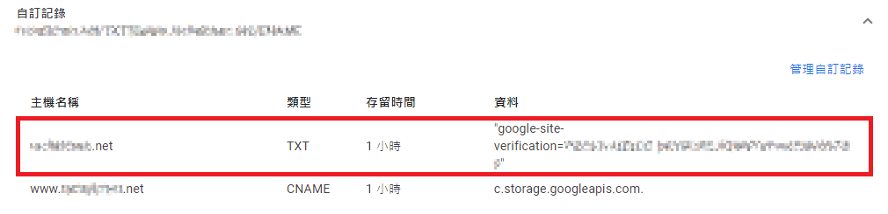
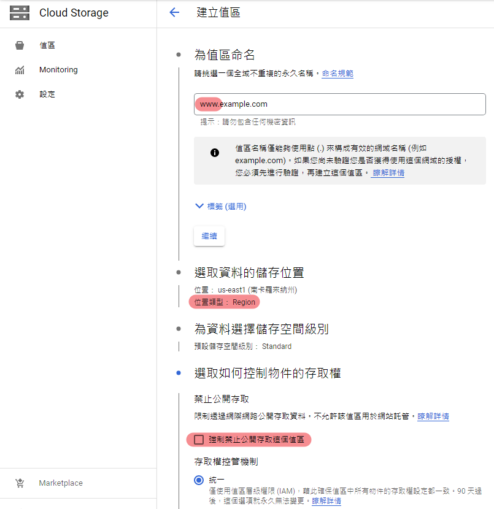
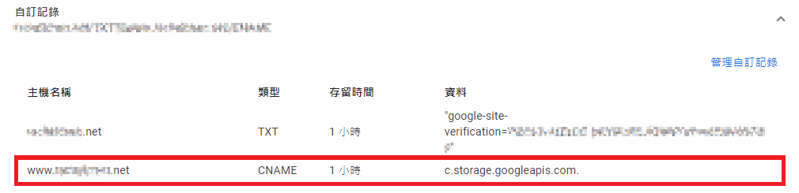
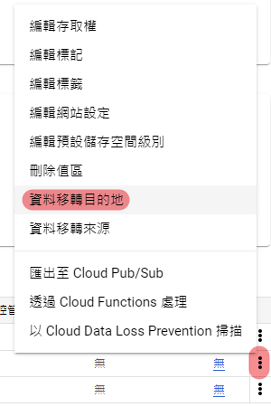
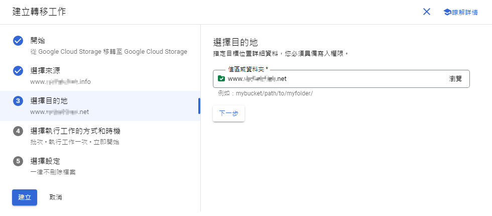

原本靜態網站的域名到期漲價，買了一個新的；但 GCP 控制台不知道要怎樣把新域名設定上去，試了半天原來是要用新域名重新建一個值區。設定不難但步驟有點瑣碎，N 年才操作一次很容易忘記，記錄一下這次嘗試成功的設定步驟。
<!-- more -->

[Copyright 2022 Katerina Limpitsouni](https://undraw.co/illustrations)

## 設定步驟

1.  驗證網域（TXT 紀錄）
2.  新增值區（需以 www 開頭）
3.  將網域對應到 GCP（CNAME 紀錄）
4.  轉移資料
5.  編輯網站設定
6.  設定存取權以公開網站

### 驗證網域

新增值區前先驗證網域：

1.  到 Google Search Console 新增資源，參考 [8.2 通過Google Cloud Platform來部署靜態網頁](https://www.studymediabuy.com/docs/40day-affiliate-marketing-tutorial/8-how-to-publish-your-landingpage/8-2-how-to-use-google-cloud-platform-storage-bucket-to-deploy-static-webpage)
2.  根據 Google Search Console 的說明，到網域註冊商（下面例子是 Google Domains）建立 TXT 記錄

### 新增值區

到 GCP 控制台建立新的值區。用新域名命名，前面要加 www 否則無法正常開啟網址（參考 [GCP static website returns Error: NoSuchBucket](https://stackoverflow.com/questions/47082411/gcp-static-website-returns-error-nosuchbucket)），儲存位置選 Region（參考 [\[教學\] 如何使用 Google Cloud Storage 建立靜態網站](https://ikala.cloud/cloud-storage-application-website/)），強制禁止公開存取要取消勾選，其他維持預設。

### 將網域對應到 GCP

到網域註冊商（下面例子是 Google Domains）建立 CNAME 記錄，參考 [Connecting your domain to Cloud Storage](https://cloud.google.com/storage/docs/hosting-static-website-http#cname)。

### 轉移資料

到 GCP 控制台，從原值區（舊域名）轉移資料到步驟 2 建立的新值區（新域名），這樣就不需要重新上傳一次網頁內容。

從原值區（舊域名）的選單，選擇 \[資料移轉目的地\] 後，來源選擇原值區，目的地選擇新值區，立即執行就可以了。

### 編輯網站設定

到 GCP 控制台，從新值區（新域名）的選單，選擇 \[編輯網站設定\] 後，依序完成 index 頁面跟 404 頁面的設定即可（參考 [8.2 通過Google Cloud Platform來部署靜態網頁](https://www.studymediabuy.com/docs/40day-affiliate-marketing-tutorial/8-how-to-publish-your-landingpage/8-2-how-to-use-google-cloud-platform-storage-bucket-to-deploy-static-webpage)）。

### 設定存取權以公開網站

不知道是否因為用資料轉移的方式，頁面預設是非公開的，所以要透過設定權限公開網站。到 GCP 控制台，從新值區（新域名）的選單，選擇 \[編輯存取權\] 後，主體選 \[allUsers\]，角色選 \[Storage 繼承物件讀取者\]（參考 [8.2 通過Google Cloud Platform來部署靜態網頁](https://www.studymediabuy.com/docs/40day-affiliate-marketing-tutorial/8-how-to-publish-your-landingpage/8-2-how-to-use-google-cloud-platform-storage-bucket-to-deploy-static-webpage)）。

設定完成後應該就可以用新域名開啟網站了（參考 [\[教學\] 如何使用 Google Cloud Storage 建立靜態網站](https://ikala.cloud/cloud-storage-application-website/)）。

## Reference

[\[教學\] 如何使用 Google Cloud Storage 建立靜態網站](https://ikala.cloud/cloud-storage-application-website/)

[8.2 通過Google Cloud Platform來部署靜態網頁](https://www.studymediabuy.com/docs/40day-affiliate-marketing-tutorial/8-how-to-publish-your-landingpage/8-2-how-to-use-google-cloud-platform-storage-bucket-to-deploy-static-webpage)

[Connecting your domain to Cloud Storage](https://cloud.google.com/storage/docs/hosting-static-website-http#cname)

[GCP static website returns Error: NoSuchBucket](https://stackoverflow.com/questions/47082411/gcp-static-website-returns-error-nosuchbucket)