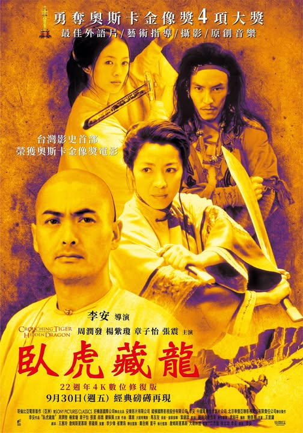

《臥虎藏龍》的故事如果用最精簡濃縮的說法，我覺得是情與義的兩難。情再往下推是本能衝動，義再往下推是克制壓抑，而玉嬌龍和俞秀蓮正好是這兩個方向的代表。
<!-- more -->

**_Warning 📢 觀影筆記和讀書筆記都會涉及劇情，請斟酌閱讀。_**

## 秀蓮與嬌龍：情與義

> 俞秀蓮：「走江湖，靠的是人熟，**講信、講義**。應下來的，就要做到。不講信義，可就玩不長了。」

> 玉嬌龍：「可我看書上說的都是挺有意思的，**到處都能去，遇上不服氣的就打**。」

先從玉嬌龍開始吧。嬌龍的名字很有趣，諧音「蛟龍」，蛟是還未成為龍之前的型態，需要經過修煉（一說是隨大雨流入江河）才能成為龍。那在《臥虎藏龍》的故事裡，「嬌龍」要經過什麼修煉？

「情」更多是基於自己的想望去行事，「義」則要考量到自己與他人的關係做出權衡。可有人的地方就有江湖，反過來說江湖就是建立於人與人之間的關係，所以一開始秀蓮才和嬌龍說走江湖最重的是道義和誠信，一味只靠著力量是無法在江湖上生存的（其實也可以，若強到極處、不顧人情，那就是慕白擔心的走上邪道後變成「毒龍」了）。至於能不能領略這一點，就是嬌龍的修煉了。

玉嬌龍的思考和行事方式是本能、直接、衝動的——既然我有力量就要使用它：梳子被搶走就要去搶回來，遇上心愛之人就要和他在一起，想要寶劍就要去拿——如果我有力量、做得到，那為什麼不做？俞秀蓮和玉嬌龍說了自己和亡夫孟思昭、李慕白的故事，嬌龍也只是覺得愛就愛了，為什麼不能在一起？但對秀蓮來說，遵從社會禮教、考量江湖道義、顧及大家顏面，這才是她的思考和行事方式：**一則是有力量但未必要用**，所以比起大張旗鼓讓嬌龍和玉府難堪，她選擇暗示嬌龍自己把劍還回去；且秀蓮的武術實力深厚，能用普通兵器打贏持青冥劍的武術天才玉嬌龍，但對秀蓮而言，若事情有更合宜的解決方式，她是能不出殺招就不出殺招的。**一則是有情意但未必要求**，所以儘管她愛慕白，仍選擇守著與亡夫的婚約、選擇成全慕白求道的願望。

## 青冥劍：器與心

有趣的是看了[這篇訪談](https://4bluestones.biz/wp/?p=1463)才知道這不只反應在她們的行事方式，也反應在她們的武術風格上：「…俞秀蓮很務實，玉嬌龍很輕佻，務實的人必然沈穩，輕佻就毛燥飛揚，所以兩人較勁的時候，俞秀蓮的動作就是拚命把玉嬌龍往下扯，要留人留劍，但是玉嬌龍則是就努力往上衝，要飛要竄」。難怪《臥虎藏龍》的打戲這麼好看，打得不只是功夫，更是心法的較量。（岔個題重看一次還是覺得《臥虎藏龍》的武戲太好看了，場景、配樂跟動作的設計和搭配真的就是藝術！）



說到心法就要講到《臥虎藏龍》的另一個要角青冥劍（李慕白：？）。李慕白想把青冥劍送給貝勒爺，藉此退出江湖。對他來說，青冥劍是伴隨著名聲而來的江湖恩怨和風波，因此他急著想送出去；但玉嬌龍在青冥劍身上看到的卻是力量，是使武當玄牝劍法之人最稱手的武器，是那個在她想像中代表著自由與不被拘束的江湖，因此她眼巴巴地想要搶來，彷彿拿到青冥劍她就能成為李慕白。但劍本身是中性的，它只是「器」；用來傷害人或保護人，作惡事或作好事，全在用劍者一念之間。對應到廟中李慕白向玉嬌龍說的，武器是虛名，宗派也是虛名，真正重要的還是人心（心法），器是虛名是死物，是人心的善惡操縱了它。

## 故事的落差

講到了玉嬌龍對江湖的想像，不免俗地還是試著探討一下《臥虎藏龍》故事裡的「落差」。玉嬌龍想要「隨心所欲、不被束縛」，**她以為江湖就是一個讓她可以「隨心所欲」的地方**；但前面也提到，俞秀蓮說過江湖上「講信、講義」，「道義」便是要考量到他人，而不是隨心所欲。

然而，在江湖上不義不取、不義不作的道理或許是對的，但在感情上這不一定是最好的法則。

**李慕白以為送了青冥劍、報完師仇，就能真正離開江湖和秀蓮過平靜日子**，但實際上困住他們的也不完全是道義，還有他們自己的心。我覺得《臥虎藏龍》想說的也許是——**情與義的取捨，沒有什麼正確答案，而對每個人來說答案也都不一樣。**李慕白在死前對秀蓮說他已經浪費了一生（和秀蓮相守的機會），但也許重來一次，他還是會這麼選擇；而對玉嬌龍來說，走過這一遭，江湖道義未必是她能接受的束縛，原始情慾也未必是她真心追求的答案（有偷看原著小說的劇情介紹，玉嬌龍和羅小虎最後似乎還是分開了）。

## 真正的強大

所以最後秀蓮才跟嬌龍說：「**不論你對此生的決定為何，一定要真誠的對待自己。**」

她只要嬌龍做不違背本心的選擇，並沒有告訴嬌龍哪條路一定是對的。但在離開前，秀蓮也向嬌龍展示了真正的「強大」：已證明自己有能力打敗嬌龍的秀蓮第一次拿起了青冥劍，但最後沒有殺嬌龍。不是有力量就一定要使用，不是想要什麼就非取不可。我有大過你的力量，我可以怨你，但我也可以選擇不殺——這是一種異於嬌龍向來認知的思考邏輯，她讓嬌龍理解真正強大的不是虛名的器，不是外在的力量，而是內在的心。

在《臥虎藏龍》電影的結局，玉嬌龍根據羅小虎告訴過她的傳說，在小虎許願後，縱身躍入懸崖。電影對於她的選擇沒有多做解釋（小說有說她是遁逃了），我覺得也許是贖罪也是試圖超脫，經過逃婚她已回不了玉府，也無法放下對秀蓮的愧疚毅然和小虎回大漠，因此她選擇放手一搏、縱身一躍——就讓上天決定，或者祂要定我的罪，或者讓我隨江河入海，化成一條真正的龍吧。

© [Sony Pictures 索尼影業](https://www.facebook.com/sonypicturestw/posts/pfbid02qBnuzWZpyy9urFASfGpDXstnXgT7wJz92ZCJgcZMk6qPoKiZqfb8DFcyNWteWg7sl?__cft__[0]=AZa5WXVy5qWf6q7b4z5bXCceCV7M61tHKUPE-HOi4rIq59LaVHxmu3JLk0-8ZfDowLy9oB0b0w4LYSBW6fGYXx6luXhcWaSX7xhakrZixaNJroW9D6kUaoUW_M9FP4rKzRq7ORW-oKK3ZlgRuUW4JcxMLtElY9N94PFjuUOYZXa-eQ&__tn__=%2CO%2CP-R)

---

**臥虎藏龍**

*   導演：李安
*   播映年份：2000
*   觀看平台：[MyVideo](https://www.myvideo.net.tw/details/0/218564)
*   觀看時間：2026-05