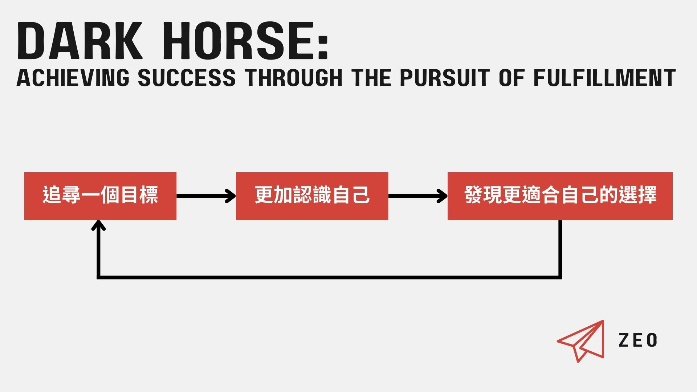

## 標準化思維 vs 黑馬思維

> 標準化協定完全是為了要複製出色的成品——每瓶藥都一樣、每根螺絲都一樣、每條藍色牛仔褲都一樣。

我們有多常懷疑，從家庭、學校、社會所接收到的成功標準——上最好的學校、進最好的公司、成為世界第一、成為億萬富翁——有可能不是真正的成功標準，至少不是適合每一個人的成功標準？

追求永遠都要做得比其他人更好的「標準化思維」有其歷史背景：工業革命。在追求大量生產的時空背景下，個人的特質被抹除，企業推崇的是標準化：標準化的規格、零件、制度、員工，為了推動經濟發展，社會和學校則一起配合落實這套思維。

標準化有益於管理和量產，不需要花費太多教育成本針對每個人的差異性個別培訓，而是讓大家都接受同一套教育模式，在進入社會後便可以無縫接軌生產線，再接受同一套管理模式，被用一樣的標準衡量績效，給予賞罰。

這個標準化的系統乍看之下好像很公平，讓人人只要「努力」就有機會；事實上，因為準則只有一種，而人人特質不同，這套系統只能「篩選」出「適合該種標準」的人，至於無法配合的人則被視為不夠努力。

然而，往錯誤（不適合個人）的方向努力，就算再努力還是只會走向錯誤的結果。

Photo by Pixabay on [Pexels.com](https://www.pexels.com/zh-tw/photo/259958/)

黑馬思維的基本觀念就和標準化思維非常不同。黑馬思維並不在乎其他人做得好不好，也不在乎體制怎麼看待成功，而是將重心放在「你自己」身上。
<!-- more -->

**_Warning 📢 觀影筆記和讀書筆記都會涉及劇情，請斟酌閱讀。_**

這套思維相信，透過觀察找到自己的微動力，透過行動選擇適合自己的機會和策略，忘掉設定目的地、忘掉苦練幾萬小時的定律、忘掉不許失敗這些無益的思維；人人都能透過自我實現，達到個人版本的卓越。

個人版本的卓越並不是指考一百分或得到世界冠軍，而是善用你和其他人不同的地方，透過不斷地嘗試、失敗、再嘗試，找到適當的機會，讓自己的特質得以完全發揮。

Photo by cottonbro on [Pexels.com](https://www.pexels.com/zh-tw/photo/4614200/)

## 如何追求自我實現

### 找出微動力：評判遊戲

在標準單一、不注重個人特質的標準化社會中，產生了普世的「一般性動力」，像是要努力、要有耐心、要堅持，目的是**「盡量在耗用最少的精力和成本下，激發愈多人去實現標準化的成功」**。個人的微動力則源於每個人內心不同的渴望，設法達成這些渴望讓個人得以追尋對自己而言快樂又充滿幹勁的生活。

個人的微動力可能非常微小，在標準化社會中簡直不值一提，書中給的例子像是：喜歡整理實體空間、喜歡欣賞鳥的叫聲、喜歡把不平整的物體變得平滑。但不要因此小看微動力：對於個人而言，它是實現自我的重要驅力。

Photo by Abby Chung on [Pexels.com](https://www.pexels.com/zh-tw/photo/1297938/)

如何找到自己的微動力？書中提供的方式稱為**「評判遊戲」**，目的是利用產生強烈情緒的瞬間，往下挖掘找出自己所注重的是什麼，而且挖得愈深、觀察得愈細愈好。

評判遊戲有三個步驟：

1.  查覺自己評判別人的瞬間
2.  觀察內心的感受
3.  感受因何而生？如果和被評判的人交換，你會喜歡或不喜歡什麼？

在執行評判遊戲時有幾個重點：

*   **不管正向或負面情緒都有助於更了解自己。**評判沒有對錯，是褒是貶都無所謂，無須故意保持客觀。例如：你覺得書中刻意把修理沙發的訪談對象吹捧得很成功，如此一來你就知道你可能比較注重地位和讚揚。
*   **要深入的想被評判者的各個面向。**例如：你覺得當公園管理員很不錯，可以在大自然裡工作；再換個角度想，你喜不喜歡獨自一人工作？
*   **要深入的想在這個人的身上究竟是喜歡哪些特質？討厭哪些特質？**例如：如果你覺得討債工作很棒，那你是覺得追蹤欠債的人很棒，還是覺得逼他們交錢很棒？

Photo by Sam Lion on [Pexels.com](https://www.pexels.com/zh-tw/photo/t-6002000/)

### 遵循熱情 vs 組合微動力

> 找出愈多微動力加以善用，你的人生就愈能與你的興趣相結合。

黑馬思維認為熱情**「不僅有很多方向，還會變動」**，因此你不該追尋心中的熱情，而是應該**「打造」**你的熱情。你的熱情可能會隨時間改變，但當你找出愈多微動力，就愈有可能在環境改變或新的機會來臨時，調整你的微動力，再次達成個人卓越，如此一來你的熱情便可長可久。

這讓我想到之前在《做自己的生命設計師：史丹佛最夯的生涯規畫課，用「設計思考」重擬問題，打造全新生命藍圖》也有讀到相同的觀點：**別管什麼熱情，你應該要動手設計你愛的人生。**兩者其實是很相似的概念。

Photo by Pixabay on [Pexels.com](https://www.pexels.com/zh-tw/photo/273230/)

### 衡量風險的方式：成功機率高低 vs 契合度高低

> 某個機會愈能激發你的微動力，你選擇後愈有熱忱，選擇的風險就愈低。

在標準化社會我們很少能真正做選擇，大多只是在已經被限制的選項中**「挑揀」**：我們看似能夠自由選擇要就讀的學校科系，實際上，我們只能「挑揀」錄取我們的學校科系。

也許你會覺得這是公平的制度，愈努力的人考得愈高分，就應該進愈好的學校，不是嗎？但若學校只錄取十名達標的學生，但實際上達標的學生卻有 100 名的時候，對於剩下 90 名學生而言，這個制度是否真正公平？書中另有一個章節專門探討「才能等分制」的問題，對於這個現象有進一步的分析。

Photo by Andy Barbour on [Pexels.com](https://www.pexels.com/zh-tw/photo/6683933/)

> 標準化的重要前提：把決定權從職員和學生手中拿走，交給主管和校方，以提升系統的效率。

黑馬思維注重自己做選擇，因為**「你比體制更了解你自己」**。如同鳥類根據習性選擇適合自己的棲地生活，你也應該根據你的特質，清楚你的選擇，並自己做出選擇。這也就是為什麼，我們不該選擇成功率高的機會，而是應該用契合程度去衡量機會——也就是：這個機會是否符合你的個人特質？

如果我們單只用成功機率去衡量，很容易忽略個人特質，錯失那些可能更適合自己的機會。此外，由於「成功」仰賴的是「機率」，個人能掌控的因素就很少，只能祈禱自己運氣夠好。但用契合度衡量風險，就不必仰賴幸運，而且通常會選到不錯的機會，因為你的選擇源於你的個人特質。

這個衡量標準適用於任何情境。當新的機會來臨，即使你覺得自己現在已經足夠好，好到選擇新的機會可能會有風險，需要犧牲許多東西，你依然應該用契合度去評估，假如新的機會更適合當下的自己，仍要把握機會嘗試，才有可能邁向下一個卓越。

> 選擇讓你自己展開行動，把熱情化為目標。

Photo by Leah Kelley on [Pexels.com](https://www.pexels.com/zh-tw/photo/3935702/)

### 花時間投入練習 vs 花時間找出策略

為了便於管理，標準化社會習慣以時間來衡量成果：無論學得快或慢，你就是得唸四年的大學（除非你跳級）；很多公司會規定員工至少有一定年資，才能往上升遷（尤其軍公教單位更是如此）。因此，我們很容易認為時間是達成卓越的最大要素，像是透過一萬小時練習就能精通的說法，也反映了這樣的思維。

黑馬思維認為，時間並不是卓越的最重要因素，策略才是。並不是說時間不重要，而是相較於直接將大量時間投入練習，你應該先花時間找到適合自己的策略。書中提到的其中一個例子是錄取率極低的侍酒師考試，由於每個人採取的應考策略都不同，花的時間也都不一樣，並沒有什麼平均花五千小時準備才能通過侍酒師考試這種標準。有些人先花了大半時間用不適合自己的策略練習，卻每次考試屢屢失敗；但在仔細觀察並找出適合自己的策略後，只花了不到一半時間練習便通過考試。

所以你不該問要花多少時間才能學好游泳、彈鋼琴、寫程式，而是該問：**「這是適合我的策略嗎？」**

Photo by Tima Miroshnichenko on [Pexels.com](https://www.pexels.com/zh-tw/photo/10626018/)

### 目的地 vs 目標

> 你不必知道目的地也能成功。但你必須了解自己才行。

無論生長在亞洲還是西方國家，就算小時候作文題目沒寫過我的志願，也一定被問過長大想當什麼。黑馬思維告訴我們，其實這樣先設定目的地的方式，對實現自我是有害的。

除了你的微動力可能隨著時間改變，外在環境的機會也有可能會改變。比如許多新興的職業，在十年前根本還不存在。而且，如果你沒有先弄清楚自己的微動力，即使達到原先設定的目的地，也未必會感到自我實現的滿足。

Photo by Yaroslav Shuraev on [Pexels.com](https://www.pexels.com/zh-tw/photo/8968077/)

如果不設定目的地，我們怎麼知道該往哪裡前進呢？我們應該從自己的微動力出發，設定可以立即行動的目標，在每一次目標的嘗試中更加認識自己，並逐漸找出適合自己的策略。黑馬思維不在乎這些嘗試成功或失敗，重點是要在試錯的過程中，了解嘗試的目標以及使用的方法究竟適不適合自己。你必須**「經歷許多有用的失敗」**。整個流程就像是這樣的循環：

## 跟別人一樣，但做得更好 vs 把自己在乎的事情做得更好

用一句話來總結黑馬思維，就是「把你在乎的事情做得更好」。

具體回顧書中談到的幾個重點，可以歸納為以下幾個行動：

書中使用「梯度上升法」這個演算法，來解釋黑馬思維，如果你要穿越一片高低起伏的山嶺，爬上最高的山峰，但你無法看見這整片地域的全貌，無從得知哪一條路上可以通行或是會有阻礙，你要如何爬上高峰？以黑馬思維而言，不是設定好我要沿著某條路上山然後就一路往前衝（前面提到的設定目的地），而是先找出離你最近的山當中最高的一座，爬上去之後，再從高點尋找附近最高且適合攀爬的山，透過不斷重複這個尋找和攀爬的過程逐漸到達高峰。

Photo by Serkan Bayraktar on [Pexels.com](https://www.pexels.com/zh-tw/photo/8094209/)

而**「你在乎的事情」**就像是選擇要爬哪座山：  
首先你要「知道你的微動力」以打造熱情；並「清楚你的選擇」以打造目標。

**「更好」**則是指爬向個人卓越的山頂：  
你必須「了解你的策略」和「忽略你的目的地」以追尋成功。

* * *

在讀這本書的時候一邊反思，覺得自己是很受標準化思維制約的人，是很怕在人生中一步行差踏錯就會跌死的標準化社會俗辣，所以黑馬思維帶給我不小的衝擊。我很認同作者提出的觀點，但一邊讀著還是不免和從小接受的舊觀念互相拉扯，而且就算讀完，標準化思維還是很常在無意間跑出來搗亂，在設定目標的時候還是很容易不小心跟目的地混淆。所以以我個人的情況來說，要內化書中的思考模式是很需要找到好的策略來練習的。

我覺得書中提到的評判遊戲是一個值得嘗試的工具，也很好奇大家執行的成效如何。目前有看到的一篇分享：[How to Figure Out What Your Passionate About](https://camwarrenm.medium.com/how-to-figure-out-what-your-passionate-about-a23d59c0163d)，作者說他的確在過程中觀察到自己的一些面向，但也坦白這個練習還可以做得更深入。如果有看到其他不錯的心得或自己實行後有什麼想法再來分享。