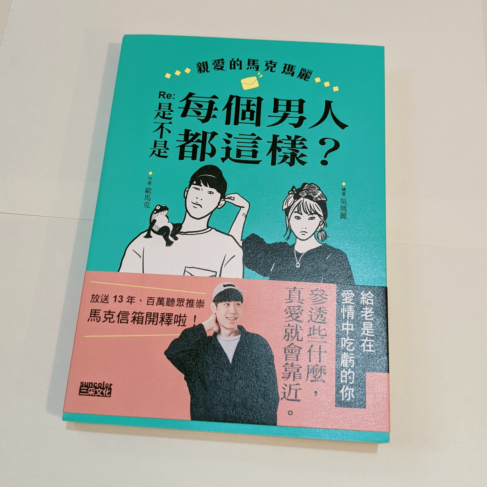

這本書是 [Youtube](https://www.youtube.com/c/MARCORANGE/featured) / [Podcast 節目](https://podcasts.google.com/feed/aHR0cHM6Ly9hbmNob3IuZm0vcy85OGE2ZmFjL3BvZGNhc3QvcnNz?sa=X&ved=0CAYQ9sEGahgKEwj4jfGskPn6AhUAAAAAHQAAAAAQ9AI)馬克信箱的衍生物。馬克信箱是一個回覆聽眾實體信件的節目，而書中的內容就是從歷年聽眾來信中挑選出幾封有關感情的信件加以改寫，並由主持人之一的馬克在書中回覆，搭配另一名主持人[瑪麗](https://zh.wikipedia.org/wiki/%E5%90%B3%E7%91%AA%E9%BA%97)的插畫（其實瑪麗的插畫很古靈精怪，不暗黑呀，而且畫人物好傳神）。平時在節目上馬克和瑪麗也會在讀完信後分享想法，書中的回應則再經過比較有組織地統整。
<!-- more -->

**_Warning 📢 觀影筆記和讀書筆記都會涉及劇情，請斟酌閱讀。_**

雖然書名就點出是討論感情，但我覺得書中給予的建議適用於生活中許多面向，面對工作、面對友情、面對親情、做決定、做選擇、處理焦慮等。尤其書中有一篇說到感情和工作高度相似，我在讀的時候也會不自覺一直聯想或置換到工作上。像是最後一封信在討論由內而外的選擇 v.s. 單憑感覺的選擇，讓我醒悟很多時候我也會憑感覺挑工作，而不是先有了自己的想法和方向，再去想這個工作和我的目標符不符合。

書中也將來信以感情的不同階段分成四個章節，方便大家閱讀。但其實不管是在什麼階段、面對什麼樣的問題，最終其實還是要回到自己身上：我夠不夠認識自己？知不知道自己要的是什麼？

> 我認為不安跟這件事有著絕對的關係：自信。你知不知道你是誰，你處在光譜上的哪個位置，你要往哪裡去。知道的人，就不會猶疑不定，他們的起伏平靜，他們了解自己；相反地，越不認識自己的人，越不知道自己在幹麼的人，也就越容易被影響，越容易被觸發，越容易焦慮，越容易不安。

要改變他人或外在世界相對困難，要改變過去也是不可能的，所以不管焦慮、恐懼或擔憂，我們當下能控制的只有自己，能做的就是更認識自己，然後把自己過好。

*   煩惱可不可以、有沒有資格、恐懼擔憂的時候　→　去體驗、去做，更認識自己（〈無性戀行不行〉）
*   患得患失的時候　→　專注在自身的發展，讓自己快樂（〈內在匱乏的人不要用交友軟體〉）
*   憤世嫉俗的時候　→　將重心放在可以控制的事情，也就是自己身上（〈一步錯步步錯〉）

不過認識自己是一個大家都知道很重要但也最難的課題，而且這個課題之大令人光是想到就頗感壓力。因為職涯不太順利的關係，前後嘗試過許多方法來認識自己，從書籍、專業幫助到生活上的實踐，雖然起了頭，愈嘗試卻愈覺得要走的路還很長，但也會感受到每次對自己有多一點點點的了解，可能這就是沒辦法速成的事情吧。願我們有一天都可以成為更了解自己的人，向教母看齊（好愛瑪麗在書末寫的話啊）。

摘錄一些其他我喜歡的段落（有的句子經過濃縮，和原句不完全相同）：

> 不要滿足於當下浮出的答案，懷著好奇心繼續探索。速解通常不是最佳解，當你覺得找到答案了的時候，其實也是你認知閉合的時候，而一旦認知閉合了，你也失去成長的空間了
> 
> p.106

前陣子尋求職涯諮商的協助，在一個 session 結束後了解到「因為我是用XXX方式來理解世界，所以必須要滿足OOO狀況會工作得比較快樂」這個概念，我以為這就是結論了，就不再繼續探索自己然後興高采烈地直接應用，這時候卻發現對自己理解還是不夠，以至於沒辦法將這個概念應用得很好。諮商提供的只是其中一種方法，但探索自己應該是要不斷持續下去的。

> 太多善良的人，把善良這個十字架扛在肩上，可是沒有認清那架上參雜了許多的討好、害怕、恐懼、期許世人如何看待自己的眼光，那樣的善良，只會讓自己越活越不快樂，越付出反而累積越多負面情緒，最終還是會爆炸
> 
> p.187

與其說善良，在工作上我可能偏向[討好型人格](https://youtu.be/ifUwBhTGZ3Q?t=1535)，常常擔心自己份內的事沒做好影響到別人，同時我也很擔心假如沒做好，別人會認為我是一個沒能力的人。但為了盡量做好每一件「份內」的事就會導致這個詞的涵蓋範圍逐漸擴大，最後要操心的事情愈來愈多又導致每一件都沒辦法專心去做，最後的確就爆炸了——工作還沒爆炸，是我先爆炸了。

> 我們在做決策的時候常常沒有辦法忽略沉沒成本，但是偏偏沉沒成本就是我們在選擇時最不該考量的事情。之前的付出已經付出，我們要學會的是不該讓未來繼續承擔過去犯下的錯，盡快地停止錯誤，將損失控制住。
> 
> p.199

雖然許多討論職涯的書都告訴讀者轉換跑道並不會讓過去的經歷被浪費，而是延續你的核心能力，將它們使用在更適合的地方。但當真的要放下過去熟悉的環境和累積的經驗時，一定還是會猶豫不決。

> 也有人會說，遇到困難就逃走，不試圖去克服困難，是草莓的行為，做人應該要越挫越勇，把吃苦當吃補，如此才能成為更強大的人。我是滿反對這種自虐式的生活態度的。我覺得我們有能力也有義務去選擇自己的環境，選擇跟什麼樣的人在一起，打造出自己想要的生活圈。
> 
> p.202

這段話救贖了我，我就是個在職場硬撐到感覺不行了就會逃走的人（可能跟討好型人格也有點關係），每次逃走後又會自責是不是我太廢了…明明其他同事在一樣爛的地方也是活得好好的啊！不過後來想想同事有因應環境發展出生存之道，而那是我沒辦法做到的，我也說服過自己 quiet quitting 就好但要那樣度過八小時實在太痛苦了。所以讀到這段話的時候一瞬間覺得…啊，原來從不適合自己的地方逃走也沒關係啊。頓時心裡覺得輕鬆一些了。

如果有興趣可以在以下地方收聽馬克信箱。由於兩名主持人都是廣播電台出身，不但默契絕佳，節目的節奏也非常流暢。聽眾來信的內容其實不只感情，非常五花八門，從家常到荒唐應有盡有，每週最期待的就是主持人會用什麼聲音表情詮釋來信，然後給出超直接或各種意想不到的回覆。不管是通勤、做家事或運動的時候都很適合當背景音樂。

Youtube 版本是最新進度：



Podcast 版本是兩年前的進度（有固定更新）：

<iframe data-testid="embed-iframe" style="border-radius:12px" src="https://open.spotify.com/embed/episode/25Grg76UocR7rmXV4W3DRw?utm_source=generator&si=f905f16ba778466c" width="100%" height="152" frameBorder="0" allowfullscreen="" allow="autoplay; clipboard-write; encrypted-media; fullscreen; picture-in-picture" loading="lazy"></iframe>
