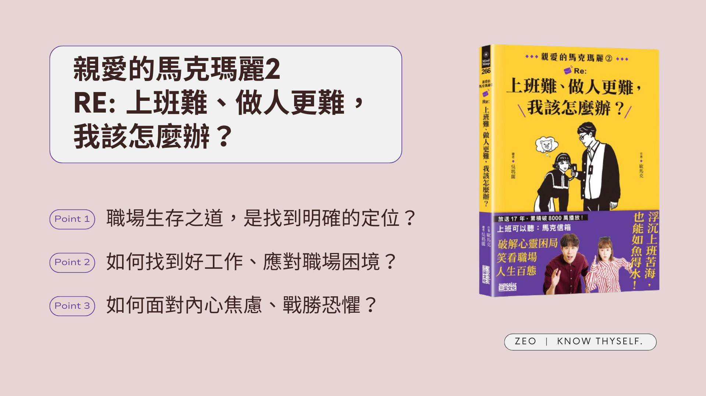

沒想到續集這麼快就出了，上一集[《親愛的馬克瑪麗 Re：是不是每個男人都這樣？》](https://zeoutput.com/2022/10/dear-marcy/)談的是感情，這一集則談的是工作。書中討論了工作和人生的多個面向，如果你希望解決工作上的某些具體問題，可能會覺得書中內容不夠深入，但或許能找到一些新的觀點。如果你想找一本討論工作的入門書籍，《親愛的馬克瑪麗2：Re:上班難、做人更難，我該怎麼辦？》應該是個快速入門不錯的選擇。
<!-- more -->

**_Warning 📢 觀影筆記和讀書筆記都會涉及劇情，請斟酌閱讀。_**

[封面來源](https://www.facebook.com/photo/?fbid=831114125507694&set=pcb.831117332174040)

筆記一下讀完覺得滿有啟發的內容：

## 1\. 提高找到好工作的機率：找工作前的評估表

作者提到，光是「錢多事少離家近」這些耳熟能詳的工作條件，都可以進一步探討「多少錢算多」、「多近算近」，每個人的答案都會不一樣。

如果能仔細定義這些條件，會更有助於設定目標和篩選機會，從而增加找到適合工作的機率。

以前找工作時，我也列過類似條件，但比較簡略，不外乎薪水、通勤時間、職務內容等。後來看了一些書、上了一些課，開始將主管風格、團隊文化等因素納入考量。讀這本書時，我又按照書上的範例仔細列了一次，發現其實能列出的條件比想像中還多還細。

此外，我覺得這個表格也能用來評估現在的工作。如果對目前工作不滿意，可以拿出列表檢視一下，看看工作是否滿足這些條件。如果大多數符合，是否能排除讓你不開心的因素繼續努力；如果嚴重不符合，就可以考慮尋找更符合條件的機會。

也分享這是我最後排出的前 5 名夢幻工作條件：

1.  每天工作 6 小時即可處理完基本工作，偶爾加班（一個月不超過 3 次，不影響吃飯睡覺時間）。
2.  工作內容是我擅長且喜歡的。
3.  大部分任務可以獨立完成。
4.  主管了解我的工作、重視我的感受，允許員工身心不適時休假，溝通清晰，願意為員工和部門利益站出來，且賞罰分明。
5.  有機會學到新技能。

現職的符合度大概是 70 分，如果之後幸運找到超符合的夢幻工作再來更新（現在想想薪資怎麼沒有列在裡面XD）。

## 2\. 覺得腦子很亂時的行動指南：列清單，然後去做

兩種列清單的方向：

1.  把自己想做的事情列出來，並分析：
    1.  這件事的好處／壞處
    2.  對你人生的緊急／重要程度
2.  列出五年後你想在哪裡，並分析：
    1.  回推每年／每月／每週／每日目標
    2.  分類緊急／重要程度

這些步驟不僅適用於人生已經很亂的時候，在因目標太多、事情太雜而迷茫時，也能幫助自己冷靜下來。只不過太愛列清單導致清單過多，造成另一種焦慮的清單病，那又是另一回事了。

> 行動是排解焦慮的最好方式
> 
> p.89

（所以重點其實不是列清單，是列完之後要行動XD）

另外書中介紹的練習，例如 50 個夢想刪刪樂，還有曼陀羅九宮格法，都很不錯且容易實作。我也在實作後發現，自己對某些意想不到的事情有異常的執著 XD

[Photo by Alexander Suhorucov](https://www.pexels.com/photo/multiethnic-businesswomen-walking-and-discussing-successful-project-in-contemporary-office-6457577/)

## 3\. 職場生存之道：找到你的定位

來信者提到一位白目同事的事蹟，作者提醒我們看到的可能只是「他沒把工作做好」的表面情況，但這名同事在辦公室或許有難以替代的價值，例如他負責張羅食物、炒熱氣氛，或是像里長一樣熱心助人。這些看似與工作技能無關的「價值」，讓他在職場上得以生存。我們也可以思考自己在團隊中扮演什麼角色，是否能找到一個特殊且不可或缺的位置，讓自己也能生存下來。

另一位來信者說，他常常努力加班工作，但得到主管賞識的卻是「只會拍馬屁」的同事，為此感到不平衡。即便真的是付出了努力工作，也可以換個角度思考，先暫時放下自己過不去的點（例如努力加班），冷靜觀察別人值得學習的地方：對方不加班可能是因為工作效率高、或許比起對方自己真的比較不會說話等。一旦承認自己的不足並加以改進，自己也會成長。

另外，如果我們因太習慣扮演工具人而感到疲倦，可能需要思考自己還能扮演什麼角色？最好的方法可能是不要一開始就把自己放在工具人的位置（真難）。

> 最好的生存之道是在期限前交出一個 60 分的東西，讓主管有發揮的空間可以去改你的東西，然後你還有餘裕把作品改成 80 分，剛好在期限時達陣。
> 
> p.192

（朋友也勸過我類似的話，但耳朵太硬老是聽不進XD）

## 4\. 讓工作過程更順利：調整自己，用對方偏好的方式溝通

遇到過溝通上真的很沒有交集的同事，至今還是不知道怎麼應對，只能祈禱工作時能和對方保持距離。（題外話，我覺得對方就是前面提到的，在團隊中有一個工作外特殊價值的人。）

想用書中特斯拉設計師和馬斯克溝通的故事提醒自己，可以再試試用對方習慣的方式溝通，我想到的有：

1.  用 DISC 大致分類對方，預測對方可能偏好怎樣的溝通風格
2.  觀察別人都怎麼和這名同事互動
3.  求職時，把團隊的溝通風格列入篩選條件

[Photo by Kelvin Valerio](https://www.pexels.com/photo/man-wearing-black-cap-with-eyes-closed-under-cloudy-sky-810775/)

## 5\. 面對焦慮：正視內心匱乏／不用特意「轉念」

作者舉了一名聽眾想購買高額課程的例子，指出這可能是一種用購物來填補內心匱乏、緩解焦慮的行為。如果不正視或處理焦慮的源頭，即使真的去上課了，也不會減緩焦慮。

我覺得要正視和處理焦慮的源頭，最終還是要回歸到認識自己並建立自信。但這是一個相對漫長而痛苦的過程，因此可以理解購買或上課感覺上是一個更速效的解法（我也做過類似的事情，現在也還是會有這樣的想法）。

但我現在的想法比較傾向於：有時候人就是要經歷這些嘗試，才會知道什麼是有效的、哪些對自己更有幫助，畢竟每個人適合的學習成長方式都不同。所以我抱持比較開放的態度，如果經濟許可、課程也不是貴到難以負擔的話（當然這要自己衡量），就去試試吧！試了才知道有沒有用呀。

> 想法不是真實的，只有當你賦予它意義的時候，它才會變成真的
> 
> p.110

另外，這段與焦慮相關的建議是我想提醒自己，不用特意去「轉念」。思考本身沒有正面或負面，那只是我們貼上並相信的標籤；如果思考只是思考，我們也無需費心去轉變它，只要讓它過去就好。

* * *

最後想分享書中我很喜歡的一段話做結：

> 不作為會滋長懷疑與恐懼；行動帶來自信和勇氣。  
> 如果你想戰勝恐懼，別只坐在家裡想，行動吧！
> 
> —— 戴爾．卡內基

---

**親愛的馬克瑪麗2：Re:上班難、做人更難，我該怎麼辦？**

*   作者：歐馬克
*   繪者：吳瑪麗
*   出版年份：2024
*   出版社：三采文化
*   閱讀平台：實體書
*   閱讀時間：2024-05