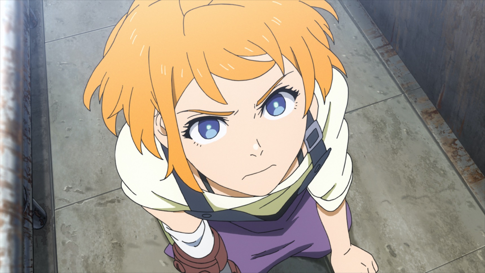
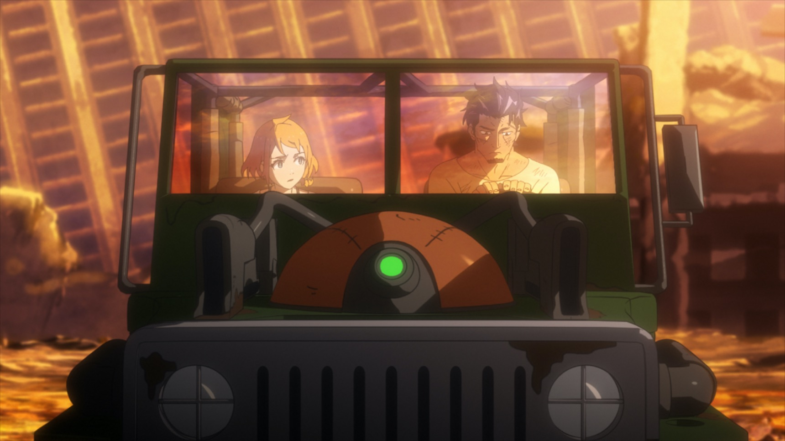
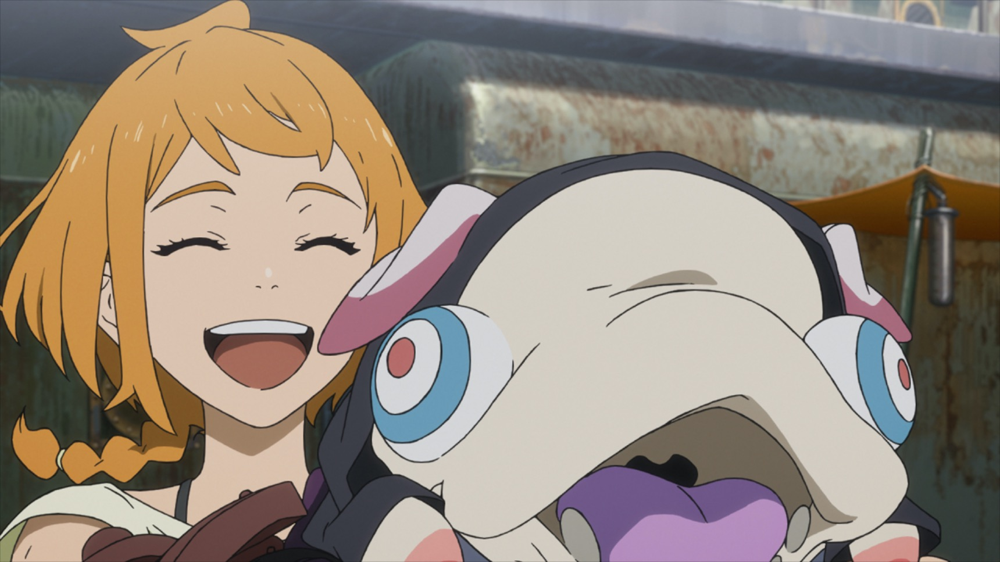

「一個被貶為修理工的少女夢想成為戰士」，最開始就是被 Netflix 上這段莫名其妙的介紹吸引，看了半天《DECA-DENCE》好像是個跟巨大怪獸戰鬥的故事，正準備要棄坑的時候決定再給它一次機會，沒想到打開第二集我就見到了新世界啊！
<!-- more -->

**_Warning 📢 觀影筆記和讀書筆記都會涉及劇情，請斟酌閱讀。_**

話說從頭，在人類不斷發展導致地球生態被破壞到無法居住後，國家界線已然消亡，此時巨大企業開始掌控地球。為了不重蹈人類覆轍，巨大企業製造由「系統」控制的生化人，並在歐亞大陸上圈地，作為生化人的遊戲場地，這個遊戲就是 DECA-DENCE。

生化人可以選擇外貌近似人類的素體登入遊戲，以素體形態在遊戲範圍內活動。在遊戲中，生化人玩家以名為 DECA-DENCE 的巨大機械移動要塞作為據點，與同樣是被製造出來的巨大怪獸「葛多爾」作戰，取得能量「奧奇松」。此能量可以注入 DECA-DENCE 及作戰時的移動工具成為動力，同時也是生化人在遊戲外需定時補充的能量。

在 DECA-DENCE 要塞內，還有被生化人視為「瀕臨絕種」的人類居住其中，主要負責補給修繕等後勤工作，所以在遊戲中也是生化人少數能接觸到人類並與其交流的場合。

但這一切，生活在 DECA-DENCE中 的人類全然不知，觀眾一開始也是不知道的。

## 你的遊戲，就是我全部的人生

動畫巧妙安排我們從主角夏芽的視角出發。夏芽出生油輪（遊戲裡對人類階級的稱呼，因為他們的生活區域在 DECA-DENCE 的油槽；而生化人在遊戲裡則被稱為齒輪），在幼年時因遭遇葛多爾攻擊失去右手，本被分配加入裝甲修理工，但她一心想成為戰士。她的修理工上司鏑木組長要她別抱持任何希望，油輪很難加入戰士團隊「至高之力」，況且就算變成戰士清除了葛多爾，戰爭也不會如同夏芽預想般結束，人類是永遠不可能到要塞外面生活的。鏑木一開始就像個討人厭的厭世大叔，但隨著劇情發展，就會知道鏑木的絕望並非無中生有，因為他說的都是他所知道的世界現實。

© [TV Animation 'DECA-DENCE' official site](http://decadence-anime.com/en/)

鏑木原本和其他生化人一樣是齒輪的戰士，卻在一次和葛多爾的對戰中，因為涉入同隊團員「極限解除」的事件——也就是解除素體受傷不會影響到生化人本體的限制，以使素體力量大幅增強——而被系統判定為「錯誤」（妨礙世界正常運作的存在），被系統要求在遊戲內執行回收錯誤的工作來贖罪。鏑木背負著害朋友被報廢的罪惡感、對系統的質疑，以及無法改變現狀的無力感，了無生趣地執行著回收人的工作，打算就這樣平凡地等著自己被報廢，直到他遇見夏芽。

## 「我想死命掙扎到自己的最極限！」

大多數遊戲內的人類都默默接受自己永遠生活在油輪、作為後勤工作的命運，接受由齒輪去和葛多爾對戰，無法離開要塞到外面生活的世界樣貌，但其實被企業和系統掌控的生化人們也是如此。生活在企業太空船上的生化人，儘管實際生活沒有面臨巨大怪獸的威脅，但活動空間仍被限制在太空船內，只能以企業提供的奧奇松補充能量，唯一的娛樂也是企業提供的 DECA-DENCE，所有言行無一不在系統的掌控：什麼時候要被報廢，什麼人需要被矯正，一切都由企業決定。說實在除了生存環境比較安全之外，生化人也和人類沒有什麼區別，大家就是在被限制好的框架內過著一成不變，毫無意義與生氣的日子；就連 DECA-DENCE 遊戲也像是企業提供給生化人的[奶頭樂（tittytainment）](https://zh.m.wikipedia.org/zh-tw/%E5%A5%B6%E5%A4%B4%E4%B9%90)，避免他們因為無處發洩而群起造反。

但是夏芽讓鏑木感覺到了許久沒有體會到的「生氣」，她讓鏑木體會到了另一種生活的可能。夏芽天生的衝勁、為了成為戰士付出的努力、對於周遭所有人事物的真心相待、激勵人團結一致的特質，這些逐漸啟發了鏑木也動搖了他的想法，還有更重要的是——鏑木發現夏芽是不在系統控制下的人類，她是個「錯誤」——這讓他看到系統控制外的可能性。

沒想到在夏芽接受鏑木的訓練而獲邀加入戰士團隊後，系統卻打算在遊戲裡開啟新任務——剿滅葛多爾巢穴：透過幾乎不可能打敗的葛多爾，製造讓優秀老玩家回鍋的機會，帶給玩家新鮮刺激感。　

對於生化人玩家而言，這只不過是個高難度的新任務，是遊戲的一環；對於遊戲內的人類而言，他們以為這是要真正進攻葛多爾巢穴，只要消滅了葛多爾的 BOSS，戰爭就結束了。抱持著這樣想法的夏芽不顧鏑木阻止，執意參與任務，但在所有葛多爾都被消滅後，由於遊戲重置，人類們看到葛多爾竟在地表重生，夏芽也對眼前所見不敢置信。同時，鏑木也因為破壞活動，被系統送到矯正設施。

## 「如果這就是真相，我寧願什麼都不知道。」

鏑木在生化人的勞改營矯正設施內，做著更沒意義、更消磨意志的工作。工作內容是分解葛多爾糞便後，由設施製成奧奇松能量再注入他們體內，套句前 DECA-DENCE 工程師吉兒的話，「我們利用糞便製成的能源處理糞便，簡單來說，我們全都是一群糞便」。透過吉兒的幫助，鏑木好不容易用新的素體偷偷登入遊戲，卻發現 DECA-DENCE 要塞的油槽，也就是人類的居住區，破了個難以修補的大洞。

原來系統為了平衡愈來愈多的油輪數量，打算讓葛多爾透過直接攻擊油槽，來消滅部分人類。正當人類束手無策，只能任由葛多爾進犯，鏑木見到夏芽不放棄地說服油輪的人們一起蒐集材料和工具來修補裝甲；也見到夏芽隱藏在堅強表面下，對於這個不可能和平的世界不甘心但又無可奈何的淚水——這讓鏑木下定決心，他要摧毀這個控制了所有人的系統。

鏑木登出遊戲回到矯正設施，和吉兒著手規劃反抗計畫。他們的目標是抵達葛多爾工廠，啟動葛多爾殲滅系統，讓系統短時間內無法再生成新的葛多爾。他們夥同矯正設施內的生化人們製造炸彈，先破壞了設施上方的葛多爾工廠；同時鏑木登入遊戲，帶著因沒有晶片而無法被系統偵測到的夏芽一起從地面前往工廠。在那裡他們遭遇到遊戲警察的強力阻攔，但仍成功啟動殲滅系統。

© [TV Animation 'DECA-DENCE' official site](http://decadence-anime.com/en/)

儘管任務成功，夏芽卻也明白了世界的真相——葛多爾是被製造的，人類是被圈養的，而生化人眼睜睜地看著這一切發生——包括鏑木在內。夏芽把被蒙騙的不滿情緒全數發洩在鏑木身上，兩人不歡而散，鏑木留下一封給夏芽的信表明心意後便登出遊戲。

回到油輪，看到大家都在慶祝葛多爾的消失與即將到來的和平，夏芽更加鬱鬱寡歡。但在景仰的女戰士紅的鼓勵之下，夏芽想起與鏑木相處的日子，儘管她所生存的世界不過是個謊言，她與鏑木經歷的一切和彼此的情誼卻是真實的。

## 「但是這樣…真的能算得上是活著嗎？」

此時，在葛多爾工廠殲滅前一刻從異變中誕生的新型葛多爾，由於不在系統的掌控，自行吸收各種葛多爾、人類、素體的屍骸後，在短時間內成長到了 DECA-DENCE 要塞也無法對抗的程度。系統決定緊急關閉遊戲，並壓縮回收遊戲空間，這將導致新型葛多爾和生活其中的人類全部滅絕。為阻止此事發生，鏑木藉由吉兒的幫助以 DECA-DENCE 要塞作為素體登入遊戲，並在眾多玩家和油輪的努力下成功擊退新型葛多爾，但鏑木也因為使用「極限解除」而使生化人本體跟要塞（素體）一起遭到破壞。

由於威脅解除，遊戲空間得以保存。DECA-DENCE 也從對戰葛多爾的生存遊戲，逐漸轉變為和人類一起耕種、在競技場戰鬥、培養無攻擊性的葛多爾、油槽觀光和大地探索等活動的場所。數年後，吉兒意外發現某次幫鏑木備份的檔案，她回復了鏑木的資料，使他能再次登入遊戲和夏芽重逢。

故事就結束在這裡。

## 動畫糖衣下的警世寓言

《DECA-DENCE》的世界觀和敘事手法非常有趣，在故事整體還未明朗前，每一集都給人驚喜的感覺。《DECA-DENCE》的故事也可以從各種角度解讀，它展現了人類的樂觀、團結和堅韌，它告訴我們容許常規外的錯誤才會發生新的可能……但同時，它也是一部讓人看完心裡發毛的作品。

© [TV Animation 'DECA-DENCE' official site](http://decadence-anime.com/en/)

在遊戲的世界裡，齒輪們的活動區域乾淨新穎，而且一出生就是戰士階級（因為是玩家），就算死亡也能用新素體重新登入；油輪則大多只能負責後勤工作，住在破舊擁擠的地段，卻也默默接受命運，沒想過要反抗——因為在系統灌輸的世界觀裡，外面有葛多爾非常危險，但齒輪會負責跟葛多爾作戰，你們只要乖乖待在要塞內就好。

不過實際上，齒輪在遊戲外的人生也沒好到哪裡去。企業掌控了生化人的食衣住行育樂，但生化人也沒想過要反抗，因為系統告訴他們反抗也沒用，系統做的一切都是為了維持世界穩定必要的措施。

雖然故事的結局是正向的，也因為夏芽和鏑木的重逢帶來一絲希望，但仔細想想還是不免覺得可怕。所有生物——無論是生化人、人類（除了夏芽）或葛多爾——都依然在企業控制之下；雖然系統暫時退場，但是企業沒有被破壞，仍然可能創造出下一個系統，仍然隨時可能有生化人被回收或報廢，人類也仍然沒有辦法回到過去完全獨立自主的生活。

回到真實的生活，儘管地球還沒有荒蕪，我們也還沒有（？）受到大型怪獸的威脅；但我們是不是已經像油輪一樣，接受如螺絲般工作的命運，只為了讓更大的齒輪運轉，就這樣日復一日漠然地活著？是不是已經像生化人一樣，沉浸在刺激感官的娛樂，默默接受世界加諸於我們的一切，拒絕去思考另一種生活的可能？

或者，我們是不是早已被系統控制而不自知？