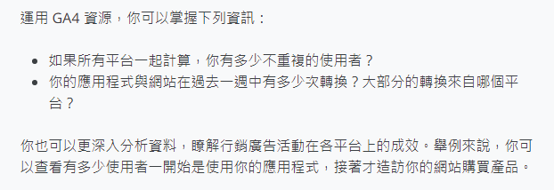
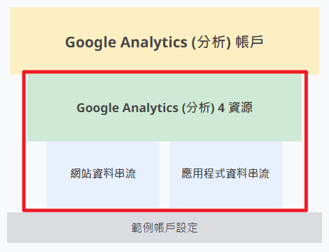

課程連結：[認識新一代的 Google Analytics (分析)](https://skillshop.exceedlms.com/student/path/66750-google-analytics)

1.  [探索 Google Analytics (分析) 的新功能](#discover-the-next-generation-of-google-analytics_1)
2.  [Google Analytics (分析) 4 資源的特色](#discover-the-next-generation-of-google-analytics_2)
3.  [認識 Google Analytics (分析) 4 資源](#discover-the-next-generation-of-google-analytics_3)
4.  [建立自己的 Google Analytics (分析) 4 資源](#discover-the-next-generation-of-google-analytics_4)
<!-- more -->

Photo by fauxels on [Pexels.com](https://www.pexels.com/photo/person-using-a-laptop-3183131/)

## 1\. 探索 Google Analytics (分析) 的新功能

GA4 和 舊版 GA 的差異：

*   不僅僅是網站，可以在單一平台分析所有**網站和應用程式**蒐集到的資料
*   提供**機器學習**技術，主動深入探索商家資訊

## 2\. Google Analytics (分析) 4 資源的特色

GA4 資源和 UA (Universal Analytics) 資源 (Property) 的差異：

*   UA 資源是以工作階段 (session) 為基礎
*   GA4 資源是以**事件 (event)** 為基礎

以事件 (event) 為基礎的優點：

*   更有彈性，資料區分得更細
*   能提供更多與動作相關的詳細資訊，例如購買交易的金額、使用者造訪頁面的標題，或使用者的地理位置
*   是為了因應跨平台分析的評估才改為使用事件

身分識別空間 (Identity spaces)－GA 用來識別登入網站的使用者，有三種：

英文參考：[\[GA4\] Reporting identity](https://support.google.com/analytics/answer/10976610?hl=en)

*   User-ID: 商家自行定義指派
*   Google 信號 (Google signals): 使用者以 Google 帳號登入
*   裝置 ID (Device-ID): 瀏覽器 (當使用者造訪網站) 或應用程式執行個體 (當使用者啟用應用程式) 的 ID

GA4 和 UA 在身分識別上的差異：

*   過去 UA 不會整合不同的身分識別空間；但在 GA4 系統會以 **User-ID > Google 信號 > 裝置 ID** 的優先順序給予使用者 ID，並自動尋找和整合所有與此 ID 相關的資料，以建立完整的使用者歷程，並去除重複使用者

GA4 資源應用方式：

## 3\. 認識 Google Analytics (分析) 4 資源

GA4 的報表：

*   報表已經經過預先分類，可以提供每種分類的深入分析資訊 (例如「你的使用者客層為何？」)
*   主要有兩種：**摘要報表**和**即時報表** (顯示 5 秒至 30 分鐘前發生的活動)

GA4 的探索工具：

*   可以自訂分析維度、指標等
*   可以匯出分析結果作為目標對象，或匯入其他工具使用

探索工具技巧：

英文參考：[\[GA4\] Get started with Explorations](https://support.google.com/analytics/answer/7579450?hl=en#zippy=%2Cin-this-article)

*   任意形式探索 (Free-form exploration)
    *   適合**個案分析**
    *   可自由選取變數
*   程序探索 (Funnel exploration)
    *   可了解使用者在重要轉換步驟的操作方式
    *   適合分析並優化**網站／應用程式的流程**
    *   能看到使用者分別在哪個步驟進入／離開，以找出並建立目標對象
*   路徑探索 (Path exploration)
    *   了解使用者如何從流程的一個階段進入下一個階段
    *   相較於程序探索只能分析單一路徑，路徑探索則能追蹤無上限的任意路徑
    *   方便找出重複的行為判斷使用者是否**無法完成該步驟**，或了解使用者**如何到達某個特定步驟**
*   區隔重疊 (Segment overlap)
    *   比較不同使用者區隔 (最多三種)
    *   可**找出區隔間的重疊**並建立新的目標對象
*   使用者探索 (User exploration)
    *   找出**特定客群** (例如曾造訪你的網站且下載你的應用程式者)
    *   或了解**匿名使用者行為**以提供客製化體驗
    *   或分析**非預期使用者行為**
*   同類群組探索 (Cohort exploration)
    *   根據使用者在網站上的行為分群 (例如，在本週訂閱電子報的所有使用者屬於相同的同類群組)，可了解**同一群組的行為變化**

用搜尋工具找到所需資訊：

1.  自動建議回答 (舉例來說，你可以搜尋「上週來自美國的轉換」)
2.  用關鍵字搜尋相關報表 (例如，開始輸入「轉換」這幾個字，就會看到與轉換相關的報表。你可以搜尋更詳細的資料，例如：「過去一週內的行動使用者」)
3.  尋找設定資訊 (輸入「帳戶 ID」、「資源 ID」或「評估 ID」等)
4.  搜尋說明、教學 (例如「新增網頁串流」。)

## 4\. 建立自己的 Google Analytics (分析) 4 資源

資料串流：

*   如果一家公司同時經營網站和應用程式，就需要在每個平台上都有個別的資料串流，才能將報表和深入分析合併到單一 Analytics (分析) 資源
*   針對 iOS 和 Android 應用程式，必須要各自設定資料串流

設定 Google Analytics (分析) 4 資源後，可選擇是否要：

1.  新增建議事件：可以根據不同行業別，定義比預設更多的事件種類（參考：[\[GA4\] Recommended events](https://support.google.com/analytics/answer/9267735)）
2.  連結至 Google Ads，以互相存取資料，好處：[\[GA4\] Link Google Ads and Analytics > Benefits](https://support.google.com/analytics/answer/9379420#benefits&zippy=%2Cin-this-article)