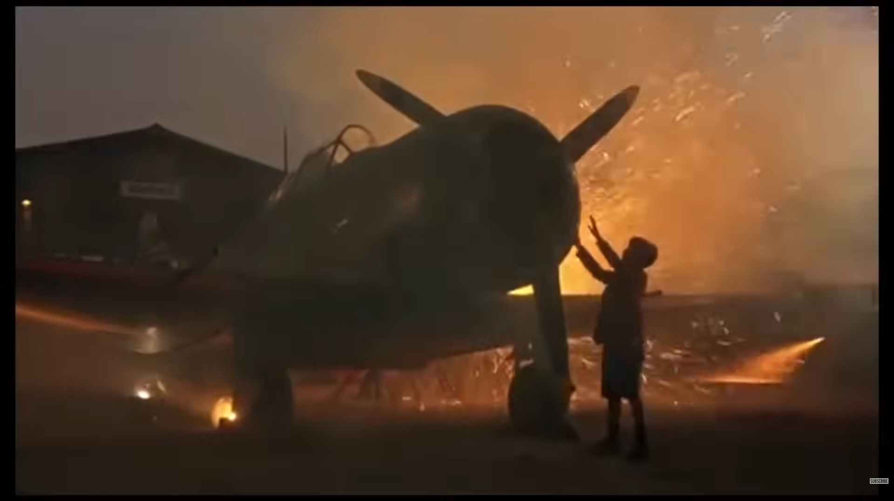
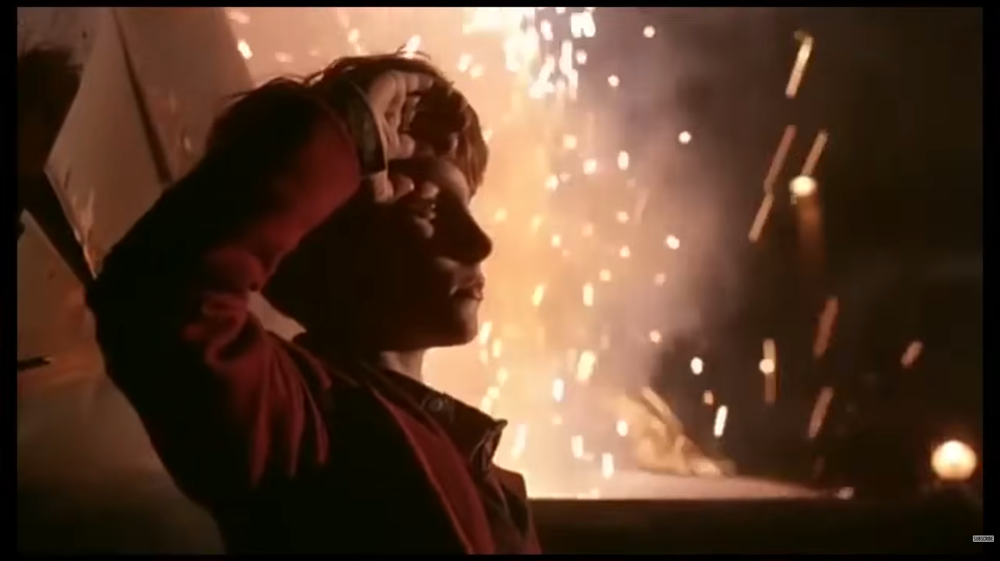
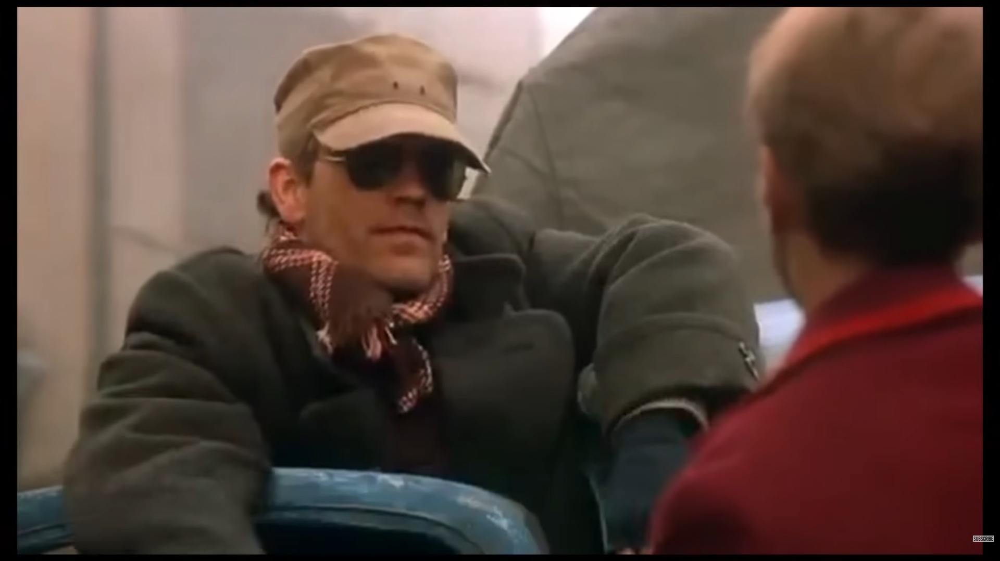
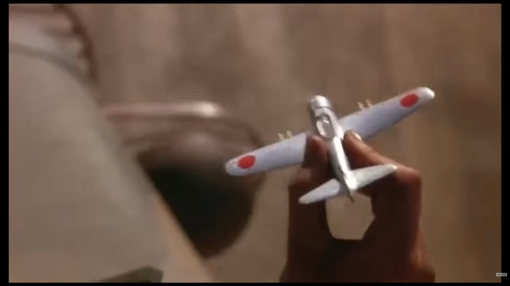
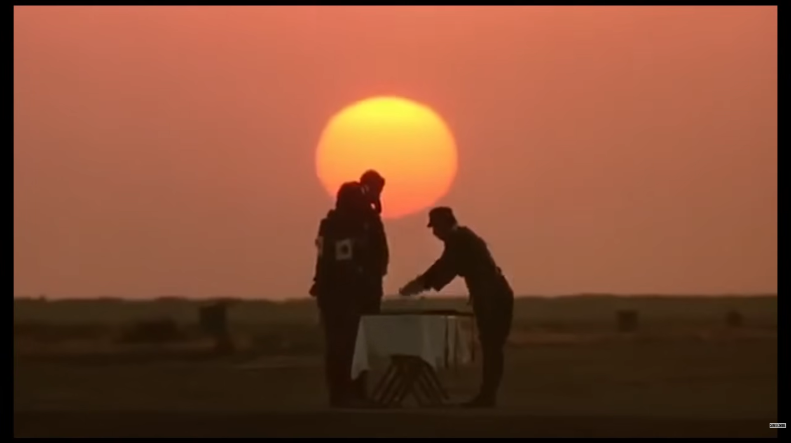

這篇文章比起心得，更像是看完《太陽帝國》後的分析筆記。我覺得這部電影最厲害的地方，在於它將預期中恐怖血腥的戰爭議題處理得很「輕」——表面看起來沒有太多開腸剖肚的廝殺，往下一挖卻全是駭人的瘡疤。以下我嘗試用「敘事技巧」的主題方式紀錄電影中讓我印象深刻的地方，除了個人的想法，也附上和 Claude、Gemini 討論後我覺得有趣的觀點。
<!-- more -->

**_Warning 📢 觀影筆記和讀書筆記都會涉及劇情，請斟酌閱讀。_**

## 1 敘事手法：孩童眼光下的戰爭

### Jamie 男孩視角下的戰爭別有一種異樣的殘酷

*   因為覺得日軍的飛機很厲害而想要開飛機
*   看到軍艦用燈打暗號覺得好玩，也跟著打暗號
*   看到墜毀的飛機和飛機轟炸時超級興奮
*   原子彈爆炸時 Jamie 卻以為是 Mrs. Victor 的靈魂上了天堂

### 戰爭和混亂的描寫：日常被打碎

Gemini補充：用**微觀的改變**暗示宏觀的崩潰：

*   Jamie 和家人入城參加舞會，旁邊卻都是逃難的人
*   聖誕舞會如常舉辦，宴會上大家卻都在討論逃到別的地方
*   出城時家禽的血跡因推擠打在車窗上
*   Jamie 回家途中，發現老是坐在路邊的乞丐不見了
*   Jamie 回家看到家中一團亂，房裡有人掙扎的痕跡
*   Jamie 在舊日家中被以前畢恭畢敬的僕人打巴掌
*   Jamie 再次回家，從窗外剪影以為是母親回來，結果是日軍

### 用少年略帶童趣的眼光描繪可怕場面

幾次 Jamie 都幾乎撞在槍口上但逃過一劫，Jamie 覺得沒甚麼但知情的觀眾都捏把冷汗，我覺得這種資訊落差就是電影能夠把這些恐怖場面處理得很「輕」的主要原因。

*   像是他想看飛機結果不小心闖入日軍戰壕
*   他學著船艦打燈以為只是惡作劇，不知道這樣會引發砲火
*   他差點要被賣掉，還問 Frank 為什麼 Basie 賣不掉自己
*   聽 Basie 的話要幫他去放陷阱抓家禽，差點被日本軍官槍殺
*   看到美國跟日本飛機轟炸對方，超興奮地在高層平台上跳來跳去

### 刻意選擇孩童為主角，這個手法對這部電影最大的意義是甚麼？

*   我覺得是能夠把戰爭這種「重」的議題處理得比較「輕」，但同時卻又更加殘酷（因為連象徵純真、希望跟未來的孩童，都已經徹底受到戰爭的影響無法復原）
*   Gemini：可以打破戰爭即痛苦的單一情緒，且讓劇情有更多層次，對成人而言戰爭是打擊，對Jamie而言在戰時經歷的一切卻正在型塑他的價值觀，他在戰爭中經歷的轉變、眼神中失去的光芒都是不可逆的。

### 無時間感

*   Claude：電影中其實是刻意「無時間感」的，只有暗示 Jamie 進入青春期，讓觀眾知道時間有在流逝
*   Gemini：這能表現出戰俘生活的麻木感——每一天的生活都是重複且單調的，對他們而言日期並沒有意義，因為每一天都與前一天一樣，無可期待。此外，主角 Jamie 在戰火中成長，**他的童年在戰爭中被無聲無息地偷走**——我們僅能透過食物品質的下降以及 Jamie 逐漸變得老練等變化，感覺到時間的流逝。
*   Gemini：這種透過「質變」來暗示「量變（時間）」的手法，通常能帶給觀眾更深層的代入感。

© [Rotten Tomatoes Classic Trailers](https://youtu.be/i_WiDVA1kLY?si=KtYP616Oj0AUF9VN)

## 2 主角人物弧線：靈魂墜落的過程

技術重點： 這裡呈現了「道德刻度的墜落」。透過「生存物資」的需求升級，來具象化一個角色的性格腐蝕。

### Jamie 的轉變

*   一開始講著一口高級英文（在戰時毫無用處）
*   後來開始學會以物易物、設法弄到食物（戰時最需要的技能）
*   甚至討好日軍、講日文、對日軍下跪（靈魂也可以給出去），但他做這些也是為了保護自己，同時保護大家（傾向實用主義）
*   但後來為了照顧 Mrs. Victor 留下來（回歸人性的連結）
*   回到戰俘營後和日軍少年言歸於好、分食水果
*   Mrs. Victor 和日軍少年相繼死去，Jamie 失去眼裡的光輝

### Jamie 一直投降象徵著甚麼？

*   我：對平民而言能吃飽跟活下去是比甚麼偉大情操都更重要，為了食物投降很殘酷但也很真實
*   Claude：電影中的投降愈說愈空洞，也再度反映了語言的意義被侵蝕：晦澀的英文字詞在戰時顯得無用、拉丁文變成咒文禱詞、投降不過是求生手段（語言也是文明的展現，語言的倒退就是文明的倒退）

### 失根

*   Gemini：Jamie 在戰俘營和醫生說想不起父母的臉，暗示戰爭造成的不只是肉體的傷害，更是精神上的「失根」。生存壓力大到極點時，大腦會自動過濾掉那些無助於生存的記憶（但這些記憶卻是形塑一個人的重要部分）
*   Gemini：故事的最後 Jamie 雖認出了母親，但必須透過觸摸母親的臉、手、頭髮，他才能真正喚回對母親的記憶。這表現了戰爭對他造成的「靈魂休克」，代表理智的視覺已經麻木，只有代表感性的原始觸覺能帶他回家

### 對於戰爭下小人物境況的描寫

#### 食物：

*   電影**非常有層次地描寫的 Jamie 的餓**：一開始嫌棄過期食物（聞味道後放下）→餓到開始搜括所有家中食物→看到日軍在路邊吃飯立刻衝上去投降，希望能分到食物→在 Basie 住所狼吞虎嚥，甚至用手抓食物直接吃（Claude 補充：每個動作都是一個道德刻度的墜落）
*   大家為了食物可以不擇手段—— Jamie 的往下墜落就是從他偷死人的飯碗開始的
*   Jamie 被打食物的女人潑湯水，但眼睛竟然沒事；間接也能知道戰俘營的食物根本不熱，非常細節
*   食物裡有象鼻蟲，Jamie 照吃不誤，甚至每天記錄象鼻蟲數量
*   從一開始吃長芽的馬鈴薯，到沒有馬鈴薯可以吃，再到美軍空投物資，食物是電影中一個重要的意象
*   Jamie 兩次說出 I surrender 都是因為食物

#### 衣物（鞋子）：

*   實用主義的 Basie 第一個要 Jamie 偷的死人東西是碗（食物），第二個他自己出手搶的就是鞋子（衣物），可以看出鞋子在戰時也是重要物資（Gemini 補充：鞋子＝移動能力＝存續能力。戰時需要大量的步行、逃難。沒了鞋子，腳會受傷、感染。這也符合 Basie 一貫務實／現實的邏輯。）
*   Jamie 在戰俘營偷東西／以物易物，也把鞋子給了食物鏈最高層的日本軍官
*   Jamie 一直問醫生可不可以要將死的男病患的鞋子，醫生覺得他太沒有道德；後來 Jamie 向日軍下跪救醫生，不知道醫生是感謝他還是覺得他沒救了還是兩者皆有，反正醫生把男病患的鞋子給了他。這裡也能看出 Jamie 道德上的逐步妥協：一開始 Basie 要從死人身上脫鞋給 Jamie，Jamie 不肯；後來 Jamie 卻親自跟醫生開口要別人的鞋子

© [Rotten Tomatoes Classic Trailers](https://youtu.be/i_WiDVA1kLY?si=KtYP616Oj0AUF9VN)

## 3 其他角色象徵：主角成長路上的不同投射

### 美國人 Basie 對 Jamie 來說到底象徵著甚麼？

*   我覺得是父親，還有歸屬感。沒有父親的他崇拜有趣又強大的 Basie，但 Basie 也和父親一樣拋下了他
*   Gemini：和 Jamie 自己的父親對比，**Basie 是叢林法則下的父親**，強大、能在戰爭這種艱困環境下存活、而且有些殘酷
*   Claude：Basie 除了是父親也代表了「美國神話」，Jamie 對他的崇拜也代表了對這套神話的崇拜——效率、極度務實、不受規則束縛。但最終 Basie 也讓 Jamie（和觀眾）看清，**這套神話背後的本質是徹底的自利**，它的效率邏輯拋下了 Jamie，殺死了日軍少年，徹底摧毀了 Jamie 的情感世界。
*   我的延伸想法：殺掉日軍少年跟投放原子彈的邏輯基本上是一樣的——霸道地毀掉可能存在的威脅，無論那摧毀的是什麼、是一個人或數十萬人的性命。
*   Claude 補充：（殺掉日軍少年跟投放原子彈）規模不同，但結構一樣——**效率邏輯的本質是把人變成變數，而不是目的。**Jamie 那麼憤怒，是因為他第一次親眼看見這個邏輯在他最在乎的人身上運作。

### Mrs. Victor 對 Jamie 又象徵了甚麼？

*   我覺得是母親，但又混合一點青春期對女性的悸動
*   Claude：在 Jamie 一再被拋下後，Mrs. Victor 是唯一讓 Jamie 可以去照顧、發揮主動性的對象。Jamie主動選擇留下照顧 Mrs. Victor，但她仍然去世了，這對 Jamie 來說是一次真正的失去
*   重看一次片段之後，**我發現 Mrs. Victor 可能推動了 Jamie「渴望長大」的念頭**，她在鏡中對著 Jamie 說他已經不再是 12 歲，也許該搬去成年男生的宿舍了；後來 Jamie 又看到 Mr. Victor 和妻子的親密時刻（性是青春期轉變的重要象徵）（Gemini補充：孩童目睹性行為也是純真喪失的起點）。在這之後不久就發生了 Jamie 為了完成 Basie 交付的任務冒險越過警戒線的事件。**這場事件實際是 Jamie 轉大人的成年禮，只是這場成年的考驗諷刺地是以生命作為成長的賭注——要嘛你長大，要嘛你死**（Gemini補充：這條警戒線同時具有視覺上的象徵意義，它也是童年與成長的分界線）。

### 日軍少年對 Jamie 的象徵

*   日軍少年也是 Jamie 曾經的憧憬（他幼時曾和父親說過想加入日軍當飛行員，因為覺得他們的飛機很酷很厲害），少年被殺死時 Jamie 對開槍者淒厲地大罵 Bastard，因為文明被摧毀後、代表純真的夢想如今也再不可及了
*   Gemini 補充：Jamie 已經知道將死之人是無論如何救不活的，但他仍然努力地用心肺復甦、努力地用禱告般地重複念誦祈求喚回少年（也是仍純真的自己）的生命，用文明世界的殘留物去對抗戰後留下的、現實和精神的荒蕪。但無論是 Mrs. Victor 的靈魂其實沒有升天——那不過是原子彈爆炸發出的光，或者祈禱和心肺復甦無法從槍口下救回少年；這些現實打擊一再告訴 Jamie 清楚的事實：信仰已經不在，如今已沒有神，只有絕對的野蠻。

### 日軍少年到底有沒有要殺 Jamie？

*   Gemini：也許少年有殺意，但 Jamie 選擇相信人與人之間的連結
*   Claude：電影刻意不給答案，讓觀眾無從判斷
*   我最初認為：有，但是 Jamie 深信少年不會殺他。但重看一次片段之後，我有了不同想法。日軍少年一開始深陷戰敗和不能報效國家的屈辱，揮刀亂砍，看見洋人臉孔的 Jamie 舉起刀就要殺；但在認出 Jamie 的那一刻，少年臉上短暫露出笑容，隨即又轉變成悲傷（我覺得那是：我們曾經在戰時出於同樣對於飛機的熱愛和崇高情操的敬意，跨越了敵我界線，有了短暫卻真誠的友誼；可 Jamie 此刻的出現也提醒了他，如今美國勝了，他的國家戰敗、他飛行的夢想也破碎了。）但如果要殺 Jamie，大可在一開始 Jamie 手無寸鐵時就殺，不必分芒果給 Jamie 還費心跟他解釋要剖開來吃，所以我認為他是沒有殺意的。
*   那如果 Mrs. Victor 之死象徵文明的舊日回歸無望，日軍少年之死又代表甚麼？或許是：好吧——雖然舊日文明已經被摧毀，至少如今戰爭結束了，大家也許有機會真的放下立場做朋友，重建沒有任何目的、單純的人之間的連結。但日軍少年之死讓 Jamie 徹底心死：即使戰爭結束，人性的真善也已經不可能回復了。

© [Rotten Tomatoes Classic Trailers](https://youtu.be/i_WiDVA1kLY?si=KtYP616Oj0AUF9VN)

## 4 意象隱喻：讓物件承載抽象概念

### 名字的循環

*   Jamie 說著高級英文（原始純真） → 改名為 Jim，開始偷東西 → 被父母找到，又被叫自己的名字 Jamie（回歸原本名字，但靈魂已破碎）

### 飛機與長刀的意象翻轉

*   「飛機」從孩子的憧憬變成殺人武器，「長刀」又從殺人武器變回切水果的用具，就當一切彷彿要從殺戮回歸日常時，作為武器的「槍」讓這一切又瞬間破碎了

### 為什麼 Jamie 最後要把行李箱丟掉？

*   我：徹底拋下自我
*   Gemini：儀式性地和過去自我告別
*   Claude：接受自己已經改變了，承認過去那個（純真的）自己已經不會回來
*   裝著飛機模型的行李箱是過去生活在上海租界那個 Jamie 的象徵，而最後一幕行李箱漂蕩在水面也呼應開場棺木漂蕩在水面，因此行李箱暗喻失去的純真是可以確定的。但我還是對於 Jamie 丟掉行李箱的時間點不太理解，這一幕發生在戰俘們行進到 Nantao Stadium 之前，當時電影好像也還未很明確點出戰爭已結束那為什麼是這個時間點？目前 Gemini 給的答案是：當時戰俘們處於極度飢餓與虛弱中。行李箱裡裝的是文明、是過去、是家。但在長途跋涉中，這些東西成了致死的重量。

### 開場的「棺木」vs. 結尾的「行李箱」

*   第一幕是棺木在海上漂流，最後一幕是 Jamie 的行李箱在河上漂流（肉身的消亡／靈魂的消亡）
*   Claude 補充：棺木漂流——是別人的死，是外部世界的消亡，是 Jamie 被動目睹的。**行李箱漂流——是他主動放手的，是他選擇讓它走的**。所以這不只是「肉身消亡vs靈魂消亡」的對比，也是被動承受vs主動選擇的對比。

### 在 Nantao Stadium 那些被擺出來的高級家具代表甚麼？

*   戰爭時這些東西都是無用的、阻礙的？
*   對美好往日的回憶（Jamie 看到自己家裡的舊車）
*   提醒 Jamie 他自己曾經是誰，所以才決定留下來陪 Mrs. Victor？
*   Gemini：超現實的場景，昂貴家具卻被棄置在荒野中
*   Claude：被凍結的正常世界，他們被保存完好，但容納他們的生活已經消失了。Jamie 看到舊日在上海時家裡的用車，是在丟棄行李箱後唯一一次面對能令他想起「他曾經是誰」的實物，讓他某種程度上感受到了「連結」，而他留下來陪 Mrs. Victor，一方面也是不願拋下這連結。

### 電影名稱 Empire of the Sun 具體是甚麼意思？

*   指英國跟日本，還有後來像太陽般冉冉崛起的美國？
*   Gemini：日本：日出之國，以太陽旗為象徵（這顆太陽也即將退場）；英國：曾經的日不落帝國，但隨著戰火蔓延，太陽正緩緩落下；美國：原子彈造成的刺眼白光象徵美國這顆冉冉升起的新人造太陽，近乎神蹟卻又如太陽般酷熱殘忍；太陽也象徵中立的觀察者，普照世人，無論是軍人、戰俘還是將死之人（從這層意義來說，太陽更像 Jamie 前面提到的「神」）。

© [Rotten Tomatoes Classic Trailers](https://youtu.be/i_WiDVA1kLY?si=KtYP616Oj0AUF9VN)

## 5 故事結構：利用落差將主角逼入絕境

### 外在落差（表象的落差）

如果說故事的本質是「落差」，那這個故事的落差是怎麼表現的：

*   主角想找父母→他回到媽媽指定的地點等她，但媽媽始終沒有出現，而食物已經吃完
*   主角很餓想吃東西（回歸生理需求）→去街上找東西吃，被一個瘋男孩追
*   主角想逃跑（安全需求）→遇到 Frank，被帶回 Basie 家
*   主角想要依附 Basie（歸屬感）→ Basie 賣不掉想要丟下他，主角說服了 Basie 留下自己
*   主角想要得到 Basie 的認同，想住進美國宿舍（歸屬感）→ Basie 沒有答應，直到主角從日軍槍口下逃過一劫，獲得住進美國宿舍資格，結果 Basie 丟下他逃跑
*   主角想要看顧 Mrs. Victor → Mrs. Victor 死亡，但主角認為她的靈魂升天，直到他發現那是原子彈
*   主角想要和日軍少年友善交流 → Basie 射死了日軍少年
*   主角丟掉行李箱，放棄了舊日的自己，對美軍投降，打算以「Jim」的身分活下去 → 爸媽來領他

### 內在落差（實際的落差）

不管是 Claude 或 Gemini 都提醒，除了外在落差／生理落差，更應該關注內在落差／心理落差：

*   外在落差／生理落差——角色想要X，但得到了Y：Jamie 想住進美國宿舍依附 Basie，結果 Basie 丟下他逃跑
*   內在落差／心理落差——**角色對世界的認知，和真實世界的運作方式有落差**：Jamie 認為只要足夠努力、證明自己足夠有用就不會被丟下，然而事實是實用主義比他想像得更現實而野蠻

### 重新思考後的心理落差：

*   主角以為聽大人的話就會得到食物和歸屬感 → 聽話在家等媽媽，沒有等到
*   主角以為只要展現了自己的價值（有用）就會得到安全與歸屬感 → Basie 還是拋下了他
*   主角以為只要自己不拋下對方，對方就能活下去陪著自己 → Mrs. Victor 還是死了（肉身的連結消亡）
*   主角以為戰爭結束大家就可以一笑泯恩仇 → 日軍少年還是被殺了（精神的連結消亡，所以他才對殺死日軍少年的人那麼生氣）

Claude 補充：四條落差其實有一個隱藏的順序——**Jamie對「連結」的信念，是從外部規則逐漸退守到內部意志，然後連內部意志也失守的過程**：

*   第一條：「只要遵守規則，就會得到照顧」→ 規則（等媽媽、聽大人的話）失效了。打碎的信念：世界是有秩序的，秩序會保護我。
*   第二條：「只要讓自己有用，就不會被拋下」→ 這已經是退一步了——規則沒用，那我用價值換安全。但Basie還是走了。打碎的信念：只要我夠努力，我可以控制別人留下來。
*   第三條：「只要我不放棄對方，對方就能活著」→ 又退一步——他已經不奢求別人留下來了，他改成自己主動留下來，用意志力對抗失去。但 Mrs. Victor 還是死了。打碎的信念：我的意志和行動能保護我在乎的人。
*   第四條：「只要戰爭結束，敵意就會消失」→ 最後一道防線——他退到了相信「外部環境改變之後，人性會自然回歸善意」。但日軍少年還是被殺了。打碎的信念：人本質上是善的，只要條件對了就會顯現。

這四條信念，一條比一條更「往內退」：從依賴規則，到依賴自身價值，到依賴個人意志，到依賴對人性的基本信任。**每一次退守都是因為上一個支撐點崩潰了。到第四條崩潰的時候，他已經無處可退了。**

## 6 故事主題

技術重點： 這是故事的靈魂。它討論了在「野蠻」面前，文明的無力感。

### 這部電影想說的到底是甚麼？

*   我：人天生就會尋求歸屬感、戰爭的殘忍是讓靈魂墮落，但人的本善能讓人重拾人性光輝
*   Gemini：探討生存的代價，Jamie 雖然活下來，眼中的光芒卻也消失了
*   Claude：尋找歸屬是人的本能，但戰爭摧毀一切能夠歸屬的對象。父母、Basie、英國人群體、日軍少年，最後都一一離他而去。儘管電影的最後 Jamie 和父母重聚，但他的眼神也透露出那已經不是真正的回歸。

### Mrs. Victor、日軍少年之死與文明舊日

*   Gemini 認為，Mrs. Victor 象徵了文明的舊世界。如果從象徵回推，由於 Mrs. Victor 死亡後「靈魂升天」的時刻，也正是原子彈爆炸的時刻，因此她代表文明的舊世界是合理的——但她具體是怎樣象徵了文明的舊世界呢？**我認為是她不像 Basie 對 Jamie 有算計，也不像 Dr. Rawlins 對 Jamie 有期待**，就只是像人們有難時彼此互相照顧那樣，在宿舍被美軍炸毀、Basie 又丟下 Jamie 逃跑後，很自然地接納了 Jamie 住進原本她和丈夫的房間，還幫 Jamie 拿出行李箱的物品裝飾好他的小空間、並把 Jamie 以前最喜歡的飛機模型（純真的象徵）擺好在床邊。那一刻 Jamie 罕見地流下了淚水，那是他少數感受到人性也展露人性的時刻。
*   Gemini 補充：這種在生存以外注重精神、美感的「非功能性」行為就是文明。
*   Gemini 補充：行李箱內的物品象徵過去住在文明世界的 Jamie，Mrs. Victor 透過拿出物品短暫幫 Jamie把原本的自我拼湊回來，因此 Jamie 才會流淚，他想起在這些功能性的目的之外，自己還是一個「人」。
*   延伸 Gemini 對於「文明」的解釋——人類學家 Margaret Mead 曾被問到：「文明最初的標誌是什麼？」她的回答是「一根痊癒的股骨（大腿骨）」，因為這代表有人願意照顧受傷者、協助治療他、等待他康復，**這在當時的環境是無用而且低效的行為，但這就是文明的起源——互相幫助**。也就是說，**Jamie 後來照顧基本上沒有康復希望的 Mrs. Victor，這個看似徹底無用的行為卻是他試圖重現往日文明**，但是仍然徒勞無功，因為 Mrs. Victor 死了，而原子彈更直接把文明的積累摧毀。
*   Gemini 補充：這種徒勞往往不是為了改變世界，而是為了不讓世界改變自己。
*   Jamie 最後徒勞無功地用心肺復甦和拉丁文祈禱，試圖喚回日軍少年。心肺復甦和拉丁文都是醫生教給 Jamie 的，我想是暗示 Jamie 下意識想用文明世界的知識抵抗野蠻，但最後證明文明在野蠻造成的混亂和死亡面前只是徒勞

### 國族象徵：美國人和英國人

*   戰俘營就像租界一樣分派系，像電影一開始說的，外國人在上海過著像在故鄉時的生活，戰俘在租界也是
*   英國醫生（Dr. Rawlins）要 Jamie 念書學單字，要他別那麼實用主義，而是希望他無論如何都要保持高貴的靈魂
*   Jamie 崇拜美國人Basie 覺得他很酷，甚至用自己的命換來（雖然 Jamie 並不知情）在 Basie 美國人宿舍住的資格，覺得很意氣風發。沒想到 Basie 背叛了他，自己逃走，讓 Jamie 覺得很受傷，又再次被拋下，也才發現 Basie 根本不在乎自己
*   Gemini 補充：Dr. Rawlins 和 Basie 也象徵兩種不同的意識形態在爭奪 Jamie 的靈魂，Dr. Rawlins 代表著過去的文明、道德、秩序，Basie 則代表著未來的荒野、生存、實用主義；而 Jamie 在兩方遊走，其實是在選擇他要成為什麼樣的人。最終 Jamie 走出了自己的路：既學會了生存，也保有同情心。

### 電影裡英國／日本／美國是否有各自的象徵意涵？

*   我的想法是英國代表對高貴情操的崇拜，美國代表實用主義跟效率但自私，日本則絕對忠誠但殘忍
*   Gemini：英國——過時的體面，底線是尊嚴；美國——實用主義、資本主義（注重效率和價值），底線是生存；日本——集體主義、自毀式的榮譽感，底線是忠誠
*   Claude：值得注意的是電影對三方都有所批判，高貴到底是無用和不合時宜，實用到底是無情和冷漠，絕對忠誠雖美卻以死為代價；**Jamie 在三者之間遊走、模仿、內化，最後一一幻滅。他最後既不是純粹的任何一種人，而是戰爭創造出來的新的一種人。**

### Jamie 一直想要照顧所有人

*   在戰俘營時他幫大家跑腿、取得食物
*   他想救回垂死的女病患和日軍少年
*   最後一邊幫日軍少年心肺復甦，一邊瘋狂地喊 I can bring everyone back. Everyone. I can bring everyone back. Everyone...（Claude 補充：他怕被拋下——這是他整個故事的創傷核心，日軍少年是他最後一個真實的情感連結，連結斷了他恐慌了。但「bring everyone back」不只是「把人帶回來」，也是「讓一切回到原來的樣子」。他喊的是少年，也是Mrs. Victor，也是那個還相信人性本善的自己，也是戰前的世界。它同時是恐慌、是哀悼、也是一個孩子第一次意識到有些事情是真的回不來的——然後他還是繼續喊，因為他不知道如果停下來自己還剩下什麼。）
*   照顧是為了讓自己不崩潰：Basie一開始就有跟Jamie說如果他一直想照顧所有人，他會撐不住的

### 關於神和信仰

*   主角一開始說他是無神論者（也許神只在夢裡，而我們是他的夢）
*   日軍為了日本天皇可以去死（天皇和為國犧牲的榮譽，對日軍來說就是信仰）
*   主角一直唸著的"Amatus sum, amatus es, amatus est" is a Latin phrase meaning "I am loved, you are loved, he/she is loved".
*   日軍唱日本國歌，Jamie 唱 Suo Gân（蘇格蘭搖籃曲）
*   主角後來一度認為 Mrs. Victor 的靈魂上了天堂（雖然後來諷刺的是他發現那其實是原子彈），比起信仰應該更偏向是他需要給 Mrs. Victor 的死一個美好的詮釋來安慰自己
*   Claude 補充：電影說的比起「戰爭讓人需要信仰」，更精確的說法是：**人在極限狀態下會自動把某個東西升格為信仰，無論那個東西是什麼**。日軍信天皇，信為國犧牲的榮耀；Basie信效率和生存；英國醫生信高貴情操；Jamie 相信他能照顧所有人、相信 Mrs. Victor 的靈魂升天。這些「信仰」的內容完全不同，但功能一樣——給一個人理由繼續撐下去。

© [Rotten Tomatoes Classic Trailers](https://youtu.be/i_WiDVA1kLY?si=KtYP616Oj0AUF9VN)

## 7 價值取向分析

跟[分析《陽光女子合唱團》]()一樣，嘗試用從《故事的解剖》這本書看到的一些概念來分析看看故事的結構。先說明我對四種價值觀面向的理解：

*   正面價值觀（Positive）：帶有正面意義的價值取向，通常是主角方代表的價值取向
*   矛盾價值觀（Contradictory value）：無法和正面價值觀並存
*   對立價值觀（Contrary value）：我理解是不符正面價值觀但並非完全無法並存
*   負面的負面價值觀（Negation of the Negation）：負負但沒有得正，而是更慘（量跟質的同時下滑，抵達人性黑暗的極限）

### 針對《太陽帝國》的故事價值取向，我的分析版本：

*   正面價值：純真＝好奇、友善、熱情與夢想（最初的 Jamie）
*   矛盾價值：自私（Basie）
*   對立價值：現實
*   負面的負面價值：肉體上看似純真（Jamie 外表仍是小孩的樣子），靈魂已經不再純真（Jamie 的眼神／靈魂之窗在經過這一切已經無法回到最初的純真）

### Gemini 的版本：

| 價值層級 | 對應狀態 | 具體表現 |
| :--- | :--- | :--- |
| **正面價值** | 純真 (Innocence) | 開頭穿著合唱團白袍、唱聖歌的 Jamie。 |
| **對立價值** | 世故/生存 (Experience) | 學會以物易物、討好敵人、吃象鼻蟲。 |
| **矛盾價值** | 墮落 (Corruption) | Basie 的自私、醫生不得不放棄理想、為了鞋子偷死人的東西。 |
| **負面的負面** | 異化 (Dehumanization) | 「外表是小孩，內心已成空殼。」 他認不出父母，眼神只有對戰爭生理反應的麻木。 |

### Claude 的版本：

*   正面：**連結**（人與人之間真實的情感依附）
*   對立：**利用**（把人當資源而非目的）
*   矛盾：**自我保護式的麻木**（不連結才不會受傷，但這樣活著算活著嗎？）
*   負面的負面：**以連結之名行利用之實，自己還不自知**——這其實才是 Basie 最可怕的地方，他不是惡人，他只是完全不覺得自己在利用 Jamie

---

**太陽帝國**

*   導演：Steven Spielberg
*   播映年份：1987
*   觀看平台：[Youtube 電影](https://youtu.be/C0nhfX4j5y0?si=NhQfDVvYZo6RqrEh)（這部是沒有中文字幕的，我被騙了嗚嗚嗚…）
*   觀看時間：2026-04