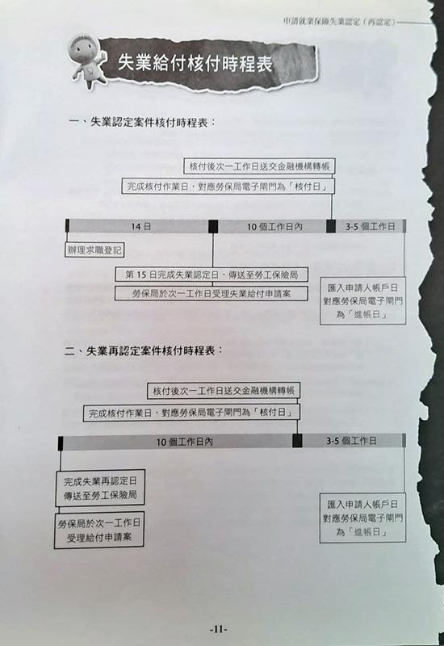
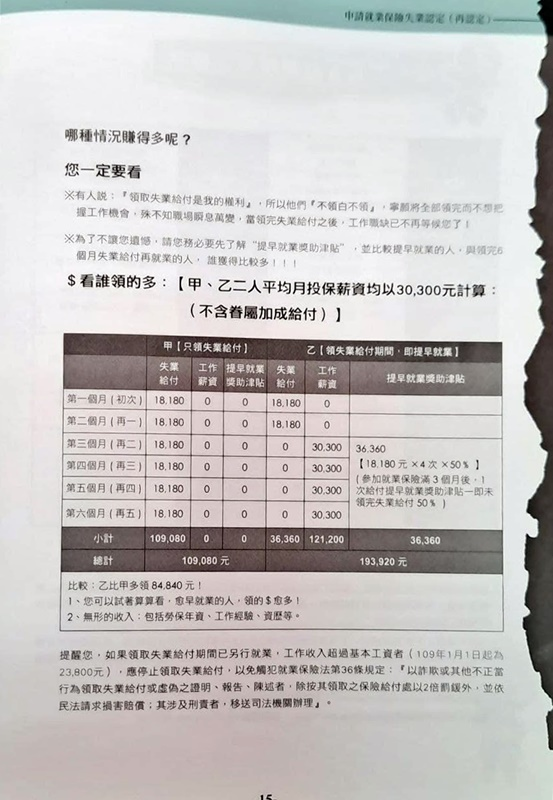

最近領到了提早就業獎助津貼，紀錄一下資遣和申請補助的流程，以免將來還需要用到（當然希望是不要啦，或是公司可以等我待個十年八年再資遣我😂），也提供有需要的人參考。

## 公司內部資遣流程

得知被資遣後，有 3 件事情要確認：

*   契約終止日
*   最終會領到的金額
*   非自願離職證明
<!-- more -->
### 契約終止日

就是公司希望你做到哪一天為止，這個日期很重要，因為要用來推算預告期。資遣和自提離職一樣都必須給對方預告期，根據在職日期長短預告期也不同，可參考：[雇主資遣勞工應在幾天前預告勞工？](https://www.mol.gov.tw/service/19851/19852/19859/14645/)  
假如預告期是10天，意思就是如果公司希望你 9/11離開，則必須要最晚要在9/1告知你；相對地如果今天9/1公司通知要資遣你，則理論上你要做到9/11。如果公司希望你被通知的隔天開始就不上班也是可以的，但是必須支付你預告期間的薪水。如果預告期是10天，公司當天通知資遣，當天請你離開，就必須要支付10天（9/2 ~ 9/11）的薪水。  
所以契約終止日非常重要，因為關係到公司是否需要給予預告期薪資。

*   預告期規定可參考這篇文章，有滿清楚的圖例：[資遣通報 - 試問:雇主至遲應於何時告知員工?及向勞工局作資遣通報?](https://ilabor.ntpc.gov.tw/page/layoff/layoff-qa#:~:text=%E8%A9%A6%E5%95%8F%3A%E9%9B%87%E4%B8%BB%E8%87%B3%E9%81%B2%E6%87%89%E6%96%BC%E4%BD%95%E6%99%82%E5%91%8A%E7%9F%A5%E5%93%A1%E5%B7%A5%3F%E5%8F%8A%E5%90%91%E5%8B%9E%E5%B7%A5%E5%B1%80%E4%BD%9C%E8%B3%87%E9%81%A3%E9%80%9A%E5%A0%B1%3F)
*   預告期薪資規定可參考：[(轉知)勞動部核釋勞動基準法第16條第1項及第3項規定，關於「預告期間計算」及「預告期間工資之給付標準」，自109年10月29日生效](https://www.labor.taichung.gov.tw/1644782/post)

[Photo by Tatiana Syrikova](https://www.pexels.com/photo/anonymous-woman-using-laptop-in-bedroom-3975590/)

### 最終會領到的金額

除了資遣費和預告期薪資，還有一個常被漏掉的是未休完的特休也要折算成工資給你。這些網路上都有提供算法，可以自己先稍微計算一下。最後確認公司提供的金額明細符合計算出來的金額就行了（如果多出來當然也不用太計較😆），然後也要確認何時會發放這些費用。

Photo by Karolina Grabowska on [Pexels.com](https://www.pexels.com/zh-tw/photo/4491441/)

### 非自願離職證明

跟工作證明書或離職證明書一樣，只是上面會註明你是非自願離職，這張是申請補助的依據，一定要確認有拿到這份文件。

[Photo by Andrea Piacquadio](https://www.pexels.com/photo/job-applicant-passing-her-documents-3760072/)

## 請領失業補助

### 失業認定

需要準備身分證、非自願離職證明、存摺影本至就業服務站辦理失業認定。各地區的規定好像略有不同，建議先打電話到離住處近的就業服務站確認需要攜帶的文件和證件（不需要到戶籍地的服務站），準備好後就可以於上班時間前往就業服務站。具體條件和申請方式可以參考：[我失業了，該到哪裡申請失業給付？](https://www.wda.gov.tw/News_Content.aspx?n=5B7D022B7B2A81BA&sms=A08B1EA8119FA444&s=2376933CA35541CB)  
關於首次失業認定，我記得的流程是：先填寫基本資料，然後要在台灣就業通網站上找 1~3 個要投遞的職缺，接著就等叫號臨櫃辦理認定。印象中下午時段包含抽號碼牌後等待時間約 1 ~ 1.5 小時（可能市區就業站人比較多，如果要辦理早上就去比較好）。  
首次認定完成後，如果兩週內沒有開始上班需要再次前往辦理認定。因為我只請領第一個月就去上班了，所以沒有走過後續幾個月再認定的流程，但是辦理時現場人員都會仔細說明再認定的注意事項。  
最後再提醒一下，只要是非自願離職並符合[請領條件](https://www.wda.gov.tw/News_Content.aspx?n=5B7D022B7B2A81BA&sms=A08B1EA8119FA444&s=2376933CA35541CB)都能申請，不一定要受到疫情影響才能申請喔！

失業給付核付時程表

*   給付內容、給付的核發可以參考：[勞動部全球資訊網 - 失業給付](https://www.mol.gov.tw/topic/3075/6065/19561)

### 健保加保

因為失業期間沒有公司可以加保健保，必須以第六類人口加保至戶籍所在地公所。可以用[健保快易通APP](https://www.nhi.gov.tw/Content_List.aspx?n=98F22C99E092DC9A&topn=CA428784F9ED78C9)（就是排隊買口罩那個APP）自行加保即可，具體步驟我已經忘記了，不過網路上有很多教學可以看。記得這個好像按一按滿快就弄好了。

## 請領提早就業獎勵

完成初次認定之後～請領滿六個月的失業給付之前，在這期間開始上班滿三個月後就可以申請提早就業獎助津貼，會發給尚未請領失業給付金額的50％。因為當時已經在上班比較難臨櫃辦理，我是用自然人憑證者從勞保局網站申請的。審核通過之後幾週會收到紙本通知已經發放獎勵津貼。

*   提早就業獎助津貼的資格和手續可以參考：[勞動部全球資訊網 - 提早就業獎助津貼](https://www.1955.gov.tw/0006446.html)

領滿失業給付和提早就業請領金額比較，當然還是鼓勵大家積極求職囉

以上就是整個流程我記得的部分，希望大家申請順利＆求職順利！😉