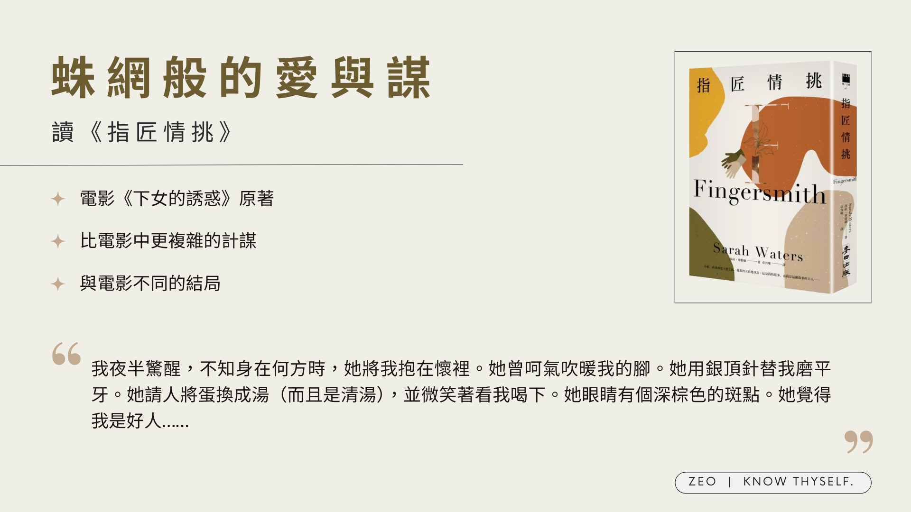

知道韓國電影《下女的誘惑》是改編自這本《指匠情挑》後，便很興奮地找來看。因為看過電影兩遍，一開始以為劇情差不多可能會讀得很無聊，沒想到翻開後便忍不住一章接一章看下去，一天就看了快半本，不愧是得過推理小說和犯罪小說獎的作品。
<!-- more -->

**_Warning 📢 觀影筆記和讀書筆記都會涉及劇情，請斟酌閱讀。_**

## 關於《指匠情挑》：這世界對女孩太殘忍了

### 故事主要結構

不過《指匠情挑》的故事其實比《下女的誘惑》複雜得多。故事背景在維多利亞時期的英國，從頭說起的話就是：

千金小姐瑪莉安．里利未婚懷孕，從父親和哥哥所住的荊棘莊園逃到倫敦，被住在鎖匠鋪、以販賣嬰兒維生的薩克斯比太太收留。恨透了貴族生活的瑪莉安希望女兒不要繼承自己的命運，而是做為一名普通女孩長大，於是她和薩克斯比太太約定，希望薩克斯比太太替她撫養女兒蘇珊，而她則帶走薩克斯比太太的女兒茉德假裝是自己生下的孩子。瑪莉安立下遺囑，等到她們十八歲時，她會將自己的遺產各分一半給這兩位女孩。

> 「…我告訴她：『是妳的孩子啊！親愛的！』她說：『我的孩子？是男的還是女的？』我回答：『是女孩。』她一聽到便扯著嗓子哭喊：『願老天保佑她！這世界對女孩太殘忍了。我希望她死掉，讓我跟她一起死！』」  
> p.311

故事主要情節圍繞著一個計謀，但這計謀實際上有三層。

1.  第一層是**假扮侍女的蘇珊所知道的計謀**：暱稱為「紳士」的騙子要蘇珊到荊棘莊園假扮侍女服侍茉德，哄騙茉德和紳士私奔並與他結婚；紳士取得茉德財產後，會藉故將茉德送進瘋人院，拿到的錢則會和蘇珊分。
2.  第二層是**荊棘莊園小姐茉德所知道的計謀**：紳士一樣讓蘇珊到莊園假扮侍女，但其實他跟茉德說好，拿到財產後將蘇珊以「發瘋以為自己是侍女的茉德小姐」名義送進瘋人院，兩人對分財產，茉德則能取得蘇珊身份自由地活下去
3.  第三層才是**真正的計謀**，也就是薩克斯比太太十七年前的預謀：讓自己的女兒被當作小姐悉心撫養長大，按計畫把蘇珊關進瘋人院，帶回自己真正的女兒茉德，讓茉德以蘇珊的身分活下去並取得實際上是蘇珊的所有財產。這樣一來不但她們母女能團圓，還能得到一大筆錢過上好日子。

而讀者隨著劇情推進也才會知道這一層又一層的計中計，感嘆自以為精明的女孩們竟都只是計畫中的棋子／棄子。豈料設計的人，最終也付出了代價。

### 故事的轉折：隱藏在層層計謀下的真心

茉德一心想逃離了無生趣又被迫滿足舅父變態「學術研究」的莊園生活，所以薩克斯比太太的計畫本應是個雙方得利的買賣。唯一的差錯就是，**在莊園共同生活的這段期間，蘇珊和茉德愛上了彼此。**

儘管蘇珊確實是紳士計謀的幫兇，但她也確實用真心對待茉德。撇除她試圖撮合兩人的彆腳心機，她關心茉德的需求和感受，給予她無微不至的照顧和陪伴，甚至因看不慣紳士對待茉德的態度，一度打算對茉德全盤托出。因此，在茉德得知真相後，對於蘇珊不僅被自己騙、還是這整個計畫的最大犧牲者感到很愧疚。

這也是為什麼在蘇珊逃出瘋人院、回到鎖匠鋪後，茉德即使知道蘇珊會恨自己，仍然幫著薩克斯比太太說謊——茉德知道如果蘇珊發現薩克斯比太太對她的愛，其實只是想犧牲她換回茉德，蘇珊一定會大受打擊；茉德也知道紳士為了分到遺產，會不擇手段甚至傷害蘇珊。

## **和電影**《下女的誘惑》**不一樣的地方：劇情反轉更複雜，女孩處境更無助**

電影抽掉了第三層計謀，也就是兩人複雜身世，**轉而讓小姐和侍女在莊園就互相坦白，並反過來使計逃離紳士，並一起取得財產遠走高飛**。電影的結局大快人心，兩名主角也比較幸福。小說裡兩名女孩後續的故事就坎坷得多。

### 茉德：棋手也不過是聽天由命的棋子

茉德離開莊園、被紳士帶回倫敦後，不但未得到嚮往已久的自由，反而被關在鎖匠鋪，等待著處理好拿到遺產的那天。鎖匠鋪的生活對茉德而言，除了比莊園更不自由也更加庸俗不堪。這段期間她費盡苦心想逃走，甚至因此被下藥迷昏、被紳士毆打；好不容易逃出鎖匠鋪，在倫敦無親無故的茉德只能指望父親的書商好友，這名先生卻只是不停地勸她回到「丈夫」身邊，卻發現茉德怎樣也不肯，最後竟將她送到「上流棄婦之家」。

茉德這才明白，**就算受到天大的委屈，女孩出嫁前就是屬於家族的「資產」，出嫁後就是屬於丈夫的「資產」**，若想自己獨立生活，不是像薩克斯比太太那樣做著見不得人的生意，就是到瘋人院、棄婦之家過著見不得光的生活。瑪莉安．里利的下場已證實了這一點，她的經歷又再一次印證這個事實。走投無路的茉德最終認命回到了鎖匠鋪，回到她「應得」的生活——確確實實是「應得」，因為薩克斯比太太向她坦白，其實她就是自己的女兒，讓茉德進入和離開莊園，全都是薩克斯比太太一手策畫。

### 蘇珊：女孩為了紳士的方便被關進瘋人院

蘇珊的遭遇更慘。她被紳士和茉德陷害、送進瘋人院後，不但生活環境堪慮，更因為她經常奮力反抗院內的一切，受到看護加倍欺負，更被施以各種不人道的治療。在這真正沒有盡頭、也沒有希望的生活中，蘇珊從原本積極地想方設法逃走，逐漸變得意志消沉。

> 和剛來時不同，這種病不會令人恐慌冒汗，不知所措，而是會令人感覺遲鈍麻木。那是一股憂鬱悲慘的氣氛，會不知不覺、一點一滴滲入內心，就像牆面的顏色、餐點的氣味、哭泣和尖叫的聲響一樣，我發覺情況不對時，一切已太遲了。我依舊會跟所有願意和我說話的人強調，我腦袋很清楚，我來這裡是個錯誤，我不是茉德．瑞佛斯，他們一定要馬上放我走。但我太常掛在嘴邊，這些話反而變得輕飄飄的，彷彿錢幣經手太多次，上面的臉孔慢慢磨損消失。  
> p.410

事情直到一名荊棘莊園的僕役來訪才意外有了轉機，讓蘇珊得以藉著僕役的幫助逃出瘋人院，回到倫敦的鎖匠鋪。蘇珊在瘋人院的經歷是我看得最難受的幾章，想到前面紳士說：「我們全都知道，女孩子時不時會為了紳士的方便被關進瘋人院。」（p.314），他輕描淡寫的態度，聯結到蘇珊的遭遇更令人感到不寒而慄。

在鎖匠鋪，對於自己身世仍不知情的蘇珊和茉德正面對質，茉德為保護蘇珊哀求她離開，不要和紳士起衝突；不久紳士喝得醉醺醺地出現了，他偶然發現了薩克斯比太太和茉德是母女的事實，想要告訴蘇珊好打擊她一番，正要出言挑釁時卻被茉德拿刀刺傷。為保護女兒，薩克斯比太太自首認罪，最後受到絞刑。蘇珊一直到絞刑後，偶然在薩克斯比太太的衣服內發現瑪莉安．里利的遺囑，才知道整件事情的真相。故事的結尾雖然兩名女孩終於重逢也澄清誤會，但比起欣慰，更深的感受還是女孩們真的好苦啊…

看完之後更加覺得電影《下女的誘惑》改編得很好，保留了精華的懸疑成分，加快了故事的節奏，電影中獨有的反轉（小姐和侍女聯手合謀）也令人拍案叫絕，兩名女孩的情感發展也更為直接濃烈——我尤其喜歡電影中淑姬撕書的一幕，她對秀子的愛與憐惜、對女孩命運難以自控還要遭人羞辱的不甘全都在這一幕展現得淋漓盡致。

### 其他感想

書中有許多前後呼應的安排，既諷刺更反映出女性在那個年代的艱難處境，讓人不禁感慨。例如瑪莉安（茉德以為的母親）被送進瘋人院，後來瑪莉安真正的女兒蘇珊又再次被送進瘋人院，這次茉德還參與其中；蘇珊則以為自己的媽媽（薩克斯比太太虛構出的女性）因犯罪被抓而被吊死，沒想到最後是薩克斯比太太為維護茉德而被吊死。此外，**女性的自由似乎只能由另一名女性的犧牲來換**，瑪莉安犧牲茉德換蘇珊的快樂童年，茉德犧牲蘇珊來逃離小姐身分，薩克斯比太太犧牲性命換女兒茉德平安。幸好最後這一次打破了不幸的輪迴，茉德和蘇珊在小說的最後得以掙脫束縛重新相愛。我覺得這些數之不盡的細節，都是小說比起電影更令人玩味的地方。

必須一提的是，能夠一頁接一頁不停讀下去，除了故事和角色吸引人、作者的敘述詩意又精準，優美流暢的中文翻譯也是一大重點。

### 關於《下女的誘惑》的改編

至於改編電影《下女的誘惑》將場景從維多利亞時代的英國搬到日本殖民時期的韓國，不僅保留了原作中男性和女性的權力關係，還多了一層殖民母國與殖民地的權力關係。崇尚日本文化的叔父強迫小姐用日語朗讀日本情色書籍給日本紳士聽，這樣的設定更加凸顯了小姐身處多重壓迫之下的困境。

## 我的疑問

陸續看完改編電影跟原著小說我也有不少疑問，嘗試整理一下書中片段和參考資料來解答。

### 關於手套

*   在維多利亞時代，手套對上流社會女性而言是極為貼身的物品。維多利亞女王甚至在日記中提到，要借手套給同母異父的姐姐讓她感到不便。女性在家中可以不戴手套，但外出時或有異性在場則必須戴上，因為赤手可能令人聯想到裸體。因此，**手套不僅代表身分地位（只有上流階層能負擔），更象徵女性的貞潔**。
*   然而，茉德不分場合地戴著手套，無論是待在自己房間、在家裡用餐、外出散步，甚至睡覺時都不例外。這乃是出自她叔父的要求，希望她保持手指的柔嫩，以免在翻書時損壞書頁。童年時因不戴手套而受罰的經歷可能讓茉德留下陰影，導致她走向了另一個極端——幾乎全天候戴著手套。因此我覺得，手套對茉德而言既是束縛，如同荊棘莊園般困住她；也成了她對自己的武裝和偽裝。**手套裹住了真實的茉德**，就像她相信了被灌輸的身世（母親是妓女或瘋子，所以我可能也是如此），**將他人強加於她的外衣誤認為自己真正的樣貌**。

> 「妳的眼睛會代替我的眼睛。妳的手會成為我的手。妳如今已能雙手赤裸來到這裡，在正常的世界裡……我指的是出了這房間的世界，一般人要碰硫酸和砒霜一定要戴上手套，保護血肉之軀。妳跟他們不一樣。這裡才是妳生活的常態。我將妳一手培養而成。我一點一滴謹慎餵食妳毒物。現在來承受更重的劑量吧。」  
> p.186

*   當茉德的叔父開始訓練她閱讀情慾書籍時，她第一次脫下了手套，象徵著失去了純潔的心靈。手套上沾染食物，就如同她外表下藏著已被不潔文字污染的內心（她總覺得自己不是「好人」），這令她感到不安——她依然希望在蘇面前維持小姐的形象，不願讓蘇看見她「不是好人」的一面。
*   但在故事的最後，茉德寫書時已經不再戴手套，除了象徵她**掙脫了叔父對她的束縛，也代表她接受了真實的自己**（「世上沒有女孩子像我一樣」）。當蘇來到她面前時，茉德也不再在意墨水沾到皮膚，如同蘇所說的：「那終究只是墨痕而已」。這不是真正的茉德，而蘇現在已經知道了真正的茉德是什麼樣子。因此，與其說手套保護的是茉德的貞潔，**不如說手套保護的是她的「真心」**。在莊園中，唯一讓茉德心甘情願脫下手套並接受直接觸碰的人，只有蘇。
*   回到手套與上流女性的身分，有趣的是，隨著兩位女孩的身世揭露——茉德原來是平民，而蘇其實是小姐——此時，茉德在鎖匠鋪已經不再戴手套（擦鞋童探路後向蘇回報），反而蘇卻始終將茉德的手套收在身邊。
*   再從手套這個茉德的代表物延伸，評論中也提到，蘇將茉德的手套收在身邊，茉德其實也帶走了蘇為她算命的紅心2紙牌，**兩人身上都帶著紀念彼此的小物**。茉德後來甚至請擦鞋童將這張牌送給蘇，以表達她的心意。

### 關於文字與知識

> 我將書拿回。「對不起。」我說。但我毫無歉意，只感到不可思議。不識字！我覺得不識字是天大的好事，像是殉道者或聖徒失去痛覺。
> 
> p.232

*   掌握知識也就掌握了權力。茉德的叔父以學術之名強迫她為自己的索引事業服務，薩克斯比太太則握有可以獲取巨額財富的關鍵遺囑；相反地，蘇珊因為不識字，無法讀懂紳士寫給茉德的信，因此渾然不知自己被欺騙。
*   然而，無知或不識字有時也能避免傷害。蘇珊認為茉德純潔善良，因為她不曉得茉德究竟在讀什麼，茉德卻因閱讀情慾書籍而深信自己已被污染。當她在鎖匠鋪讀到叔父的信時，也感覺這些文字深深地傷害了她。
*   茉德同時也從書中獲得了知識，這些知識讓她不被紳士的甜言蜜語所迷惑，並讓她意識到荊棘莊園之外有更廣大的世界。然而，書中的知識與現實世界有著差距：真實的倫敦比她想像中的更加險惡，她所學的知識亦不足以支撐她在外面的世界生存；不過，**真實的愛情與性也比她從書中讀到的更為濃烈而深刻**。換言之，茉德的成長來自於將知識與親身經歷結合，這促使她反過來利用自己的技能與經驗寫書賺錢。

> 「有時候，」我低著頭說，「我覺得我自己身上一定也貼著藏書票。我已被標籤、記錄和上架，差不多就像舅父的書一樣。」我抬頭和他四目交會。我雙頰發熱，但語氣依舊冰冷。「兩天前你說你觀察初這棟房子的事。那你當然了解。不論是書本或我，我們都不是為了正常的理由而存在。我舅父讓我們與世隔絕。他說我們是毒，會不小心傷到他人雙眼。但話說回來，他又稱我們為他撿來的孩子，從世界各個角落來到他身邊，有的富有、養尊處優，有的窮酸可憐，有的受了傷，有的斷了脊骨，有的俗麗，有的噁心。雖然他全都嫌棄，但我想他最喜歡的其實就是噁心的孩子。因為它們是其他父母拋棄的書，當然我指的是其他書商和收藏家。我就像它們一樣，我原本有家，後來遭自己的家拋棄——」  
> p.206-207

*   **書籍和茉德也互為隱喻**。她對叔父來說就像藏書一樣，讓他又愛又厭，但終究只是工具。叔父在茉德離開後寫給她的信也證實了這一點，儘管他們多年來朝夕相處，茉德對他而言除了秘書的角色外毫無其他意義。
*   茉德與文字始終愛恨糾纏。書籍曾將她困在荊棘莊園，也陪伴她度過了整個童年；她曾想逃離文字，希望在獲得自由後家裡不再有任何書籍存在。但最終，她仍然回到莊園，提起筆用文字討生活。

## 參考資料

*   [書評》一場文化的乾坤大挪移：評莎拉．華特絲《指匠情挑》](https://www.openbook.org.tw/article/p-63964)

*   [Gloves and the Victorians: They Go Hand in Hand](https://victorianweb.org/art/costume/gloves.html)

*   [Writing, Reading, and Erasing Identities in Fingersmith](https://victorianweb.org/neovictorian/waters/sevcik.html)

*   [關於Fingersmith 二三事](https://www.orange-review.com/2006/11/about-fingersmith.html)

*   [《小姐》到底對《指匠情挑》做了哪些改編？](https://movie.douban.com/review/8022872/)

---

**指匠情挑**

*   作者：Sarah Waters
*   譯者：章晉唯
*   出版年份：2020
*   出版社：麥田
*   閱讀平台：實體書
*   閱讀時間：2024-07