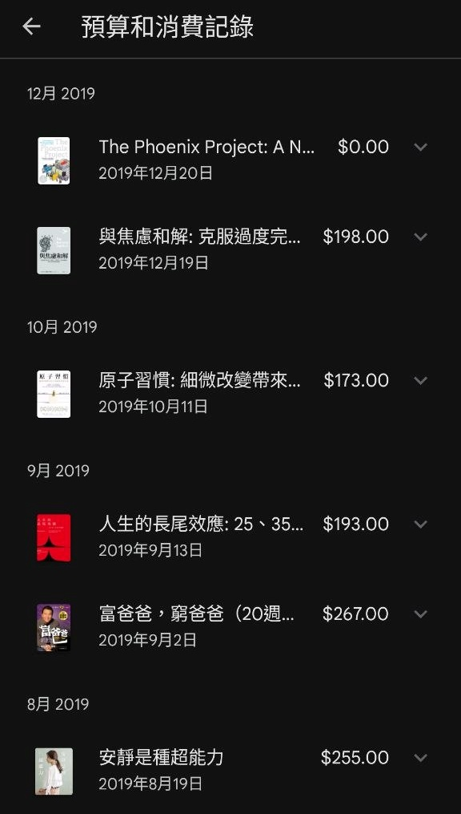
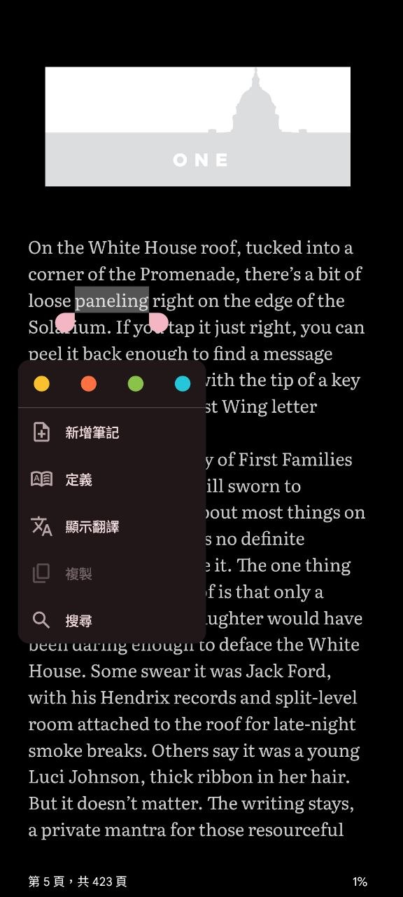
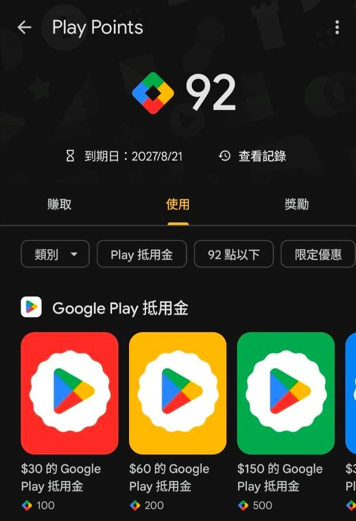
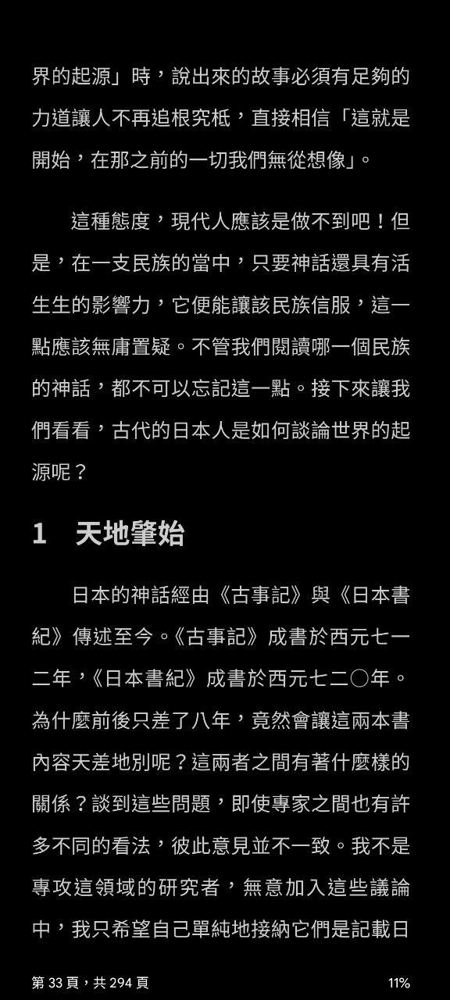
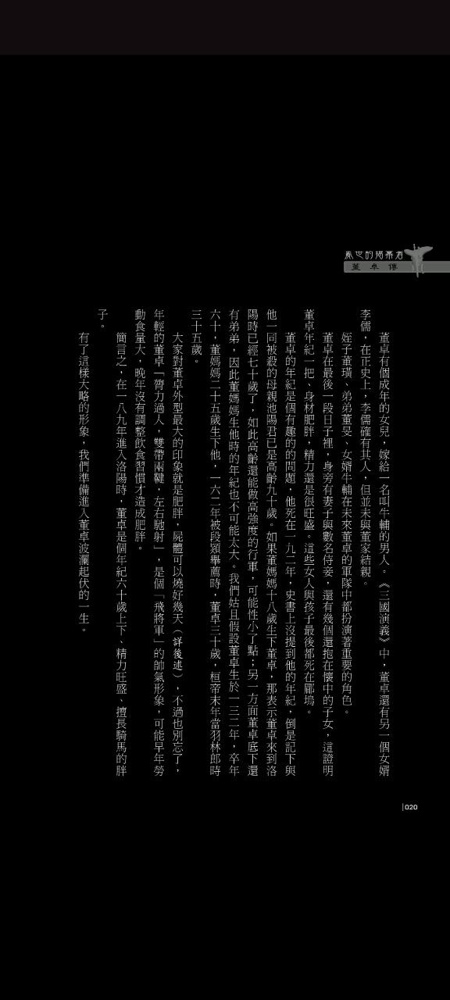

前陣子剛好被問到推薦的電子書平台，加上常常跟人說我用 [Google 圖書](https://play.google.com/store/books?hl=zh_TW) 看書的時候大家都很問號，因此想說來分享一下使用 Google 圖書 7 年的經驗，也聊聊為什麼當初選擇並持續使用這個平台。

**適合族群**：
* 想利用零碎時間看書
* 懶得維護太多裝置
* 不想管理太多平台帳號
* 初次使用電子書想嘗試看看低門檻的平台

<!-- more -->

## 最初想解決的問題

* **空間有限**：雖然紙本書看完可以賣掉，但一直要上架跟寄書這過程也是有點麻煩；另一方面，很喜歡的書雖然想留著重看，但最現實的問題就是空間有限，而且紙本書在台灣潮濕的氣候下也不太好保存。
* **不方便做筆記**：除非特殊情況，不然我不會在紙本書上直接劃線或寫筆記，只能拍下來或抄下來再另外整理，其實蠻不便的。
* **看書量下降**：最主要想解決的其實是這個問題——出社會之後明顯感覺到比求學時期看書量下降很多（當時一週內就能看完一本書……）。雖然還是會買書，但明明書就放在觸手可及的地方，可就是不會主動想拿起來看。對我來說，那好像變成一件需要轉換情境、特別預作準備（培養閱讀心情）才有辦法去執行的事情。

## 分析我的閱讀習慣

因為主要想提升閱讀量，我想了一下為什麼閱讀量下降，以及可以從哪邊提升：

* 常常規劃好睡前看幾分鐘的書，最後還是在滑手機。
* 很多等車、搭車、等人之類的零碎時間都在滑社群，希望能盡量將這類時間的活動轉換成閱讀。
* 像前面提到的，感覺讀書這件事的「摩擦力」變高了，想要設法降低執行門檻。

同時，我也想了一下自己對電子書平台的需求：

* 中文書夠多，買書流程不要太麻煩
* 要能畫重點跟做筆記
* 最好能直接在手機上閱讀，降低閱讀門檻

綜合以上問題和需求，我得到的結論是：**零碎時間最常使用的工具就是手機，如果能在手機上直接看書，對我來說門檻最低。** 而且這些零碎時間常常是不可預期的，也就是說，我當下通常沒有預先準備要看書，自然不可能特地帶紙本書或閱讀器出門。所以，在一開始我就先排除了購買閱讀器這個選項。當時單純想說既然已經有 Google 帳號，那就先試試看 Google 圖書好了，因為只要裝個 App 而已也不用再額外申請帳號、買設備或做什麼設定，沒想到一用就用到了現在。

## 手機搭配 Google 圖書，7 年來的使用心得

### 優點

* **搜尋跟作筆記很方便**：相較紙本書，要搜尋特定文字或段落時更方便；直接在書上劃線作筆記也沒有破壞書籍的壓力。
* **書籍比想像中多**：新出版的主流中文書，只要有發行電子書，Google 圖書基本上都能找到。但舉例來說最近讓我比較震驚的是[三民出版的書](https://play.google.com/store/books/series?id=3z2rHAAAABB1IM&hl=zh_TW)也有上架 Google 圖書（終於！），順帶一提輕小說、耽美或百合小說這類的也有。
* **外文書可以用內建翻譯閱讀**：英文的電子書也很多，而且英文的書商好像比較常跟平台有合作，之前在美漫折扣的時候幾乎用半價買到。讀英文書還可以用內建的 Google 翻譯，不用一直跳出 App 去查單字，也能整段翻譯（但只有文字書可以，圖像書不能翻譯）。
* **點數回饋不無小補**：算是個意外之喜，每次買書可以累積點數，點數可以折抵消費。而且一個禮拜有兩三次抽點數活動，雖然大多時候都是抽個零頭，但體感上每兩、三個月光用抽的也能累積 100 點左右（可以折抵 30 元，Google Play 遊戲課金也可以用）。每個月也會有買書點數加倍的活動，但因為日期不固定（通常好像是接近月底），如果急著買我不一定會等這個期間，不過習慣累積多本一次買的話或許可以留意。
* **情境適應力高**：手機防水，所以泡澡泡溫泉也可以看書，手機能到的地方就是你閱讀的極限XD

（講得好像它們有付我錢宣傳可惜沒有，我也不貪心希望 Google 爸爸如果讀到這篇文章可以送我個 5000 點吧）

      

### 缺點

* **排版限制**：非 EPUB 流式排版的書讀起來非常吃力，目前解法是用 PC 看或手動放大，還是可以看但就是體驗很不好。
* **漫畫字體限制**：手機上看書我覺得挺適合的，但看漫畫真的是有點痛苦（雖然部分漫畫有一個點對話框放大的功能，但要一個個點我還是覺得很麻煩），所以看漫畫我通常會從 PC 開。如果是閱讀漫畫為主的族群可能不太適合，或是要考慮再搭配其他設備。
* **無法轉賣**：買到不喜歡的書你再討厭它也是無法賣掉，只能讓它消失在你的電子書櫃但無法再消費它，多少還是令人有點惆悵。~~不過你還是可以寫心得讓全世界知道它有多難看幫大家避雷！~~

  

### 小 Tips 分享

用這麼多年當然也是踩過一些 Google 圖書奇怪的坑，也在這裡分享一下自己的解法：

* **搜尋書籍**：不知道是不是因為語系的關係，搜尋中文書如果只輸入部分書名有可能會搜不到；建議找書時把完整書名貼上去搜尋，或是嘗試看看書名 + 作者之類的組合，有時候不是沒有上架只是莫名就很難搜到…
* **跨頁劃線**：前期一直有個很笨的困擾，遇到想劃線的句子剛好跨越兩頁，就只能拆成兩段劃線；雖然也沒有不行但對強迫症來說很痛苦，而且回顧筆記的時候看起來也很零碎。解法是**把文字放大或縮小直到它們能被顯示在同一頁**，這樣就能夠順暢地畫重點了（順帶一提非 EPUB 流式的電子書無法劃線註記，在此也許願各出版社都能把電子書製作成 EPUB 格式🥺（寫在這誰會看到））。

---

最後想補充的是，我覺得閱讀平台跟裝置沒有絕對的好或不好，端看個人的習慣。身邊也有朋友覺得手機螢幕太小、讀書真的太痛苦而選擇使用閱讀器，因為能幫助他的閱讀習慣，這就是非常適合他的選擇。

對我而言，透過這個簡單的方案，讓我從**一年都看不完一本書，進步到一個月最多能看兩本**，確實解決了我的困擾，因此對我是相對有效的閱讀方案，也推薦給有類似需求的人參考。

---

雖然是隨便找的三本，但還是補充一下範例提到的書：

* [Red, White & Royal Blue](https://play.google.com/store/books/details/Casey_McQuiston_Red_White_Royal_Blue?id=MG5YEAAAQBAJ&hl=zh_TW)（我沒看完，所以不知道好不好看XD）
* [神話與日本人的心](https://play.google.com/store/books/details/%E6%B2%B3%E5%90%88%E9%9A%BC%E9%9B%84_%E7%A5%9E%E8%A9%B1%E8%88%87%E6%97%A5%E6%9C%AC%E4%BA%BA%E7%9A%84%E5%BF%83?id=95i4EAAAQBAJ&hl=zh_TW)（好看，內容非常有趣）
* [亂世的揭幕者：董卓傳](https://play.google.com/store/books/details/%E6%9D%8E%E6%9F%8F_%E4%BA%82%E4%B8%96%E7%9A%84%E6%8F%AD%E5%B9%95%E8%80%85_%E8%91%A3%E5%8D%93%E5%82%B3?id=noAqEAAAQBAJ&hl=zh_TW)（非流式 EPUB 偏痛苦，但我還是在手機上看完了，大概這麼好看）