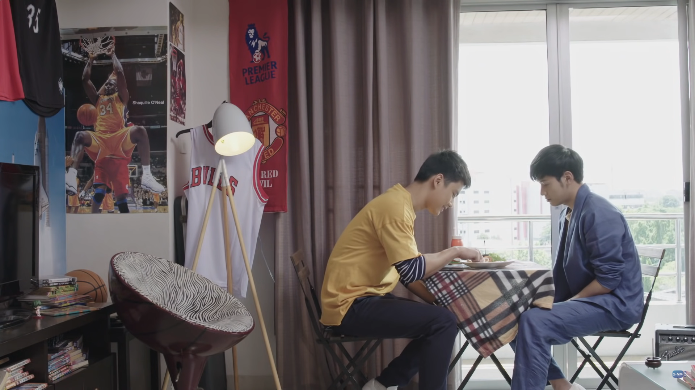
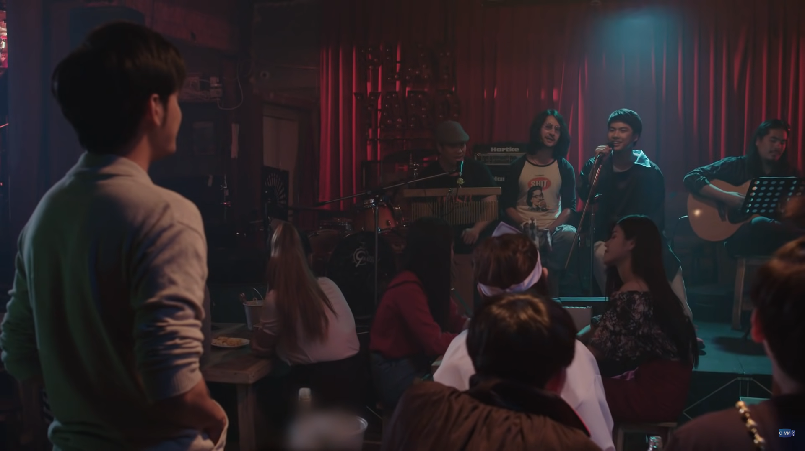
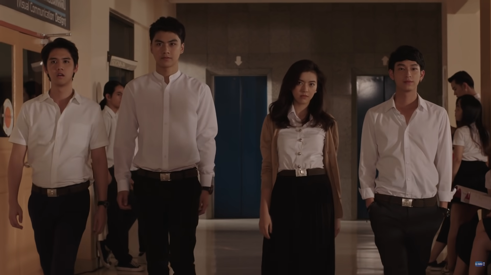
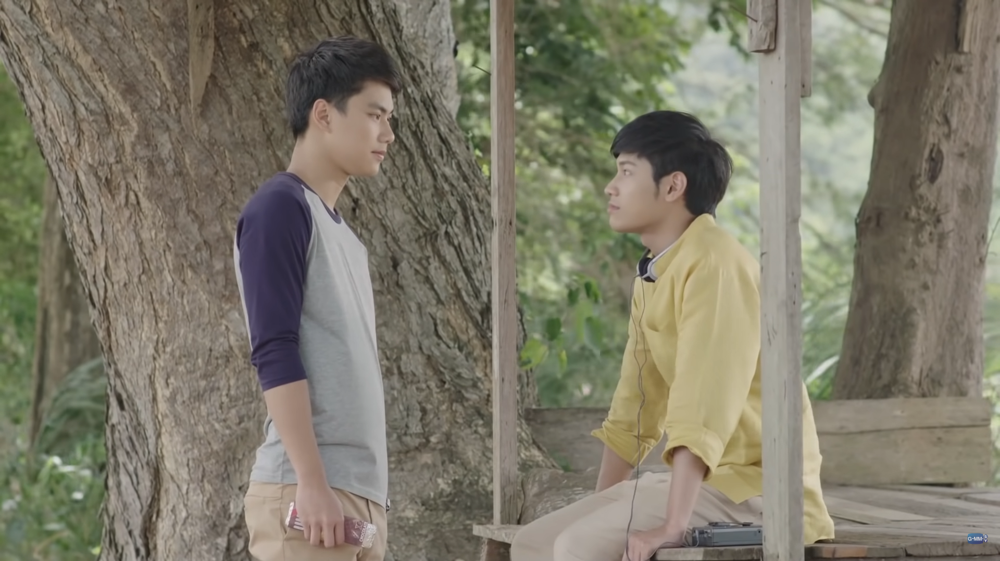

原本只是在看了《[Bad Buddy](https://zh.wikipedia.org/wiki/%E5%8F%AA%E6%98%AF%E6%9C%8B%E5%8F%8B%E5%95%8A%E6%9C%8B%E5%8F%8B)》後對於 [Ohm](https://zh.wikipedia.org/wiki/%E5%B8%95%E7%93%A6%C2%B7%E5%90%89%E6%B2%99%E6%99%9A%E8%BF%AA) 的演技養成感到好奇，才回頭找了這部 [Ohm](https://zh.wikipedia.org/wiki/%E5%B8%95%E7%93%A6%C2%B7%E5%90%89%E6%B2%99%E6%99%9A%E8%BF%AA) 和 [Singto](https://zh.wikipedia.org/wiki/%E5%B7%B4%E6%8B%89%E5%A5%87%E4%BA%9A%C2%B7%E9%B2%81%E6%B4%9B) 主演的《[他在清明來看我](https://youtu.be/YG0H6JUHLMs)》來看，因為對靈異題材沒有很愛所以本來也沒抱什麼期待，不過看完一集就馬上改觀，整部劇看完後更是驚豔。

雖然是靈異題材加懸疑主線，但整部劇在嚴肅和輕鬆的氛圍之間平衡得很好，並不會一開始就讓人感到心情沉重，反而用輕鬆帶點搞笑的視角（墓園三鬼組）拋出懸疑的線頭（Med 的身世之謎），讓人產生好奇而想一直看下去。片中很多幽默橋段都不是生硬的笑點，像是 Thun 燒紙衣服幫 Med 換裝，還有 Med 因為不熟悉網路在 Facebook 上問投胎引發的鬧劇，都讓人會心一笑。
<!-- more -->

**_Warning 📢 觀影筆記和讀書筆記都會涉及劇情，請斟酌閱讀。_**

## 懸疑性質的主線劇情＆循序漸進的情感發展

因為這部劇有條明確的主線——尋找 Med 的身世，讓所有情節都在這個前提下發生，也讓 Med 和 Thun 的情感發展更加自然，少了快速暈船的情節，多了細膩的情感累積。

在看完大半部劇後才發現，其實 Med 和 Thun 的肢體互動非常少，兩人的關係建立在一步步了解對方的同時也學著接納自己，還有過程中對彼此的陪伴及付出。一開始 Thun 對 Med 的關心僅是出於善意和同情，他帶 Med 出去玩、幫 Med 做功德、和 Med 一起追蹤關於身世的線索，Med 便教他功課或打掃作為回報。

但在日復一日的相處下，從最初的拘謹禮貌、互相玩笑打鬧，一直到傾訴彼此內心的煩惱，Thun 始終為 Med 體貼著想，把他擺在生活中重要的位置，更堅持要幫他找出死亡真相，這些 Med 都看在眼裡。兩人對彼此愈發了解，關係也更加親近，Med 逐漸對 Thun 有了朋友之外的情感。

©️ [GMMTV OFFICIAL](https://www.youtube.com/c/gmmtv/featured​​)

在 Thun 的生日，Med 冒險使用所剩不多的法力，親手為他做了早餐。沒想到生日當晚，喝多了的 Thun 和好友 Praifah 在曖昧的氛圍下接吻了（巧的是，當天 Praifah 送 Thun 的禮物也是她親手做的蛋糕），這個吻打破了一切看似穩定卻搖搖欲墜的日常：Thun 驚覺自己不喜歡女生，Praifah 因為被不明不白的冷落而受傷，暗戀 Praifah 的 Prince 再也無法裝作若無其事。

但這個轉折點是讓 Thun 了解自己的契機，也迫使 Med 正視自己的情感，即使他不得不忍痛放下——因為他發現 Thun 的媽媽 Kwan 就是自己生前的前女友。這個事實讓 Med 無法接受，即使 Thun 已經對他表明心意，他還是決定離開 Thun 回到墓園。然而在分開的日子裡，兩人愈發思念彼此。Thun 決定鼓起勇氣向好友和媽媽坦承性向，並去找 Praifah 道歉，正因如此，Thun 才有機會發現 Med 和 Praifah 家族的聯繫，和 Med 修復關係，進而揭發 Med 的身世。

©️ [GMMTV OFFICIAL](https://www.youtube.com/c/gmmtv/featured​​)

在接近高潮時製造出的懸疑感也很足夠，隨著 Med 的死亡真相逐漸揭開，看的時候情緒也愈來愈緊張。除了預期 Med 的死因可能是他殺，而且跟 Praifah 的家人有關；當 Med 知道死因得以順利投胎時，也代表兩人離別的日子就愈來愈近了。

雖然一人一鬼的戀情，大家都和他們同樣心裡有數：兩人總有一天會分別（但其實活人也是一樣啦，人都會死）；卻沒有為了堆疊悲情氛圍，讓雙方愛得死去活來。就算知道離別在即，兩人也沒有哭哭啼啼，而是盡量用正面的態度看待這件事。Thun 儘管不捨，為了不讓 Med 擔心還是展現堅強的一面，把握剩下的時間和 Med 創造回憶。Med 也告訴 Thun 他所擁有的已經超越了他應得的：在他離開這個世界時，能有一個他所愛著也深愛他的人。兩人的互表衷情，因為共同經歷的波折和即將面臨的別離而顯得更有份量。

兩人的成熟也使臨別時 Thun 的情緒潰堤更有衝擊力。儘管經歷過和父親的分離，儘管已經對結局有所預期，儘管已經努力留下回憶，當真正的離別來臨，還是令人難以承受。而這也是觀眾一路以來經歷的感覺，所以帶入感格外強烈。

劇中很少有為虐而虐或者單純灑糖的情節，所有情節都是有意義的，整個故事非常流暢和完整。

## 真心相待的情誼

> 也不是什麼特別的事情，只是感覺對方一直都在身邊，不管我做什麼、去哪裡，他都在身邊照顧著我，我隨時都能找到他…這不就是愛嗎？
> 
> Kwan

除了 Thun 和 Med 的情感主線，劇中對其他角色的情感描寫也不隨便，無論是愛情、友情還是親情。Prince 一直暗戀著 Praifah，但出於朋友之間的義氣（大家都覺得 Thun 和 Praifah 互相喜歡），他始終只是在旁默默守護著 Praifah，一直到 Thun 和 Praifah 接吻後態度游移，一向在團體中冷靜的 Prince 才終於忍無可忍地對 Thun 動怒，坦白藏在心中的話：如果你還是沒辦法下定決心，受傷的不是只有 Praifah 一個人。

Thun 和死黨們的友誼也很珍貴。在 Thun 出櫃後，Prince 和 Khem 馬上給予他最大的支持；而在 Thun 和 Med 同住期間一直以為他嗑藥或是中邪的兩人，費盡心思想幫他戒毒；Thun 在雨中昏睡一整夜後，也是兩人找到他、送他去醫院，Khem 還自作主張地打電話給 Thun 的媽媽，雖然被 Thun 責怪，事後卻證明是一個非常正確的選擇。

©️ [GMMTV OFFICIAL](https://www.youtube.com/c/gmmtv/featured​​)

而在接吻事件後，得知 Thun 真正想法的 Praifah 很大氣地接受了 Thun 的道歉，雖然經過此事，她開始害怕友誼變成其他情感可能會造成無法挽回的改變，但一向積極主動的 Praifah 仍勇敢答應了 Prince 的追求。不僅如此，她更是在家族都逃避面對 Med 的過往時，代替家族站出來做決定的人。她慎重告訴 Med 他會被家族接納，不會再被遺忘，這對 Med 來說別具意義，他終於知道自己是誰，不是一個被抹除存在的人。

而 Kwan 和 Med 的前世未了情，也有好好地把話說開，經歷了生離死別的 Kwan 不僅溫柔地接納了兒子的性向，也接納了 Med 對於兒子的情感。

## 具說服力的角色

成功的角色塑造也是撐起這部劇的關鍵，除了得益於演員們純熟的演技，劇中也透過許多小細節呈現角色的個性。在墓園住了 20 年苦於無法投胎的 Med，並沒有失去天真調皮的本心，在離開墓園後對一切事物都感到好奇，常讓 Thun 哭笑不得；在和 Thun 變熟之後甚至在課堂上鬧他，但事後也很認真地向他道歉；雖然 Thun 的朋友看不到自己，Med 還是會如同在場一般和大家對話。

但也因為英年早逝，又在墓園住了這麼久，他非常珍惜與 Thun 的相遇，感激 Thun 為他做的一切，這也讓他擔心自己對於 Thun 的情感是不是奢求太多。所以他在看到 Thun 和 Praifah 接吻、發現 Kwan 是 Thun 的媽媽後，立刻選擇離開；而在 Thun 再次邀請他同住的時候，Med 也沒有一口答應。

©️ [GMMTV OFFICIAL](https://www.youtube.com/c/gmmtv/featured​​)

Thun 喜歡耍小聰明，和喜歡惡作劇 Med 是天作之合。雖然會要 Med 幫他贏球甚至在考試作弊，或是聯手 Med 一起整朋友，但 Thun 也有認真上進的一面，而支撐著他讀書的動力依然是他想幫助 Med 的初衷。

Thun 在運動上對自己很有自信，在調查 Med 的事情上也非常積極；相較之下，他對自己性向的猶疑和對於出櫃的恐懼，能看出他確實花了一些時間消化和接納自己。不過一旦得到家人朋友的支持，他又能繼續勇往直前追求自己想要的：幫助 Med，讓 Med 明白自己的心意。因為這樣的小聰明和自信，加上幫助 Med 的使命感，他敢為了 Med 去做一些冒險的事，像是潛入書庫調查 Med 的論文，或是潛入 Praifah 家調查 Med 的身世。命運讓感情上比較內斂的 Med 遇見了較為主動的 Thun，Med 才有機會知道身世的真相，這段感情也才有可能萌芽。

## 烘托劇情的配樂

配樂也是本劇的一大亮點（GMM 業配自己實在泰用心），像是 Med 隨身聽常播放的歌曲，不僅營造懷舊的氛圍，歌詞提到向星星許願也和劇情有所呼應；還有 Thun 在生日派對上為了 Med 特別獻唱的老歌，也很符合兩人感情加溫的過程。可以在網友製作的歌單找到這些歌：

https://open.spotify.com/playlist/1bFnvPuJbk17djdwZI6CI0?si=12c97188ae2141d3

* * *

《[他在清明來看我](https://youtu.be/YG0H6JUHLMs)》是一部在劇情、寓意、人物、節奏、情感和氛圍營造表現都非常好的佳作，也是我目前心中的最佳 BL 泰劇。看完也會讓人反思，是否有好好珍惜看似平凡其實得來不易的每一刻？

> 我們只會活一次，請好好善用生命，珍惜生命中的每一刻。
> 
> Med

可以在 YouTube GMMTV 官方頻道收看《他在清明來看我》：

