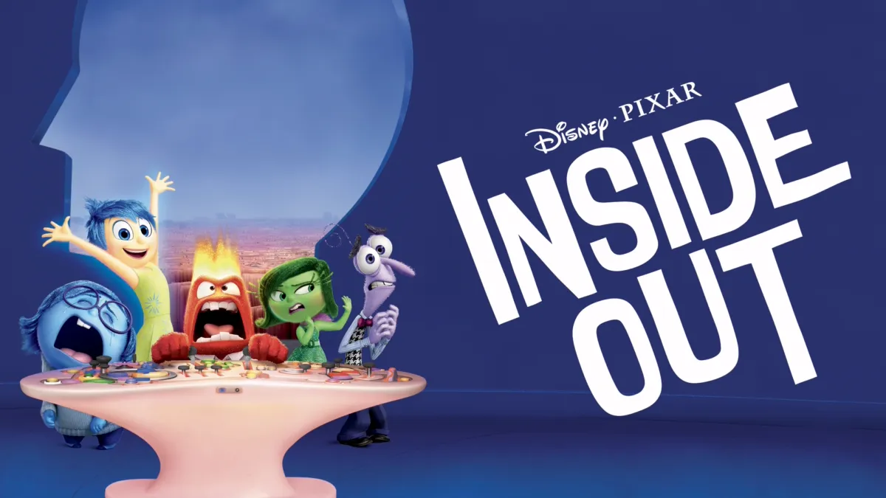

趁著續集上映，最近才在 Disney+ 上看了《腦筋急轉彎》，覺得是一部不同年齡層、不同生命階段看了都會有收穫的電影。對兒童觀眾來說，電影用擬人化的方式介紹情緒，簡單易懂；對成人觀眾來說，電影也能帶來很多啟發。
<!-- more -->

**_Warning 📢 觀影筆記和讀書筆記都會涉及劇情，請斟酌閱讀。_**

## 1\. 愈長大，就愈難體會到單純的情緒

人一旦脫離嬰孩時期，開始進入學校、出社會，當人際間的互動變得愈來愈複雜，很多時候情緒也都是混雜的，很難像孩童時期那麼容易感受到單純的快樂；就像《腦筋急轉彎》裡最後樂樂最後發現悲傷的情緒也可能帶來快樂（萊莉因輸球而難過，但家人和朋友的安慰帶給她溫暖），還有萊莉的情緒主控台從樂樂主導轉變成所有人輪流操控。

## 2\. 一昧追求快樂並不切實際

一開始樂樂想把憂憂排除在情緒主控台之外，畢竟人的本性就是趨樂避苦，但如同 1 所說，樂樂後來也發現萊莉長大的旅程中不能沒有憂憂。

而且樂樂幾乎總是處在亢奮狀態，憂憂才是能夠靜下心來傾聽的人；這讓我想到在某本書中讀到，令你享受的事未必是總是帶來快樂，有可能在做的過程中其實很痛苦，例如很努力蒐集資料、苦思架構、鑽研排版，但最後做出很棒的報告。

## 3\. 除了快樂，其他情緒也同樣重要

《腦筋急轉彎》故事的最初，情緒主控台幾乎是由樂樂主導；但最後所有情緒都發揮力量，幫助樂樂和憂憂回到總部。故事的結尾，在萊莉的曲棍球比賽中，所有情緒也輪流掌握主控台，讓萊莉發揮她的最佳狀態。接受各種情緒的存在，能幫助人在生活中更自在展現自己的特質。

與之相反，當大腦由極端情緒掌控時，則容易做出衝動的決定。當驚驚、怒怒和厭厭掌握情緒主控台時，萊莉不僅陷入低潮，還做出偷錢、翹家等和她本性相悖的行為。

在[皮克斯介紹《腦筋急轉彎》的頁面](https://www.pixar.com/feature-films/inside-out)上也可以看出，各個情緒其實各有任務，並沒有正面負面之分。像怒怒是希望確保事情對萊莉來說是公平的，驚驚則是希望確保萊莉的人身安全；只是仍然要確保這些情緒的平衡，避免由某一個情緒過度主導自己。

## 4\. 想像力就是你的超能力

當樂樂和小彬彬陷入垃圾場時，雖然已有預料小彬彬會犧牲自己讓樂樂離開，但實際發生的時候還是忍不住熱淚盈眶。樂樂藉由小彬彬的幫助並利用萊莉的幻想男友回到總部，或許是電影想提醒我們要保有童心，還有不要失去夢想。感到失落的時候，也許想像和希望能帶你重新找到前進的力量。

## 5\. 多重身份有助於對抗壓力

搬家讓萊莉在一夕之間失去多個身份，包括冰球隊隊員、兒時玩伴的摯友，甚至父母生活中也有其他事要擔心，自己對他們來說似乎已經不是最重要的。身份的改變影響了萊莉對自己的價值判斷，進一步導致她情緒失衡。

這也讓我聯想到[在《夠好的工作》心得](https://zeoutput.com/2024/02/the-good-enough-job/)中提到的：「發展多重身份能讓一個人承受風險的能力更高」，電影中萊莉的狀態提供了一個反面例證，萊莉的多個個性島也讓我覺得很像不同的價值容器，個性島連結著潛意識區（回憶、夢境、抽象思考等）和大腦總部（意識），愈多的個性島（價值容器）能讓一個人的人格更穩固。

## 其他衍生感想

我覺得核心記憶這個設定滿有趣的，真正形塑一個人的主要是某些重大經驗，像電影中萊莉搬家的經驗。大腦總部存放核心記憶的位置有限，許多記憶最後都會進到垃圾場然後被遺忘，比如我剛才在網路上隨興滑到的內容。延伸想到的是，應該盡可能去創造生命經驗，因為愈多新體驗就愈可能觸發不同的情緒，產生快樂情緒、創造快樂回憶的可能性也更高。

另外所有電影中出現的文字，例如告示牌、報紙等等都有翻成繁體中文（至少 Disney+ 上的版本是這樣），覺得很用心。

©️ [Disney+](https://www.google.com/url?sa=i&url=https%3A%2F%2Fwww.disneyplus.com%2Fmovies%2Finside-out%2FuzQ2ycVDi2IE&psig=AOvVaw3jl072YJVCKp2Z_HokcXlv&ust=1719490004572000&source=images&cd=vfe&opi=89978449&ved=0CBMQjhxqFwoTCMCHzdCd-YYDFQAAAAAdAAAAABAE)

---

**腦筋急轉彎（Inside Out）**

*   導演：Pete Docter
*   播映年份：2015
*   觀看平台：Disney+
*   觀看時間：2024-06