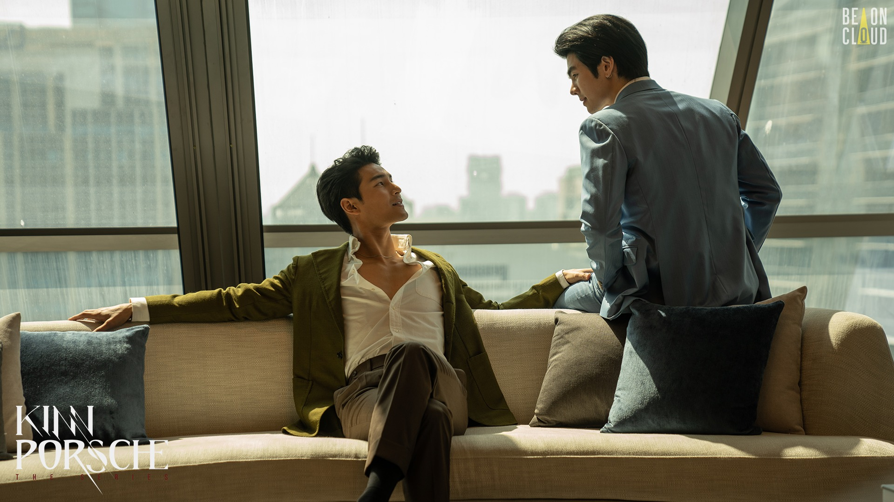
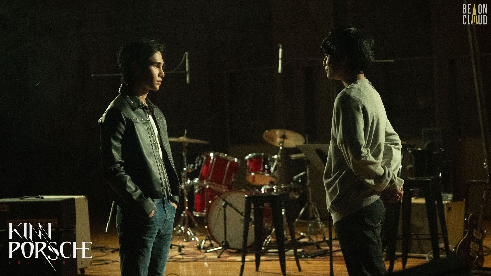
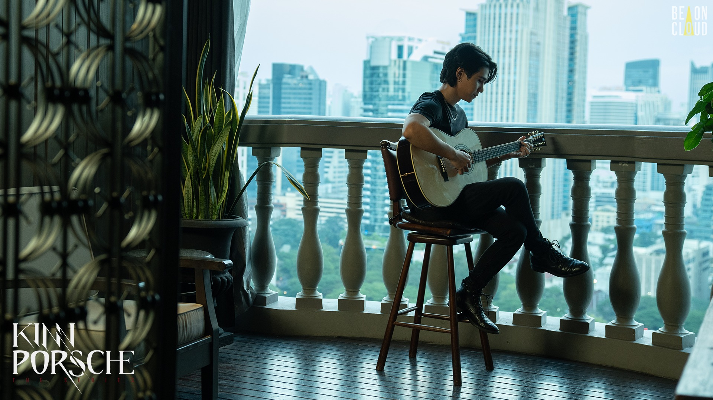
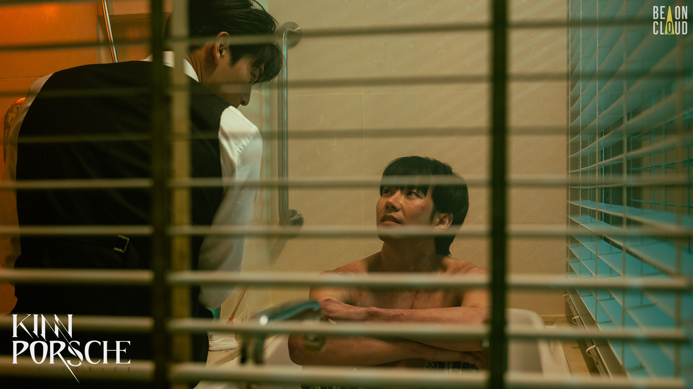
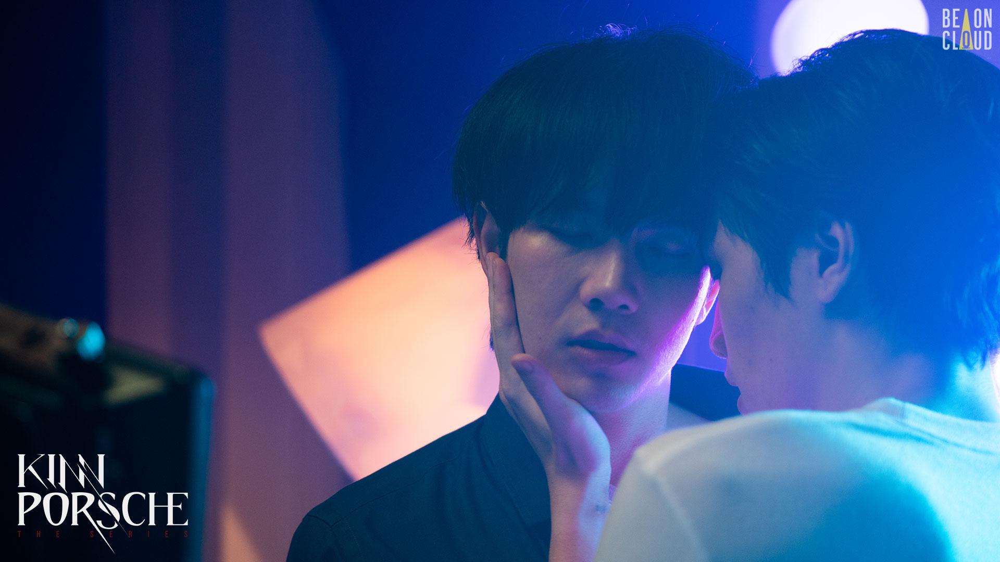
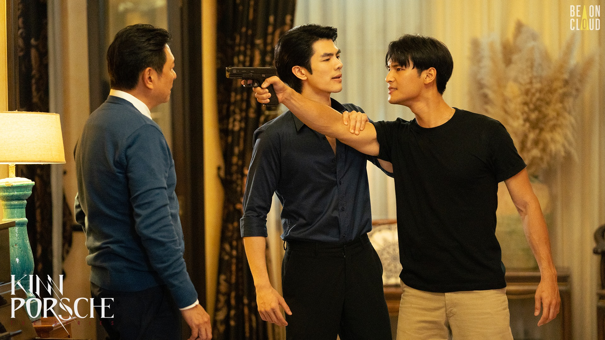

《黑幫少爺愛上我》是一部由於劇名太像言情小說而差點忽略的作品，幸好有朋友強力推坑才沒有錯過。由於黑幫故事的設定，劇中既有緊湊的槍戰和打戲，又不失泰劇一貫的幽默，讓人很容易一集接一集看下去。這部劇優點是**畫面很美，色調和構圖非常好看（我心目中的巔峰是 EP8），加上精緻的場景、道具和服裝，讓整部劇呈現出幾乎超越電視劇的質感**。前期劇情的節奏很不錯，但可能也因為前半段把期待和張力推得太高了，反而讓後續收尾有點（相對而言）輕輕放下的感覺，但整體來說瑕不掩瑜，是一部製作用心的劇。
<!-- more -->

**_Warning 📢 觀影筆記和讀書筆記都會涉及劇情，請斟酌閱讀。_**

劇情圍繞著黑幫家族之間的爭鬥展開，隨著主角 Porsche 加入緹納班亞坤本家成為接班人 Kinn 的保鏢，和 Kinn 逐漸被彼此吸引，卻也開始捲入一連串的秘密和謊言。故事中總共有三個配對，但除了主要 CP —— 也就是 Kinn & Porsche 有較完整的篇幅描述他們的心境轉折和感情歷程，其他兩對 CP 就稍嫌可惜，不是鋪陳較少，就是有許多細節需要自行想像補足。

## 主線 CP - Kinn & Porsche：秘密比子彈危險

Porsche 從小父母雙亡、和弟弟相依為命，為了養家，不僅在酒吧打工因而練就一身討好人的技能，有跆拳道資格的他甚至會參加武術競技賺取外快。一次意外 Porsche 搭救了黑幫當家少爺 Kinn（好容易落難的少爺XD），Kinn 的父親江先生得知後，不顧家族內眾人質疑，執意要 Kinn 設法讓 Porsche 成為自己的保鑣，無論用什麼手段——說服、利誘、綁架、或是逼迫。

Porsche 最終迫於生計不情不願地答應了，卻也因此和 Kinn 互看不順眼，甚至一度被換到 Kinn 哥哥天坤的手下工作。可是在出了幾次包出了幾次任務，還有從不同角度觀察這個家族後，Porsche 逐漸理解了 Kinn 的難處，Kinn 也在相處中發現 Porsche 除了欠揍外真誠直率的那一面（還有 Porsche 肉體的吸引力），開始對 Porsche 動了心。兩人歷經各種不可思議的意外（他們…到底…怎麼掉進森林…）還有個性上的磨合，終於在江先生的同意下公開交往。沒想到這還只是開端，後面還有一連串的家族和身世秘密在考驗著他們。

©️ [Be On Cloud](https://www.facebook.com/BeOnCloudOfficial/)

最後 Porsche 會答應當分家老大很出乎我意料，原以為基於他的個性和保護家人的立場應該會拒絕，**但或許這是他現階段能做到同時保護 Kinn、Porchay 和媽媽最好的方法吧**。當 Kinn 把分家戒指套上 Porsche 的手指，不僅象徵本家和分家的結合，也像兩個人互換誓言一樣。很喜歡 Porsche 在 EP14 以分家老大身分走進本家時，出現了他第一次走進本家的對比畫面，有種看著他歷經好多事一路成長的感覺。

## 副線 CP - Kim & Porchay：弦外之音

在 Porsche 的保護和寵愛下長大的弟弟 Porchay，是個聽話體貼、懂得照顧自己，「總是用愛指引他人」的男孩，他的夢想是考上自己最喜歡的歌手 WIK 就讀的音樂學院。當 Porsche 為了不讓弟弟擔心，背著他偷偷去當保鑣時，Porchay 則在一次招生活動上和偶像 WIK 有了交集。而 WIK 的真實身分其實是黑幫本家的小兒子 Kim，他原本對於 Porchay 表達的好感沒有太多興趣，卻在得知來路不明的 Porsche 被父親指派為 Kinn 的保鑣後，起了調查 Porsche 的念頭，而開始積極與 Porchay 接觸。

在 Kim 藉著指導吉他之名行調查之實和 Porchay 相處的期間，Porchay 總難掩對 Kim 的喜愛和崇拜，Kim 也在不知不覺中對他漸生好感。沒想到在 Porchay 對 Kim 告白、兩人愈來愈親近的時候，Porchay 發現了 Kim 真正的身分——Kim 最初接近 Porchay 的動機也造成了兩人之間的芥蒂。

©️ [Be On Cloud](https://www.facebook.com/BeOnCloudOfficial/)

Kinn & Porsche 和 Kim & Porchay 是兩組有趣的對照。**兩組人的接觸背後都藏著秘密**（Kinn 隱瞞他派人去向 Porsche 叔叔討債以迫使 Porsche 當保鑣的事實，Kim 也沒有坦白他最初是為了調查 Porsche 才接觸 Porchay），但 Kinn 和 Porsche 能找到方式溝通和建立對彼此的信任；而無論是個性使然、想要保護 Porchay，甚至他可能知道更多的秘密——不管如何，**Kim 都無法對任何人坦誠內心想法**。儘管行動總是洩漏了 Kim 對 Porchay 的情感，但他始終沒有親口對 Porchay 表明自己的心意，甚至在面對的 Porchay 質問時也沒有多做辯解，讓 Porchay 非常受傷。

而 Porchay 儘管平時天真直率，倔強起來卻比 Porsche 更激進。也許正因為他毫不保留地付出真心，在發現真相後更難以原諒。他不僅斷了和 Kim 的聯絡，甚至毅然放棄一直以來的努力，沒有去他夢想中的音樂學院。

**音樂大概是 Kim 唯一能表達真實情感的管道，也是他和 Porchay 共同的語言**。Porchay 透過音樂喜歡上 Kim，也用自己寫的歌對 Kim 表白，兩人的感情也是在作曲和練習中升溫。Porchay 放棄音樂學院的資格之所以讓 Kim 錯愕，一半因為那是 Porchay 長久以來的夢想，**一半或許是 Kim 感受到 Porchay 真的打算放棄所有和自己交流的可能性**。最後 Kim 還是沒有任何解釋或道歉，他選擇用歌聲來表達自己對 Porchay 的情感；而 Porchay 儘管放棄音樂學院，卻自始至終沒有丟掉 Kim 送他的吉他。從這個角度看，也許兩個人的關係還是有希望的吧。

©️ [Be On Cloud](https://www.facebook.com/BeOnCloudOfficial/)

對於 Kim 的迷惑行為中最令人不解的是…從頭到尾不知道他為什麼要調查 Porsche？雖然劇情早有暗示兄弟身世並不單純，但原本以為 Kim 調查完後會和江先生對質，或是這件事情和他本人會有什麼關聯，但調查最後好像就這樣不了了之…我都已經開始腦補會不會 Porchay 真的是江先生的私生子，所以兩個人是真骨科，導致 Kim 只能忍痛放手XD

很喜歡 Jeff（飾演 Kim）在花絮中也有提到的，EP13 中錄音室那一段劇情：Porchay 對 Kim 唱著寫給他的情歌， Kim 隔著錄音室的玻璃看著 Porchay，同時心裡卻明白他們沒辦法在一起了。兩個人雖然透過玻璃看著彼此，感覺卻已經是被分隔在兩個不同的世界。**Porchay 和 Kim 之間總是隔著一道看不見的牆**，就像 Porchay 隔著玻璃傳達心意，就像 Kim 雖然也唱了一首歌給他，卻還是隔著手機螢幕。Kim 唯一一次對 Porchay 明確表示心意的舉動，是在 Porchay 告白以後突然吻了他，但我們也是透過錄音室的玻璃看著這一幕——**好像這是只能發生在夢中的場景，一回到現實世界就不復存在**。Kim 什麼都不說，所以他的情感只能透過其他事物表達出來，很喜歡這種用畫面說故事的地方（雖然直到最後我依然不知道隔著他們的那堵牆是什麼）。

## 副線 CP - Vegas & Pete：🦔（對不起我不知道怎麼幫他們的關係下個合適的註腳）

分家長子 Vegas 和 Kinn 總是針鋒相對，無論在家族事務或是爭奪 Porsche 的好感上。**事實上 Vegas 從小就被父親甘先生當成扳倒本家的工具，所以他也把人都視為工具利用**：他想利用 Porsche 毀壞 Kinn 的信任，利用 Kinn 的前男友塔萬來離間 Porsche 和 Kinn。在 Vegas 斯文有禮的外表下，壓抑著他被父親暴力對待的自卑靈魂。

Pete 是本家長子天坤的保鑣，也是 Porsche 在本家交到的第一個朋友。樂觀正向的他總是以寬容開放的心對待每一個人，他開導了 Porsche，改變他對於 Kinn 的看法，也盡心照顧幼時曾被綁架而精神異常的天坤。在塔萬事件發生後為證明好友 Porsche 的清白，Pete 冒險潛入分家（但 Kinn 如果一開始就知道塔萬的計畫，為何還讓 Pete 去受苦呢🥲）。在落入 Vegas 手中後，Pete 被遭受本家通緝和父親責怪雙重壓力下的 Vegas 折磨。

©️ [Be On Cloud](https://www.facebook.com/BeOnCloudOfficial/)

就因 Pete 如此善良樂觀，即使面對虐待自己的 Vegas；在看到他和父親不對等的關係後，Pete 仍嘗試用自己的經驗開導他（Pete 你難道是聖母嗎🥲），也意外開啟和 Vegas 的對話…雖然兩人的溝通方式相當不健康，Vegas 陰晴不定的個性，總讓他不時在威脅殺死 Pete 和求 Pete 不要丟下自己之間擺盪。出於對本家的忠誠，Pete 儘管發現自己喜歡上 Vegas，也還是忍痛丟下他找機會回到本家。但可能就像嚐過了鹽，便再也沒辦法安於平淡無味（《鹽的代價》），Pete 回到本家後既無法拋下自尊向任何人說出自己的遭遇，也無法否認自己已經愛上 Vegas 的事實。

Vegas 對於 Pete 的依賴比較容易理解，**Pete 讓父親的虐待有了完全不同的解釋，打破了甘先生和 Vegas 一直以來的權力關係**，Vegas 甚至一度鼓起勇氣對抗父親（如果用《徬徨少年時》比喻，可能 Pete 就是他的德密安吧）。在甘先生死後，失去了長期依從對象的 Vegas 一心求死，是 Pete 成了他在世界上新的依靠。

©️ [Be On Cloud](https://www.facebook.com/BeOnCloudOfficial/)

可是 Pete 對 Vegas 的情感，除了斯德哥爾摩症候群我還是不知道要做何解釋。在善良的 Pete 眼中也許 Vegas 不完全是壞人，也許他在性方面給了 Pete 他人難以給予的體驗；但 Vegas 也摧毀了 Pete 的自尊、動搖他對本家的忠誠，在這種情況下，Pete 喜歡上 Vegas 難道是出於本能的同情嗎？當然在逃離 Vegas 後，Pete 也知道自己不該喜歡上 Vegas 而感到煎熬，也想過殺死 Vegas；不過他最後還是無法違背自己的心意，辭職去照顧受槍傷的 Vegas。

或許有些愛就是無法簡單解釋，但還是希望 Vegas 跟 Pete 可以一起先去看心理醫生……嗯……

（後來聽了 Podcast[《純愛火葬場》EP.52](https://podcasts.google.com/feed/aHR0cHM6Ly9vcGVuLmZpcnN0b3J5Lm1lL3Jzcy91c2VyL2NrZ3cxdGI5bGt2b3kwOTAzY3hiZXFjM3E/episode/Y2w3MXM1b213MGFiMTAxejY3aXBlYXVibQ?sa=X&ved=0CAIQuIEEahcKEwiIxrDJo8T8AhUAAAAAHQAAAAAQLA) 對 Pete 性格的分析讓我比較釋懷，大家的解析跟延伸都好厲害，反觀原劇裡的劇情真的太濃縮了啊！）

## 撲朔迷離的劇情：本家分家之爭 & Porsche 身世之謎

劇情上有一種在前半段鋪陳了很多伏筆和營造出懸疑感，但太多事情壓在最後兩集才一次爆開（像江先生詐死、楠蓬其實是江甘兄弟養妹等等等等），隱約有種八點檔之感。雖然 EP2 江先生一句「終於棋子都到齊了」讓人覺得背後有隱情，但之後很長一段時間就只有 Kim 非常努力在追查這件事（好吧，從這角度看，可能也只有他適合調查了，但還是覺得有點牽強啊哈哈哈），同時本家忙著找出到底是誰在衝康自己，分家則忙著搞本家。

©️ [Be On Cloud](https://www.facebook.com/BeOnCloudOfficial/)

雖然結尾好像一切真相大白，但江甘兄弟對事情真相各執一詞，而甘先生話沒說完就被打死，江先生又天外飛來一句「**勝利者書寫歷史**」，儼然是大魔王的感覺；加上尾聲媽媽楠蓬抱著兄弟倆時不單純的眼神，**到底媽媽是真的失憶還是有苦不能申**，這一切讓我對於真相有全然不同的想像。楠蓬對 Porsche 說過希望他像鳥一樣自由飛翔，像鳳凰一樣強大，會不會其實是江先生辜負了楠蓬，會不會是楠蓬把希望寄託在兒子身上，希望他脫離甚至扳倒這個家族？

**期待如果有 Season2 會來個楠蓬的復仇，最後是楠蓬浴火重生那就太精采了。**

最後一集雖然動作戲很華麗，有 KinnPorsche 聯手還有 Kim 帥氣一打十；但…其他人要賣肉就算了，到底為什麼不發給昌哥防彈衣……（最帥最可靠的保鑣昌哥😭）

* * *

可以在 iQIYI 收看《[黑幫少爺愛上我](https://www.iq.com/album/%E9%BB%91%E5%B9%AB%E5%B0%91%E7%88%BA%E6%84%9B%E4%B8%8A%E6%88%91-18%2B-2022-1vg8kmesarl?lang=zh_tw&sh_pltf=15)》。官方預告：



飾演 Kim 的 Jeff Satur 作曲及演唱的插曲 แค่เธอ (Why Don't You Stay)：

