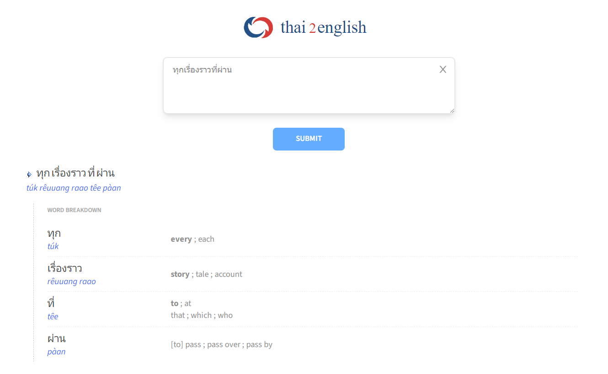
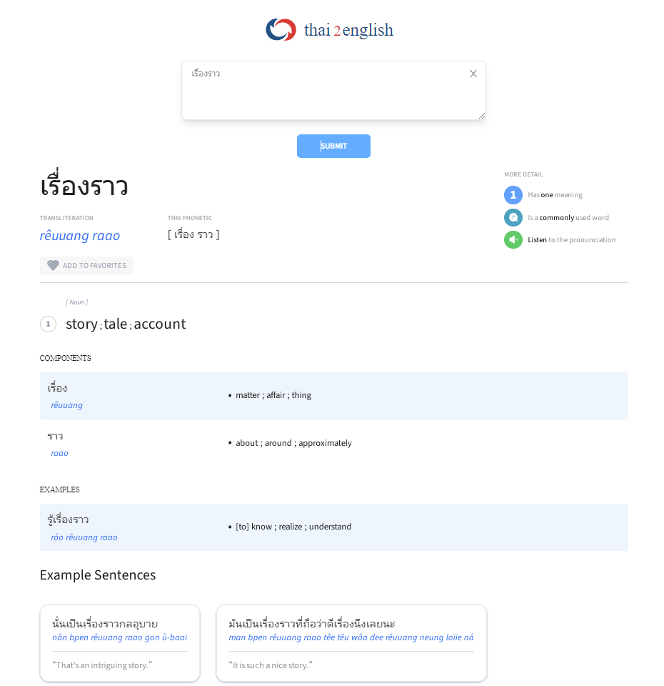
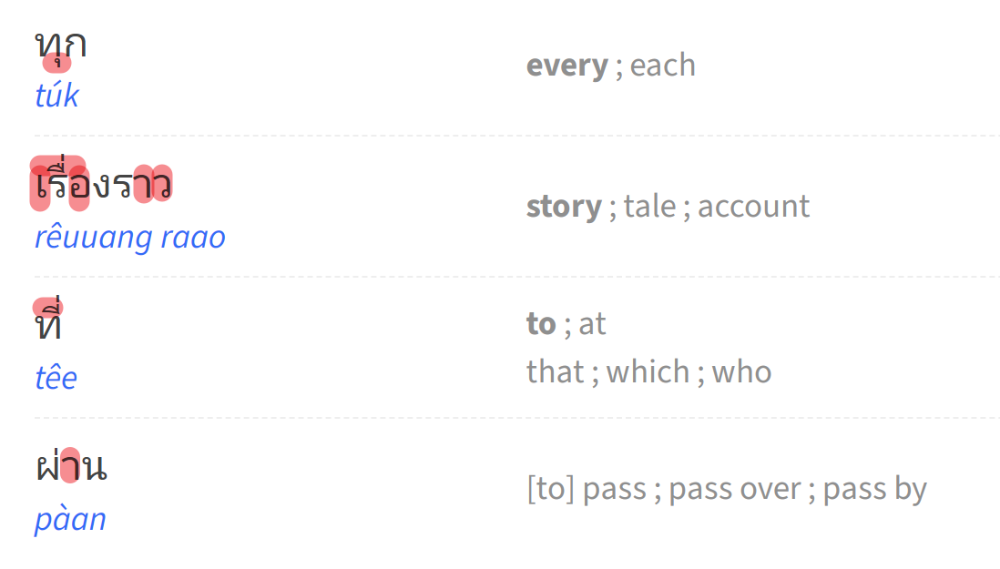
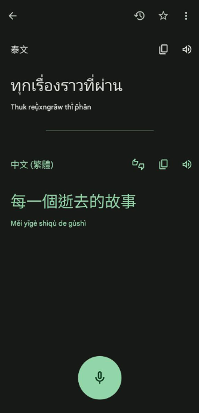
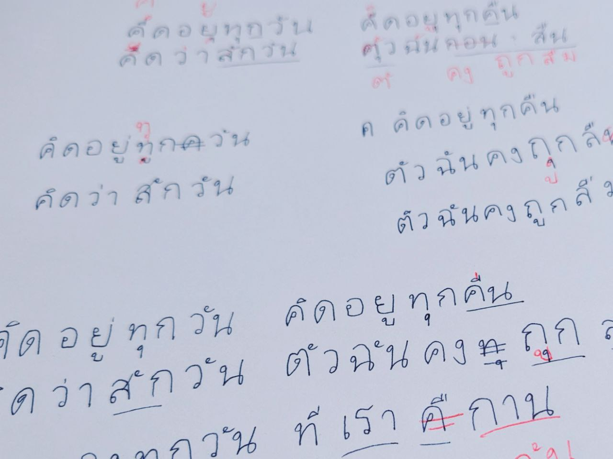
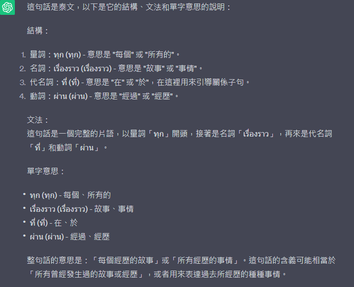
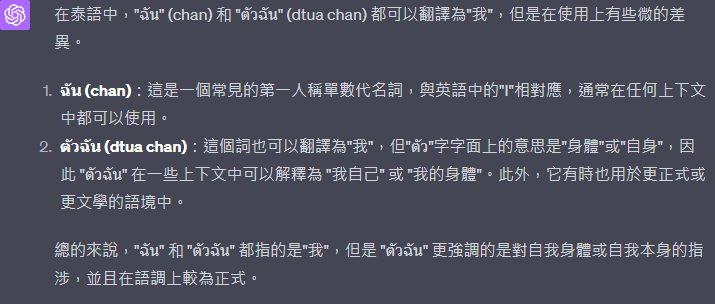

本來很有雄心壯志地想要等泰文很流利的時候再來寫一篇「教學」（到底哪來的自信），後來想想以我的三分鐘熱度說不定根本不會有那麼一天，與其這樣不如邊學邊筆記下來，一方面算是督促自己，一方面就算學到一半停擺了，哪天突然想回頭繼續也有個紀錄可以看。

這篇想先分享一下我的學習方法。這個方法的目的是**在學會唱一首泰文歌的同時，學習歌詞裡出現的子音跟母音，也順便學一些單字**。也許看到這裡你會疑惑：有現成的字母表可以直接記，為什麼要這麼大費周章呢？道理我都知道，但我就是做不到啊XD

我也試過拿著子音表從 ก 開始背，而且試了不只一次，卻從來沒有成功背完。後來在看[《黑幫少爺愛上我》](https://zeoutput.com/2023/01/kinnporsche-the-series-la-forte/)時聽到 [แค่เธอ (Why Don't You Stay)](https://youtu.be/s-MZid-59Hc) 這首歌，不禁幻想如果略懂吉他又能唱出泰文歌詞，是不是就能跟劇裡的 Kim 一樣帥氣又會有可愛的弟弟崇拜我呢？

結果在學歌詞的路上意外地堅持了下來，雖然還是差 Kim 大概十八個光年的距離，但至少學完這首歌後記得不少子音母音，也開始覺得學泰文還滿有趣的。

先說說目前覺得這個方法有什麼優缺點：

*   優點：
    *   **目標明確，容易持續。**把目標從「背完所有字母」變成「學完一首歌」，相對來說是一個更看得見的里程碑，也更容易有成就感。每多學一句歌詞，聽歌時就能跟著多唱一句，學完全部就能唱一首喜歡的歌了。如果單純背子音，就算背完了全部還是不太確定能做什麼，也沒辦法唱出一首歌（因為還要背完母音啊啊啊）
    *   同一首歌的歌詞裡常會有重複的單字，所以能很快記住特定單字
*   缺點：
    *   相反地，就算學完一首歌，也未必會學到所有的子音跟母音
    *   無法速成，比較沒效率

不能說是一個聰明的方法，但對我有用；不過如果比較習慣按部就班學習或想要學得快一點的話可能不太適合，請斟酌參考～

## Step 1. 找一首想學的泰文歌

喜歡的歌才有動力持續下去，溫馨提醒歌詞必須是泰文的，請不要選[泰國人唱的英文歌](https://youtu.be/8HnLRrQ3RS4)或是[泰國人唱的中文歌](https://youtu.be/BIaX7YjJkzU)。

## Step 2. 句子拆成單字

首先找出泰文歌詞之後，從第一句開始，**把歌詞丟進 [THAI2ENGLISH](https://www.thai2english.com/) 這個神奇的網站，它可以把一長串黏在一起完全看不懂的泰文拆成單字**，還會列出每個單字的發音跟意思。

舉例把 แค่เธอ 的第一句 ทุกเรื่องราวที่ผ่าน 丟進去它就會拆成這樣，看起來是否親切了許多：

也可以把拆出來的每個單字再丟進去看例句：

是不是非常神奇！這個網站對於從 0 開始的我幫助實在太大了，可以說沒有這個網站我根本不可能踏出第一步，誠摯推薦加入書籤。

## Step 3. 單字拆成字母，再用子音跟母音組回單字

能分出單字也大概知道意思後，接下來再從每句的第一個單字開始，**去字母表找出每一個字母的發音**。可以找個有發音、自己看得習慣的表來參考，手機 APP 有很多，或是網路上也有，我常用的是 funtolearnthai.com 的[子音表](https://funtolearnthai.com/consonants_list.php)跟[母音表](https://funtolearnthai.com/vowels_list.php)。

舉例 ทุกเรื่องราวที่ผ่าน 的第一個單字是 ทุก：

1.  先從子音表找出 ท 的發音是/th/
2.  再從母音表找出 อุ（下面那個小小的母音沒辦法單獨打出來）的發音是短促的/u/
3.  再從子音表找到 ก，因為放在單字最後面，發音要發/k/
4.  所以三個字合起來的發音是 /túk/

要提醒一下泰文的母音出現位置跟英文母音或注音符號不太一樣，不一定會好好長在正中間，有可能出現在上下左右（是真的…），如下圖是 ทุกเรื่องราวที่ผ่าน 這一句中各個單字的母音位置：

這個步驟一開始會有點挫折，不知道該從子音表還是母音表找，不過大概拆解到第二、三句開始，就逐漸能猜得出來了。

## Step 4. 練習句子發音

這樣把字母組回單字，再把單字組回句子之後，其實就能唱出來了。但想知道自己發音是否準確的話，可以在手機上下載 [Google 翻譯 APP](https://support.google.com/translate/answer/6350850?hl=zh-Hant&ref_topic=7011755&sjid=5259229427503340349-AP)。打開 APP 之後**把原文語言設定為泰文，譯文語言設定為中文 (繁體)**，接著**按下麥克風把剛剛學到的句子說一次**；如果APP能顯示和歌詞一樣的泰文或翻譯出相同意思，就表示發音對了。如果發音錯了也沒關係，跟著Google重新多唸幾次，或是回頭找出自己發音卡在什麼地方，多試幾次也會讓自己對句子的印象更深刻。

## Step 5. 記住字形

能唱出來之後，下一步就進到寫的階段。我自己試過之後覺得寫下來還是記住每個字母最有效的方法。我是看 [Let's Learn Thai!](https://youtube.com/playlist?list=PLznCJh4pLKufg0VeieNbxoAHmE_YQdJCq) 這個 Youtube 頻道學習怎麼寫每個字母；除了字母寫法， 她的發音說明也對我幫助很大，看得出嘴型相較於機器發音更容易模仿，而且她會把同一個母音的長音跟短音放在一起教，方便比較。

我習慣學會一句之後，**就唸著發音然後憑印象在紙上把字母默寫出來**，這時候就會發現有時候以為自己記住了其實沒有XD（如下圖，看得出來是哪一首歌嗎？）

記下自己錯誤的地方也有助於找出發音是否正確，例如我常在默寫時把 คุย 寫成 คื，那表示我這個字的發音很可能並不準確。

一邊寫的時候也可以整理一下目前學到哪些子音／母音、有哪些發音和字形是自己常混淆的，慢慢列出來以後就會發現自己學到的音愈來愈多了！

## Step 6. 重複 Step 1 ~ Step 5

第一句拆完已經認識了 6 個子音跟 5 個母音，第二句 ทุกค่ำคืนผ่านไป 丟進去會發現重複的字出現了，這樣就可以少學一個字啦！

就這樣重複這幾個步驟直到整首歌的歌詞都做過一次。

## 一點建議

如果你跟我一樣從 0 開始學泰文，想參考這個方法嘗試看看，有幾個小建議：

1.  如果使用電腦看泰文字母，建議把螢幕尺寸放大到 200% 以上，不然一些字很容易搞混，例如聲調的符號 อ้ 跟母音的字母 อั
2.  我覺得一邊記字形和發音一邊還要學聲調實在太難了（聲調就是長在字母上面的小東西，可以參考[這篇文章](https://erikkk.pixnet.net/blog/post/59053165)裡的符號表），而且只是唱的話聲調感覺不太影響，所以在學第一首歌的時候我都是無視聲調，從第二首歌才開始了解聲調（但還是覺得好難）
3.  不要給自己太大壓力，一天學一句就好，就算只是每天一句一個月也能學會一首歌的（除非那首歌超長…）

## 學習文法

剛開始學的時候我不太管文法，只專注在記住發音和字形，但久了以後也會好奇到底句子是怎麼拼成歌詞的意思。因為太懶了我直接把句子丟進 ChatGPT，例如：「請說明這一句話的結構、文法和單字意思：ทุกเรื่องราวที่ผ่าน」，以下是 ChatGPT 的回答：

也可以問一些單字用法，例如我一直很疑惑：ฉัน 和 ตัวฉัน 的分別是什麼（這是GPT-4的回答，我覺得回答的品質比GPT-3.5好）

希望這個分享能對想學泰文的朋友有所幫助，尤其是和我一樣背字母表有障礙的朋友們。

大家一起開心地（？）來學泰文吧！一起迷失在母音的汪洋中吧！

