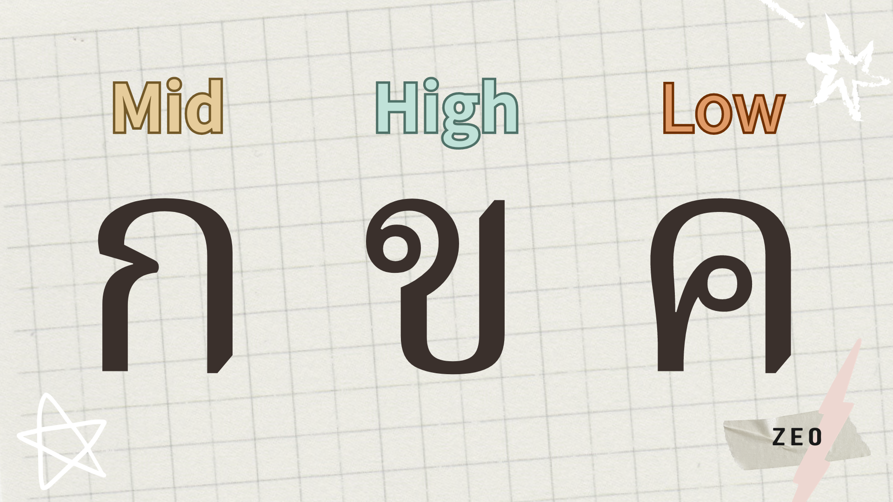
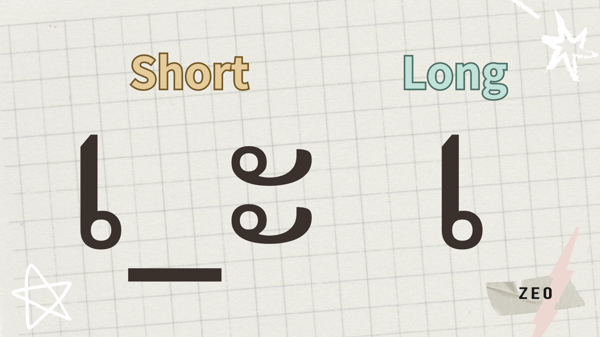
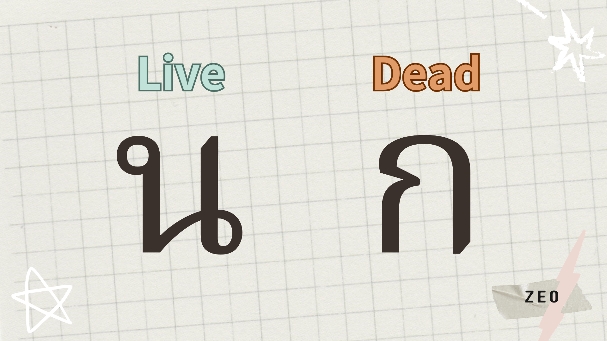
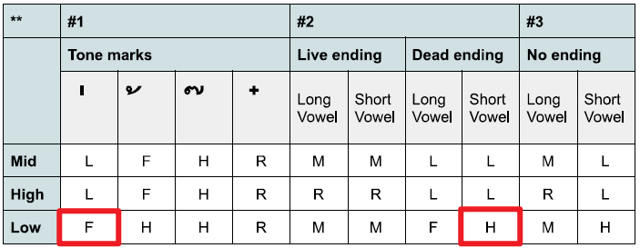
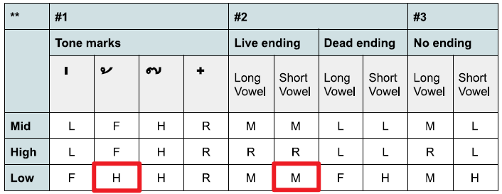
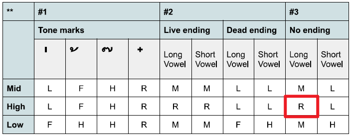

上一篇〈[泰文小筆記 EP.2]()〉提到我報名了泰文課程，這一篇想分享我在 Level 1 課程中最主要的學習內容——泰文聲調。文章內容分為以下幾個部分：

*   [什麼是泰文聲調（Thai Tones）](#what-is-thai-tones)
*   [泰文聲調的發音](#pronunciation-of-thai-tones)
*   [影響泰文聲調的因素](#factors-of-thai-tones)
    *   [1 子音的群組](#consonant-class)
    *   [2 母音的長短](#vowel-type)
    *   [3 尾音的種類](#ending-consonant-type)
    *   [4 是否有聲符](#tone-mark)
*   [泰文聲調發音規則 & Cheatsheet](#thai-tones-rules)

## 什麼是泰文聲調（Thai Tones）

*   泰文和中文一樣，每個詞都有明確的聲調，可以想成類似注音符號的一二三四輕聲。
*   同樣的子母音組合，在不同的聲調下就會變成不同的詞，例如中文裡一聲ㄓ的「之」跟四聲ㄓˋ的「至」也是不一樣的意思。所以如果沒辦法正確發音，說出來的句子很可能意思完全不同。

## 泰文聲調的發音

可以先聽聽看這兩個影片，初步了解五種聲調發音的不同：



 



也可以看推特上網友整理的[這幾張圖](https://twitter.com/net_drifter/status/1395873796272398347/photo/3)，下面留言他也有示範每個聲調的發音。

如果嘗試用注音去比喻我理解的聲調發音，大概會是：

*   Mid tone：類似注音一聲（ㄓ），但尾音稍微往下一點點
*   Low tone：類似注音四聲（ㄓˋ）
*   High tone：類似注音二聲（ㄓˊ）往上的感覺，但是假如二聲是往上一層，泰文的 High tone 大概要往上三層，而且斜度更高，是一種快速從平地衝到三層樓的感覺
*   Rising tone：類似注音三聲（ㄓˇ）先下後上的感覺，但是假如三聲是往下一層，泰文的 Rising tone 大概是往下兩層，再往上回到平地
*   Falling tone：注音沒有對應的聲調，方向是先上後下，大概是往上兩層後直接往下掉的感覺

聲調真的有點難心領神會，只能多聽多講；有時候我聽完覺得都理解，但換成自己要講出來又是另一回事。

聲調的發音規則剛開始看雖然很複雜，不過練習久了就會比較熟悉了，反倒聲調的發音一直都讓我覺得要發得精準其實很困難。

## 影響泰文聲調的因素

影響泰文聲調組成的因素比注音複雜很多，無法單純依照聲符（類似注音中ˋˊˇ˙的東西）來判斷，必須要結合以下幾種因素才能判斷正確聲調：

*   子音的群組
*   母音的長短
*   尾音的種類
*   是否有聲符

以下就逐一說明這些因素，在文章最後也會附上我自己使用的 Cheatsheet 希望能幫助大家快速判斷出一個詞的聲調。

### 1 子音的群組

子音的對應聲調根據所屬群組（Mid / High / Low）而不同，可以看[這個表](https://funtolearnthai.com/consonants_list.php)的「Class」來確認群組。如果你在這個網站上聽 ค 跟 ข 的發音，會發現即使這兩個子音的拼音都是 /k/，但聲調稍有不同，ค 的聲調比較平（Mid tone），ข 的聲調則有先低後高的感覺（Rising tone）；這是因為 ค 屬於 Low 這個群組，而 ข 屬於 High 這個群組。在我之前推薦的[子音學習影片](https://youtu.be/DEJmG-uvZ3U?si=nPsjjW_oyt0y9DNe)，也可以從老師的發音聽出 ค (02:15) 和 ข (01:00) 發音的不同。

這三個群組有各自對應的基本聲調——指的是在 ① 沒有聲符、② 也沒有 Dead Endings 影響之下，③ 搭配長母音時的聲調，所以當這些子音放在字首時，如果符合以上條件，就要根據它所在的群組去判斷音節的聲調。

*   Mid 群組子音基本聲調：Mid tone
*   High 群組子音基本聲調：Rising tone
*   Low 群組子音基本聲調：Mid tone

### 2 母音的長短

泰文母音有長短音之分，通常是兩兩一對，例如 เ 跟 เ\_ะ 分別是長音跟短音的ㄟ。母音屬於長或短一樣可以看[這個表](https://funtolearnthai.com/vowels_list.php)，或是看[這系列的教學影片](https://youtu.be/4_XYfzWmRD4?si=-AVEnbwUrJ52BuPC)。

### 3 尾音的種類

和注音符號中ㄅ永遠在上面當字首，ㄤ永遠在下面當字尾不同，**泰文子音有可能出現在字首或字尾**。而尾音指的就是當一個子音被放在音節最後一個字時的發音，可能會跟子音原本的發音不同，例如 ญ 放在字首時發 /y/，但放在字尾時發 /n/。

尾音分成兩大類：Live Endings 跟 Dead Endings。基本上只要記得 Dead Endings 有這三個尾音：ก、บ、ด，其他尾音都是 Live Endings。可以看這篇文章的[第一張圖](https://www.bananathaischool.com/blog/blog-ending-consonants/)，列出了所有泰文尾音以及對應的子音，前三個是 Dead Endings，其他都是 Live Endings。

### 4 是否有聲符

泰文總共有四個聲符，但不像注音符號裡「ˋ」永遠是二聲、「ˇ」永遠是三聲，**泰文的每個聲符不一定總是對應到同一種聲調**，而是會因為前面提到的子音群組影響，而變成不同聲調。

## 泰文聲調發音規則 & Cheatsheet

知道這些要素之後，發音規則可以用以下順序判斷

1.  有沒有聲符：有聲符，優先根據聲符的發音走
2.  尾音類型：沒聲符但有尾音，根據尾音判斷
3.  以上都沒有：沒聲符也沒尾音，根據母音長短和子音的 Class 判斷

可以按這裡下載 Cheatsheet，看最後一部分的聲調規則速查表來快速判斷一個音節的音調：

[下載 Cheatsheet](Thai-Tone-Cheatsheet.pdf)

以下舉一些單字當作使用 Cheatsheet 的範例：

**น่ารัก（可愛的）**

*   第一個音節 น่า 有聲符，先確認第一個子音 น 的群組是 Low Class，而「่」這個聲符在搭配 Low Class 子音時是發 Falling tone
*   第二個音節 รัก 沒有聲符，有尾音 ก，是屬於 Dead Endings，母音 รั 是短母音，而第一個子音 ร 的群組是 Low Class，短母音＋Dead Endings 在搭配 Low Class 子音時是發 High tone
*   所以 น่ารัก 的兩個音節音調，分別是 Falling tone 和 High tone

**วันนี้（今天）**

*   第一個音節 วัน 沒有聲符，有尾音 น，是屬於 Live Endings，母音 วั 是短母音，而第一個子音 ว 的群組是 Low Class，短母音＋Live Endings 在搭配 Low Class 子音時是發 Mid tone
*   第二個音節 นี้ 有聲符，先確認第一個子音 น 的群組是 Low Class，而「้」這個聲符在搭配 Low Class 子音時是發 High tone
*   所以 วันนี้ 的兩個音節音調，分別是 Mid tone 和 High tone

**หมา（狗）**

這類是我在學發音之前超困惑的單字，因為前面有一個 ห，**這表示要用 ห 所在的群組來判斷發音**。

*   這個單字沒有聲符也沒有尾音，า 是長母音，而第一個子音 ห 的群組是 High Class，長母音在搭配 High Class 子音時是發 Rising Tone
*   所以 หมา 這個單字的音調是 Rising Tone

* * *

理解音調規則之後，解開我以前自學時很多的疑惑和困擾；像是終於知道為什麼有些音節前面要放一個不發音的「ห」，也終於認得這些在子音上面的聲符，不用再假裝它們不存在了🤓