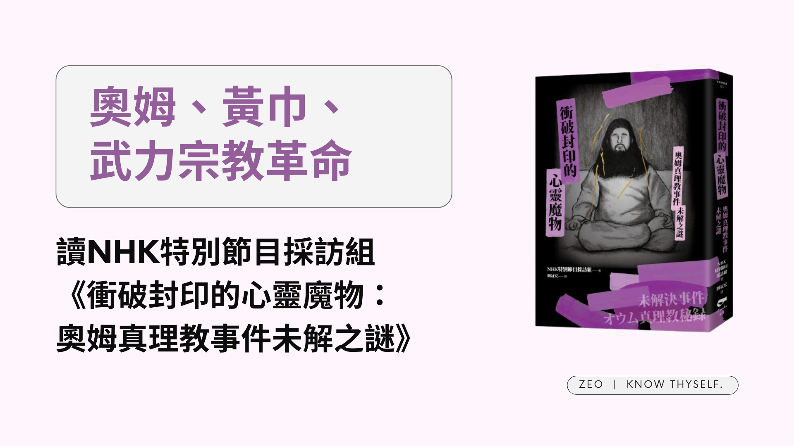

## 為什麼想讀這本書

最初是在看某篇報導時從關聯文章發現[一篇書評](https://www.twreporter.org/a/bookreview-nhk-unsolved-cases)，進而對這本書產生了興趣，原因倒不是想了解奧姆真理教的事件，因為相關資料網路上查一查其實也很多；而是因為最近在看三國志（也太無關），對於太平道／黃巾軍產生很多疑惑。

怎麼說呢，雖然知道黃巾之亂開啟了三國時代，也讀過關於太平道不同的看法（明確的道教革命組織 vs. 單純的宗教狂熱團體），但可能因為時代背景真的相差太多，很難想像在當時太平道在當時人心中具體是一個怎樣的存在，而當時人又受到了太平道怎樣的影響。

這件事情讓我始終困惑著，所以看到書評中的一些關鍵字，例如「奧姆真理教延續時間長，教徒眾多，活動範圍廣」，當下突然就聯想到太平道，於是想說或許可以嘗試看看其他資料來觸發一些想法。**不過這只是我個人為了便於理解才做的類比，並不是說兩個事件真的有多相似**，實際上看完之後我覺得有像的地方但也有許多不同，後面會再詳述我的看法。

<!-- more -->

**_Warning 📢 觀影筆記和讀書筆記都會涉及劇情，請斟酌閱讀。_**

## 關於奧姆真理教

簡要介紹一下從書中理解到的奧姆真理教歷史。一開始教主麻原彰晃（以下簡稱麻原）成立的是單純的瑜珈團體「奧姆神仙會」，後來才轉變成宗教意味更濃厚也更規模化的奧姆真理教（以下簡稱奧姆）。根據書中記者採訪到的前信徒說法，一開始在奧姆的生活都是很單純的宗教活動，像是講道、瑜珈、冥想等等。

關鍵性的事件是一名信徒在奧姆的修行道場意外死亡，奧姆內部秘密處理屍體而未對外通報，這是第一起已知的違法事件，此後就一路失控。在教團內秘密殺害信徒、計畫性殺害幫助前信徒脫離教團的人權律師一家、開始大量購入土地建造武器工廠，與此同時麻原應該也開始層層「精煉」出能幫助他實現武裝計畫的信徒，所以並不是每個人都知道教團正在製造武器，只是或多或少感覺到教團的氛圍似乎變得不太一樣。教團持續攻擊可能對教團造成負面影響的內外部人員，其中也包含政府官員；同時也不斷擴大影響力，例如設立海外分部、參與選舉等。期間地方警察陸續和奧姆進行著攻防，最後總算掌握了可以強制搜查奧姆的證據，無奈奧姆仍發動了震驚世界的地下鐵毒氣事件。

最讓我意外的是，雖然參與犯案的教團成員被判處刑責，但因為調查單位最後無法取得足夠證據起訴奧姆，反而被奧姆（後改名為Aleph）以傷害教團形象的名義起訴求償。**也就是說時至今日，奧姆都沒有真正解散，仍以別的名字繼續存在著**，甚至從書裡的訪談也能感覺到麻原還是對信徒存在著或多或少的影響力。

值得一提的是，過往普遍認為敗選是致使奧姆轉向武裝化的原因。但在記者聽取麻原講道及與信徒交談的七百多卷錄音，並交叉比對前幹部證詞後，**發現其實麻原從最一開始就有訴諸武力推翻政府的想法，而且目的性地以「救贖」之名去包裝殺戮**，好讓犯罪行徑在信徒心中被合理化。

## 信徒觀點的奧姆真理教

那奧姆又是如何從一開始的「瑜珈團體」逐漸變成後來的「武裝恐怖組織」？讀完這本書我覺得有幾個可以關注的點：

### 早期的奧姆

*   時代背景：奧姆興起時正值日本泡沫經濟的入口（經濟起飛期），在物質生活充裕的表象下，年輕人們的內心卻充滿空虛與迷惘，或是和父母輩重視金錢和物質的價值觀產生衝突。部分人轉向宗教或神祕學尋求慰藉和生存意義，正巧碰上了奧姆。
*   迷惘心靈：在這樣的時代背景下，在生活上受挫或尋求生命更大意義的年輕人，受到麻原本身的魅力吸引或感受到修行對他們的幫助，因而紛紛入教。從記者的梳理可以注意到，許多後來被判刑的重要幹部都是在求學時期就入教。
*   實質幫助：部分受到麻原的講道啟發或是感受到靈性經驗才入教的信徒覺得，奧姆提倡的教義確實對他們的人生產生實質影響。甚至在奧姆私下進行的非法行為公諸於世後，仍有前信徒表示即使這樣也無法否認在奧姆確實學習到很多。
*   個人魅力：由於NHK取得數量龐大的麻原講道錄音帶，記者於是請了年輕助手一起幫忙消化資料。眾人在聽的同時都能感覺到麻原在講道時善於鼓舞和煽動人心的特質，年輕助手甚至表示「麻原真的是壞人嗎？他很有魅力呢。」

### 出家信徒的奧姆

> 既然出家將自己獻身給奧姆這種「宗教」，那麼世上的常識就與我無關。甚至，還會加入「自己正在拯救世人」這種特別的意念。由於失去了後悔或躊躇的感受，奧姆漸漸變成一個排他的組織……。  
> 〈第一章　教團為何失控〉

> 這樣的日常周而復始，她整理心情「我會心有不滿，是因為自己的修行還不夠」，便不再對小事生氣或內心動搖。因為她領悟到，這樣比較輕鬆、不會累積壓力。另一方面，她變得無法深入思考，漸漸失去現實感。  
> 〈第三章　奧姆武裝化的真相〉

*   與世隔絕：奧姆的信徒分為在家信徒和出家信徒，出家信徒必須要布施一切財產給奧姆並搬進奧姆道場過著修行生活，基本上算是與外界隔絕。在這樣的生活狀態下，**信徒感知真實世界的一切，包含道德、法律、常識等等的現實感會降低**，使得信徒更容易接受麻原灌輸的一切，也更容易對於在教團發生的任何事淡然以對，即使看起來有悖於常理。
*   曲解原典：麻原在講道時會引用各種不同宗教的經典，以佛教為主，但也雜揉了宇宙、基督等思想，基本原則就是擷取原典中對於傳道有利的部分，並將其轉化成麻原自己想要表達的意思，在原意被扭曲的狀況下灌輸給信徒。
*   絕對服從：麻原也在講道中灌輸信徒要服從上師旨意，**在信徒被植入遭曲解的原典以及絕對服從麻原的想法後，麻原便得以利用宗教操控信徒做出非法行為**。書中出現多次的是麻原與信徒討論「頗瓦」的例子，頗瓦原意並不是要取人性命，但在麻原的刻意誤導下，便出現了如果是上師（麻原）的意思，即使取人性命也是救贖那個人的結論。
*   被迫加入：由於出家的信徒便脫離了原本的家庭和人際圈，許多父母出於擔心不得已隨子女加入奧姆，也有為了情人被迫加入奧姆的例子。我認為當親近的人都一起加入奧姆，會使得奧姆凝聚力更強，同時也更加排外。

### 轉向極端的奧姆

> 一九八八年八月，他（麻原）在富士山附近的富士宮開設公社。報告指出，從這個時候開始，教團的想法就從拯救世界人民，變成只有加入奧姆真理教的天選之人才能得到拯救。
> 
> 〈第五章　事件還沒有結束〉

*   層層揀選：麻原雖然在講道中潛移默化地灌輸以救贖包裝的殺戮思想，但對於實際協助他執行武裝革命計畫的幹部，他仍會層層篩選。例如從講道互動中對信徒做初步測試，看看信徒是否確實接受了這套思想（上面提到討論頗瓦的例子）；或是以試煉包裝迫使信徒做出非法行為，以測試信徒的忠誠度。
*   非法手段：後期的奧姆為了擴張規模，會在修行時令信徒服下奧姆非法私造的興奮劑，以讓信徒以為在修行中真的獲得靈性體驗，來藉此增加信徒；為了維持凝聚力（一方面應該也是擔心信徒洩密），對於叛教信徒的手段則更激烈，不但會被強制注射抑制鎮靜神經的藥物，甚至會被施予電擊，並在身心脆弱的情況下被不斷說服留在教內、被關在單人房內悔過。另一方面，為了取得更多資金，教團也不惜以綁架威脅等手段詐取信徒家人的財物。
*   塑造對立：奧姆參選失敗後，為了維護麻原的救世主形象，教團開始宣傳敗選是因為對奧姆不滿的有心人士介入選舉的說法，刻意在教團內塑造社會和奧姆的對立，
*   被揀選的：在營造出奧姆和（奧姆以外的）社會對立的氛圍後，教團進一步激化這樣的情緒，宣揚只有奧姆內的人才是被揀選的，除此之外的人則需要被救贖。

這邊只梳理了奧姆在思想及制度上的轉變，書裡也有提到奧姆私造武器的過程，如果有興趣可以自己去閱讀。我讀完只能說是毛骨悚然，一個宗教團體竟然可以取得這麼多的資金跟資源去建造工廠、實驗室跟醫院，並實際製造出各種生化武器。

我覺得奧姆沒造成更大傷害，一部分可能也歸功於日本社會的排他性（？），因為奧姆蓋武器工廠的小村子很排外，對於可疑的外來人士非常警醒，才使得奧姆的一部分武器生產被迫中斷。但更可怕的是有些經過轉移的武器原料和非法武器去向至今都沒有被查出來。

## 實際讀完後和太平道比較

回歸到讀這本書的奇妙初衷，那實際讀完究竟覺得奧姆和太平道有可以對照著看的地方呢？

### 兩者相似的地方

*   都以宗教團體發跡：
    *   太平道：鉅鹿張角自稱「大賢良師」，奉事黃老道，畜養弟子（《後漢書》）
    *   奧姆：初期主要以佛教思想傳道
*   對信徒或多或少有某種層面上的幫助：
    *   太平道：符水咒說以療病，病者頗愈，百姓信向之（《後漢書》）
    *   奧姆：主要給予信徒心靈上的慰藉
*   都提倡追求一個更好的世界：
    *   太平道：「蒼天已死，黃天當立，歲在甲子，天下大吉」（《後漢書》）
    *   奧姆：把世界創造成可以讓所有人用盡一生實踐真理的空間（建立宗教國度）
*   地域廣泛的長年經營：
    *   太平道：十餘年閒，眾徒數十萬，連結郡國，自青、徐、幽、冀、荊、楊、兗、豫八州之人，莫不畢應。（《後漢書》）
    *   奧姆：信徒及道場遍布日本全國甚至海外
*   信徒滲透到社會各個層面，包含政府組織：
    *   太平道：靈帝以周章下三公、司隸，使鉤盾令周斌將三府掾屬，案驗宮省直衛及百姓有事角道者，誅殺千餘人（《後漢書》）
    *   奧姆：書裡提到像警察組織裡面也有奧姆信徒，導致警方在對奧姆出手前消息就已經走漏
*   有類政府的組織編制：
    *   太平道：遂置三十六方。方猶將軍號也。大方萬餘人，小方六七千，各立渠帥。（《後漢書》）
    *   奧姆：模仿日本國家體制，有不同的省廳和官員
*   試圖武裝革命：
    *   太平道：角等知事已露，晨夜馳敕諸方，一時俱起。皆著黃巾為摽幟，時人謂之「黃巾」，亦名為「蛾賊」。殺人以祠天。…所在燔燒官府，劫略聚邑，州郡失據，長吏多逃亡。旬日之閒，天下嚮應，京師震動。（《後漢書》）。但實際上對於太平道是否真的一開始就想要起事，或者只是狂熱宗教活動最後失控，這部分仍有不同看法。
    *   奧姆：麻原一開始就有武裝革命推翻政權的想法，前面已經講過。

### 兩者較不同的地方

單純就自己看到覺得不同的地方列出，不表示太平道真的是或不是這樣。

*   布施：
    *   奧姆：提倡布施，出家強制布施財產
    *   太平道：沒特別提到治病要付錢，不過有提到信徒「或棄賣財產、流移奔赴，填塞道路，未至病死者亦以萬數。」（《資治通鑑》）
*   提供的服務：
    *   奧姆：歸屬感、成就感、意義感，偏心靈面的救贖
    *   太平道：治病，偏生理面的救贖
*   威脅性：
    *   奧姆：一開始給人的感覺是詭異但無害的宗教團體，威脅性源於開始非法行為
    *   太平道：
        *   一開始地方政府不覺得需要留意：郡縣不解其意，反言角以善道教化，為民所歸。（《資治通鑑》）
        *   是中央政府察覺到流民群聚移動的問題，威脅性源於大量聚眾：太尉楊賜時為司徒，上書言：「角誑曜百姓，遭赦不悔，稍益滋蔓。今若下州郡捕討，恐更騷擾，速成其患。宜切敕刺史、二千石，簡別流民，各護歸本郡，以孤弱其黨，然後誅其渠帥，可不勞而定。」（《資治通鑑》）
*   教主的權威地位：
    *   奧姆：要求服從麻原，最好不要自行思考
    *   太平道：只要求悔過，比較沒提到對張角的個人崇拜
*   出家制度：
    *   奧姆：提倡出家，創造價值觀單一、與世隔絕的環境
    *   太平道：不強調出家，但信徒自發跟隨，「或棄賣財產、流移奔赴，填塞道路，未至病死者亦以萬數。」（《資治通鑑》）
*   製造武器：
    *   奧姆：私造武器
    *   太平道：沒特別提到武器方面的準備

整理到這邊有一個比較深刻的感受，**那就是奧姆很大程度上依附於提供心靈信仰的「教義」（麻原版本，非原典），這個教義為很多麻原的意志背書，而且只要植入教徒的價值觀就後就能讓教徒自發性地以此去解釋和合理化周遭的一切**，這就是為什麼即使要求信徒去做違背常理的事他們也能接受，以及為什麼信徒在教團的非法事件曝光甚至麻原本人伏誅後，仍然持續相信麻原、相信奧姆。

太平道則比較依附於生理上的需求，**處理的是實際的病痛問題**，教徒依從是因為相信能夠病癒活下去，在天災人禍疫病不斷的時代自然受到各階層大眾歡迎，畢竟就算是有錢人也會生病嘛，資源貧乏的底層人民就更不用說。但缺點就是當教主和渠帥們相繼死去（甚至不知道渠帥有沒有治病能力，還是只是管理職務），能獲得的實際價值消失了，信徒很容易就失去凝聚力。~所以革命還是要靠意識形態吧。~

另外一點是書裡蠻詳細整理出各地警察和奧姆的攻防，但記者和不少警政單位的成員最後也得出結論，警察和政府組織的編制和作業方式上的限制（不能跨出轄區去處理轄區外的案件），亦是沒能更早阻止奧姆犯下憾事的原因之一。不知道這個情形在東漢末會不會也是一樣，因為太平道信徒／黃巾軍是跨州郡移動的，實際上州郡官府能做的也只有回報政府，讓政府以中央的名義去處理；但如果政府沒有下達命令，其實州郡好像也沒有權力能做什麼。

## 讀完的其他想法

> 奧姆在單一的價值觀下「成長茁壯」。在我大量接觸審判紀錄與其他信徒手記的過程中，逐漸可以體會到這件事。以下是我自己的解釋。這件事用現代話來說，大概就是可以藉由出家「重置」（reset）人生吧。社會的束縛、過去的自己也都可以重置，而且出家後的生活有保障，也能藉由「救贖」他人得到滿足感。我認為，若社會階級固化，持續強化閉塞感、累積負面情緒，今後出家的需求可能會再度增加也說不定。
> 
> 〈第一章　教團為何失控〉

凡是人都有脆弱的時候，在身心狀態不好的情況下，很容易對提供幫助或慰藉的人事物產生好感；尤其在身心狀態不佳的時候，判斷力也不會像平常那麼敏銳，就更難察覺到異常。

加上如果在那時候有什麼賦予了這份痛苦意義，也許真的會把它當作救贖也不一定，而一旦產生這樣的想法後面就會更難去否定它，否則前面忍受痛苦就又沒有意義了。

因此讀完這本書我其實覺得也很難去質疑信徒「為什麼會相信」或是「不覺得奇怪嗎」，換個角度想處在那樣的時空背景下，我也不敢說自己一定不會做出同樣的選擇。所以我更覺得前陣子心靈課程風波中，那些願意出來分享經驗的人真的非常勇敢，他們的決定幫助了很多人。

至於個人層面要怎麼去面對這樣的情況…我覺得可能是學習接受痛苦也是一種正常的狀態，悲傷也是一種正常的狀態，不好的狀態也是一種正常的狀態。人不一定都要功成名就或子孫滿堂或一定要怎樣才是「正確」或「正常」，只要活著其實就已經很了不起了。

記得之前看過一個影片在講活在當下，講者的孩子意外過世了，她沉浸在悲傷之中，又覺得自己應該設法走出來；但有一天她突然醒悟到，其實悲傷也沒有關係啊，悲傷的狀態也只是一種狀態。在接受了自己可以有悲傷的狀態之後，她反而感受到了解脫。

雖然這樣說但我也知道要內化這個想法其實很難，而且人天生都是想要找到存在價值跟想要得到成就感的。不過在這點上我確實覺得媒體（包含社群媒體）對於強化這樣的情緒必須負很大的責任：為了吸引點擊、曝光和消費，而去鼓勵比較和鼓吹成功，進而讓人更容易覺得自己不足、覺得自己需要更多。

在思考這些的時候，我一直想到之前讀過的[《夠好的工作》](https://zeoutput.com/2024/02/the-good-enough-job/)，我覺得裡面有很多概念在這樣的情況下也是值得拿來參考的。

現在就是夠好的狀態，你已經夠好了，你不需要再「更」怎樣了。

---

**衝破封印的心靈魔物：奧姆真理教事件未解之謎**

*   作者：NHK特別節目採訪組
*   譯者：劉冠宏
*   出版年份：2021
*   出版社：凌宇
*   閱讀平台：Google Play 圖書
*   閱讀時間：2026-01