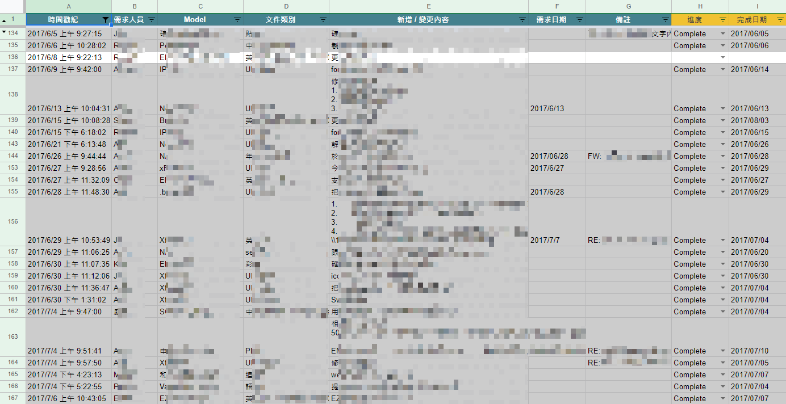
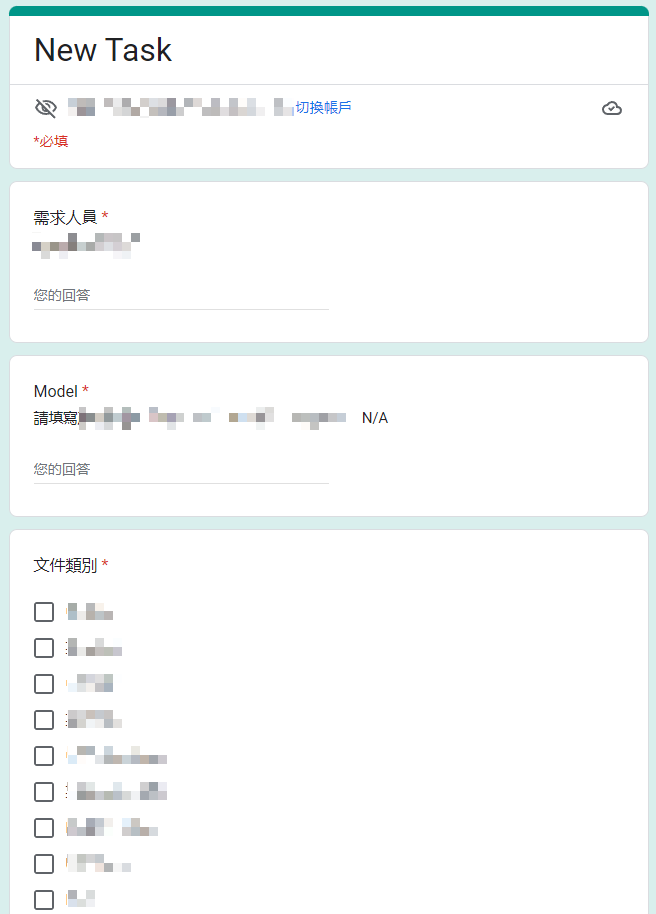
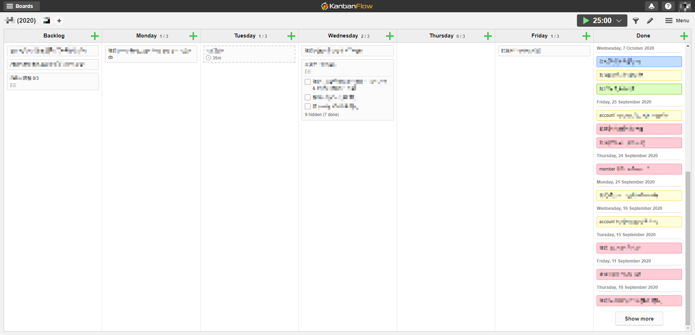
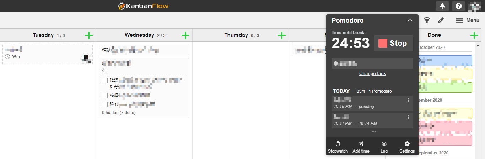
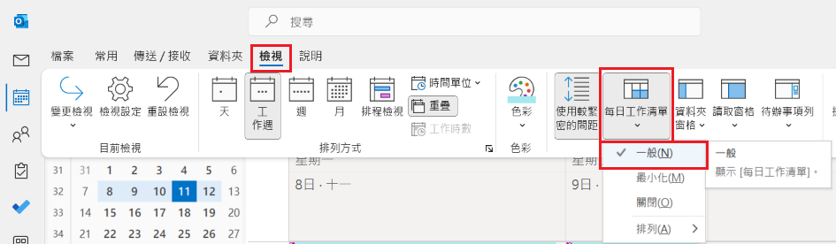
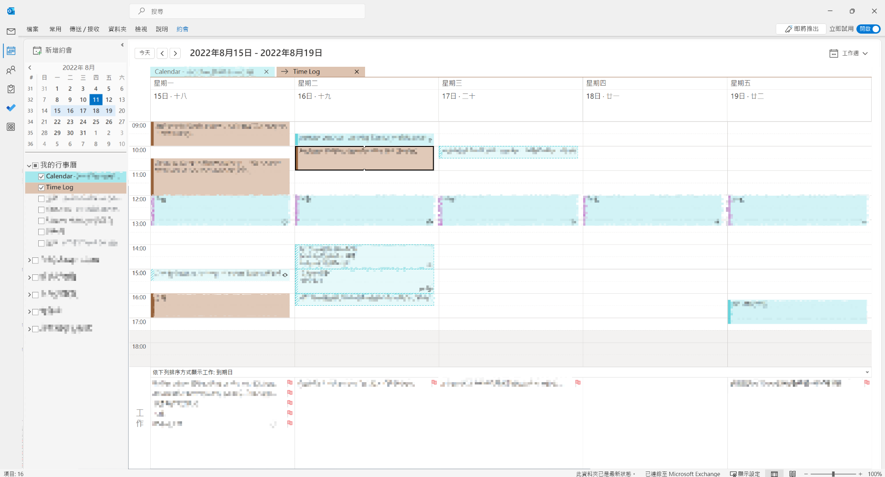

O365 是許多公司採用的辦公軟體方案，通常員工一天裡會有大量時間在 O365 的工具上作業，如何利用這些工具管理任務才能增進效率呢？

我花了一些時間在 O365 摸索出現在的管理任務方式，希望能帶給有一樣困擾的朋友（有人在困擾這種事嗎）一點靈感，也回顧一下自己這一路以來，任務管理方式的演進過程。
<!-- more -->

Photo by [Annie Spratt](https://unsplash.com/@anniespratt?utm_source=unsplash&utm_medium=referral&utm_content=creditCopyText) on [Unsplash](https://unsplash.com/?utm_source=unsplash&utm_medium=referral&utm_content=creditCopyText)

## 紙本

隨著每個階段任務的性質不同，對管理工具的需求也不一樣。

剛開始工作時，由於很多任務有週期性，例如月底要結帳、每週要回報數量，或是預期每幾週要進貨一次，當時還不太懂數位任務管理的概念，因此我是用[自填日期的週記本](https://www.muji.com/jp/ja/store/cmdty/detail/4550182109740)來記錄。

當時的需求主要是能快速紀錄任務，並一目了然本週及近期要做的事情，而且當主管詢問某件事會在何時發生時，能夠快速查閱紀錄來回覆。事實上以週為單位管理任務的模式從那時開始就一直保留到現在，只是從紙本轉為數位的形式。

不過紙本的缺點是，一旦計畫改變就必須手動把原計畫劃掉，翻到新的日期再寫一次，工作量多或變更頻繁的時候其實不太方便。而且如果資訊太多，當天的格子就寫不下了，版面也容易顯得雜亂。

## Google Sheets

之後的任務大多是隨著專案而來 ，常常手上同時有數件專案的任務，還有其他大大小小的需求；因此除了紀錄任務外，也要能知道每個工作的進度、對應的專案或是需求人員，以方便每週或是每天安排工作時，知道還有哪些任務沒完成或是哪些任務較緊急。

所以我當時自己設計了一個 [Google 表單](https://www.google.com.tw/intl/zh-TW/forms/about/)，讓我能快速填入任務的資訊，填好送出後資訊就會整齊地列在 [Google Sheets](https://www.google.com.tw/intl/zh-TW/sheets/about/) 上，這就是我當時的任務版。

Google Sheets 的篩選功能除了能用狀態找出待辦任務，也能以專案篩選，知道某個專案還缺哪些東西，或是用需求人員篩選，列出哪些事項要跟該位同事一併確認。

自己設計的 Google Sheet 任務清單

自己設計的 Google Sheet 任務填寫表單

## Jira

[Jira](https://www.atlassian.com/software/jira) 應該是許多敏捷團隊熟悉的工具，它的本質偏向專案團隊任務管理平台，不過在個人任務管理上也很方便。在 Jira 可以預排自己預計在何時用多久完成任務，實際開始後也能記錄花了多久完成；一方面能預留時間給應完成的任務，一方面也能比較預想和實際上執行任務的時間差異（當然預想通常都很美好…）。

不過事隔久遠，我已經不記得這個功能叫什麼名字、在什麼介面，是預設的還是另外裝了外掛，只記得這功能太好用以至於後來的工作都還是對它念念不忘。

## Kanban Flow

在離開使用 Jira 的團隊後，還是想找個有預排任務功能的免費解決方案，但是始終沒有找到，取而代之的是可以自己定義看板＋內建番茄鐘的 [Kanban Flow](https://kanbanflow.com/)。

雖然沒有心心念念的預排任務功能，但 Kanban Flow 的優點是設定靈活有彈性，操作簡單好上手，介面是樸素了點，但是該有的功能都有。它可以自訂看板，一般看板通常分成 To Do、In Progress、Done，但在 Kanban Flow 可以自行增加看板及設定名稱。我當時因為希望能預排一週任務，自訂了 Backlog＋週一～週五＋Complete 共 7 個看板（神奇的是用 7 個看板也不會很擠，就算覺得很擠，也可以收合看板）。

自訂的 7 個看板

任務則可以設定子任務，也可以選擇到期日，還可以根據專案用顏色分類。在記錄任務工時上，可以直接用番茄鐘紀錄，時間到了會跳提醒，如果中途被打斷還可以記錄被打斷的原因，例如同事跟老闆一直來煩我（不過要在同事面前按這個需要一點勇氣）。除此之外，還能產生報表檢視自己每天大概能做幾個番茄鐘，或是大多是什麼原因被打斷工作。

Kanban Flow 內建的番茄鐘

Kanban Flow 唯一的缺點就是不像大型軟體 Jira 或 O365 有那麼多整合（官網是說可以透過 API 串，但沒有內建），如果想在任務中加入文件連結，需要手動複製貼上。雖然有點不便，但如果對這方面需求不高，我還滿推薦 Kanban Flow 這個工具。

## O365 - Microsoft To Do

用 O365 的初期我很直覺地找了微軟預設的任務管理工具 [Microsoft To Do](https://www.microsoft.com/zh-tw/microsoft-365/microsoft-to-do-list-app?rtc=1)。我將每個專案各自建一個清單，用清單去分類工作。

To Do 最大的好處是和家族成員的整合，例如在 Outlook 上標幟的郵件會自動被加進來，[Teams 上的訊息也可以一鍵建立任務](https://support.microsoft.com/en-us/office/create-a-task-from-a-teams-message-ce086555-cc04-455e-a5e5-4288ca2f6a08)。但我還是很想要有預排任務的功能，就在 O365 各種應用程式間嘗試了很多組合，最後就是採用下面這種方式。

## O365 - Outlook + Teams + Microsoft To Do

要能夠在時間表上排任務，首先想到的就是 Outlook 行事曆。但我不想逐個手動新增任務，而是想像 Jira 那樣直接把自己的任務排到時間表上。如前面提到，Outlook 本來就有跟 To Do 整合，剩下的就是要怎樣能快速把工作加到行事曆上。所以我搜尋到了可以[透過設定讓工作顯示在行事曆下方](https://www.michaellinenberger.com/blog/use-outlooks-daily-task-list-to-look-ahead/)，這樣就能快速將已經在 To Do 內的任務拖曳到行事曆上了。

利用「每日工作清單」讓工作顯示在行事曆下方

同時我希望能把會議的行事曆（也就是讓同事看到的公開行事曆）和自己預排工作的的行事曆分開，因此我為預排工作[另建了一個新的行事曆](https://support.microsoft.com/zh-tw/office/%E5%BB%BA%E7%AB%8B%E5%85%B6%E4%BB%96%E8%A1%8C%E4%BA%8B%E6%9B%86-4b5570c4-e95d-4673-b38a-2b8ead5f00ee)，所有預排的工作都是拉到新建的行事曆上，這樣同事查看我的空閒時間時，是不會看到被預排工作佔掉的那些時間的，這樣就能保留讓同事預約會議時間的彈性。

這樣一來，就能建立流暢的任務管理流程：

1.  **O365內直接整合，減少手動新增工作的麻煩：**從 Outlook 或 Teams 一鍵加任務，到期日設定為我預計要執行工作的日期。
2.  **直接在 Outlook 上瀏覽工作，loading 一目了然：**每天一早或每週第一天，檢視當天／當週的任務，拉到行事曆上我預計要完成任務的時間段，塞不下的任務就拉到其他日期的工作欄。
3.  **完成後清除任務，保留執行紀錄：**完成任務後，在行事曆上調整實際執行的時間，接著把工作欄上的旗幟清掉，工作會從工作欄消失。行事曆仍保留紀錄，方便回顧做了什麼、花多久時間完成任務，對於金魚腦人如我要寫週報的時候很有幫助。

目前這個方法已經使用了一年以上，覺得還滿順手的。也推薦有類似需求的人試試。如果有其他不錯的方法，也歡迎分享給我😀