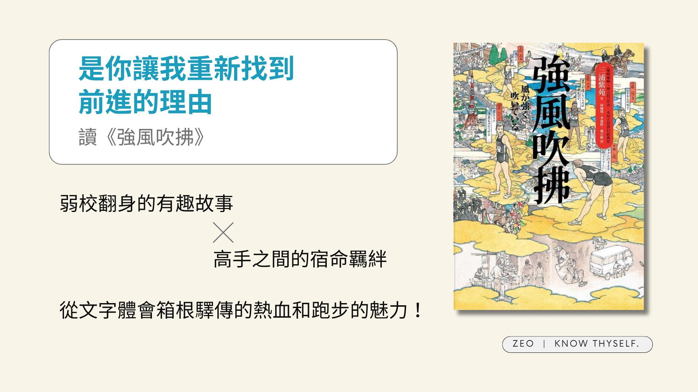

> 「只要努力就一定能成功，其實是一種傲慢。…田徑的世界沒有那麼天真，但是，目標也不是只有一個。」

正如簡介所述是關於一支臨時拼湊的隊伍參加日本一年一度路上長跑接力賽「[箱根驛傳](https://zh.wikipedia.org/zh-tw/%E7%AE%B1%E6%A0%B9%E9%A9%9B%E5%82%B3)」的故事。和一開始想像得有點不同，不是著重在描寫能將普通人在短時間內訓練成厲害跑者的祕法，更像是描寫一群人如何克服各自心魔，互相合作以及挑戰自己的故事。

參加箱根驛傳至少需要十名跑者，因此故事中描寫了十名同住在寬政大學破舊宿舍「竹青莊」中，年齡、性格和興趣各異的男大生們，如何組成隊伍，並在訓練到比賽的一路上互相磨合和幫助。十名選手加上配角其實出場的人物還蠻多的，因此主要的描寫還是聚焦在兩位主角「清瀨（清瀨灰二）」和「阿走（藏原走）」的身上。
<!-- more -->

**_Warning 📢 觀影筆記和讀書筆記都會涉及劇情，請斟酌閱讀。_**

說到兩位主角，雖然一開始沒有特別用這樣的視角去看這個故事，加上這個故事是有（雖然存在感相當薄弱的）女主角的，但清瀨和阿走的互動常常讓我讀著讀著腦海中不自覺冒出問號，回過神發現自己已經在姨母笑。這邊隨便摘錄一段：

> 阿走瞥向身旁的清瀨。雖然他沒有再爆青筋，卻仍繃著一張臉，似乎在思考著什麼。又給他添麻煩了。阿走硬是吞下那聲差點脫口而出的嘆息。
> 
> 「對不起，灰二哥。」
> 
> 「你沒必要跟我道歉。」
> 
> 他果然還在氣頭上。阿走左思右想，重新選擇了另一句話。
> 
> 「謝謝你，灰二哥。」
> 
> 「不客氣。」清瀨說。
> 
> 清瀨臉龐的線條比剛才柔和多了。阿走這才明白，原來這種時候只要道謝就好了。灰二哥剛才站出來維護我！阿走心中的憤怒與煩躁逐漸退去，心情輕鬆了不少，開始邁開大步向前跑。
> 
> 「你回去後先放洗澡水。」清瀨說。
> 
> 阿走舉起一隻手，表示自己聽到了。
> 
> 儘管高原的夜風帶著寒意迎面撲來，阿走的身體卻暖呼呼的。

阿走是天生的跑者，但因不喜歡傳統田徑嚴格死板的訓練方式而和教練起衝突，也相當於中斷自己的田徑生涯，最後才選擇不進入體校而是一般大學的寬政大。清賴熱愛跑步，原本曾是田徑選手，卻因為腳傷的關係再也無法於跑步上有突破。

但，非得是選手才能跑步嗎？就算不是為了比賽，是否還有其他跑下去的理由？為了尋找跑步的真諦，為了追尋繼續跑下去的原因，清瀨才毅然進入與田徑無關的寬政大，好在一定的距離外重新思考自己與跑步這件事的關係。

在故事的一開始，意外目睹阿走的跑姿的清瀨，重新感受到跑步這件事的純粹和美麗，因此深受感動。而從訓練開始一直到比賽結束，清瀨也將這份體悟傳達給包括阿走在內的所有人：跑步是為了自己，是為了體驗到那心流般的境界，不是為了比賽或任何其他原因。就算不是專業的跑者也沒關係，就算無法再突破了也沒關係，只要開始跑、只要持續跑下去，那只有你跑過才能體會的獨特境界始終在那裏等待著你。

讀著讀著是真的會讓人想跑起來，不過看到書中提到參加箱根驛傳預賽（甚至不是決賽）的低標是「十七分鐘以內跑完五千公尺」（時速約為 17.65 公里），當下只覺得這應該不是隨便就可以跑出來的速度吧！更別提阿走決賽時跑出的紀錄，很想吐槽阿走跑步時看到的風景根本不是每個人只要想跑都有辦法看到的啊！清瀨！

覺得作者很厲害的是，真的有把比賽時（尤其是最後幾棒）的緊張感寫出來，雖然多少知道寬政大高機率會進種子隊，但分別讀到阿走跟清瀨衝過終點線時還時覺得蠻感動的。如果要說比較可惜的部分，大概是角色真的太多了，雖然作者給予了他們各自的特色，但還是很難一一記住每個人的特色和分清每個人，有點像是想寫成群像小說（或說看簡介會讓人這麼感覺）但又差一點點的感覺。

無論如何，清瀨和阿走宿命般的愛情，我是說革命情誼，著實令我印象深刻。推薦有興趣的朋友們親自閱讀，感受他們一路上的成長和羈絆。

---

**強風吹拂**
*   作者：三浦紫苑
*   譯者：林佩瑾、李建銓、楊正敏
*   出版年份：2022
*   出版社：漫遊者文化
*   閱讀平台：實體書
*   閱讀時間：2026-05