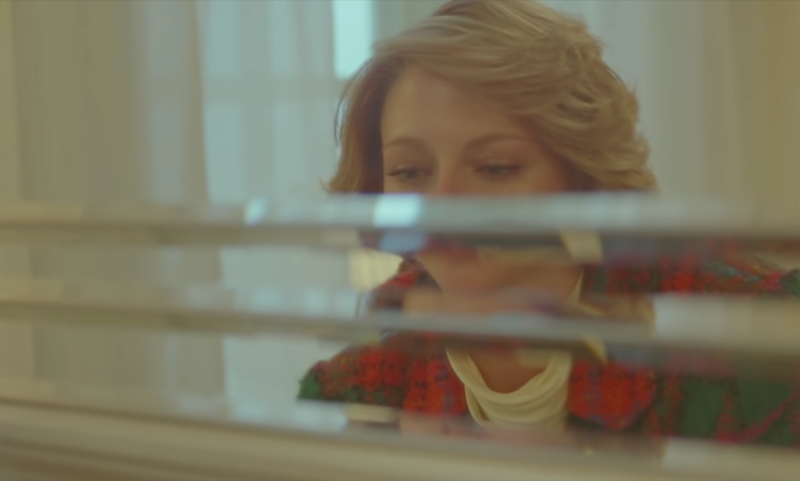
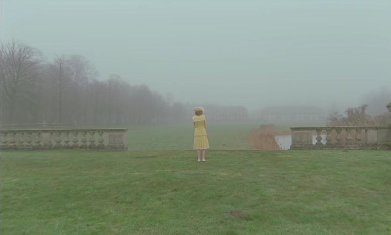
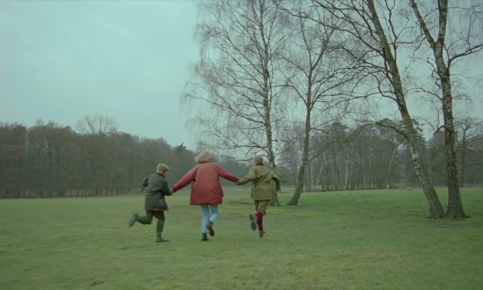
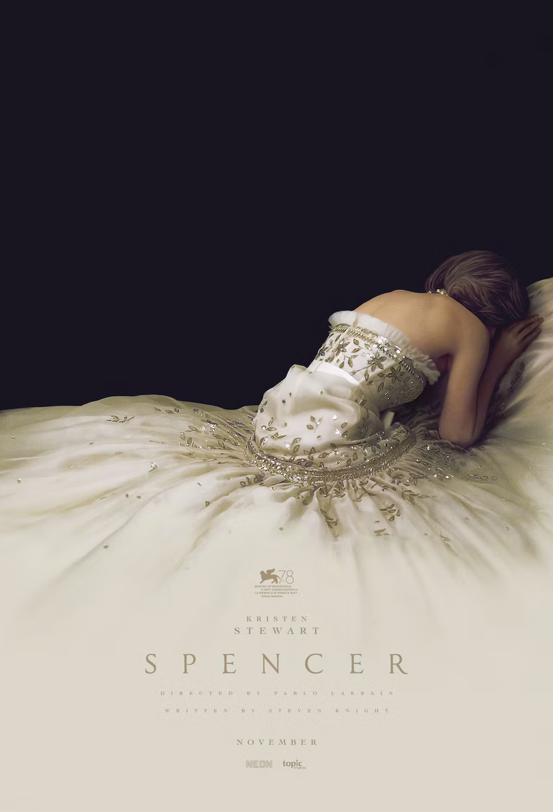

「你覺得他們會殺了我嗎？」

歡樂的耶誕家宴在陰影下拉開序幕，黛安娜為耶誕節驅車前往桑德令罕宮。因迷途而遲到的她，更像是抗拒參加這場活動，因為她不得不和外遇的丈夫及似乎不歡迎她的王室成員共處。她說服自己只要忍耐這幾天就好——只要和查爾斯繼續在公眾前扮演和樂的一家人，只要和其他人一樣對查爾斯的外遇視若無睹、只要壓抑自己任何的意願和欲求，就可以和孩子共度節日，然後回到她自己的生活。

電影中主要劇情的時間跨度很短，只有黛安娜在桑德令罕宮度過耶誕節的這幾天。黛安娜抵達之前已經非常不快樂，事實是她早已忍耐了太久：她忍耐著查爾斯令她心碎的外遇、忍耐著記者們的不時窺探，忍耐著查爾斯既不關心自己的身心狀況、也不關心兒子們的意願……而她抵達後發現這個理論上算是「家」的地方，竟也無時不刻在窺看著她，這更加劇她的壓力，將她逼到了絕境。
<!-- more -->

**_Warning 📢 觀影筆記和讀書筆記都會涉及劇情，請斟酌閱讀。_**

但對王室而言，或許她就是個我行我素、不守規則到可能危及王室的存在。畢竟王室有義務遵循傳統，按著排定的行程表走下去，沒有時間承接妳的個人情緒——小至每餐的服裝搭配，大至君主的繼承順位；但如果這些都是傳統都被默許發生，那麼王子外遇難道也是其中之一嗎？或者史賓賽家族嫁入王室的女孩最終都會被捨棄嗎？像亨利八世曾經迷戀的安博林一樣？

黛安娜知道這裡沒有人會支持她，甚至只是好好聽她說話（因為到處有人在偷聽），但她仍嘗試將自己的想法和憂慮源頭告訴查爾斯：她對於查爾斯送卡蜜拉同一條項鍊耿耿於懷、她覺得做錯事永遠只有她會受到關注、她希望她的服裝師好友可以回來服侍她…但這些查爾斯似乎都不在意。她又退了一步：如果你真的已經不關心我，那你至少尊重兒子的意願，等他準備好再教他用槍吧。

她坦承攤開傷口，只換來查爾斯曉以大義的責難：能不能在這短短幾天內，照著行程表「忍耐」一下就好，這才不是為了要粉飾太平，這都是為了「國家」跟「人民」啊。

剛到達桑德令罕宮時，黛安娜就和小兒子哈利抱怨著這裡總是「很冷」，可能又是顧慮傳統，房間裡不允許開暖氣。在這令她身心都感到寒冷的地方，她一心想要突破封鎖線、回到附近小時候居住過的老宅看看，儘管那裡年久失修，如今已成一棟廢墟。

在和查爾斯一番談話無果（查爾斯執意要帶兒子們去打獵），更覺孤單的黛安娜去找宮中與她友好的廚師。廚師不知道她心底的擔憂，當下只是安撫她，打獵用的雉雞天生就是要被殺的，因為牠們「漂亮但不聰明」。驚懼不安又孤獨的黛安娜卻直覺把自己和雉雞連結在一起。

當天黛安娜做出自殘舉動，因為留下明顯傷口，她對於出席晚餐躊躇不決，畢竟那裡沒有人會關心她「怎麼了」，只會責怪她「為什麼」。一念之下她冒險前往老宅，就算再怎麼破舊荒蕪，那是曾經帶給她真實溫暖的地方，而如今回憶仍在。想起一路走來曾經擁有快樂、自由自在的自己，她忍住了再次傷害自己的衝動。她要為了自己還有孩子努力活下去。看似是安博林的幻象救了她，但我覺得是她自己救了自己。

即使處境如此孤單無助，她也沒有屈服，而是選擇堅強地走下去。即使她的家已經荒蕪，她還是盡最大努力要給孩子們一個正常、溫暖的家。她衝進獵場，「和雉雞站在一起」，向丈夫堅定表達自己的立場，阻止查爾斯讓兒子繼續打獵，並帶走兩個兒子。

在她的車上，她允許孩子們開莊園裡不能開的暖氣，帶孩子們去吃平常不能吃的速食。在離開桑德令罕宮前，她把老宅附近曾經穿著父親外套的稻草人，套上了自己的外套。

她要用「史賓賽」的方式去教育孩子，用她自己的方式。

儘管現實中的發展令人遺憾，至少在電影中這段故事有個溫暖結局。在結尾黛安娜的服裝師瑪姬告訴她，有很多愛她的人——她並不是一個人，她還有愛她的朋友、愛她的兒子們，還有救了她的自己。

這並不是一部意圖忠實呈現王室或黛安娜生活的傳記電影，它是一個描述女性遭遇困境，依然勇敢面對的故事。

電影配樂非常優美，和劇情相當貼合，也很能烘托黛安娜的情緒轉折。

---

**史賓賽（Spencer）**

*   導演：Pablo Larraín
*   播映年份：2021
*   觀看平台：[Google Play 電影](https://play.google.com/store/movies/details?id=n-eso9IV6ZM.P)
*   觀看時間：2024-03