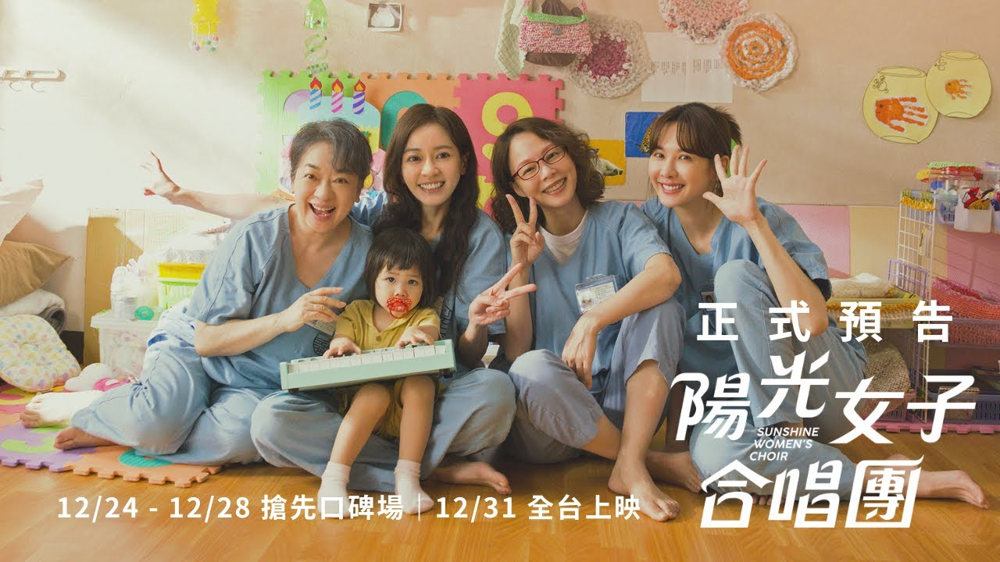

終於跟上潮流看完《陽光女子合唱團》，哭爆之餘也覺得故事寫得很好，想嘗試分析看看為什麼覺得這個故事好。

覺得好看的幾個主要原因：

*   群像劇但主次清晰，且每條線都緊扣主題
*   重要事件都有多層功能
*   劇情緊湊沒有廢話
*   整體節奏自然，少有強塞情緒、解釋、說教（這是我覺得最厲害的地方）

下面主要會根據我對《陽光女子合唱團》電影的印象跟對《故事的解剖》這本書的印象來分析，我的記憶可能有錯誤，且以下只是我個人主觀的分析，不一定反應電影的實際情況。
<!-- more -->

**_Warning 📢 觀影筆記和讀書筆記都會涉及劇情，請斟酌閱讀。_**

# 《陽光女子合唱團》的主題與價值觀

主題：無私的愛

載體：母女親情

價值取向：這邊嘗試用《故事的解剖》的價值取向來看

*   正面價值觀：無私的愛
*   矛盾價值觀（Contradictory value，無法和正面價值觀並存）：恨
*   對立價值觀（Contrary value，我理解是不符正面價值觀但並非完全無法並存）：自私
*   負面的負面價值觀（Negation of the Negation）：看似是愛實則自私

價值取向和劇情的關係：

*   恨：因恨而不得已犯罪入獄（宥芯、玉英、惠貞的背景故事）
*   自私：主角惠貞在想與女兒相伴和是否送女兒離開監獄之間掙扎、玉英阿嬤為女兒好但卻對她造成傷害
*   看似是愛實則自私：原生家庭議題（尤其宥芯和母親的故事）
*   無私的愛：獄友代替惠貞和玉英活下去以及關心芸熙／子晴

# 《陽光女子合唱團》價值取向的落差與轉變

> 故事的本質是落差，是一個人採取行動時期望發生和實際發生之間的落差，是期望與結果之間、可能發生與必然發生之間的分歧……至於故事的能量來源，答案也一樣——落差。觀眾對角色產生同理心，入戲地與他一起追尋他的慾望。……一旦角色面對落差，觀眾也同樣感受到落差。
> 
> 故事的解剖

情緒是透過與價值取向衝突造成的落差和價值取向的轉變堆疊出來的：

1.  價值取向衝突造成的落差：即使在最無望的情境下（入獄後／自盡前），角色仍要盡力給孩子最好的。

惠貞：想盡力給女兒最好的

*   內在的衝突（心智）：親自陪伴女兒 vs. 送出獄
*   個人的衝突（家庭／朋友）：希望女兒記得自己 vs. 不希望女兒被貼上殺人犯兒女的標籤
*   外界—個人的衝突（社會）：出獄後可以見到女兒 vs. 獄中遭遇意外使她沒能出獄

玉英：想盡力給孩子最好的

*   內在的衝突（心智）：作為歌手的快樂及成就 vs. 相夫教子
*   個人的衝突（家庭／朋友）：當個好媽媽 vs. 丈夫與家庭的不支持
*   外界—個人的衝突（社會）：和女兒和解 vs. 疾病使她無法如願

2.  價值取向的轉變：外在目標失敗但仍成就核心價值

*   外在目標（Want）：惠貞想見到女兒、玉英想和女兒和解
*   內在需求（Need）：無論過去如何，在絕境中我們仍有愛人的能力，這份愛是有價值的，且可以超越死亡的藩籬

雖然故事最後角色沒有達成外在目標，但是透過成就內在需求（獄友代替玉英／惠貞關心女兒），讓「無私的愛」從個人層面昇華到「群體價值」，仍然完整了價值正面的價值觀（無私的愛）。

# 《陽光女子合唱團》的故事結構

其實原本編劇是用五幕劇去編排，但以下為了容易切分我只用四幕來分：

## 第一幕：截至宥芯入獄

*   幕的主題：
    *   主要角色出場和基本性格塑造
        *   惠貞：疼愛女兒的溫柔媽媽
        *   玉英：受大家敬重的長輩，身體不好
        *   阿蘭、阿珮：相對比較敢出頭，但仍關心阿嬤和芸熙
        *   方科長：初始的嚴母形象
        *   宥芯：初始的叛逆女兒形象
    *   鋪陳惠貞＆獄友對芸熙的愛
        *   為芸熙舉辦抓周等活動
*   觸發事件：因為幫芸熙慶祝請假太久被集體處罰
    *   帶出監獄不適合養小孩（她長大一定會恨你）的議題
    *   觀眾開始同理主角群

## 第二幕：截至送走芸熙

*   幕的主題：為芸熙留下回憶
*   高潮事件：惠貞和芸熙的別離

*   重要事件：
    *   餐廳打架，惠貞跟宥芯被罰禁閉
        *   引出芸熙的眼疾（必須送她出獄的理由）
        *   引出阿嬤的癌症（答應指揮合唱團的理由）
        *   初步引出宥芯的故事
        *   帶出惠貞性格中的另一面：平時和善文靜，但會為了女兒挺身而出
    *   合唱團籌組
        *   透過監獄內派系、玉英原先不答應指揮、惠貞克服五音不全的上台恐懼，表現合唱團籌組不易，襯托惠貞為芸熙付出的努力
        *   透過合唱時的信任練習揭露獄友們的背景
        *   獄友們透過合唱得到抒發情緒、展現自我和互相了解的機會（音樂和陽光一樣，不分種族性別帶給所有人感動）
    *   合唱團表演
        *   表演愈快樂熱鬧，愈襯托送走芸熙的悲傷
    *   惠貞和芸熙的別離
        *   表現惠貞的為母則強，為了女兒兩次作出艱難決定（第一次是為保護女兒殺丈夫、第二次是為女兒著想忍痛送她出獄）
        *   方科長從嚴母到慈母的人設反轉點
        *   惠貞的「她忘記了」暗示芸熙離開監獄後就會忘記生母和獄中的一切

## 第三幕：截至和芸熙重逢

*   幕的主題：母女關係的處理，開始著重處理副線和其他人的故事
*   高潮事件：惠貞和芸熙的重逢

*   重要事件：
    *   玉英：在此之前觀眾還不知道玉英入獄的完整背景故事，這邊揭露了玉英入獄原因以及和女兒的關係
    *   宥芯：雖然一筆帶過宥芯和母親的關係，但也側面烘托其他人的母愛和獄友對宥芯的情誼
    *   芸熙：交代芸熙找到收養人，惠貞卻沒見到芸熙（落差），引出後來方科長設法推動音樂會讓母女相見
    *   音樂會表演
        *   失竊事件
            *   點出社會普遍對受刑人仍有既定印象，甚至警察單位沒有依法執法
            *   方科長嚴母／慈母一體兩面的形象完整化
            *   一樣透過意外事件表現這場音樂會的得來不易，更去烘托所有人的情感重量
        *   惠貞和芸熙重逢，知道芸熙過得很好，可也驗證芸熙真的「忘記了」

### 第四幕：截至結局

*   幕的主題：回扣核心價值觀（愛與陪伴不能兩全造成遺憾，但愛會延續）
*   高潮事件：揭露惠貞之死

玉英線收尾：

*   玉英給獄友的信，透過獄友互相扶持的情感強調「無私的愛」的核心價值觀
*   揭露玉英完整的背景故事，其實嘗試自盡前有交代後事給女兒
*   獄友合唱送玉英＆撫慰玉英女兒

惠貞線收尾：

*   回扣電影開頭，揭露惠貞之死（落差）
*   獄友代替惠貞繼續關心芸熙／子晴，無私的愛從個人層面昇華到群體價值
*   芸熙／子晴戴上陽光女子合唱團的徽章，象徵情感的延續

整體的價值轉換：

| 初始狀態 (負面) | 故事過程 (衝突) | 結尾 (昇華) |
| :--- | :--- | :--- |
| 因恨產生的罪而入獄。 | 即使仍想愛人但監獄不適合育兒，愛也無法讓女兒理解，主角群在愛與自私間掙扎受苦。透過音樂建立連結，試圖觸碰陽光。 | 死亡與別離不會切斷情感，愛透過眾人延續。 |

---

**陽光女子合唱團**

*   導演：林孝謙
*   播映年份：2025
*   觀看平台：影城
*   觀看時間：2026-02