位在宜蘭的太平山國家森林遊樂區景點眾多，尤其數條步道長短不一且各有特色，大家選擇遊玩的路線也根據停留天數及住宿地點等因素各有不同，這次和伴侶於八月造訪太平山一日遊，也分享一下我們的行程安排。

*   前一天：晚上先至英仕山莊住宿
*   當天：早上翠峰湖→中午～下午太平山莊區域→傍晚鳩之澤
<!-- more -->
## 住宿

因為前一天晚上出發，為了隔天上山不要太累，我們選擇住在英仕山莊。雖然官網說它位在太台平山下，但其實從市區出發已經先爬一段山路了，所以從這裡上山可以省去不少時間。  
基本上是一個可以過夜、洗漱後，隔天早餐吃飽再出發的地點，推薦給追求效率以及對舒適度要求不會太嚴苛的朋友。　  
整體服務其實很不錯，中式早餐也還OK。主要是地點真的絕佳，可以簡單睡一晚隔天早早出發。

## 景點安排

[翠峰湖](#cueifong-lake) → （[太平山莊區域](#taipingshan-villa)）[紅葉道](#red-leaf-way)＋[雲海咖啡館](#coffee-shop)＋[檜木原始林步道](#cypress-forest-trail) → [鳩之澤](#jioujhihze)

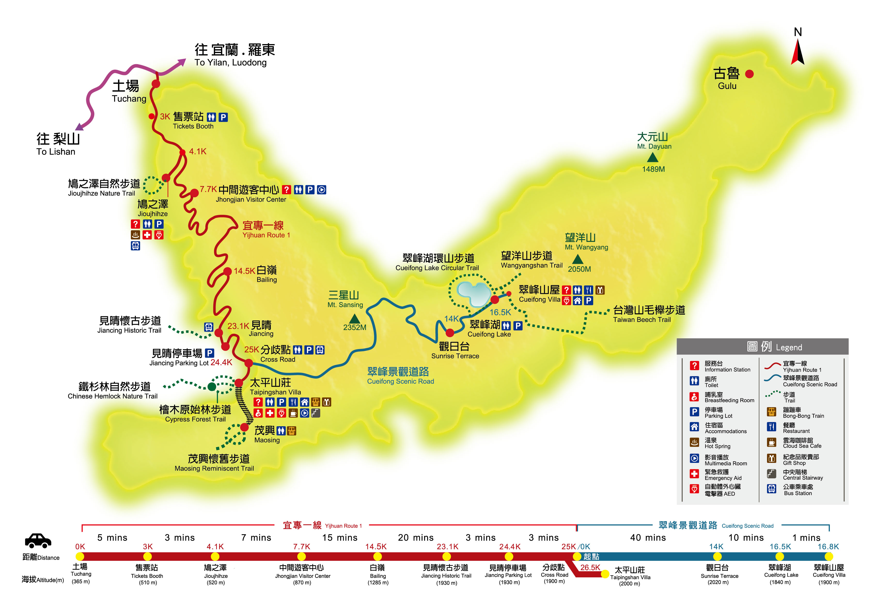

太平山景點位置圖 @ [太平山國家森林遊樂區入口網](https://tps.forest.gov.tw/TPSWeb/wSite/mp)

出發前我們看了一下網路上大家的遊記，先確定我們要去翠峰湖。由於翠峰湖位置最遠，步道也很長，預估會花掉半天左右，所以就決定剩下的步道只選一條就好。比較了各步道的特色後我們選擇了檜木原始林步道，由於沒有打算泡溫泉，所以回程一定會經過的鳩之澤就排在最後，這樣一來如果前面行程耗費太多時間，也方便調整在鳩之澤停留的長度。

因為前一天就在英仕山莊住宿，所以隔天能夠一早就出發上山。我們選擇先到距離最遠的翠峰湖，事後證明這個選擇也是正確的，因為翠峰湖不但最遠，步道也消耗最多體力。我們大約八點從山莊出發，兩小時內爬完環山步道，中午在步道東口吃午餐，到達太平山莊區域正好下午一點多，到雲海咖啡喝個下午茶回復體力，再繼續比較簡單的檜木原始林步道。三點多結束太平山莊這邊的行程，再開車40分鐘左右，在鳩之澤停留一下煮個溫泉蛋，就以充實的心情下山了。

夏天造訪的好處是天色暗得比較晚，大概五點左右下山天色都還滿明亮的。

## 翠峰湖

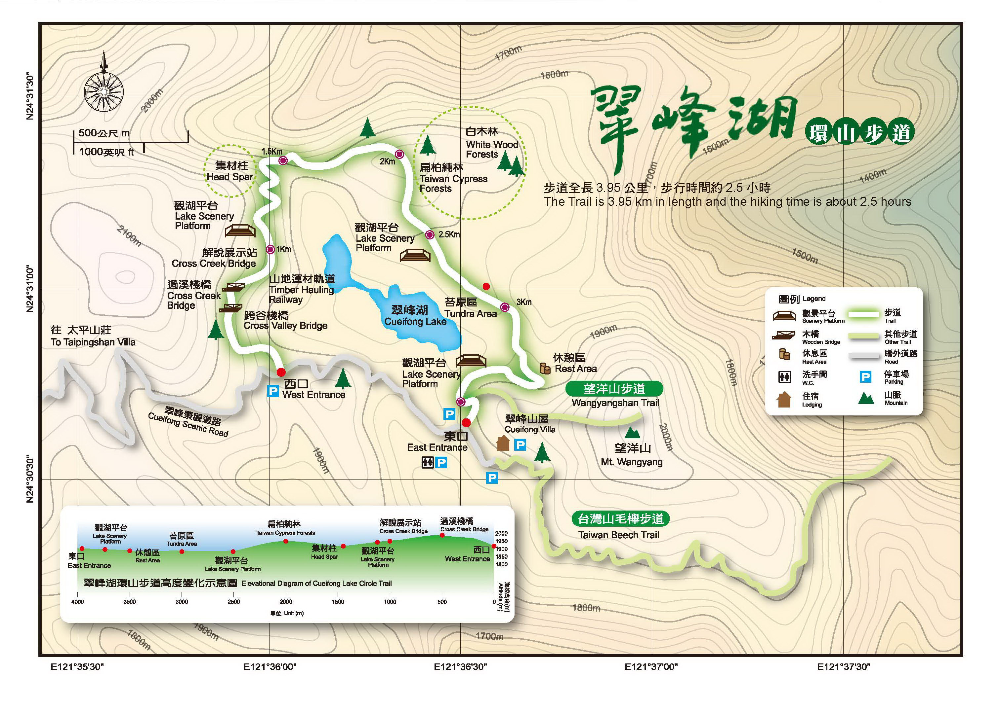

翠峰湖景點位置圖 @ [太平山國家森林遊樂區入口網](https://tps.forest.gov.tw/TPSWeb/wSite/mp)

翠峰湖有兩個出入口「西口」和「東口」，兩邊都有停車場。我們是西口進東口出，看旅行團好像都是東口進西口出，可能因為東口一開始比較平坦好走。不過無論從哪一個入口進，最終都能繞湖一圈走完，然後從另一個入口再沿著馬路走15分鐘左右回到停車的地方。

雖然翠峰湖這個季節湖水不多，群山環繞的湖泊景緻依然很美。如果走完全程更能以不同角度欣賞，在路途上也能體驗置身森林中的感覺。以前在書上讀到關於森林的描述，其實對久居城市的人而言有點難想像，像是大到可以讓動物躲進去的樹幹，不同樹種錯落生長交織而成的自然景觀，還有「山」真正的樣子——以往遠遠看到山都覺得坡面是一大塊綠色的土地，實際上是由一層又一層不同的樹木組成的）。走在步道中可以聽見響亮的蟬鳴（一開始還以為是鋸木頭的聲音XD）還有不絕於耳的鳥鳴，當天運氣很好，在路上也看見兩種台灣特有種的鳥類。

如果一樣是西進東出，爬完步道可以坐在接近東口的觀湖平台上稍作休息，在此群山湖泊一覽無遺，還能看到山嵐從對向山谷慢慢湧上來，是平時少見的景象。

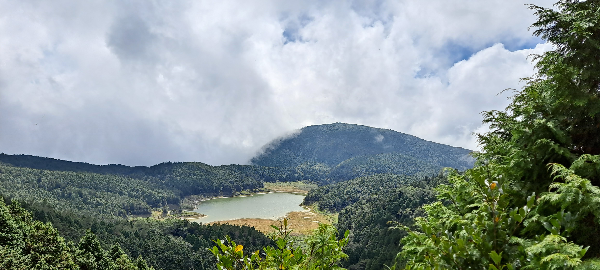 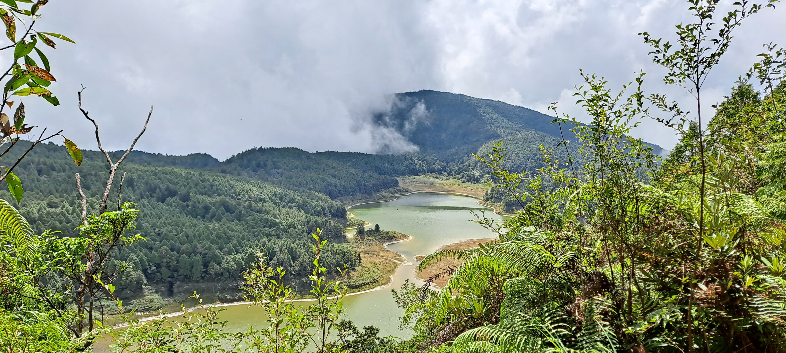 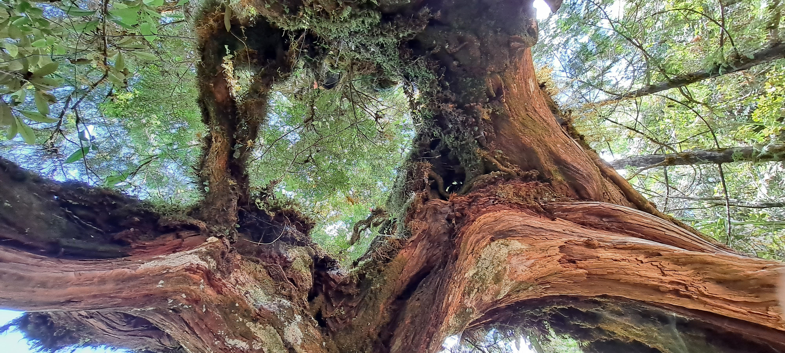 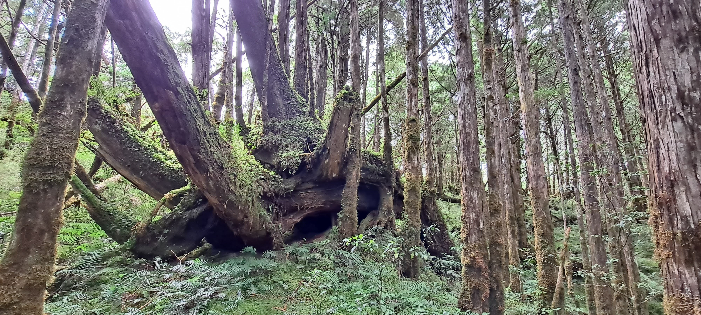 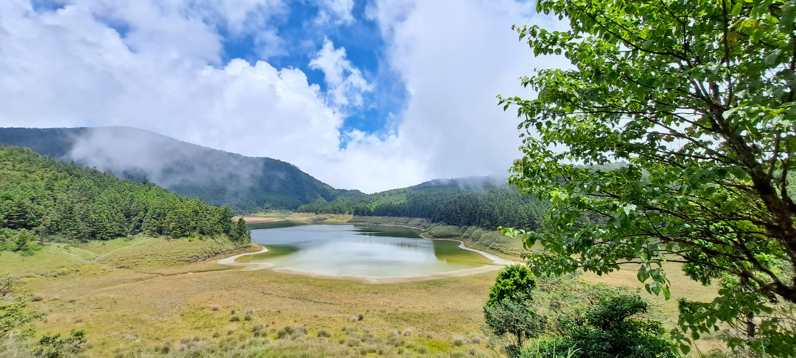

如果專程都來一趟太平山了，時間和體力允許的話推薦走一程環湖步道，體驗一下豐富的山林生態。需要注意的是，不像檜木原始林步道有平整的人造木梯，為保護生態，環湖步道只有木板和泥土塊簡單排成的路徑（但有這些路徑已經好爬很多了），部分區域會有泥濘跟樹根，要小心行走避免滑倒或扭傷，加上地形比較陡峭，對於不常運動或爬山的人來說也許會有點難度。如果帶著小小孩或行動比較不便，可能就要謹慎考量。

對於常在爬山健行的朋友來說應該是沒問題的，路上遇到很多長輩也都順利走完全程。當天天氣路況很好，我們一路上慢慢走，大概在2小時內就走完步道（接近十點從西口進入，約十一點半到達東口）。

## 太平山莊區域

太平山莊區域應該是最多旅客停留的地方，因為除了山莊本身，包括紅葉道、檜木原始林步道、鐵杉林自然步道、茂興懷舊步道、餐廳、咖啡館以及蹦蹦車都在這個區域。

附近有三個停車場，第一個停車場接近分歧點，第三個停車場最接近太平山莊，但最理想的方式應該是停在接近步道入口的第二個停車場，沿著步道一路欣賞風景，一邊走到太平山莊區域。

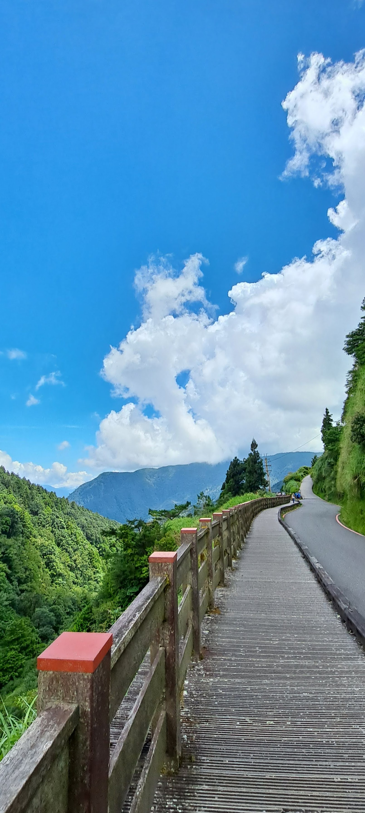 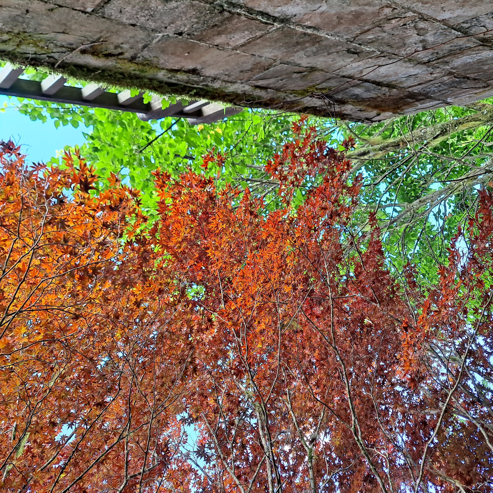

### 紅葉道

紅葉道就是一條長長的石梯，兩旁長滿紫葉槭非常漂亮，但走起來其實滿喘的XD  
這條樓梯能通往山莊、咖啡館以及更上面的步道。

### 雲海咖啡館

在紅葉道走160階就會到達雲海咖啡館，很幸運到達時就有座位不需排隊。我們選擇戶外靠窗的座位，雖然剛入座時有一點悶熱，但當風從窗戶透進來的時候還滿涼爽的，可以愜意地一邊品嘗咖啡一邊欣賞山景。

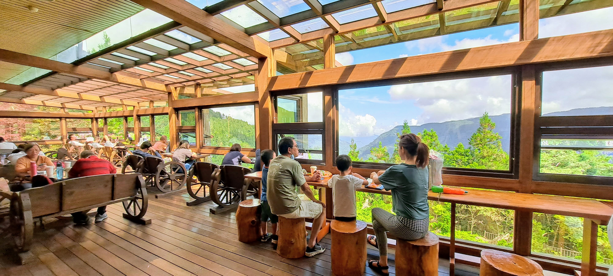 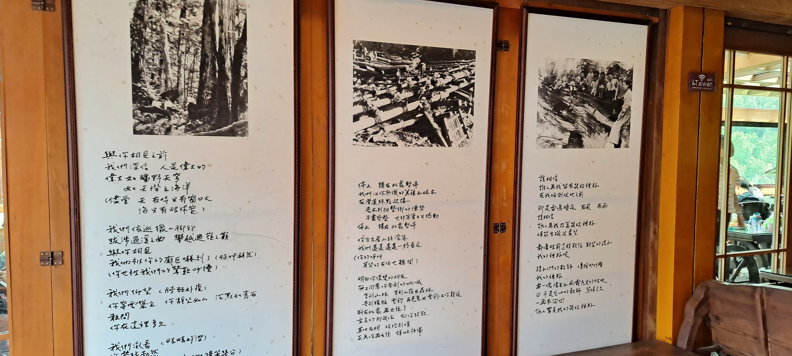

### 檜木原始林步道

在咖啡館喝完下午茶，就可以再沿著步道往上走，經過鎮安宮來到檜木原始林步道的入口。前面說過相較於翠峰湖環山步道，這一條步道相對好走，可以悠閒地在林中散步。路上也能看到多樣的自然林相，空氣中隱約還有檜木的香氣，推薦給喜歡樹木的朋友。

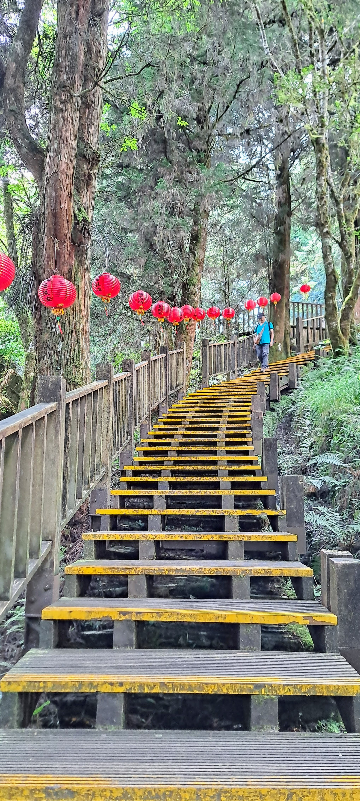 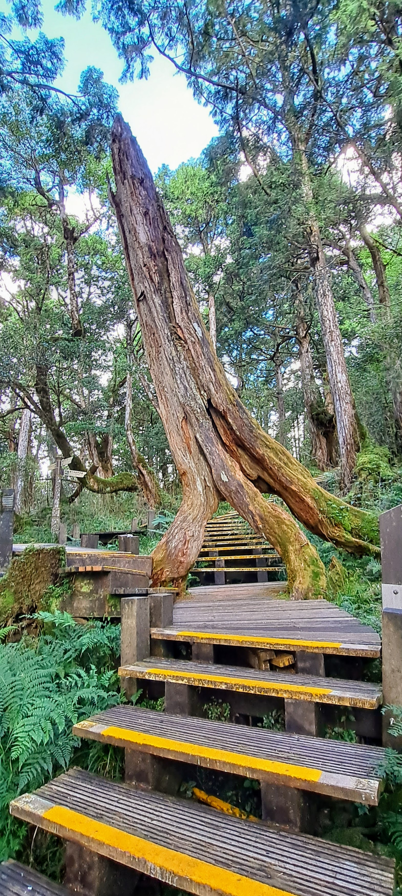 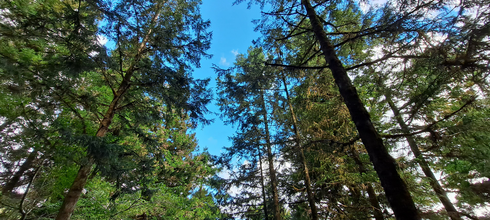

## 鳩之澤

離開太平山莊區域往回開，會經過的最後一個景點就是鳩之澤了。在停車場往下走的販賣部和煮蛋區，可以買玉米跟蛋來煮，也可以買到水或其他飲料，像是運動飲料。

但因為我當時暈車得不得了，對這裡的回憶沒有很深刻😅，只記得蛋一直煮都煮不熟(?)

下山的路上除了售票站外就沒有其他廁所，所以可以在這裡吃點東西休息一下，順便上個廁所。

離開鳩之澤也離開太平山最後一個景區了，如果是一日遊，接著就可以下山找個地方吃晚餐（爬完一天的步道吃什麼都好吃啦），開開心心踏上歸途。

## 台北宜蘭交通

我們去回程都是搭葛瑪蘭客運。在官網訂票後，搭車時直接出示手機上的QR Code就可以上車，不用另外取票這點很方便！還可以在訂票時選位。

不過目前好像沒有分票功能，如果一次買多張票，只能從取票人的手機上刷QR Code。

雖然台北到宜蘭不算很遠，考量到上下太平山的山路，如果全程自己開車也是滿累的。葛瑪蘭客運班次選擇多，如果提早到達車站也可以補位上車，行程安排比較彈性，車程也很舒適，是下次造訪宜蘭還會考慮的交通方式。

## 夏天造訪太平山的注意事項

*   水（很重要，尤其如果要爬步道的話，建議至少一人一瓶水）
*   防曬用品（陽傘、外套、帽子、防曬乳）
*   暈車藥或藥膏（防蚊蟲咬傷）
*   靠近翠峰湖的區域可能會沒有網路，可以把地圖等資訊事先下載到手機裡
*   午餐（如果一早從宜蘭出發也許可以從市區買熱食，但因為我們前一天就出發，選擇買比較耐放的麵包；太平山上有賣食物的只有幾個點而已，彼此間距離也不是很近）
*   防滑易走的鞋