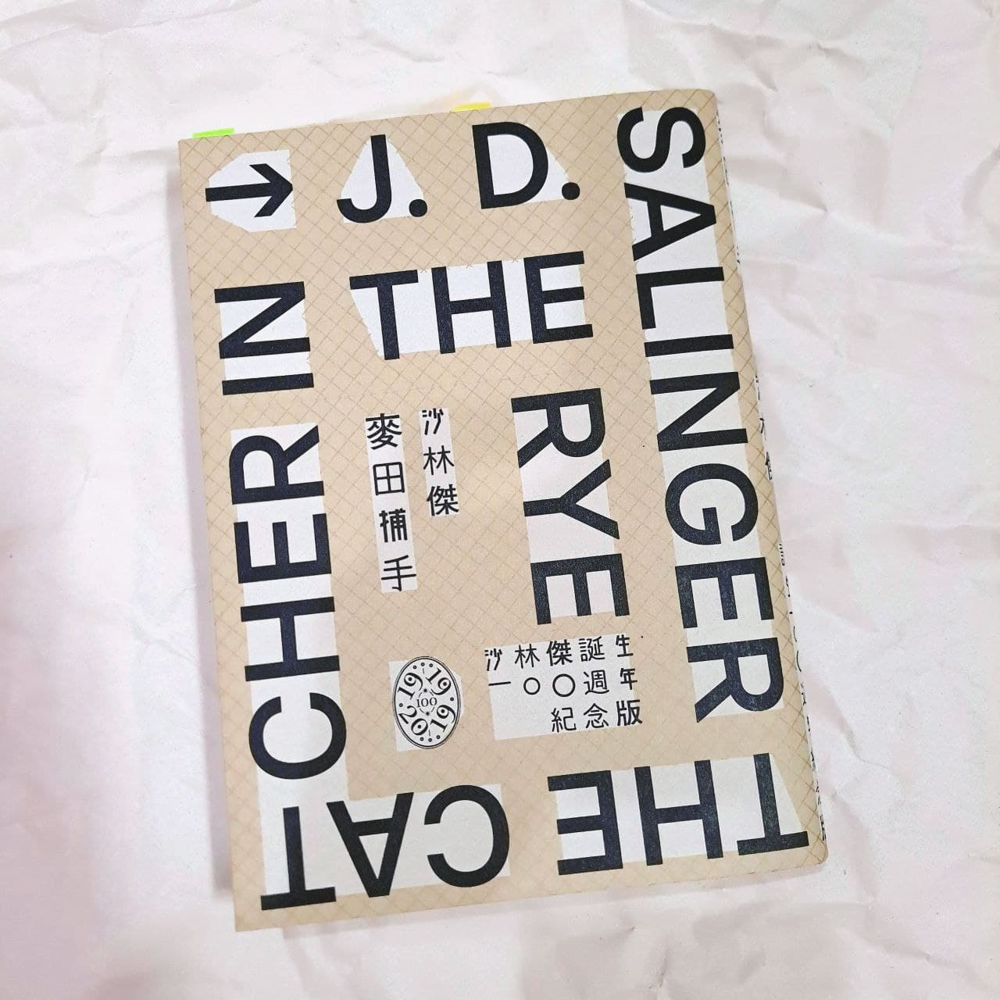
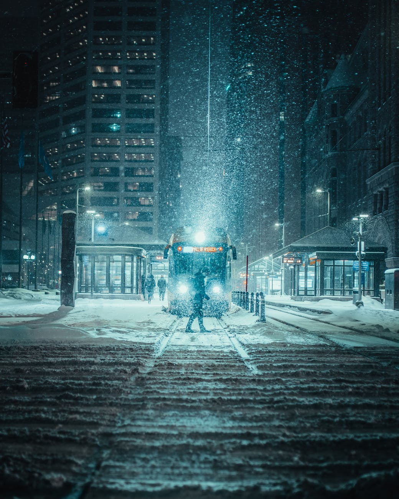
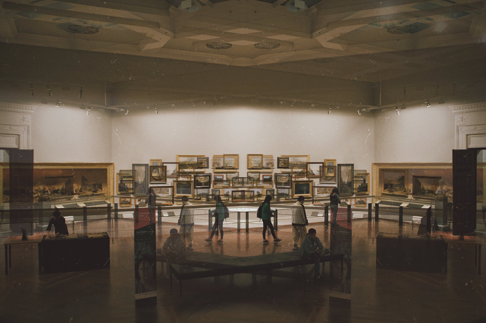

> 「妳有沒有覺得厭煩透頂過？我是說妳是否曾經覺得深怕一切事情會愈來愈糟，除非妳做點什麼？我是說妳喜不喜歡學校，以及一切的一切？」

<!-- more -->

**_Warning 📢 觀影筆記和讀書筆記都會涉及劇情，請斟酌閱讀。_**

故事的開頭，主角霍爾頓不僅被退學，還在帶領劍擊隊到紐約比賽途中弄丟了所有裝備，導致大家無功而返；更糟的是他發現迷人的室友和他喜歡的女孩子琴約會晚歸，感到難受的霍爾頓和室友打了一架後（其實比較像是他單方面挨揍），決定立刻離開學校，但因為害怕父母知道他被退學的事，他也不打算直接回家，而是決定在這段提早離校的時間內，放自己一個「小小的假期」。

霍爾頓到紐約的第一晚就過得相當忙碌。他入住旅館後便前往旅館的舞廳，在那裡遇見三名金髮女子，並輪流和她們跳舞。霍爾頓認為自己和三名女子在調情，但實際上對方只把他當孩子看待，沒有把他的話當一回事，更別說心靈層面的交流，諷刺的是當霍爾頓騙她們看見電影明星出現在舞廳時，三名女子都為了這個謊言興奮不已，這一切使霍爾頓感到沮喪。接著霍爾頓去了以前哥哥常去的夜總會，但裡面大多數人讓霍爾頓覺得不是怪胎就是傻瓜，不巧又遇到哥哥的前女友來攪局，使他不得不離開。掃興的霍爾頓回到旅館，電梯小弟問他是否有興趣找個女人來陪，霍爾頓衝動之下答應了，卻在女孩真正到他房裡後，無法下定決心與她發生關係，事後還被女孩跟電梯小弟聯手勒索，甚至被打暈。

Photo by Josh Hild on [Pexels.com](https://www.pexels.com/zh-tw/photo/2422497/)

經過混亂的一晚，隔天霍爾頓突然想到約一位與他曖昧許久的女孩薩麗一起去看表演。在這天的約會中，霍爾頓一再感受到薩麗的虛假和浮誇，卻又不由自主為她的美貌吸引，甚至突發奇想讓薩麗和他一起遠走他鄉。薩麗當面指出他的不切實際，兩人大吵一架後不歡而散。迷惘的霍爾頓又到酒吧見以前學校的學長路斯，希望得到一些啟發，經過一段沒有交集的談話後，對方只勸他去找心理醫生。在酒吧獨自喝到凌晨的霍爾頓內心疲倦至極，在紐約的寒夜中感覺自己就要死去，他決定在（他想像的）死前冒險回家看妹妹菲比一眼。

與菲比見面讓霍爾頓心情頓時好轉，但由於退學這件事，他暫時還是不想面對父母，因此在和菲比借了錢後，他前往以前教過他的英文老師家借宿。知道霍爾頓三番兩次被退學，老師語重心長地對霍爾頓說了一番話，但又醉又昏沉的霍爾頓只是隨便應付，就在老師家的客廳睡了。讓霍爾頓震驚的是，這位他所信賴的老師，竟在半夜他睡覺時悄悄坐在旁邊注視著他，甚至撫摸他的頭，這讓霍爾頓感到非常不舒服，於是匆匆離開了老師的家。這令霍爾頓徹底喪失對成人世界的信心，虛弱的霍爾頓再次感到自己好像就要消失，他決定實行遠走他鄉、隱居山林的瘋狂計畫。但在他打算和菲比道別，卻發現菲比竟然拖著行李決心和他一起離開時，他動搖了。霍爾頓最後答應菲比他會回家，故事結束在霍爾頓站在雨中，看著菲比坐在旋轉木馬上轉個不停，那一瞬間，他突然感到非常快樂。

Photo by cottonbro on [Pexels.com](https://www.pexels.com/zh-tw/photo/4551857/)

一開始會覺得霍爾頓在很多時候似乎言行不一：他說他討厭電影，但他常和家人同學去看電影，也常提到電影情節（他被電梯小弟打暈的時候，幻想自己像電影主角一樣中槍倒地，而琴就在他身旁）；他也不怎麼喜歡薩麗，覺得她裝模作樣，但還是找薩麗出門約會，甚至在約會過程中情不自禁愛上她；他覺得舞廳和夜總會裡充斥著虛假和偽善的人，但他卻總愛去那些類似的地方。而對一切不滿的霍爾頓，以世俗的眼光來看：他屢次被退學、常常被打、喝得爛醉、泡不到妹、連跟妓女上床都不敢、最後弄到身無分文，他似乎是一個徹徹底底的魯蛇，魯到有點讓人看不下去。但也因為這樣，讓人感覺這個角色分外真實——畢竟我們也未必總是能看清自己的內心，保持言行一致。而這同時反應出：即使霍爾頓想要抵抗進入成人社會，想要永遠保護純真，但人終究是會長大的——如同霍爾頓會說謊博取同學母親的好感，或是不由自主受到性的吸引——即便是他也沒辦法抗拒他所不喜歡的這一切，因為長大的過程無可避免地要經歷這世俗社會的洗禮。

> 麻煩就在這裡。你永遠找不到一個舒服、寧靜的地方，因為這樣的地方並不存在。你或許**以為**有這樣的地方，但當你到了那兒，只要一不注意，就會有人偷偷溜進來，在你的鼻子底下寫個「幹」。

但繼續讀下去又會發現，雖然霍爾頓總用看似成熟的外表（他長得高大還有半頭白髮）、漫不經心的態度、輕視一切的想法包裝自己，並且以髒話和曖昧的語言（差不多、甚至、簡直、差點、我是說…）來自我保護，他其實是個內心非常善良的人。他會為那些比較貧窮的人、比較傻的女孩和不受歡迎的同學感到難過，他心裡一直記著被欺負後跳窗身亡的同學，他知道退學會使媽媽傷心而感到愧疚，他甚至在撒謊騙了舞廳的女孩後也感到自責。霍爾頓的內心具有強烈的正義感和道德感， 是真正成熟的人應該具備的素質。 無奈的是，這個環境讓他認知到的成熟就像他對薩麗和菲比說的：「坐辦公室、賺很多錢、搭車、打橋牌、喝酒、看新聞、擺架子…」，這使他覺得自己被這個「成熟的」世界完全拒於門外。

從霍爾頓的旅程可以看出，他所遇見的成人幾乎一再令他失望，尤其他們的虛偽更令他作嘔。舞廳的女子只顧著看明星是不是在附近，對於就在他們眼前的霍爾頓毫無好奇；老師們在乎他的成績、在乎他被退學、在乎作文或演講有沒有離題，而不是那些真正講得好的內容；大家都覺得霍爾頓的哥哥在在好萊塢工作非常了不起，儘管對於要創作的主題他根本所知甚少；學長路斯宣稱和異國女子約會的原因是喜歡東方哲學，但當霍爾頓追問更具體是喜歡什麼，他卻轉移話題；薩麗和名校男學生的交流方式更是一絕，「他們以最快的速度不斷想出一些地方來，然後再想出一些住在那地方的人」；電影院裡的婦人對舞台上的劇情淚流滿面，卻完全不顧身邊的孩子。人們不願談論真實的事情，他們看著舞台上和電影中虛構的故事叫好或流淚，卻對真實世界發生的事情滿不在乎，這些都令霍爾頓無法忍受。

相較之下，菲比在得知霍爾頓被退學後，最擔心的是他會被父母責罵；而在得知霍爾頓異想天開的出走計畫後，也無條件地相信他，甚至毅然決定要和霍爾頓一起離開。雖然菲比和霍爾頓分享的大多是些微不足道的生活瑣事，但比起成人們虛無的交談，他們之間稀鬆平常的聊天便顯得更真實和有溫度。

> 無論如何，我總是會想像，有那麼一群小孩子在一大片麥田裡玩遊戲。成千上萬個小孩子，附近沒有一個人——沒有一個大人，我是說——除了我。我呢，就站在那混帳懸崖邊。我的職務是在那裡守備，要是有哪個孩子往懸崖邊跑來，我就把他捉住——我是說孩子們都在狂奔，也不知道自己是在往哪裡跑，我得從什麼地方出來，把他們**捉住**。我從早到晚就做這件事。我只想當個麥田裡的守望者。

Photo by Max Bonda on [Pexels.com](https://www.pexels.com/zh-tw/photo/6863770/)

即使一路上遭受世俗社會的打擊，霍爾頓還是想盡力保護純真，在麥田裡當孩子們的守望者。他喜歡博物館無論經過多久總是展示著一樣的展品（這是我在書中最喜歡的一段描寫），喜歡旋轉木馬在那麼多年後仍播放相同的音樂，他希望純真就和這些事物一樣永遠不變。他保護純真的堅持尤其反應在對琴和艾利的態度：一開始室友問霍爾頓是否要去和琴打招呼，他滿口答應卻遲遲不去；後來又數度想打電話給琴，百般猶豫後終究沒有實行。也許在心裡他知道琴已經長大了——現在的琴很可能和那個曾經在下棋時總把國王放在後排不用的單純女孩已經不同，她說不定已經和霍爾頓的室友發生關係，說不定已經加入霍爾頓所認為的成人世界了。但只要霍爾頓不打電話給她，不要知道真實的情況，琴在他心中就能一直保有以前純真的樣子。霍爾頓也提到心情不好時就會和已過世的弟弟艾利說話，甚至在精神虛弱時會感覺艾利就要將自己帶走。而艾利正是純真的終極代表，他在年幼時去世，永遠不會再長大，就和博物館裡的展品一樣，在霍爾頓心中始終保持純真的樣子。

> 不過博物館裡最好的一點是一切東西總待在原來的地方不動。誰也不挪移一下位置。你哪怕去十萬次，那個愛斯基摩人依舊剛捉到兩條魚；那些鳥依舊在往南飛；鹿依舊在水窪邊喝水，牠們的角依舊那麼美麗，牠們的腿依舊那麼又細又好看；還有那個裸露著乳房的印地安女人依舊在織同一條毯子。誰也不會改變模樣。唯一變的東西只是你自己。倒不一定是變老了什麼的。嚴格說來，倒不一定是這個。不過你反正改了些模樣，就是這麼回事。比如說這一次你穿了件大衣。或者上次跟你排在一起的那個孩子得了猩紅熱，換了別人排在你旁邊。或者帶領學生的已不是艾格萊丁小姐，換了別的什麼人。或者你聽見你媽媽和爸爸在浴室裡吵了一次架，吵得很凶。或者你剛在街上經過一漥子一漥子的水，水上的汽油泛出彩虹一般的色彩。我是說你反正總有些地方**不一樣**了——我說不清楚我的意思。

Photo by Stacey Gabrielle Koenitz Rozells on [Pexels.com](https://www.pexels.com/zh-tw/photo/2425012/)

霍爾頓也為自己想了逃離成人世界的對策——他要將自己和社會隔絕，到鄉間過著裝聾作啞的單純生活，使自己的領域不被世俗社會污染。薩麗的否定傷害了他，但純真的菲比選擇相信他，因而救贖了霍爾頓，讓霍爾頓願意留下來。不長大不進入成人世界，也代表著肉體或心靈層面的某種停滯。以肉體而言就是死亡，像艾利一樣被時間永遠停住；而霍爾頓比較像是心靈上仍然抗拒著成人社會，雖然選擇留下來，但他的心靈也許還是沒有完全準備好進入世俗的社會（書中有提到他正在接受心理治療）。

看著菲比騎在旋轉木馬上，和其他孩子一樣不顧危險試圖抓住[金圈](https://youtu.be/MwFh1KvoIsU)，霍爾頓領悟到人終究要長大，你沒有辦法永遠保護孩子。即使霍爾頓有他的紅色獵人帽——帶給他安心和自信，但當外面下著傾盆大雨，帽子也只能保護他暫時不被淋濕。我很喜歡這段大雨和另外一段情節的並置：霍爾頓提到有一次去墓園看艾利時，突然下起了雨，所有人都匆忙趕回自己的車上；而現在霍爾頓選擇就這樣站在大雨中，任憑雨水將他淋濕。他要在雨中守護菲比此刻的純真，儘管最終純真總會消逝，但那不完全是一件壞事——[聖經的神話提醒我們，人類的歷史必得從樂園之外方能開始](https://www.thenewslens.com/article/41993)。

## 參考資料

[文學經典－麥田捕手的背後含義 （Language, Voice, and Holden Caulfield: The Catcher in the Rye Part 1）](https://tw.voicetube.com/videos/398)

[Holden, JD, and the Red Cap - The Catcher in the Rye Part 2: Crash Course English Literature #7](https://youtu.be/LI1CusL7Ceo)

[The Catcher in the Rye: What Does the Title Mean?](https://www.sparknotes.com/lit/catcher/what-does-the-title-mean/)

[The Catcher in the Rye: Mental Health in the Mid-Twentieth Century](https://www.sparknotes.com/lit/catcher/context/historical/mental-health-in-the-midtwentieth-century/)

[The Catcher in the Rye Summary, Analysis, Reception, & Facts](https://www.britannica.com/topic/The-Catcher-in-the-Rye)