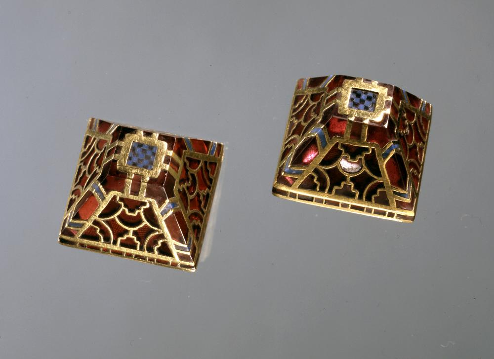
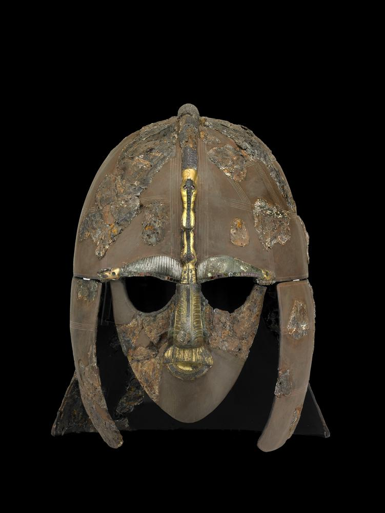
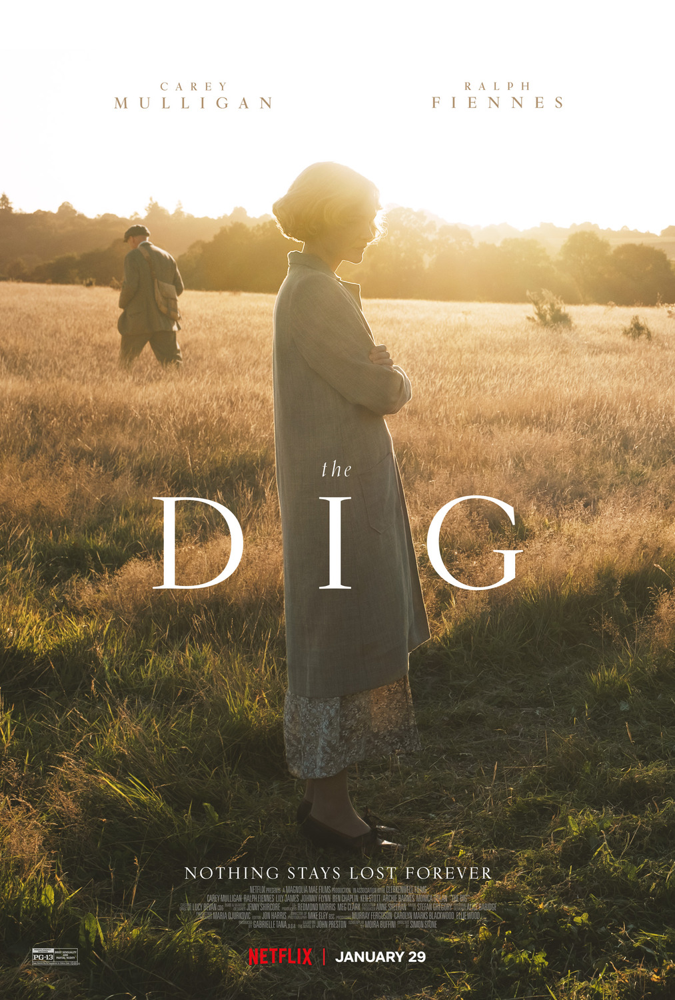



1939 年，二戰前夕，英國一座莊園的主人——伊迪．普提夫人，認為莊園的土地下沉睡著遺跡，聘請非正規考古專家巴茲爾．布朗前來挖掘。丈夫離世，與年幼兒子羅伯相依為命的伊迪，也和布朗一樣自幼便對考古充滿興趣，嚮往如同圖坦卡門陵墓的發現者（霍華德．卡特） 一樣，作為數千年來第一位見到陵墓者的感覺。

> 「他們肯定是把他的船從河邊拉到那座山上，他們會把船放到繩上，再用圓木去拉，肯定用上好幾百個人和馬匹…你能想像到他的葬禮有多浩大嗎？」
<!-- more -->

**_Warning 📢 觀影筆記和讀書筆記都會涉及劇情，請斟酌閱讀。_**

伊迪的直覺是對的，她希望布朗著手挖掘的土丘下，埋藏一座船型陵墓。正當考古作業有了重大進展，不僅當地的伊普斯威奇博物館想要插手，大英博物館也聞風而來。就在大英博物館因為英國工務部的命令接管了挖掘工作後，布朗先生負氣離去。如同布朗臨走前提醒伊迪，墓葬之所以能出土是由於伊迪的直覺，而不是工務部或博物館；布朗的妻子也提醒他，一直以來即使參與挖掘都不受重視卻還是堅持繼續，並非只想得到功勞，而是因為他知道古物對於世人的重大意義。

> 「你經常跟我說你的工作不在於過去或現在，而是著重未來，讓下一代能知道他們的歷史，使他們與祖先有所連繫，你不是經常這麼說的嗎？」

布朗回到挖掘現場，博物館方也找來更多人員，包括一名考古學家的年輕妻子佩琪。伊迪絲的表親羅伊——等待空軍徵召的年輕男性，過程中一直在旁用相機記錄挖掘現場。隨著更多人手加入，第一個墓室中的寶物終於出土，隨後又持續挖掘出更多的器物。眾人對於這批改寫對黑暗時代認知的古物感到興奮不已，與此同時，更多隱密的心思也逐一揭開：伊迪的心臟問題無法根治，將不久於人世；佩琪發現丈夫真正的性向，同時和羅伊互有好感，但此時羅伊卻被空軍徵召……

[sword-harness (pyramidal mount)](https://www.britishmuseum.org/collection/object/H_1939-1010-28) © The Trustees of the British Museum. Shared under a [Creative Commons Attribution-NonCommercial-ShareAlike 4.0 International (CC BY-NC-SA 4.0) licence](https://creativecommons.org/licenses/by-nc-sa/4.0/).

〈古寶〉並未詳細描述出土文物，而是賦予使這些文物出土的努力更豐富的意義，提供一種看待生命的方式。劇中出現幾次船載著亡者的意象：埋葬死者的遠古船型陵墓，載著墜落空軍駕駛員遺體的小船，這兩者再再提醒伊迪她的時日無多。非正規體制出身的布朗始終被排除在挖掘紀錄之外，應該最能明白被淹沒在歷史中的心情。正是這樣的他寬慰了伊迪，人死後並非什麼也沒留下，「我們是時間連續的一部份」。延續考古這個主題，人類之所以考古就是好奇自己從何而來；透過文物我們能知道文化和科技的演進都建立在前人的基礎上，每一個人在歷史中都推進了後面的時代，都留下了精神上的遺跡。

伊迪也告訴佩琪，生命如此短暫易逝，有些時刻要好好把握。羅伊在最後返回莊園與佩姬重逢，即使前途未卜，應該算是一個帶有希望的結局吧。（雖然前面伊迪已經暗示如果想要兒子死就讓他加入空軍了…XD）

我很喜歡羅伯最後和母親一起面對死亡的方式。著迷太空和冒險的羅伯，在挖掘現場的船型坑洞放置了床單和枕頭，夜晚和媽媽一起躺在「船」上看著星空。他告訴媽媽這艘船載滿子民獻給女王的寶物，要讓女王知道子民們自己可以過得很好，希望女王沒有擔憂地離開，回到天上。

如同伊迪所說，人終有一死，死後身體會腐爛，但是我們所留下的會繼續航行在時間的長河，等待著後人重新發現它，賦予它更多意義，再繼續航向更遠的地方。

> 「埋下那艘船的人，他們有何信仰？」  
> 「他們是想把船開到某處，對吧？開往幽冥，開往宇宙。」  
> 「開到人死後會去的任何地方。」

[helmet](https://www.britishmuseum.org/collection/object/H_1939-1010-93) © The Trustees of the British Museum. Shared under a [Creative Commons Attribution-NonCommercial-ShareAlike 4.0 International (CC BY-NC-SA 4.0) licence](https://creativecommons.org/licenses/by-nc-sa/4.0/).

大英博物館的 [The Anglo-Saxon ship burial at Sutton Hoo](https://www.britishmuseum.org/collection/death-and-memory/anglo-saxon-ship-burial-sutton-hoo) 專頁對電影中的船型陵墓以及出土文物有詳盡的介紹。根據內文，船型墓的年代在七世紀初，盎格魯撒克遜時期（貝武夫的年代）。考量到建造這個墓的浩大工程，加上墓室存有來自當時世界各地的寶物——拜占庭的銀器、華麗的織品、鑲金邊的飾品、斯里蘭卡的石榴石、面具頭盔，這極有可能是一位國王的墓，但因為墓室中的遺體已被出土當地的酸性土壤腐蝕，無法確知到底是哪一位國王。

專頁裡也提到了布朗和伊迪，還有當時挖掘現場的照片。有一支 3D 短片模擬了船型陵墓的原貌，還有另一支影片由歐洲中世紀早期館藏 (Early Medieval European Collections) 的館長 Sue Brunning 解說 Sutton Hoo sword（影片中還穿插一段當時挖掘的影像紀錄，抽著菸斗的布朗讓人覺得電影版好還原啊）。

另外佩姬是這部改編電影中較有爭議的角色，歷史上的佩姬在劇中挖掘時已經是位受過良好訓練的考古學家，並且和丈夫的婚姻一直持續到 1956 年。不過原著作者是佩姬的姪子，不知道他在書中是否原本就這麼寫。

© [IMDb](https://www.imdb.com/title/tt3661210/?ref_=ext_shr_lnk)

## 參考資料

[The Anglo-Saxon ship burial at Sutton Hoo](https://www.britishmuseum.org/collection/death-and-memory/anglo-saxon-ship-burial-sutton-hoo)

[網飛Netflix大片《發掘》背後的真人真事：「英國圖坦卡蒙」薩頓胡傳奇](https://www.bbc.com/zhongwen/trad/uk-55939342)

[The Dig: Is Peggy and Rory's Romance Based on Real Events?](https://screenrant.com/dig-peggy-peggy-romance-relationship-real-story-history/)

[Real story behind Netflix’s The Dig as it portrays top archaeologist as 'ditzy'](https://www.mirror.co.uk/tv/tv-news/real-story-behind-netflixs-dig-23577327)