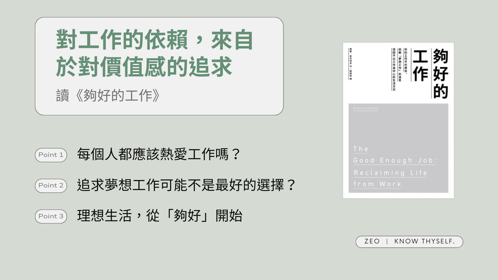

## 為什麼想讀《夠好的工作》這本書

在書店翻到《夠好的工作》時，我並未第一時間產生想買下它的衝動。我當時只想獲得「可以直接去行動」的指引，所以當下斷定它並不能立刻帶給我想要的答案。

但當我一邊看著[瓦基的年度回顧與展望直播](https://www.youtube.com/live/8fVXUekmPcQ?si=D4YAGt00ZMRAkZH9)一邊回顧 2023 年，想起和朋友聊到工作的迷惘，她語重心長地對我說「工作真的沒有那麼重要，健康才是最重要的」。我反思後發現**自己長期把工作當成重要自我價值來源，導致花很多時間在工作上或思考工作的事情，而失去自己時間和生活**，與工作關係不健康。

因此我還是想回到源頭好好面對這個問題，覺得也許這本書的內容會有所幫助，而我也很慶幸讀了它。以下分享一些我讀完後覺得有幫助的內容。
<!-- more -->

**_Warning 📢 觀影筆記和讀書筆記都會涉及劇情，請斟酌閱讀。_**

## 《夠好的工作》這本書的內容

《夠好的工作》這本書沒有提供列點式的執行步驟，而是透過作者整理幾位受訪者的經歷、各種報導和數據資料，從不同面向檢視關於工作的迷思，進而讓讀者思考自己與工作的關係。

作者也在書中坦言，即使他寫了這本書，自己也仍在摸索和工作的關係、嘗試達到理想的狀態。這聽起來令人不安，畢竟大部分職涯相關書籍都是由看起來已經相當成功的作者，舉出各種案例來告訴讀者「跟著做你也一定做得到喔！」，但我在讀完後覺得，**正是因為作者沒有隱藏地道出自己和受訪者們的困惑不安，讓我知道不是只有我有這些問題和感受，並不是我自己小題大作、我不奇怪也不孤單**，這令我感到安慰——畢竟如果連書中這些（一般社會定義中的）成功人士都有過這些迷惘的時刻、都要經過這麼長時間的摸索，我有什麼理由不容許自己迷惘徬徨，認為自己能一蹴可幾呢？

### 過度信奉「你應該熱愛工作」這個價值觀，可能對工作者個人和整體都有害

對於現代工作者而言，追尋你的熱情找到夢想工作或是在工作中發揮你的熱情，應該算是一種預設的工作價值觀了。我也非常喜歡讀各種如何找到自己夢想工作的書籍，也始終覺得還沒找到的我一定是不夠優秀、不夠努力追尋、沒有付出全力——然而，在讀完這本書之後我有了不同想法。

就像《黑馬思維》中提到「標準化思維」有其歷史背景；崇尚工作其實也是在資本主義興起、加上新教倫理強調努力工作以榮耀上帝的這種價值觀之下創造出來的。這進一步導致社會普遍以工作做為衡量成功的標準、在夢想工作中發揮熱情的「成功」範例受到媒體廣泛推崇。隨著這樣的思想成為主流，我們也將其內化，很少思考這是否是個合理的價值觀。我們只會覺得還沒樂在工作的自己彷彿是個失敗者，然後繼續深陷追尋夢想工作的無盡循環。

© [PxHere](https://pxhere.com/)

> 「你的夢想工作就在前方，所以永遠不要停止奮鬥」這種信念的問題在於，它是讓人身心俱疲的藍圖。這是一場邪惡的遊戲，創造出誘人又罕見的獎賞，幾乎沒有人能贏，但每個人都覺得有義務永遠玩下去。」
> 
> 第3章

就個人角度而言，熱愛工作的問題在於，當你看到這麼多追尋夢想工作的「成功」案例，卻不管花費多少時間金錢嘗試，都無法達到這樣的境界，**只會讓人深陷無止盡的追求，然後一再感到沮喪**。但生命中並不是只有工作，還有其他值得花時間心力追求的事情。

更何況，**即使真的得到了夢想工作，實際上的環境也不一定會是期望中的樣子，或不可能永遠都是。**書中有位受訪者因為受到圖書館員的熱心對待，認為圖書館是能包容一切的地方，在花費了大量金錢時間取得資格，進入夢想中的職場後，卻發現圖書館這個職場實際上充滿著歧視和不公。

© [PxHere](https://pxhere.com/)

> 「咖啡師的工作是整天沖咖啡，所以期望你在工作時展現出熱情，就是超出製作咖啡範疇之外的工作負擔。」
> 
> 第3章

而就宏觀角度而言，熱愛工作的問題在於，受雇者更容易覺得如果自己真的熱愛這份工作就要無條件無止盡地付出（畢竟那是你熱愛的事情呀！），而更少去爭取其它工作應得的權益和報酬（加薪、加班費、工會等等），也傾向認為如果薪資過低，都是出於自己的個人選擇，而不是社會結構的問題，進而讓企業和政府規避了責任。這種情況在一些社會賦予工作的神聖性的職業尤其明顯，例如教師、圖書館員、動物園管理員等等。

### 沒有產出 ≠ 沒有價值：把工作產出和自我價值鬆綁

© [PxHere](https://pxhere.com/)

又因為新時代工作型態的推波助瀾——把職場塑造得像是個大家庭，工作時間外舉辦各種凝聚員工的活動，提供晚餐、健身房等福利設施——**讓員工在不知不覺間花費更多時間待在辦公室，生活重心都在工作上。在沒有其他身分提供轉換的情況下，工作便成了衡量自己表現的唯一標準。**

事實上，時間的價值取決於當天的產出，這種觀念也是被創造出來的。為了讓工廠人員的工作效率最大化，管理顧問菲德烈．溫斯洛．泰勒（Frederick Winslow Taylor）拆解了每個產線的工作，並定義出最佳的工作時間。儘管泰勒的研究後來被證實存在瑕疵，他的這套以產出衡量個人價值的方式卻影響深遠，直至今日。

問題在於，**把工作和個人價值捆綁在一起，當工作出了任何一點差錯，就會動搖個人價值。**但工作是不可控的，就算你做了再多準備，大環境隨時可能改變，疫情導致的裁員就是個例子。而且我們每個人都不只是工作者，在生活中我們還有其他更多的角色：朋友、情人、家人、球迷、影迷、業餘詩人、馬拉松參賽者、挑戰百岳的人…。如果我們一昧在工作上尋求歸屬感和認同，只會讓個人價值更依附於工作。

> 在休假期間…沒有做更多情讓他感到內疚，但他沒有迴避這股內疚感，而是選擇質問它。「我認為在短暫的人生中，賦予我生命價值的事情，是為有經濟回報的企業工作做出貢獻嗎？」
> 
> 第6章

### 所以，熱愛工作、努力產出是不好的嗎？

那我們是否不該再尋找夢幻工作，在工作上也不要再費心思考如何創造更多價值了呢？我認為作者並非否定這些觀念，**而是希望我們在一頭栽進工作之前，先退一步好好思考我們與工作的關係，以及對我們而言，生命中最重要的到底是什麼？**

讀完《夠好的工作》後，我覺得值得思考和實踐的有幾件事情。

## 《夠好的工作》帶給我的收穫

### 1\. 認清工作的本質

*   工作首先是一種經濟活動。如同作者在書中提到的：**「說到底，工作就是一份經濟契約，是勞務與金錢的交換」**（第9章）。就算職場再怎麼像家庭，面臨預算壓力時公司仍會解僱員工，這與大部分家庭提供無條件支持的本質並不相同。
*   工作就是工作，工作不是生活、職場不是家庭、工作產出不等於你的個人價值，職場不應該是你唯一的社交中心，工作不應該是你唯一的熱情所在。我們可以效仿 Slack 辦公室的標語：「努力工作，早點回家（Work hard and go home）」。

© [PxHere](https://pxhere.com/)

### 2\. 思考自己與生活、工作的關係

#### (1) 培養生活優先於工作的思維：生活本身就是目的

我們總是期待週末的到來，將這兩天放鬆時間視為「工作之間的過渡」；或是把度假、休息說成「充電」，彷彿它們到頭來也只是為了工作做準備。在不知不覺間我們讓生活為了工作服務，卻忽略了生活本身才應該是我們人生的意義所在——而不是工作。

更多的閒暇時間不是為了達成其他目的的中場休息，他本身就是一種目的。雖然休息會讓人在工作（尤其是創造性工作）上表現更好，但閒暇時間不是為了讓我們在工作上更好，而是讓我們因為有時間與家人朋友相處或發展興趣，而成為更完整的人

#### (2) 劃出「夠好」的界線：期望在工作中得到什麼

前面提到，雖然社會普遍認為工作的成就 = 成功，但這只是成功的其中一種定義，每個人都可以也應該為自己訂出成功的新定義，例如書中就引用巴菲特的話，「等你們到了我這個年紀，衡量人生成功的真正標準，是你希望愛你的人當中，有多少人真的愛你」。

我認為定義自己的成功標準和價值所在，也有助於劃清工作的界線，如果沒有定義出工作（對自己而言）怎樣算是做到「夠好」，就很容易直覺用符合普世價值的方式努力做到「更好」——花更多時間加班完成做不完做不好的工作、付出更多心力追求晉升，這些都是肉眼可見的成功，但不見得對每個人都是有意義的，因為加班做完這個工作以後，還有更多的工作；努力晉升到下一個位階之後，永遠會有新的職階、新的挑戰——**如果一味地追求外在設定的獎賞，很容易陷入無止盡的追求迴圈，卻永遠沒有可以停下來休息的一天（和無止盡追尋夢想工作一樣）**。但如果為自己設定了界線，例如在這個工作能夠有穩定的收入就是夠好、能夠學到 OO 和 XX 技能就是夠好、能夠做完一直想做的 OO 專案就是夠好，才有機會中斷追逐無止盡的獎賞，轉而將精力分配到生活上。

#### (3) 辨認自己的種類

工作和生活完全切分，不是唯一的選項。並不是所有人都是必須把工作和生活清楚切分的「分割者（Separators）」，有些人天生就是習慣在生活中邊處理工作的「整合者（Integrators ）」。但了解自己在光譜中的哪一端，能幫助自己去界定工作和生活的界線。

作者也提醒，個人和工作的關係其實是流動的，或許也難以絕對切分；但思考自己理想中和工作的關係，而不是套用資本主義或社會價值的框架（沒有產出的一天就是虛度的一天），仍有助於建立和工作的健康關係。

© [PxHere](https://pxhere.com/)

### 3\. 有意識地經營生活

> 生活變成了工作，而工作變成了一連串不斷重複的日子，難以區別。
> 
> 第7章

前面提到，把工作和個人價值捆綁在一起，當工作出了任何一點差錯，就會動搖個人價值。

因此我們應該積極創造工作之外的多重身分、有意識地投資不同的價值容器，例如學習彈吉他、加入保齡球社團等。**這些身份不僅是「工作外」的嗜好或人際關係，它們本身就可以是生活的目標，更重要的是發展多重身份能讓一個人承受風險的能力更高。**如果你今天在工作上不順利，但下班後去充分地運動，或是為家人準備晚餐，都能緩和在工作上的負面感受。

但作者也提醒，我們很容易下意識就為興趣定義目標，例如挑戰跑完馬拉松或讀完一定數量的書。這種目標或獎勵導向的機制，會讓人忽略享受做一件事情的純粹快樂，實驗證明也會減少讓人主動去做這件事的動機（如果我畫畫總是能得到獎賞，那麼此後假如沒有獎賞，我就不會那麼想要去畫畫）。

**發展純粹、無目的、不在乎做得好不好的的玩樂，能幫助我們從工作中抽身，找到工作外的自己。**

至於怎樣算是身份，例如追劇者算不算，書中沒有給出一個標準。我自己的定義是需要付出努力 = 要有輸出，但不一定要做得很好的事情。例如準備餐點你必須要查食譜、買材料，還要實際動手嘗試，重點在於從嘗試中得到樂趣。

© [PxHere](https://pxhere.com/)

## 《夠好的工作》小結

讀完這本書我有個體悟，**就是真正在做一件事過程中得到樂趣、享受這件事情本身是很重要的。**若只是想著要是我做到…就會…（更富有、更好看、更開心等），或是達到…就能…（賺到多少錢就會開心、做完專案就能休息等），這就如同上面的追求成就的循環一樣，是不會有終止的一天的。

作者也在書末拋出一道思考題，如果想要破除工作中心的思維，不妨想想：**如果資本主義不復存在而你所需的一切都得到滿足，你會選擇做什麼？**

願我們經過這些思考，都能更享受生活——以「夠好」的工作。

---

**夠好的工作（The Good Enough Job: Reclaiming Life from Work）**

*   作者：Simone Stolzoff
*   譯者：陳珮榆
*   出版年份：2023
*   出版社：堡壘文化
*   閱讀平台：[Google Play](https://play.google.com/store/books/details?id=qfvkEAAAQBAJ) [圖書](https://play.google.com/store/books/details?id=gYvlEAAAQBAJ)
*   閱讀時間：2024-02