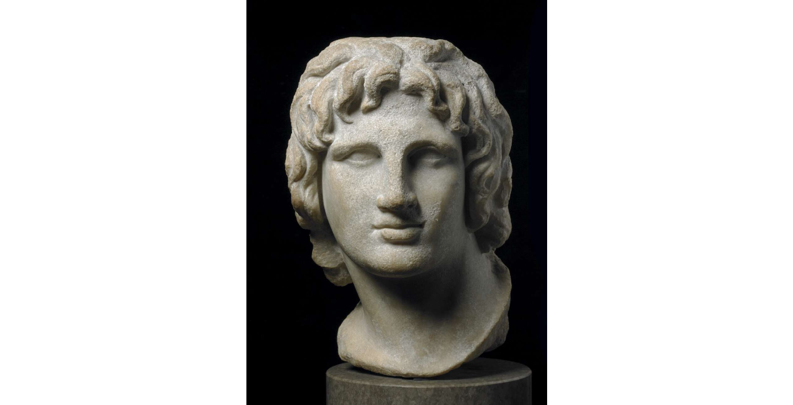
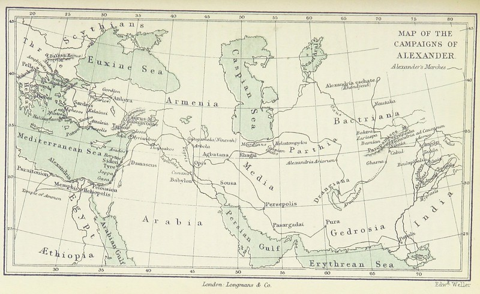
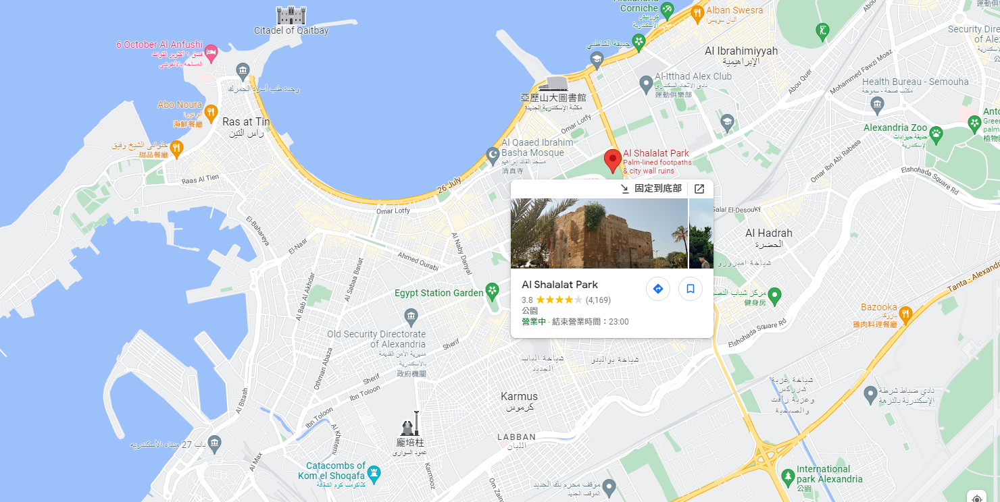
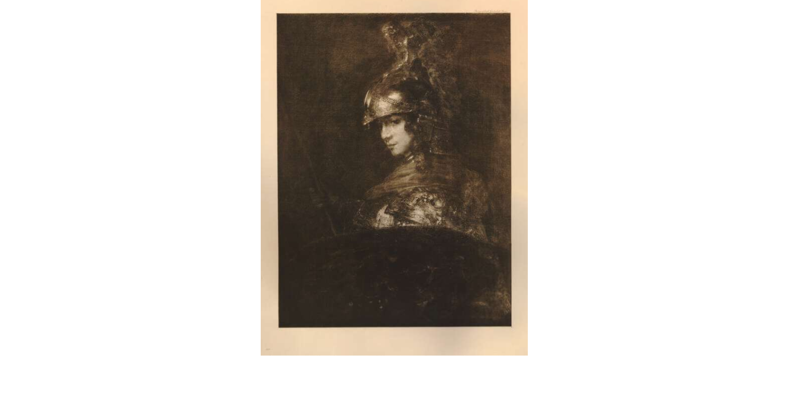

從希臘遠征至印度，影響力橫跨歐亞非三洲，將希臘文化傳播至各地，在許多地方甚至被視作神的亞歷山大大帝（Alexander the Great）——後人曾數度尋找其陵墓，然而至今尚未有人成功。

[portrait head](https://www.britishmuseum.org/collection/object/G_1872-0515-1) © The Trustees of the British Museum

## 半人半神的傳奇征服者

亞歷山大出生於西元前 356 年的馬其頓，西元前 323 年逝世於巴比倫。他曾帶領軍隊跨越 17,000 多公里，建立了超過 70 座城市，其帝國疆域橫跨埃及至巴基斯坦。

他建立了多個以自己為名的城市，其中位於埃及的亞歷山大港（Alexandria），不僅是當時帝國位於地中海的軍事及貿易中心；在西元前一世紀的希臘學者斯特拉博（Strabo）的著作《地理志》中，提到亞歷山大的陵墓就在他所建立城市的皇家小區（Royal Quarter）內，而這座古城就位於現在的亞歷山大港。

問題是，在哪裡呢？
<!-- more -->

**_Warning 📢 觀影筆記和讀書筆記都會涉及劇情，請斟酌閱讀。_**

© [The British Library](https://www.flickr.com/photos/britishlibrary/11113726534/)（取自 George W. Cox 著，《A General History of Greece》，1876年出版，頁 689；授權條款：無已知版權限制）

## 被時間掩埋的陵墓

> 亞歷山大是我成為考古學家的原因，亞歷山大是我在這裡的原因…這是我無法控制的，它來自我的靈魂。

來自希臘的考古學家佩比帕帕科斯塔（Pepi Papakosta，全名 Calliope Limneos-Papakosta），終其考古生涯尋找亞歷山大大帝的陵墓，曾經挖掘出亞歷山大的大理石雕像（在國家地理頻道的[這篇報導](https://www.nationalgeographic.com/culture/article/lost-tomb-alexander-great)中，可以看到清楚的雕像照片），引起世界關注。

她將埃及天文學家於 1866 年製作的古城平面圖與現在亞歷山大港地圖比對，認為皇家小區可能非常靠近亞歷山大港的沙拉拉特花園（Shallalat Gardens）。整部紀錄片聚焦她的考古團隊截至 2019 年在這個區域內的挖掘歷程及考古發現。

沙拉拉特花園（Shallalat Gardens）位置：

## 仍在繼續的挖掘計畫

雖然在紀錄片尾聲，佩比的團隊還沒有找到陵墓，但如同影片中另一位考古學家弗雷德希伯特（Fredrik Hiebert）所說的，他認為佩比已經比任何人都還要接近了。

挖掘的成果除了一些文物如雙耳瓶的碎片（見證了當時地中海蓬勃發展的貿易）、一條古代人造通道（由於太靠近街道和住宅區而無法挖掘），還有一座巨大希臘建築的地基——考量到它所在的位置及廣大的範圍，可能是神廟、宮殿或陵墓。這些地基以及連結它們的寬廣石板路，在過去從未有人發現。在佩比為沙拉拉特花園挖掘計畫建立的非營利組織 [H. R. I. A. C. 的網站](https://hriac.com/projects/shallalat-reports/#1630668684183-12b253c2-e607)，可以看到至少直到2021年他們還在持續挖掘，後續還出土了一些[陶器碎片和錢幣](https://www.instagram.com/hriac/)。

從紀錄片中也能看到，挖掘進度時常因暴雨或淹水而中斷，需要停下來抽水或是等雨停；而在不斷擴張的都市中，即使找到什麼蛛絲馬跡也不一定能順利往下挖掘，因為旁邊可能就是高樓大廈。在當代要挖掘遺跡，即使有更進步的技術和工具輔助，卻未必比過去容易。



佩比說，她從沒想過自己能找到亞歷山大大帝的雕像。也許很多考古學家甚至終其職業生涯也沒有任何重大發現，但他們仍堅持不懈地挖掘，期望能讓後世和他們的過去連結在一起，就像電影[《古寶》]()中的布朗先生一樣。

> 對於考古學家來說，這是一種奇妙的感覺，這是一份禮物。所以我現在沒有停下來的權利，我必須繼續挖下去。

* * *

## 馬其頓的少年亞歷山大

[print](https://www.britishmuseum.org/collection/object/P_1897-0615-21-49) © The Trustees of the British Museum

如果對亞歷山大大帝的故事有興趣，推薦瑪麗瑞瑙特的小說《天堂之火》和《波斯少年》。《天堂之火》描述從亞歷山大兒時到繼位的故事，包括與父母緊張的關係，受教於亞里斯多德，和基友夥友赫菲斯提昂緊密的情誼，希臘及馬其頓宮廷的政治局勢；《波斯少年》則從波斯人巴勾鄂斯的角度出發，敘述與波斯的戰役，遠征的旅途，一直到亞歷山大的逝世。

歷史就是歷史，儘管我們永遠不會知道所有事情的真相，也不會知道亞歷山大大帝對於他統治的子民而言，究竟比較像神還是惡魔，不過在瑞瑙特的筆下，這個馬其頓少年的故事讀來仍讓人非常著迷。

## 參考資料

* [Alexander the Great](https://www.khanacademy.org/humanities/world-history/ancient-medieval/alexander-the-great/a/alexander-the-great)

* [Alexander the Great (356 - 323 BC)](https://www.bbc.co.uk/history/historic_figures/alexander_the_great.shtml)

* [Hellenic Research Institute of Alexandrian Civilization](https://hriac.com/)

* [New clues to the lost tomb of Alexander the Great discovered in Egypt](https://www.nationalgeographic.com/culture/article/lost-tomb-alexander-great)

---

《亞歷山大大帝失落陵墓》片段：


