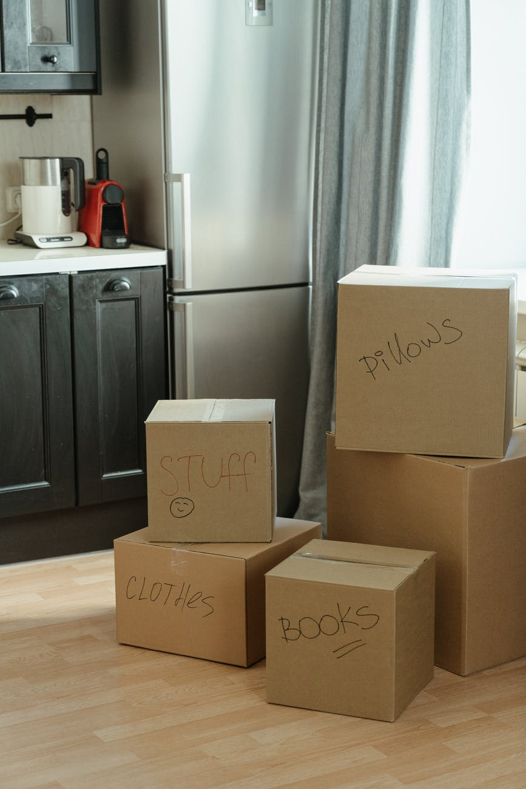
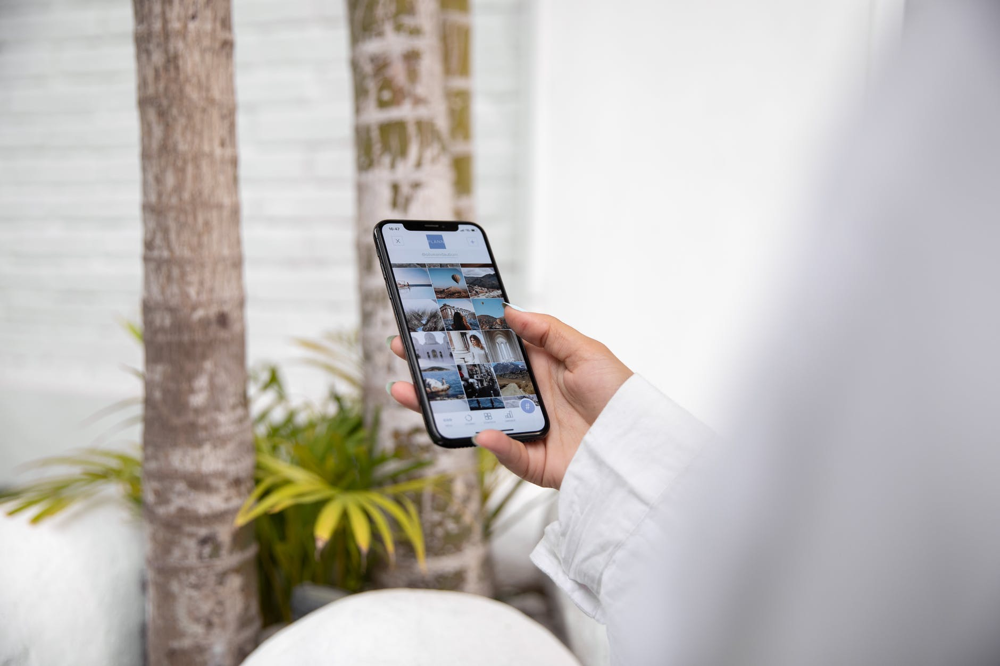
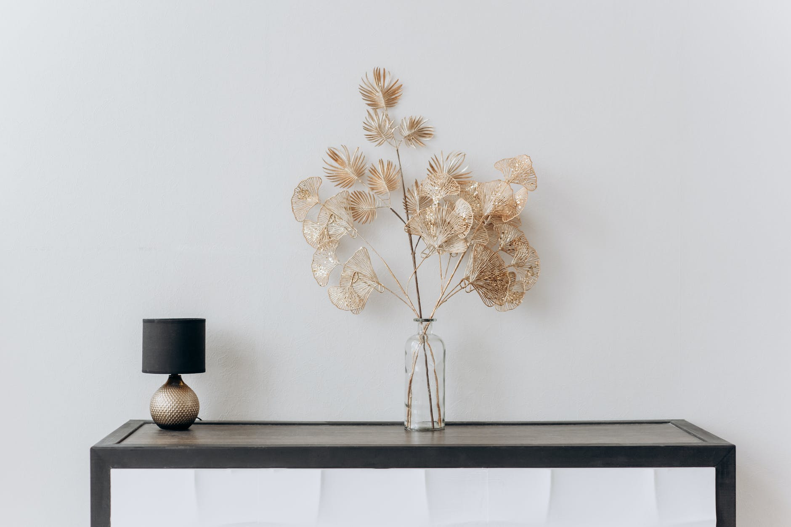
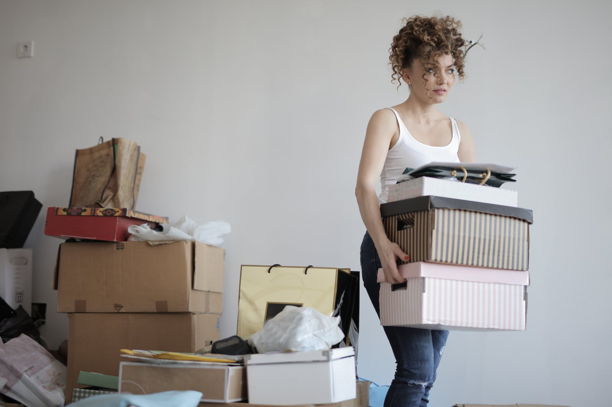
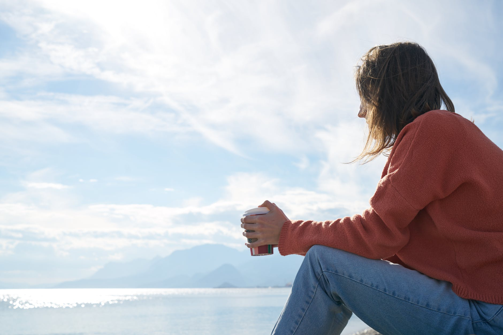
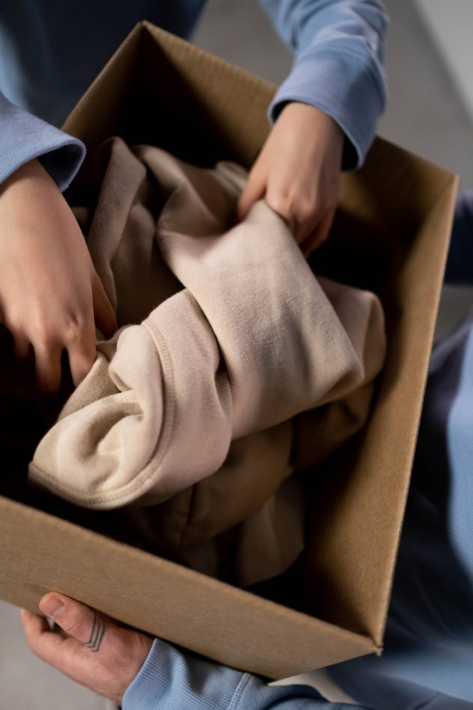

## 更多物品，更多壓力

如今我們生活的世界，廣告已無所不在。廣告不只出現在報紙的版面、建築物的外牆、電視節目的休息時段，更可能在所有我們瀏覽的貼文、影片、新聞、網路文章，甚至是搜尋結果。這支紀錄片提醒我們，這些廣告不單促使我們買更多東西，**它還會透過「擁有某樣東西你才會更好」的暗示來提醒我們：我們不夠好**。想像每天接受到數則這樣的訊息轟炸，對我們的心靈會產生何種負面影響？
<!-- more -->

**_Warning 📢 觀影筆記和讀書筆記都會涉及劇情，請斟酌閱讀。_**

Photo by cottonbro on [Pexels.com](https://www.pexels.com/zh-tw/photo/4554249/)

廣告催生對物品的渴望，而更便捷的的購物方式（網路下單、當日到貨、信用卡付款等）使取得物品更加容易，刺激我們再去獲取更多物品。我們常習慣性地想用購買物品來解決問題：影片中的母親曾經嘗試透過購買各種嬰兒用品，來解決孩子無法入睡的問題；而事實是嬰兒本來就很難入睡，這些用品並不一定能真正發揮作用。

## 更多比較，更多匱乏

影片中也提到，當人們的基本需求被滿足後，其餘的滿足感多數來自於與他人比較後的結果。在過去人們只會和周遭的人比較，而由於背景相似，大家擁有的東西都差不多。然而建立在社群媒體的生活使人們開始和社經地位差異更大的人比較，例如拿自己服裝和電影明星的服裝比較，造成更大的壓力和更多的不滿足——我們總是在比較，卻樣樣都比不上。當這些充斥在生活中的形象（更有可能它們本質上就是廣告）建構了我們對「美好生活」的想像，我們開始追求擁有更多的物品，以為這會帶給我們更多的快樂。

Photo by Plann on [Pexels.com](https://www.pexels.com/zh-tw/photo/4549418/)

廣告與比較心態的雙重作用下，讓我們養成「擁有某樣東西就會更快樂」的思考方式，**但這些對物品的狂熱會奪走我們對真正重要事物的注意力**。

銷售或行銷這些行為本身並沒有錯，但是身為消費者我們必須時時意識到，這些被推銷的東西未必是我們真正需要的。

## 更少物品，更多自由

了解到物品背後帶給我們的壓力，才能更加理解為何影片中的受訪者想推廣極簡主義。除了減少實體物品，實際上這也是一種減輕心靈負擔的方式。

> 物品助長了我們不滿足的感受，因為它們佔據了真正能帶來快樂的東西的空間

> 你得減少所謂的「需求」，這樣你才能為自己的生活創造餘裕，讓自己獨立，只要有了足夠的積蓄，必要時就能說：「我不屑這份工作」，**你的肩上不必背負大筆負債，你用你沒有的錢購買不需要的物品，以讓你不喜歡的人刮目相看**，這些行為害你放棄了獨立，放棄了自由

Photo by Mikhail Nilov on [Pexels.com](https://www.pexels.com/zh-tw/photo/6707631/)

我對於「讓你不喜歡的人刮目相看」這句話印象很深刻。有多少次我們購物時，仔細想過這究竟是為了營造自己的形象，還是真正為了讓自己過得更好呢？

## 如何開始減少物品，實踐極簡生活

影片中分別介紹兩位紀錄片主角的實踐方式：

1.  連續丟東西30天，在決定去留時思考：物品是否能提升生活價值
2.  像準備搬家一樣把所有東西都打包，在接下來3週內只拿出生活所需的物品（超級 hardcore）

Photo by Andrea Piacquadio on [Pexels.com](https://www.pexels.com/zh-tw/photo/carrying-3791617/)

萊恩（紀錄片主角之一）在實踐第 2 個方式後，發現經過3週還有80%的物品放在箱子內沒有被拿出來。他看著那些箱子想著這就是他過去十年來努力的一切，這一段讓我滿印象深刻的。我們花費大量的時間心力努力工作，賺取報酬，有些人甚至賠上健康，但我們為的究竟是自己，還是那些我們其實根本不需要的東西呢？

## 在減少物品以後

無論用什麼方式開始清理物品，都只是一個開端。如果我們不利用這些空出來的時間和空間，回頭問自己到底在生命裡什麼是最重要的，到頭來這些被清空的衣櫃和抽屜仍會再次塞滿物品，我們又會回歸到藉由擁有更多物品來填補生活空虛的老路上。

Photo by Engin Akyurt on [Pexels.com](https://www.pexels.com/zh-tw/photo/2174625/)

花一點時間靜下來和自己獨處，不要讓自己對好生活的想法被外在刺激左右。

## Less Is Now Challenge

規則：

*   第一天拋棄一樣物品，第二天拋棄兩樣，依此類推
*   丟任何東西都可以
*   丟棄的物品可以：捐出去、轉賣、回收
*   用#LESSISNOW分享進度

Photo by cottonbro on [Pexels.com](https://www.pexels.com/zh-tw/photo/6591155/)

## Action

決定當作遊戲來嘗試一下這個挑戰，但因為前陣子陸續清過抽屜和衣櫃自認東西不多（！）加上只是希望嘗試不想一開始就推到最高難度，所以我決定使用比較簡單的[每日一丟](https://youtube.com/playlist?list=PLc1yr73QJzQg1KH5j9GWURgmrRZqk46GG)版本（一天丟一樣，持續30天）。我會將進度更新在 [Instagram](https://www.instagram.com/zeo.blog/) 作為紀錄。

