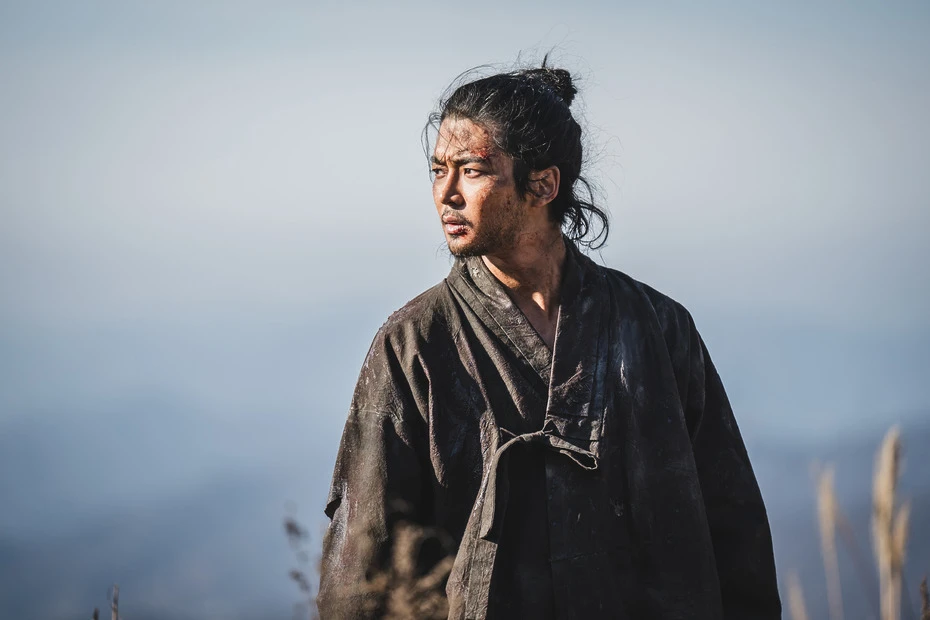

當初因為看到劇名「濁流」，誤以為是什麼黨爭劇（或許也算是）而點開《濁流之爭》。第一集真是超乎預期的好看，但之所以特別提到第一集，也是因為我覺得後面的集數並沒有延續一開始帶給我的震撼與期待感。

<!-- more -->

**_Warning 📢 觀影筆記和讀書筆記都會涉及劇情，請斟酌閱讀。_**

《濁流之爭》的故事背景設定在朝鮮王朝時期，主角張是律的母親在一次女真族的洗劫中喪生（1583 年尼湯介之亂），是律被鄭天的母親救回收養，並與鄭天情同兄弟地長大。兩人勤練武藝、夢想守護國家，成年後是律卻因祖母曾有改嫁紀錄，被取消科舉考試資格。一心想成為武官為母復仇的是律前往官府抗議，卻在反抗府吏毆打時意外縱火燒了官府而遭到通緝。在鄭天幫助下得以逃亡的是律，只好以流民身分到麻浦渡口打零工維生，卻發現自己踏入了一個由地痞主宰、同樣充滿不公的地下世界。但也正是在這裡，是律僅存的武藝意外為他贏來了尊敬與一席之地。

第一集其實就從是律出現在麻浦開始講起，開場並沒有交代這些背景，而是直接演出一個弱肉強食的世界，並暗示是律身上藏著秘密。但也正因沒有明說，除了引發好奇讓人想繼續看下去，也把亂世中人民生活的苦難具體地呈現出來——表面上看似只是惡霸地痞欺壓底層流民，背後卻是結構性的層層壓迫，而根源正是貪腐官員的默許縱容。這些訊息完全可以直接從劇情中讀到，整體處理得非常有張力。

---

前面兩、三集其實也都還行，但往後的劇情愈看愈有種說不上來的怪……我試著梳理了一下原因，覺得主要有以下幾點：

### 鋪陳很夠但期待落空

首先是看了第一集後，我開始猜測《濁流之爭》的劇情走向會不會是「結構性的問題要從各個結構去解決」，所以開場才會花這麼多精力鋪陳背後的腐敗體制。加上三位要角的設定分別是：不得已成為地痞的是律、在國家體系內的武官鄭天，以及商人之女崔恩，這更讓我隱隱期待三方會聯手去解決結構性問題（雖然結尾…勉強…算是有吧？）。但整體看下來，還是給我一種「靠個人層面的恩怨和武力解決來推動大局」的感受。當然，看完整部劇確實也能體認到，要在那樣的亂世從底層去推翻不公體制有多困難，但就…可能一開始我擅自放了太多期待吧。

### 細節撐不起氛圍的重量

其次是王海等反派原先被塑造得十分陰狠，結果後面卻好像愈來愈降智。當然我很希望看到惡有惡報，但跟鄭天五打一的時候，現場竟然沒有一個人想到要去追逃跑的崔恩嗎！大護軍也有類似的問題，起初感覺是個可靠的角色，沒想到秘密製作地圖的地方也太不秘密了，掩護這麼少，一下就被偷窺。總之就是前期氛圍塑造得超級好，結果卻敗在一些小細節上，讓人覺得非常可惜。

### 存在感微妙的支線

女主角（甚至不確定她能不能算女主角）崔恩的故事線也有點微妙。她的人物設定其實蠻有趣的，出身商賈之家，由於哥哥不想繼承家業、一心想當官（只能說哥哥掌握了真正的財富密碼），加上崔恩對經商興趣濃厚，父親也有意讓她接班。原以為劇情會有更多她的成長刻畫，但實際比重卻不多；應該說看似有三名要角，真正的重心還是只有男主角是律這一條線。

中間一度還以為崔恩要跟其中一個男人談戀愛，結果也沒有。前幾集有段是律跑去對她叫囂的劇情，無論在邏輯上（打工沒收到薪水不找老闆討，跑去問客人是什麼意思）還是互動上（是律嗆說「試著挨餓三天，你也會為一升米解開自己的衣帶」，崔恩竟然回「那你就來解解看」，此處令我看得滿頭問號——也因為這邊崔恩看起來很嗆，我一直期待她會在接班過程洗臉地痞老大，結果也沒有🥲）都顯得不太合理。一開始我還以為這段是為了鋪陳感情線才硬加的，但全劇又沒有任何戀愛要素，導致這場戲顯得更加唐突。

此外，女主角的哥哥原本也讓人覺得應該蠻有料的，看起來像是要一步步進到權力核心的人物，沒想到他出場只說要去念書，然後就無疾而終了。

---

好吧，缺點說完來說說我覺得《濁流之爭》有趣的地方。前面也提過，這部劇真的把那種層層吃人的社會結構展現得很透徹，只可惜後續沒有好好發揮。但也或許，這正是本劇想傳達的無奈：底層人民終究很難撼動結構，只能從私人層面去尋求解決。

另外，劇中部分設定也蠻用心的，例如把「地圖」作為重要戰略情資這點，很符合當時的時代氛圍。

再來就是演員的演技都蠻能支撐劇情的，尤其是男主角這一線的角色。上一次看路雲的劇是《戀慕》（但沒看完），當時對他的演出印象沒有太深刻；但這次他在《濁流之爭》裡，確實有呈現出是律在凶狠時可以生人勿近、放鬆下來又帶有一種呆呆的反差感，情緒轉換拿捏得很好。另一個讓人印象深刻的絕對是「武德」，不管是角色本身的塑造還是演員的表現都非常厲害，把亂世中小人物貪生怕死、但又不失人情味的性格演繹得很真實。

總之，《濁流之爭》整體來說就是有那麼一點可惜，但至少第一集（？）還是值得一看。

© [Vogue Korea](https://www.vogue.co.kr/?p=694599)

---

**濁流之爭**

*   導演：秋昌民
*   播映年份：2025
*   觀看平台：[Disney+](https://www.disneyplus.com/series/wp/15IBSkBsNYJf)
*   觀看時間：2026-11