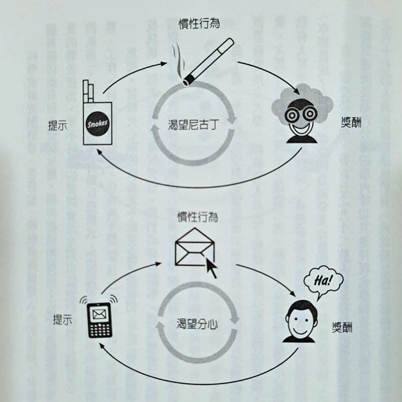
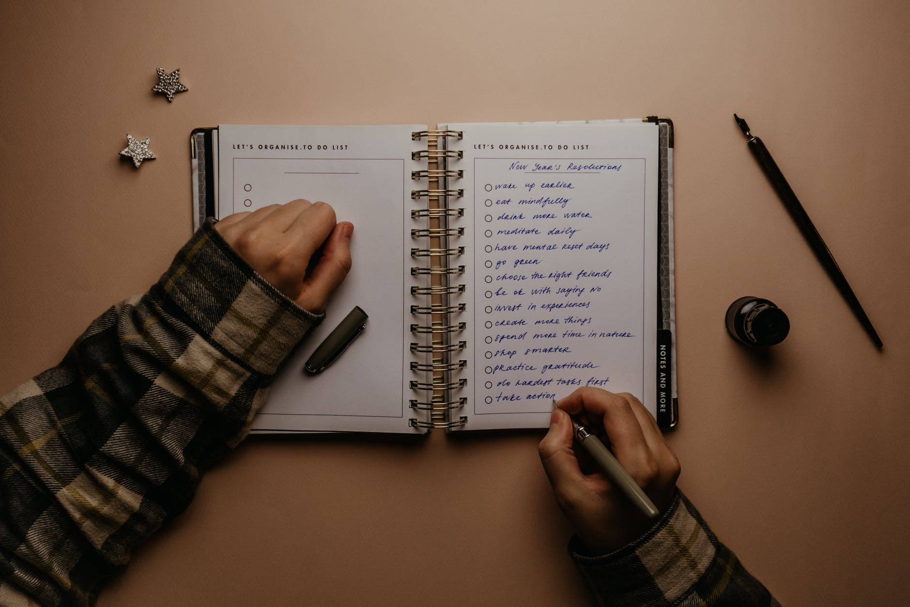

中文書名有點看不出所以然，原文書名（_The Power of Habit: Why We Do What We Do in Life and Business_）比較能看出本書講的其實是習慣，和工作其實沒什麼太大關係，好像又被騙了。本書有點像是故事版的《原子習慣》，《原子習慣》給的是明確的指引和實行步驟，這本書則是旁徵博引各種研究數據並輔以真實事件作為範例，讓人更了解習慣在個人身上、企業中甚至是整個社會裡扮演什麼樣的角色，以及要如何改變習慣。

這本在書架上躺了超久，最後用一天快速掃完😂

## 本書分成三大部分：

1.  個人的習慣
2.  成功組織的習慣
3.  社會的習慣

Photo by Andres Ayrton on [Pexels.com](https://www.pexels.com/zh-tw/photo/6551415/)
<!-- more -->

**_Warning 📢 觀影筆記和讀書筆記都會涉及劇情，請斟酌閱讀。_**

## 個人的習慣

### 1 習慣迴路—習慣如何運作？

點出本書幾個重點：

*   習慣的重要性：人們每天的活動中有40%是習慣使然而非決定
*   習慣迴路：提示→慣性行為→獎賞
*   習慣可以改變
    *   舊習慣不會完全消失，只能設法讓新習慣凌駕它
    *   習慣很脆弱，只要改變迴路中的提示，習慣就會輕易瓦解

### 2 大腦的渴求—如何建立新習慣？

提示→慣性行為→獎賞  
│　　　　↑　　　│  
└───→渴望←──┘  
（獎賞滿足渴望，渴望加強慣性行為，將來只要遇到提示就會聯想到渴望）

例如：

*   聞到肉桂捲香味，就會引起想吃肉桂捲的渴望
*   看到香菸就會渴望尼古丁的刺激

新習慣就是這樣養成（p.67）

### 3 改變習慣的黃金律—為何轉變會發生？

習慣只能改變，不能根除。改變習慣的方式：

1.  維持原本習慣的提示和獎賞迴路
2.  改變慣性作法

具體做法：

1.  察覺習慣的提示。例如：感覺到無聊→就會咬指甲
2.  執行對抗反應，對抗反應必須能滿足渴望。例如：搓揉手臂（生理上的刺激←→無聊）
3.  察覺獎酬，以找到能提供類似獎酬的行為模式
4.  相信有改變的可能。例如：加入互助團體

Photo by RF.\_.studio on [Pexels.com](https://www.pexels.com/zh-tw/photo/3621168/)

## 成功組織的習慣

### 4 核心習慣—哪些習慣最重要？

*   成功不是堅持把每個習慣都做對，而是專注於核心習慣
*   核心習慣有助於帶動其他習慣開花結果  
    例如：減重者從每週至少記錄一天飲食（核心習慣），到開始注意自己的三餐和飲食習慣（其他習慣）
*   利用小小的成功（小贏）帶動轉變

關於小贏，如果想知道多一點可以看這篇文章。文中提到關於 keeping a daily diary 的文章有中文版〈[小進展大力量](https://www.hbrtaiwan.com/article_content_AR0001732.html)〉：

https://ideas.ted.com/how-to-make-your-small-wins-work-for-you

原始影片版，裡面提到的很多內容其實也跟本書互相呼應，像是利用慣性行為和小贏達成目標：



### 5 星巴克與讓人成功的習慣—如何讓意志力自動運作？

意志力像肌肉，用得愈多就愈累。例如：如果想要下班後去跑步，就得在白天儲存意志力肌肉的精力；如果在白天就已經被無聊工作耗盡精力，晚上就更少有意志力能去跑步

  
訓練意志力→改變思考方式→控制衝動、不去注意誘惑。例如：參與金錢管理計畫的實驗者，開始記錄花費後，除了財務情況改善，也更少吸菸、喝酒、吃垃圾食物（某部分的意志力肌肉增強後，會影響到生活其他層面）

  
養成意志力的習慣：

*   設計意志力習慣。例如：如果碰到A困難，就執行B行為。例如：復健病患寫下復健計畫，詳述預計如何面對困難（轉折點）的方法後，復原速度比沒有這麼做的人快上兩到三倍
*   預先設想碰到轉折點的處理方式，並透過演練使其成為慣性行為。例如：星巴克教導員工利用 LATTE法（傾聽 Listen，表示聽到了抱怨 Acknowledge，採取行動解決問題 Take action，謝謝顧客 Thank，解釋問題為什麼會發生 Explain）應對顧客抱怨

  
如果人們在做需要意志力的行為時，感到較多控制感，或相信是為了自己的選擇自發性地去做，就不會那麼消耗意志力

### 7 連鎖零售商搶先知道你要什麼—企業如何預測與操縱習慣？

零售商的例子：

*   對零售業而言，懷孕婦女或新手父母能帶來最多利潤
    1.  他們什麼都想買
    2.  他們對價格不敏感
    3.  他們會順便買一切需要的東西

*   先買健康食物後，就更容易把垃圾食物放進籃子

*   人們習慣一進商店先右轉，因此應該把利潤高的商品放在右側

*   不照字母規則排列的商品，會讓人為了找尋而在貨架前逗留更久

音樂產業的例子：

*   經典歌單理論：電台播新歌時，要將新歌夾在兩首已經很紅或很黏（讓人忍不住聽下去）的歌中間→用舊習慣包裝新東西，能增加接受度

Photo by Jack Sparrow on [Pexels.com](https://www.pexels.com/zh-tw/photo/4199238/)

## 社會的習慣

### 8 蒙哥馬利公車抵制事件—社會運動如何發生？

社會運動的三個階段：  
**強連結**（例如：親近友人）使社會運動出現  
↓  
**弱連結**（例如：同儕壓力）使社會運動擴大  
↓  
**新習慣、新認同**使社會運動持久（自我持續）

弱連結的影響力可能比強連結更大，因為透過弱連結能得到系統之外的資訊，或進入原本不屬於的社交網絡（例如：透過弱連結得知新的工作機會）

### 9 自由意志的神經學—我們該為自己的習慣負責嗎？

如何重塑一個習慣：

1.  下定決心
2.  找出提示和獎酬
3.  找出替代方案
4.  知道自己有掌控的能力，並使用它

Photo by Kelly L on [Pexels.com](https://www.pexels.com/zh-tw/photo/4552844/)

看完這本書之後反思了一下自己的生活，覺得比較有收穫的幾個地方：

### 更有意識地慶祝小贏

我有意識到一些自己創造的小贏時刻——為自己煮一頓晚餐、又出去運動一次，但我並沒有很有意識地慶祝這些小贏。結果就是儘管已經持續運動了一陣子，每次看到自己體態不佳的部分，或是看到體態非常好的人，還是會覺得自己做得不夠，但事實上我的生活已經因為運動有顯著的改善，像是身體變得比較好、也稍微變瘦了。不過具體要怎樣「慶祝」更能促成繼續做下去的動力，我也還沒有頭緒；但至少要更正面地肯定自己的小贏。

### 消費習慣

這一章提到的很多消費習慣，因為以前沒有特別注意，讀到時覺得還滿有趣的，像是「人們習慣一進商店先右轉，因此應該把利潤高的商品放在右側」。

### 核心習慣

在看這本書的時候還沒有共鳴，是在看完一陣子，發現運動習慣開始發酵以後，有注意到自己在不知不覺中也改變了飲食習慣，比較少吃零食和喝飲料，才真正對核心習慣的概念比較有感。

### 設計意志力習慣

這是我在讀完後比較想嘗試應用到生活中的一個工具，用在自己想要偷懶、拖延或是遇到困難卡關的時候。

Photo by Polina Kovaleva on [Pexels.com](https://www.pexels.com/zh-tw/photo/5717430/)

另外關於 _How to make your small wins work for you_ 這篇文章提到的 daily diary 也想分享一下：我沒有特別針對小贏去寫日誌，但我會根據不同的目的每天記錄工作完成的情況（可能是職場或日常的工作），像是《做自己的生命設計師：史丹佛最夯的生涯規畫課，用「設計思考」重擬問題，打造全新生命藍圖》中的好時光日誌，以及我會記下讓自己感覺好的事情。記錄到目前感受到的幾個好處：

1.  雖然紀錄不一定總是有激勵的效果，有時候一天的目標都沒有達成，甚至只完成其中一個，都可能讓人沮喪（所以才會覺得慶祝小贏這麼重要）；可是反之當我實際完成了一件事並把它記下來的時候，會產生「我能夠」的感覺——會讓我在比較沮喪的日子，能夠提醒自己就算我今天沒有達成，但我曾經做到，我是有能力再去完成這件事的。
2.  我會比較留意希望自己達成的這些事情，即使不特別督促自己去做。像是開始記錄感覺好的事情之後，並不一定每天都能做到，但是每天 review 的時候都會再提醒自己，記得做一些讓自己感覺好的事情。