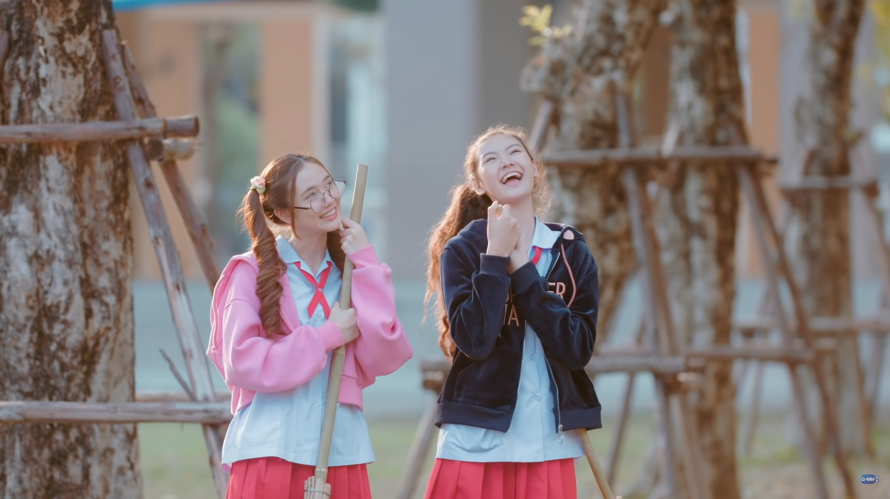
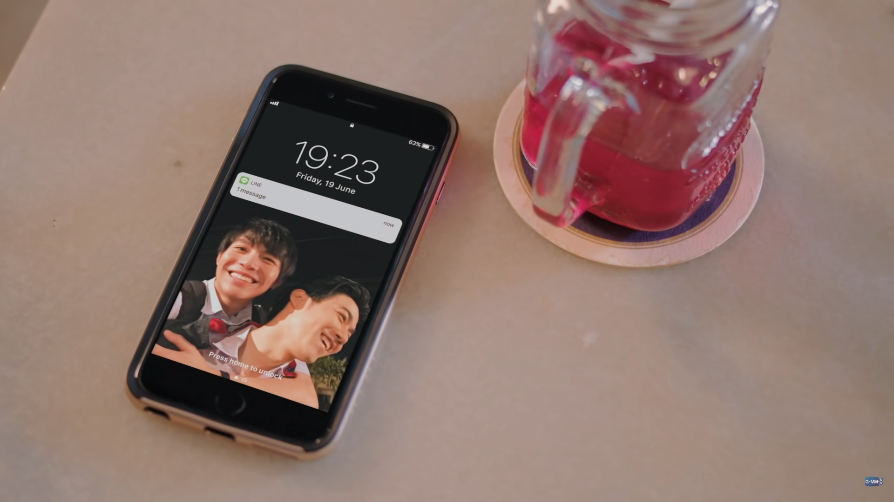
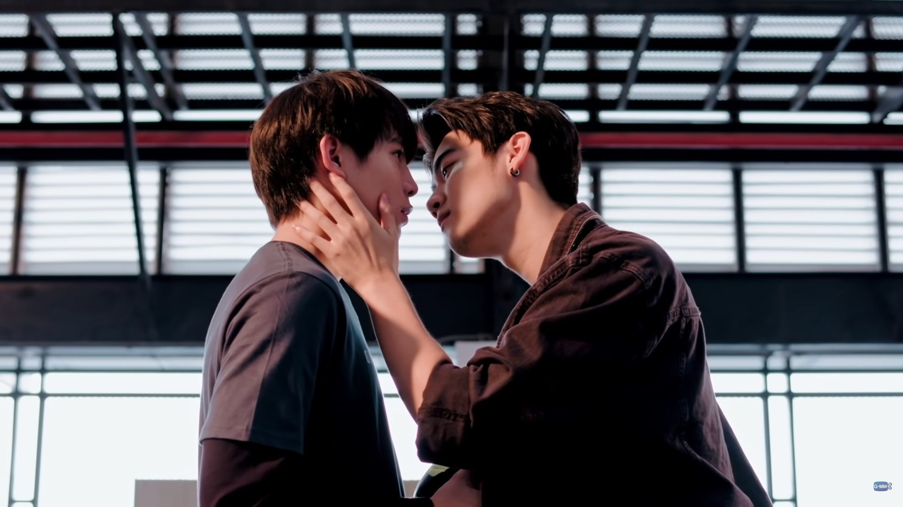
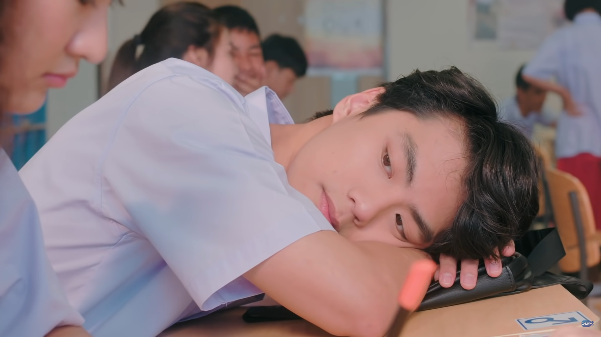

沒看任何預告就直接打開《The Shipper》，以為會是普通的腐女日常生活加 CP 幻想成真，沒料到劇情如此超展開，看得我十分歡樂。喜歡這部劇用喜劇的明亮色彩和輕快節奏包裝人生議題，雖然有很多看似老梗的元素和看似荒唐的情節，但在精心安排的劇情和轉折下這些元素被融合得非常好，整體看得很舒服，是一部能以輕鬆心情開啟，看完也能帶著收穫離開的好劇。
<!-- more -->

**_Warning 📢 觀影筆記和讀書筆記都會涉及劇情，請斟酌閱讀。_**

## 現實比小說更離奇？

Pan 和小夥伴 Soda 是熱衷於把學校風雲人物湊對的腐女，她們最愛的 CP 是：由於太常打架總在不良學生名單上的學長 Way，以及功課頂尖常代表學校去比賽的學長 Kim。兩人原本只是在小說裡寫下她們幻想中 Way 和 Kim 的 CP 生活，沒想到在一次意外後，Pan 和 Kim 靈魂交換，她的靈魂竟然跑到 Kim 的身體裡了。

©️ [GMMTV OFFICIAL](https://www.youtube.com/c/gmmtv/featured​​)

和所有廣大腐女同胞一樣，Pan 首先想到的除了能針對最愛的 CP 做田野調查，更重要的是她可以幫忙撮合 Kim 跟 Way 了！所以儘管扮演另一個人很困難，尤其是聰明又受到大家喜愛的 Kim，但為了 CP 的幸福她必須努力渡過這些難關。但比這更困難的是，她沒有想到現實中的 Kim 跟她們想像中的完全不一樣，也許他根本不是一個好人…

## 事情會發生都是有原因的

在第一集，Pan 去向 Kim 坦白自己是寫小說、害 Way 差點被退學的人時，Kim 沒有責罵她，只是問她：妳湊 CP 是希望喜歡的人能跟好的人在一起，那妳呢？妳沒想過和自己喜歡的人在一起嗎？這可能是 Pan 第一次認真思考這件事情，她回答 Kim：**「我還沒有好到可以去愛一個人。」**

但 Kim 希望她也能試試看——這就是 Kim 在人世和 Pan 最後的對話，也是整部劇想傳達的：Pan 的成長，從把期望放在別人身上，到肯定自己和珍惜身邊重要的人。

## 有時候不是我們不夠好，只是我們沒意識到自己的內在是好的

因為認為喜歡的人就是要跟「夠好」的人在一起，在了解到 Kim 其實不如她們想像中那麼好，而是一個冷漠的哥哥和會偷考卷的學生時，Pan 採取的行動也非常極端：她要忍痛破壞 Kim 和 Way 的友誼，再幫 Way 找一個「更好」的人湊 CP（劇情巧妙的地方在於，這時候 Way 發現自己真的喜歡上 Kim 了）。

©️ [GMMTV OFFICIAL](https://www.youtube.com/c/gmmtv/featured​​)

但從 Way 的口中她發現了從不知道的 Kim 的一面：是 Kim 讓 Way 願意去上學，努力唸書教 Way 好讓他能順利畢業，參加各種不想參加的競賽只為有籌碼讓學校保住 Way 的學籍。Khet 也告訴她，其實哥哥對他的冷漠是有原因的，不是像她表面上看到的那麼簡單：父母從小嚴格要求 Kim，希望他當弟弟的好榜樣，不管是課業、玩具或人生，Kim 都沒有太多選擇；不像備受寵愛的 Khet——弄壞了哥哥心愛的玩具，結果挨罵的還是哥哥——這導致 Kim 從此不願意跟弟弟玩在一起。

©️ [GMMTV OFFICIAL](https://www.youtube.com/c/gmmtv/featured​​)

沒錯，Kim 也許有種種不是，但他也有苦衷，Pan 能幫他決定是否要開始或從關係中離開嗎？他有糟到不值得被愛嗎？**事情會發生都是有原因的**，除了本人以外，很少人能夠了解到一個人的所有面向，知道曾經發生在他身上的所有事情；但偏偏人在看自己的時候又容易有盲點，就像 Pan 認為自己沒資格愛人，甚至不值得活下去；可是 Soda 眼中的 Pan 懂得保護朋友，Khet 眼中的 Pan 心地善良又總是關心別人。所以這個人到底是不是「夠好」，應該由關係中的雙方去決定，而不是其他人，就像 Pan 不能幫 Way 決定 Kim 是不是一個好的對象，也不能幫 Khet 斷言 Kim 就是一個壞哥哥，因為每一個人看到的面向都是不同的。

## 難道別人的快樂比自己的更重要嗎？

在發現了 Kim 也有不那麼壞的一面，甚至 Way 和 Khet 都在期待真正的 Kim 回來，而 Kim 的靈魂卻已經不在的時候，Pan 猶豫了。她原本那麼想把身體交換回來，但此刻她認為 Kim 比自己更值得活下來，於是打算假扮 Kim 繼續活下去，讓 Pan 的身份就這麼死去。Khet 得知後非常生氣，除了罵她不珍惜自己，更質問她：你做為 Kim 繼續活下去，你覺得這是 Kim 真正想要的嗎？

©️ [GMMTV OFFICIAL](https://www.youtube.com/c/gmmtv/featured​​)

Khet 用 Pan 最能接受的方式說動了她，而 Pan 也在看到 Kim 留下的機票後，明白了 Kim 真正的想法：Kim 希望的是每個人都能走自己想走的路，選擇自己想要的未來，每個人都能擁有自己的幸福。就像第一集他希望 Pan 嘗試找尋自己的愛情，就像他給了自己和 Way 飛向不同目的地的單程機票。**「我們不應該為了另一個人，而犧牲自己的未來」**，這是 Kim 想告訴 Way 的話——就算 Kim 不在了，他也希望 Way 朝自己的未來走去（看到 Kim 和 Way 道別的那一幕真的好鼻酸）；這也是 Kim 想讓 Pan 知道的，她不應該為了扮演 Kim 而犧牲自己的生活。

最後在 Khet 真愛之吻的幫助下，Pan 終於成功將靈魂換回自己的身體，也在了解 Khet 的心意後和他交往（還好還有這一對可愛的 CP，不然也太傷感了）。回到自己身體的 Pan 依然和 Soda 寫著最愛的小說，但和一開始的意義已經不同：從純粹想像他人的人生，變成陪伴 Way 走過人生旅程的方式。最後的結尾依然非常有 Pan 的風格：她看著新發現的 CP 重新燃起了腐女魂，Khet 雖然又無奈又好笑，但依然在 Pan 身旁陪伴著她。

* * *

雖然結局留有遺憾，但劇中許多角色的互動和情誼還是讓人覺得很溫暖。Soda 和 Pan 互相陪伴的友情，Khet 一邊捉弄 Pan 一邊默默守護著她，Pan 在 Kim 體內時盡力以哥哥的身份照顧 Khet，還有 Khet 跟 Way 因為 Kim 而彼此惺惺相惜。在最後一集片尾舞蹈看到 [Kim 和 Way 一起出場](https://youtu.be/jl9k29GL1sA?t=975)時不禁熱淚盈眶，願我們和我們的 CP 都幸福，#waykimforever

可以在 YouTube GMMTV 官方頻道收看《The Shipper》：


