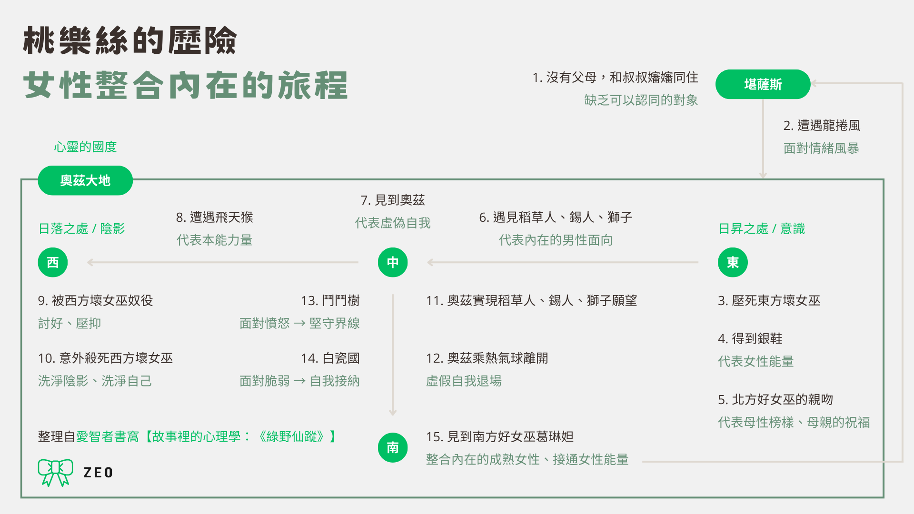

[《綠野仙蹤故事集：奧茲大地的神奇巫師》](https://www.commabooks.com.tw/book/1772)是在 2023 年時的牯嶺街書香創意市集逛到逗點的攤位，好像是因為總編說這本書很適合長大之後跌跌撞撞受了傷，需要來點療癒能量的人（具體記不太清楚了XD），所以就和《工作排毒：讓你咻咻咻的工作編輯術》一起入手了。
<!-- more -->

**_Warning 📢 觀影筆記和讀書筆記都會涉及劇情，請斟酌閱讀。_**

## 《綠野仙蹤故事集：奧茲大地的神奇巫師》說了什麼

看完以後回想小時候看過的綠野仙蹤，應該都是改編的版本，讀的時候有滿多新發現的細節。

綠野仙蹤的故事從大家都很熟悉的，桃樂絲在堪薩斯的住的房子被狂風吹走，因而和小狗托托降落在奧茲大地，意外壓死東方壞女巫，得到了壞女巫的銀鞋開始。

想回到堪薩斯的桃樂絲，在得到北方好女巫的親吻祝福後，踏上前往中央翡翠城的旅程，希望能請求巫師奧茲幫她回家。途中她救了想得到腦袋的稻草人、想得到心的錫人、想得到勇氣的獅子，他們決定一同前往翡翠城請奧茲完成他們的願望。

就在一行人同心協力、排除萬難到達翡翠城後，奧茲卻要求他們殺了西方壞女巫，才願意替他們實現願望。

善良的桃樂絲儘管不情願傷害人，為了回家只好和伙伴再次出發，踏上前往西方的旅程，一行人也分別用自己的特長擊退西方壞女巫派來的手下，桃樂絲和獅子卻仍被西方壞女巫用魔法金帽子召來的「飛天猴」抓走。壞女巫想要得到桃樂絲腳上的魔法「銀鞋」，本想用計趁桃樂絲跌倒時把鞋子搶過來，卻反而使桃樂絲一怒之下朝她潑水，讓怕水的壞女巫不小心融化，招致自己的末日。

殺了壞女巫後，一行人高興地回到翡翠城，卻失望地發現奧茲不過是個騙子——他其實一點法力也沒有，只不過因當初乘著熱氣球「從天而降」來到奧茲大地，當地人便以為他是大魔法師，而他也就順勢假裝成一名法力高強的人。儘管沒有法力，在一行人央求下，他仍然答應給予他們所求之物。他用填塞了針和釘子的稻草作為「腦袋」放進稻草人的頭，用絲線和木屑做成的「心」放進錫人的體內，用瓶裝的液體當作「勇氣」讓獅子喝下，也想出了用熱氣球帶桃樂絲和自己一起回家鄉的法子。

可惜，在熱氣球升空之日，桃樂絲為了找托托來不及跳上熱氣球。她只好又轉向最後的希望——南方好女巫葛琳妲。得到了所求之物、信心滿滿的夥伴們再次陪伴桃樂絲踏上旅程，也順利用他們的特長解決了旅途中的困難，見到了葛琳妲。一行人表達來意後，葛琳妲卻告訴桃樂絲驚人的消息：其實她腳上那雙銀鞋的魔法，就能帶她去到任何地方，包括回到堪薩斯。桃樂絲和夥伴們一一告別後，便叩了叩腳上的銀鞋，在一陣狂風中降落在堪薩斯的草原上。

## 《綠野仙蹤故事集：奧茲大地的神奇巫師》讀後感想

讀完後覺得故事核心是想告訴讀者，**即便沒有外在的認可，其實你早已擁有自己渴求的力量。**

但對一些書中情節仍有疑問，後來查到[【故事裡的心理學：《綠野仙蹤》】](https://philosopheroccultism.wordpress.com/2019/03/20/%E3%80%90%E6%95%85%E4%BA%8B%E8%A3%A1%E7%9A%84%E5%BF%83%E7%90%86%E5%AD%B8%EF%BC%9A%E3%80%8A%E7%B6%A0%E9%87%8E%E4%BB%99%E8%B9%A4%E3%80%8B%E3%80%91/)這篇用榮格心理學分析《綠野仙蹤故事集：奧茲大地的神奇巫師》的文章，發現很多有趣的觀點，非常推薦一讀。

1.  桃樂絲的整個歷險，其實代表了女性個體化的歷程。下圖就是整理自[【故事裡的心理學：《綠野仙蹤》】](https://philosopheroccultism.wordpress.com/2019/03/20/%E3%80%90%E6%95%85%E4%BA%8B%E8%A3%A1%E7%9A%84%E5%BF%83%E7%90%86%E5%AD%B8%EF%BC%9A%E3%80%8A%E7%B6%A0%E9%87%8E%E4%BB%99%E8%B9%A4%E3%80%8B%E3%80%91/)這篇文章，旅程各個階段與背後隱含的意義：

2.  桃樂絲在旅途中遇見的夥伴，也是本書的重要配角們：稻草人、錫人、獅子，**其實代表了女性內在不同的的男性面向。**

| 人物 | 想要的東西 | ←背後議題 | 看到的奧茲形象 | ←代表意義 |
| :--- | :--- | :--- | :--- | :--- |
| **稻草人** | 腦袋 | 理性須結合感性 | 美麗女子 | 情感面、感性面 |
| **錫人** | 心 | 願意卸下武裝、允許自己受傷 | 野獸 | 反映內心的攻擊性 |
| **獅子** | 勇氣 | 願意虛心求助、自我肯定 | 火球 | 反映需要自我肯定 |

3.  除了渴求的力量本就在自己裡面，**更重要的是需要有機會（困難）並且願意使用（面對困難）這些力量，它們才得以真正為你使用。**

4.  女性個體化的旅程和男性有所不同：男性只要完成冒險、達到目標便結束，**女性則還要歷經回歸自身、接通女性能量的階段。**

5.  另外，這篇文章也解答了許多我在閱讀時的疑問：

*   **桃樂絲最愛的小狗，托托的象徵意涵？**
    *   托托在故事中是很多重要轉折的推手：故事開始桃樂絲為了追托托才沒有躲進防風洞，後來桃樂絲也是因為找托托才沒有搭上熱氣球。
    *   文章裡提到許多故事中女性總是和動物有著較強的連結（例如白雪公主身旁的小動物），動物通常也代表女性內心童真的一面。可能是因為這樣，單純而充滿好奇的托托，才為桃樂絲帶來這麼多歷險和成長的機會。
*   **故事中為什麼要分東南西北四個國家和女巫？**
    *   東西方是壞女巫，南北方是好女巫，由中央的奧茲平衡四方，可以呼應「[萬象森列，圓融有序的曼陀羅](https://www.hk01.com/article/181827?utm_source=01articlecopy&utm_medium=referral)」圖形。
    *   而桃樂絲由東方壞女巫的國家走到中央的奧茲國，再從奧茲國出發到西方壞女巫的國土，正好是由東至西，從日出之處走到日落之處，象徵著意識和陰影。而前後殺死東西方壞女巫則暗示單獨偏重意識或陰影都是不合適的。
*   **抵達南方好女巫葛琳妲國度前進入的白瓷國，代表著什麼？**
    *   桃樂絲一行人是在穿過會攻擊人的鬥鬥樹林後，才進入瓷器國。瓷器國裡無論居民或動物都是瓷製的，非常脆弱易碎。這代表著憤怒的表象下（鬥鬥樹）總是隱藏著脆弱（白瓷國），而唯有面對和接納自己的脆弱，最終才有機會接通女性的能量（葛琳妲）。
    *   坦白說讀到這一段的時候覺得白瓷國出現得有點突兀，因為人造物的瓷器和充滿自然風光的奧茲大地格格不入，但看了這篇文章後覺得好像也說得通XD

---

**綠野仙蹤故事集：奧茲大地的神奇巫師（The Wonderful Wizard of Oz）**

*   作者：Lyman Frank Baum
*   譯者：陳婉容
*   出版年份：2023
*   出版社：逗點文創結社
*   閱讀平台：實體書
*   閱讀時間：2024-03