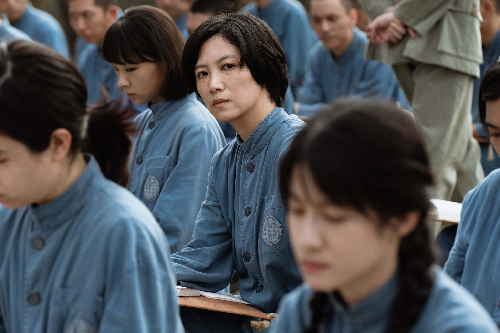
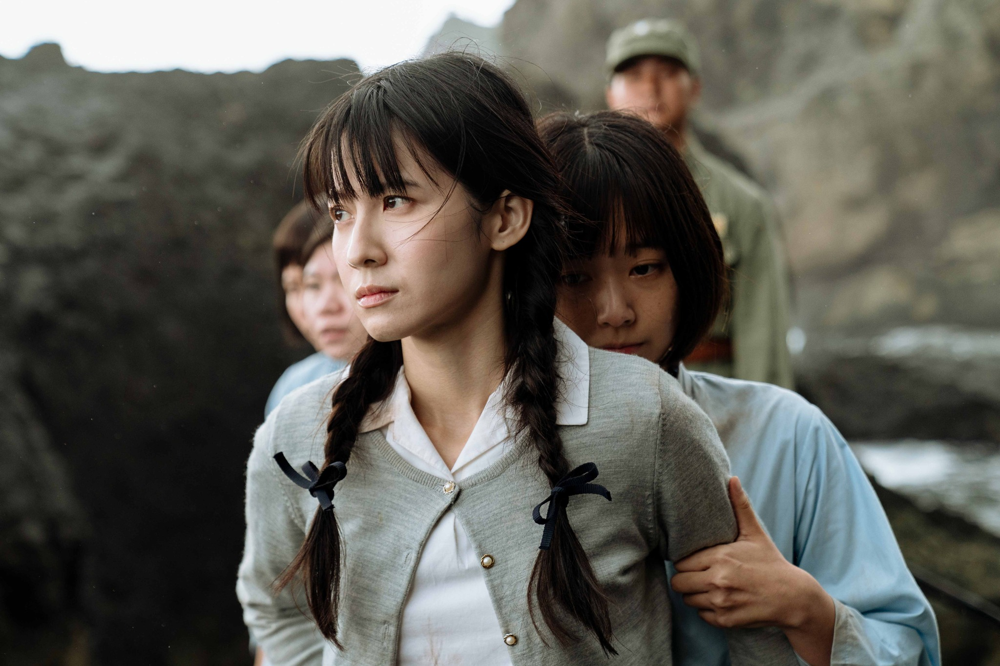
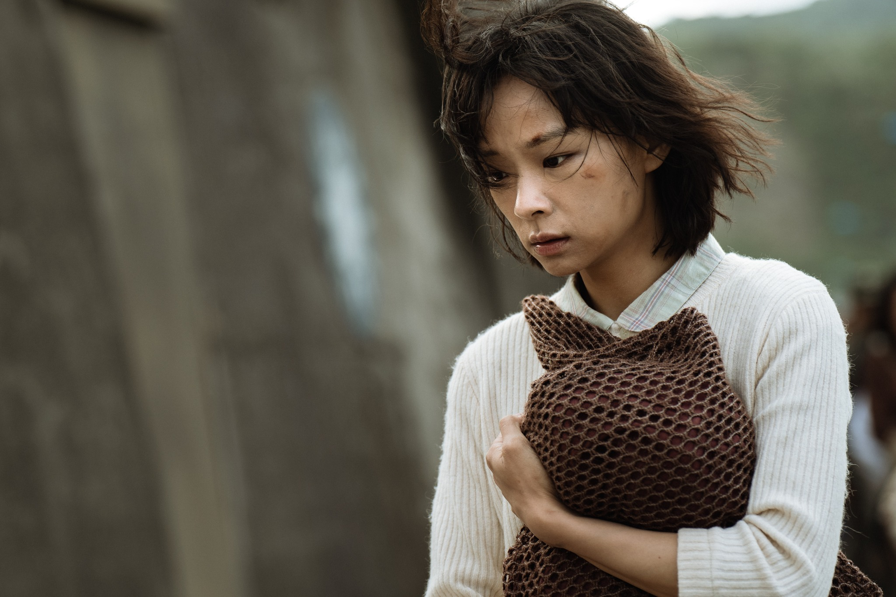
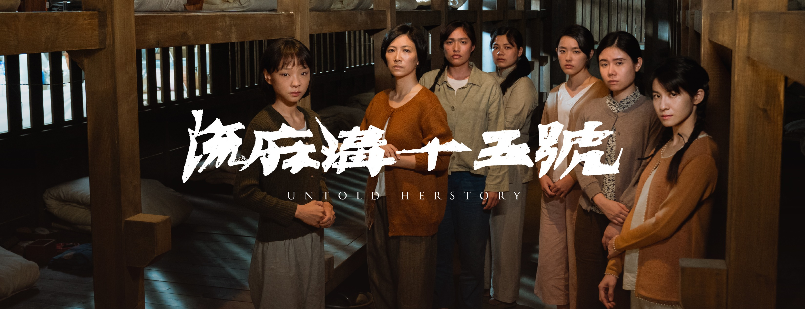

對我而言，在歷史故事之前，《流麻溝十五號》首先是一個關於女孩子們的人生故事。

（這篇感想是看完電影之後憑印象寫的，也許某些名詞有錯漏，如果發現請不吝指正。）

## 火燒島近了，但台灣就遠了

在學校擔任藝文社社長的「杏子」余杏惠，因為社員被舉報為共產黨員而受到牽連，儘管自己只是盡本份畫畫海報，仍被誣陷為共匪，帶往綠島名為「新生訓導處」的設施，實為關押思想犯的監獄。在那裡，善良單純的杏子遇見了兩名截然不同的獄友，「嚴姊」嚴水霞和陳萍。
<!-- more -->

**_Warning 📢 觀影筆記和讀書筆記都會涉及劇情，請斟酌閱讀。_**

## 信念會讓你撐下去

杏子和嚴水霞到流麻溝挑水時，看到她和男思想犯傳遞報紙，但杏子並沒有舉報她或認為這是不好的，她只是感到好奇，因而開啟她與嚴水霞的「師徒」之緣。嚴姊告訴她，儘管身陷囹圄，她們還是應該知道外面世界真正發生的事，而對於獄方下達的命令則只要做到八分，剩下一分鍛鍊，一分學習，才能使她們不至被完全洗腦，還能保有思考的空間。嚴姊也用聖經教杏子英文，讓她每天的生活不只有空洞的愛國思想。

© [湠臺灣電影 thuànn TAIWAN](https://www.facebook.com/thuannTaiwan/)

在所有女思想犯中，嚴姊也是最明顯表現出不配合的。獄方希望大家「志願」參加良心救國運動，卻又要求大家必須登記參加才能換取家中寄來的照片和衣物；但儘管看到了思念多年的兒子照片，她依然不願屈服，拒絕在紙上簽下自己的名字。對嚴水霞而言，**她只是一直堅持做她認為對的事**，就像她身為護理師認為病人就是病人不分敵我，當嚴厲監看她們的羅幹事落水時，她一樣毫不考慮就跳下水救人；也像她相信社會主義，相信要有行動才會有所改變。

她告訴杏子，最重要的事情就是要在逆境中保持信念。嚴水霞的信念也許是宗教，也許是她所相信的社會主義，這些支撐著她在行刑的前一刻，以微笑作為反抗面對即將到來的命運。諷刺的是，這個「共匪」也許比監獄裡所有號稱要感訓他們的愛國國民黨員，都還要更堅信與貫徹自己的理念。

## 姊妹之情

另一個影響杏子的是剛開始冷眼旁觀眾人，不太反抗指令的陳萍。由於擅長跳舞，陳萍總是在藝文活動上表演，當「反共花瓶」；晚上則常被大隊長「特別召見」，因而享有與她人不同的待遇，不須做苦工粗活。一次杏子觀賞陳萍跳舞後深受感動，她激動地告訴陳萍，自己認為她是位真的藝術家，陳萍聽完只對她苦澀地笑了笑，但自此與杏子有了交集。杏子也才知道陳萍之所以認命接受這一切，包括自首自己是共產黨、乖乖聽從指令、甚至和大隊長發生關係，是為了保護自己的妹妹陳果，同時她也想盡早服完刑到台灣和孤身一人在那裡念書的妹妹相會。

或許陳萍也曾和杏子熱愛畫畫一樣，單純地熱愛跳舞，並真心將其視為藝術；但當舞蹈成為在獄中不得以的求生手段，藝術不再純粹，對陳萍來說最後只是「跳得好騙騙傻子，跳不好騙騙自己」。舞蹈讓她想起獄中的不堪歲月，她最後也告訴杏子，離開綠島後她已經不想再跳舞了。

© [湠臺灣電影 thuànn TAIWAN](https://www.facebook.com/thuannTaiwan/)

透過大隊長的安排，陳果得以到綠島送物資，姊妹兩人終於相會，陳萍更拜託杏子為妹妹畫畫像。妹妹離開後，陳萍讀了她留下的信才得知，因無法治療的心臟疾病陳果已經不久於人世，更不可能等到陳萍出獄了。**靠著見妹妹的信念撐下去的陳萍已經沒有了活下去的理由**，當下投水自盡，但不會游泳的杏子在情急之下仍跳下水救她。自此以後，也許是為了彌補沒能好好保護陳果的缺憾，陳萍開始視杏子為妹妹般地照顧她。

和啟蒙杏子的嚴水霞不同，陳萍用自己的方式保護杏子。她狠心把男思想犯林耀輝向杏子告白的貝殼丟掉，因為她深知這樣做會為杏子帶來麻煩。但她也有心軟的一面，特意在排練劇目時讓杏子和林耀輝有機會相處，卻沒料到會惹禍上身。

## 在苦難中堅持去愛

陳萍帶領的劇團在蔣經國來訪時演出，參演的林耀輝和莊正雄卻將其中一段改編為諷刺歌曲。兩名男思想犯隨即被倒吊刑求，獄方也嚴加搜查宿舍，並在嚴水霞的鋪位搜到報紙書信等證據。為保護同樣在劇團內協助做佈景的杏子，陳萍佯裝吃醋要大隊長將杏子關入獨立關押犯人的碉堡。好不容易出來時，杏子才知道除了她以外其他人的遭遇：嚴水霞已被送軍法處，而林耀輝則在苦刑折磨下死去。

儘管嚴水霞後來被處刑，但她的犧牲啟發了杏子。舉發嚴姊的懷孕獄友即將分娩，看守她們的獄卒不願開門，還有人冷嘲熱諷是因為她先舉發別人活該如此。杏子卻力排眾議，為嚴水霞發聲說她若在場一定會救人，一向順從的她更衝向牢門大喊要請醫生。她的舉動讓女思想犯們群起響應，最後獄方總算請來醫生，孩子也順利產下，為暗無天日的牢獄生活帶來一點希望。

一群來自四面八方，有著不同語言文化，懷抱各自不得已苦衷的女孩子，因為一個獄友的苦難而在那個時刻決定團結起來幫助她，最後她們敲擊獄門的聲音跟傳達出來的力量很讓我動容。

© [湠臺灣電影 thuànn TAIWAN](https://www.facebook.com/thuannTaiwan/)

而和杏子同樣被關進碉堡的另一名女思想犯崔儀君，常表示自己愛黨愛國是無辜入獄，曾要陳萍幫她向大隊長伸冤，當時嚴姊只冷冷地說妳何苦為難身不由己的人。始終堅信黨會為她洗刷冤屈的崔姊在蔣經國來訪時向他陳情，卻只換來一句這是時代的罪，才知道她追隨且相信的青天白日滿地紅旗只是一張破布，失控的她被關進碉堡，從此發瘋。

## 犧牲會帶來力量

相信性善的杏子經歷了這一切並「受了感訓」後，還是不明白自己到底做錯了什麼？而在獄中所謂的感訓，也不過是思想犯們配合獄卒表演給黨看，一切訓話指令都是空洞的說詞，愛黨愛國的活動到頭來沒有幾個人是「志願」參加，連獄方抓來做模範的樁腳也是被黨強迫從軍的受害者。

雖然陳萍後來到達台灣，但是她和妹妹相別的人生遺憾已經無法彌補；而火燒島上多得是和她一樣錯過人生的人：無法相愛只能殉情的戀人、沒有緣分的母親與孩子，也有些人可能只是因為在判決書上一念之間寫下的「嚴為複審」四個字，就和家人從此天人永隔。

因為冤獄不明不白地服刑，接受不明不白的感訓，最後不明不白地被判死。受影響的不只是被抓走的人，還有在家中等待的人，以及他們的後代。

© [湠臺灣電影 thuànn TAIWAN](https://www.facebook.com/thuannTaiwan/)

嚴水霞說自由是你可以做自己，儘管在獄中身體受禁錮，她努力不讓自己的心靈也受禁錮，始終選擇她認為正確的道路。在片尾放的一張張死刑前露出微笑的照片，穿透了時間和螢幕，我實在不知道在那樣的境遇下，要有多大的勇氣才能保持笑容？

電影中其實沒有極度血腥的場面，我也覺得電影意圖不在呈現殘忍暴力；最後觸動我的也不是苦難的磨練，而是一群背景各不相同的人，在逆境中嘗試去理解、去幫助彼此，那是黑暗中的小小微光。

## 推薦閱讀

*   [《流麻溝十五號》連俞涵被丟下水體驗綠島?!演員阿嬤親身經歷火燒島50年不敢說🤫【電癮好選喆Top movie picks】](https://youtu.be/qOjftQbEiy8)
*   [描寫白色恐怖的《流麻溝十五號》，主角為什麼一直被迫參加文藝活動？從「反共文藝」談起](https://youtu.be/-8dUTkmCEyY)
*   [歪文系／《流麻溝十五號》的「她」們：不只是無知的白色恐怖受害者](https://opinion.udn.com/opinion/story/10124/6738690)