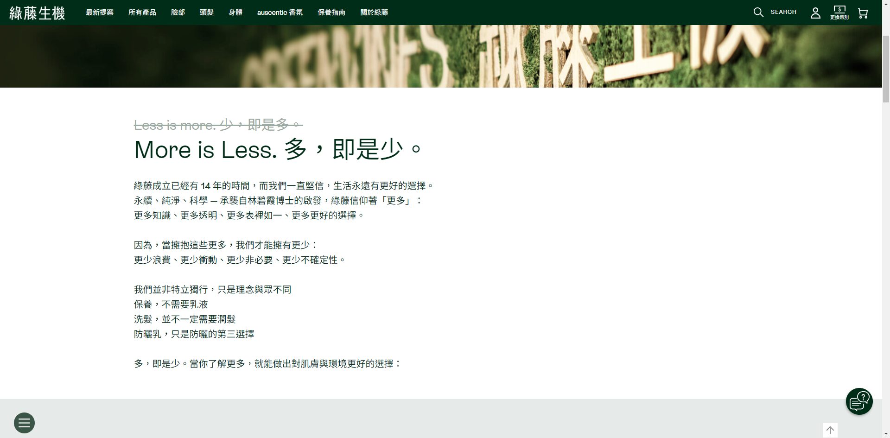
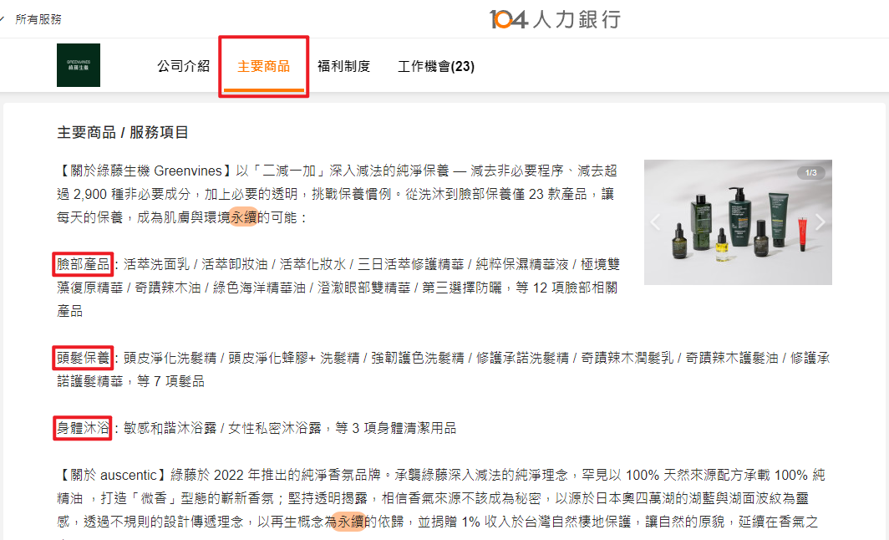

接續上一篇〈[URWM 一起更新履歷吧 #1 來寫任務記錄表](https://zeoutput.com/2024/07/update-resume-with-me-1/)〉，接著我就會根據這些資訊，打開履歷檔案把新工作更新上去。雖然主要是紀錄更新步驟，但從頭開始寫的話也是差不多的做法。

## 撰寫履歷草稿的要點

1.  從最簡單的開始
    1.  我覺得工作描述寫起來很繁瑣，很容易想逃避。對我來說可行的方法是從公司資訊、職務名稱、在職日期這些幾乎不用動腦的資訊先開始整理，更容易進入狀況。接下來可以整理專業技能或證照這些也相對簡單的資訊，最後再來寫工作描述。
    2.  我習慣準備中文跟英文履歷，對我而言英翻中比中翻英相對容易，所以我通常會從英文開始寫，確定內容後再轉成中文。
2.  先求有不求好：寫的時候別太要求用詞或文法精確度，草稿階段先確保有個 60 分的內容即可；也先不要管履歷的外觀跟格式，下一個階段再來精修調整。

## 履歷的框架

這邊要介紹我開始整理履歷時參考的大神 DANNY CHOO 的文章〈[HOW TO WRITE A RESUME](https://dannychoo.com/archive/en/posts/how-to-write-a-resume)〉，我的履歷框架受到他很大的啟發，也順利讓我應徵上理想公司。

DANNY CHOO 出生在英國，因為嚮往日本文化自學日文，成功到日本工作逐夢，曾在日本亞馬遜及微軟等公司任職，最後甚至在日本創立自己的公司。這篇文章原本有中文版（沒錯他會中英日三語寫作，不愧是大神），不知為何後來只剩英文版，大家可以自己網頁翻譯來讀。

因為看了他的文章，我對自己以前的履歷做出一些重大改變：

1.  不堅持履歷一定要在一頁以內（但這點比較有爭議，基本上 99% 的履歷教學都會建議要在一頁以內，DANNY CHOO 的原因在他文章內有寫，我個人比較偏好他的論點，大家就自己參考評估囉）
2.  除了公司名稱也會寫公司簡介
3.  把每份工作的責任跟成就分別列出
4.  提供足夠的資訊充分說明工作內容

大原則就是盡量提供足夠資訊，讓瀏覽履歷的人更容易理解履歷上的內容。

## 履歷的內容

1.  基本資訊：姓名、職稱、聯絡資訊、Linkedin 頁面、作品集網站、社群帳號等。每個產業需求不同，有需要就放。如果無從判斷，只要對應徵這個職缺更有幫助的都可以放。
2.  工作經歷
    1.  公司名稱：我通常不會列全名，舉例「世界先進積體電路股份有限公司」我可能只會寫「世界先進」。因為對不熟悉該產業的人來說，不認識的公司寫了全名還是不認識，應該透過公司簡介去補充說明；反之超有名的公司例如 Google Inc.，就算只寫 Google 也已經足夠了。另外我會在公司名稱附加公司網站連結，方便讀履歷的人直接連到網站看更多資訊。
    2.  公司簡介：簡單說明一下這是間怎樣的公司，例如提供什麼服務、製造什麼產品，如果有容易看出公司規模或能代表公司重要性的描述更好，例如世界第X大的、XX產業最領先的XX等等。我通常會看公司的官方網站類似「關於我們」這種頁面，也可以看看公司的 104 招募頁面找靈感。如果沒有太多可描述，寫清楚服務跟產品就好。
    3.  擔任職位：參考公司職稱來寫，但可根據市場常見的職稱調整。比如有些公司很多職位都叫「工程師」，但可能工作內容其實跟 coding（普遍認為的工程師工作）無關，這時候就可以調整職位名稱，讓讀履歷的人更容易理解，例如可以更詳細寫是 Pre-Sales Engineer、QA Engineer 等等。
    4.  任職期間：我通常只會寫年份跟月份。
    5.  公司所在城市：我習慣會寫，但不特別寫應該也沒關係。
    6.  職責：是時候拿出[任務記錄表](https://zeoutput.com/2024/07/update-resume-with-me-1/)了！看一下紀錄表中的工作內容，把類似的內容分組，用一兩句話來描述每一組工作。
    7.  成就：一樣從[任務記錄表](https://zeoutput.com/2024/07/update-resume-with-me-1/)挑選幾個具有代表性的成就寫下來。挑選原則：
        *   跟應徵的職務最相關
        *   成效最好
        *   規模最大
3.  學歷：學校名稱、學位別、主修輔修科別、就學期間等。
4.  專業技能：硬技能或是常用軟體工具。
5.  證照：證照名稱、發照單位等。

## 範例

### 公司名稱範例

以在 104 上隨手找到的「綠藤生物科技股份有限公司」當例子，寫「綠藤生物科技股份有限公司」或「綠藤生機」都可以，因為對於不熟悉保養品的人來說，基本上他就是不認識；但對於有接觸保養品的人「綠藤生機」知名度可能比較高，所以我會選擇「綠藤生機」。

（要稍微注意公司跟品牌是不同的，一間公司底下可能有多個品牌；但以這間公司而言，它在不同品牌的敘述都是以「綠藤」自稱，這個情況下我認為使用「綠藤生機」作為公司名是可行的。）

### 公司簡介範例

接下來我去看網站的「關於綠藤」這個頁面，但此頁感覺比較偏向對消費者傳達的資訊，對於這間公司的產品、服務或是規模沒有太多具體可用的內容，所以我轉而去看公司的 104 頁面，在「主要商品 / 服務項目」這邊就有寫到它是生產臉部、頭髮和身體的保養品，這樣就有基本資訊了。但還是沒有太多關於規模的敘述，這時候就可以搜尋有沒有市佔率或銷量相關的媒體報導。

不過從網站跟 104 可以看出，綠藤是滿強調永續概念的品牌，所以如果想往這方面發展，可以在公司介紹強調這一點。由於我一時沒有找到太多規模的資訊，可能就會簡單寫「永續肌膚保養品牌」（Sustainable skincare brand）。

### 職責＆成就範例

我繼續使用上一篇〈[URWM 一起更新履歷吧 #1 來寫任務記錄表](https://zeoutput.com/2024/07/update-resume-with-me-1/)〉的範例，把任務紀錄表貼給 ChatGPT 整理。

使用提示詞：

請根據以下原則，將這個人的工作紀錄表寫成履歷上的工作「責任」和工作「成就」。  
  
原則：  
1\. 在履歷上，要將工作的「責任」和工作的「成就」分開列出  
2\. 請提供工作「責任」和工作「成就」的足夠資訊，以讓閱讀履歷的人充分了解工作內容  
3\. 針對工作「責任」，請把相似的工作內容整合在一起，並用一個可以涵蓋這些工作的句子來描述  
4\. 請整合所有工作「責任」和工作「成就」後統一列點，而不要以每個單獨的專案為單位列點  
  
工作紀錄表：  
名稱專案文件專案時間專案規模專案狀態我的貢獻我產出的內容專案成效數據 (關鍵影響＆數字)  
2024春季產品推廣活動(文件連結)2024年1月-2024年4月涉及行銷部、公關部、設計部、銷售部，10人團隊已完成負責社交媒體營銷及活動執行撰寫社交媒體貼文、製作活動報告社交媒體曝光率增加30%，活動參與人數達2000人  
…（太長了只列出一部分，總之就是把工作紀錄表直接全部貼上）

輸出結果：

\### 工作責任  
  
1\. 負責社交媒體營銷及活動執行，包括撰寫貼文和互動數據分析報告。  
2\. 協助策劃和執行市場推廣及客戶回饋活動，製作邀請函和回顧報告。  
3\. 設計問卷並分析市場調查數據，提供數據分析報告。  
4\. 參與品牌定位調研及新形象設計，撰寫品牌研究報告和視覺指南。  
  
\### 工作成就  
  
1\. 增加社交媒體曝光率30%，活動參與人數達2000人。  
2\. 社交媒體粉絲數增加20%，互動率提高15%。  
3\. 客戶滿意度調查結果顯示滿意度達90%。  
4\. 收集到500份有效問卷，市場趨勢報告提供給高層參考。  
5\. 品牌認知度提高25%，市場調查顯示顧客對新形象反應積極。

除了「工作成就」的第 4 點我個人覺得應該屬於「工作責任」，其他大致寫得滿 OK 的。當然更好的辦法可能是自己先寫好一版，最後精修時再給 ChatGPT 調整。

## 其他我覺得不錯的參考資料

*   [如何寫一份世界的履歷？從五個實戰案例開始 (不用留學的出國工作術 — 履歷篇)](https://medium.com/dimly-lit/getting-overseas-jobs-without-studying-abroad-resume-tutorial-88564080a82b)

*   [前微軟 PM Diego Granados 的推文](https://x.com/PMDiegoGranados/status/1582115284269211648)（現在應該叫 X 文？）

不過 Diego Granados 也有提到他拿到最新職位的最大原因是他很積極 networking…（內向人已哭），希望有內向人可以來跟我一起抱團取暖❤️‍🔥

但是至少我們能先認真把履歷準備好（握拳），現在就打開檔案開始動手吧！GOGO！