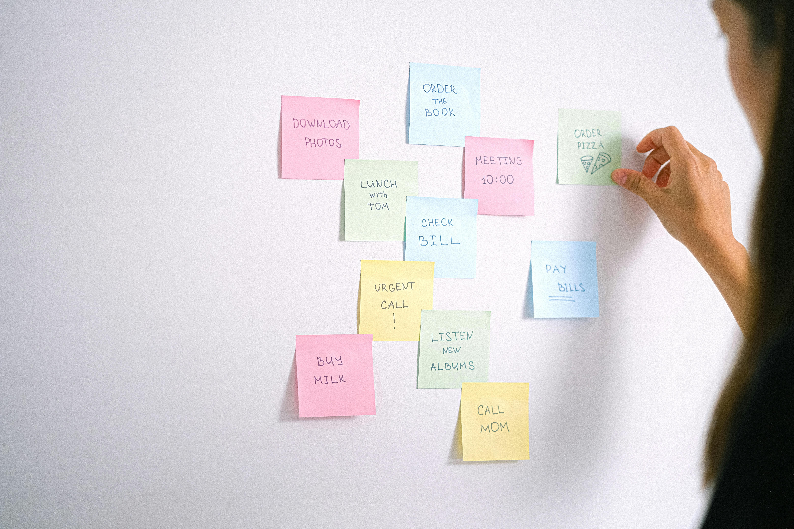
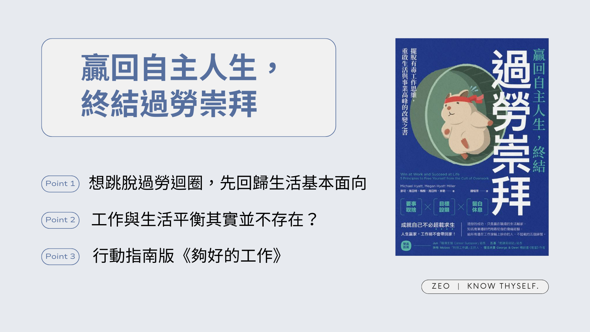

《贏回自主人生，終結過勞崇拜》比較接近我在讀[《夠好的工作》]()前想找的列點式執行指南，相較之下對案例的探討就沒有後者那麼深入。可能故事型的案例更容易深植人心，我覺得如果不是先讀了[《夠好的工作》]()、在想法上已經有一定程度的轉變，《贏回自主人生，終結過勞崇拜》的某些論點對我來說可能就不會這麼有說服力。

接續讀完這兩本書，可以發現兩者概念相似，印證了某些道理的重要性得到兩本書作者的共同認可。同時，《贏回自主人生，終結過勞崇拜》也提供了一些新的思考方向。這篇筆記將著重在《贏回自主人生，終結過勞崇拜》能與[《夠好的工作》]()互相補充的內容，會分成[關於個人生活](#about-personal-life)跟[關於工作](#about-work)兩個主題。

## A. 關於個人生活

### A-1. 關心生活的不同面向

[《夠好的工作》]()提到了「生活本身就是目的，而不是工作間的過渡」，《贏回自主人生，終結過勞崇拜》則進一步提供檢視框架。書中列舉生活的 10 個面向：心靈、智慧、情感、體能、婚姻或親密關係、育兒、社會、職業、興趣、財務（第 3 章）。

我們可以檢視自己在這些方面花費了多少時間和精力，但如果要更集中和簡化一點，書中也提到了三個最基本要關注的重點：自我照顧、重要人際關係和專業成果。

[Photo by Anna Shvets](https://www.pexels.com/photo/sticky-notes-with-to-do-list-on-the-white-wall-4586902/)

1.  自我照顧：最基本的包括：吃飽、睡好、規律運動、與所愛的人相處、培養有意義的嗜好、留有自我反思的時間。
    *   「留有自我反思的時間」在資訊過載的現代生活中尤其容易被忽略，而培養有意義的嗜好已經在[《夠好的工作》]()的心得中有所提及。書中引用了一份研究，指出經常活動和運動的人，長期所得會比較高。我是覺得參考就好，不過這結論還滿有趣的。

2.  重要人際關係：我們當然希望留出時間與重要的家人朋友相處、交流，但工作優先的思維往往讓我們忽略了這些「看起來不那麼急迫」的事情。書中提出了一個簡單但有效的小工具，就是把這些重要的相處時刻排進行事曆，這樣你就更容易為這些寶貴的時刻真正預留出時間。
    *   我自己在工作上經常使用這個技巧，效果非常不錯。在把任務真正排進行事曆之前，常常因為覺得當天工作量「看起來」不多就接受了其他人的約會或丟來的臨時任務，結果常常中途發現根本做不完。但在預先排好工作後，這種情況少了很多，也更能專注在真正重要的事情上。至於將生活中更長期的待辦事項也排進行事曆，這也是我正在努力實踐的一點。

3.  專業成果：書中提到，要產出專業結果，需要從結果回推：(1) 清楚知道你負責產出的是什麼；(2) 列出要做哪些事情；(3) 為這些事情在行事曆預留位置。或者從個人角度出發，思考：(1) 你想創造的專業成果是什麼？(2) 你專業上不可妥協的重點是什麼？(3) 為這些事情在行事曆預留位置。
    *   這些問題的答案，會成為我們在任何時候做工作上決策的標準。書中作者舉她自己的例子：她是公司的執行長，負責提出預算、發展團隊、建構願景，需要做的事情包括訓練下屬、優化現有計畫、主持財務會報等。當你把最重要的事都排進行事曆後，就會發現那些無法被排進去的事項，其實可能也沒那麼重要。

> 只要現在多努力一點點就好，報酬、休息、經營家庭、獨處時間之類的，之後就會實現。但我們遲早會發現，工作是沒有盡頭的。否認事實，想著加班只是暫時，這樣的生活很容易，但一轉眼三、五、甚至十年過去，我們仍在超時工作，而生活早就轉到另一個方向去了。
> 
> 第 4 章

### A-2. 認知到真正的「贏」＝把你認為最重要的事情完成

這與[《夠好的工作》]()提到每個人都應該重新定義屬於自己的成功很像，不過《贏回自主人生，終結過勞崇拜》有提供更具體的定義方式和注意事項。

首先要意識到，真正的工作生活完美平衡是不存在的，「如果成功代表一切完美，那我們大多都會失敗」（第 5 章）。就算我們暫時達到平衡，出於各種不可控的因素，也未必總是能保持在這樣的狀態；這跟[《夠好的工作》]()認為不應過度陷在「夢想工作」這個概念，原因很相似——即使它現在看起來完美，卻未必永遠都是。

我們真正應該努力的是：做出取捨（排序生活所有面向中（而非只有工作）最重要的事情）、投入最有意義的人事物（排進行事曆！），盡可能以自己想要的方式生活。

> 「贏在職場又贏在生活代表把該優先的事情排優先、在能力範圍發揮影響力、掌控你可以掌控的事情。」
> 
> 第 5 章

### A-3. 認知到我們「需要」沒有成就的時間（包括睡眠時間）

[《夠好的工作》]()說閒暇時間本身就是一種目的，《贏回自主人生，終結過勞崇拜》更是直接宣布我們就需要有這樣無所事事的時間。原因如下：

1.  提升生理健康：我們的生理機制需要工作與休息互換的規律；而且不是因為工作才值得休息，而是因為好好休息之後，才能有效地工作。
2.  提升心理健康：睡眠有助於控制情緒。睡眠不足時更容易抓住無效策略不放、對他人的訊號判讀錯誤、過度反應，或以負面方式表達情感。
3.  激發創意：大腦處於自在漫遊（而非以成就驅動）狀態時，更容易產生突破框架的點子。比如在工作上苦苦思索解法，卻在上個廁所或散個步回來後突然有所領悟。
4.  為專業加分：
    *   和專業無關的嗜好可增強對工作能力的自信。這裡我比較偏好[《夠好的工作》]()的說法：因為嗜好幫助我們把自我價值和工作成就鬆綁，讓我們培養多方面的自信，進而在工作上有更好的抗壓能力。
    *   發展新嗜好時的「初學」思維也可能在工作上有所幫助。重新學習一項事物會強迫我們跳脫自動（auto pilot）模式，激發新的思考或行為模式。  
        

[Photo by Ron Lach](https://www.pexels.com/photo/a-woman-sleeping-on-the-bed-while-hugging-a-cloud-pillow-8263046/)

另外，書中也提供了一些幫助睡眠的建議：至少睡 7 小時、睡眠時保持涼爽溫度（約攝氏 18 度，比想像中還低）、睡前避免接觸令人心情不好的資訊來源、睡前一到兩小時可以洗澡十分鐘。

對此我也找到一些佐證的參考資料：

*   [這篇文章](https://www.philips.com.hk/c-e/ho/air-purifier-and-air-humidifier/air-care/best-humidity-and-best-temperature-for-sleep.html)提到：理想的睡眠溫度是攝氏 16-18 度。 這聽來可能有點冷，但體溫會在晚上下降，為睡覺作好準備。
*   [這篇文章](https://case.ntu.edu.tw/blog/?p=34546)提到：研究團隊發現睡前洗澡最佳水溫在攝氏40- 42.5度，可使睡眠品質變得更好。睡前一到兩小時洗澡可以讓平均入睡時間減少十分鐘。
*   [這篇文章](https://opinion.cw.com.tw/blog/profile/390/article/7966)提到：白天時專注於學習新事物，能促進新的樹狀突開始形成。接下來，晚上睡覺時，這些小突起變成了樹突棘。新的樹突棘與新神經元的突觸開始連結。這些連結越多，就越強健，而你的腦連結組也越牢固。這表示你更容易思考你正在學習的東西，就像你能在平坦順暢的道路上駕馭思維，而不是在充滿坑洞的泥濘小徑辛苦前行。

## B. 關於工作

### B-1. 我們會超時工作，一部份原因是工作本身就有吸引我們的特質

我沒有用這個觀點想過，畢竟「我們不想工作，卻又必須抗拒想工作的念頭」這乍聽起來太矛盾。原因在於：雖然工作大部分的時候都很痛苦，但工作也可能讓我們體會到心流、感覺到成長及自我實現，甚至透過獎金或升遷誘使我們在工作的跑步機上一跑再跑——這點也和[《夠好的工作》]()所說的一樣：如果一味地追求外在設定的獎賞，很容易陷入無止盡的追求迴圈，卻永遠沒有可以停下來休息的一天。

而且，當燃盡心力工作使得生活其他面向失衡，工作的樂趣也會逐漸消失。

結論是：我們當然可以享受工作帶來的好處——只要它沒有影響到你去實現生活中所有面向重要的事。

### B-2. 工作做不完就花更多時間工作＝用過勞解決過勞

這很不應該大家都知道，但當工作做不完，我們的第一直覺通常還是加班做完。如果是緊急情況，偶偶加班趕一下沒什麼問題；但長期這麼做，對個人或公司都沒好處。書中引用研究：只要工作超過一定工時，生產力就會下降。因此用高工時提高生產力這個方式是不成立的。

作者甚至進一步提出，由於現代工作在智力和情緒投入的程度都比以前更高，所以更容易感到疲憊和不快樂；而且跟勞力會隨時間下降一樣，我們也無法長期維持這種程度的精力。因此對於知識工作者而言，也許提高生產力的方向不是增加工時，而是減少工時（每天工作約六小時）。

[Photo by Tara Winstead](https://www.pexels.com/photo/white-skeleton-figurine-on-black-laptop-computer-8386703/)

之前嘗試過《做自己的生命設計師》書中的好時光日誌（Good Time Journal）這個工具，紀錄執行每項工作時的投入程度和精力高低，我發現到了下午四點左右，無論當時做的事情我有多投入，精力通常都比較低。我覺得跟《贏回自主人生，終結過勞崇拜》所說「人（尤其知識工作者）無法長期維持高度精力」及「每天合理的工時約六小時」滿符合。只是就算你已經做滿六小時、完成重要任務，通常還是得待在辦公室無法下班XD

要跳脫用過勞解決過勞的迴圈，可以嘗試：

1.  利用書中提供的雙贏練習簿先對自己靈魂拷問一番，找出自己這麼努力背後的原因到底是什麼，是真的為了自己，還是迎合別人期待？
2.  設下明確的工作時間限制，工作就是要在工作時間內處理完，不要總想著可以在晚飯後再回一下公司訊息，也要讓你的團隊或客戶知道你所設定的界線。
3.  關注工作做了哪些事，而非投入多少時間。好好審視工作內容，找出自己擅長（做得好）的事情也喜歡的事情，然後努力把你不喜歡或覺得無聊的任務刪掉、自動化或外包。我們的目標是最大化既擅長又喜歡的工作，使工作更符合興趣和專業能力。 這一項是我覺得除了「把重要的事排進行事曆」之外最有幫助的。讀完這本書不久，我在工作上又遇到了「不喜歡的任務」：不難只是繁瑣、責任歸屬模糊。在執行時覺得好煩好煩，後來想到書中的建議，有了明確可以嘗試的方向後忽然覺得煩躁感也降低了。

> 但喜歡討好別人的人，至少要先想到討好自己，畢竟自己也是人；而如果是想要避免衝突的人，我們也要意識到，如果任何讓工作與生活失去平衡的要求，我們都概括承受的話，只會迎來更多不必要的內心衝突。
> 
> 第8章

## 我的收穫

讀完《贏回自主人生，終結過勞崇拜》再自我反省後有個想法：盲目努力其實也是一種逃避，一種覺得我花了時間就是盡力了、花更多時間就可以達到完美的自欺欺人。

比起努力，更重要的應該是「用心」**。**先用心思考 1. 什麼對我真正重要（個人層面）2. 什麼是團隊的目標（工作層面）3. 哪些工作我擅長又喜歡（個人＋工作層面），思考過再開始行動。這樣不僅能在工作上、生活上都完成目標，也可以花更少的時間來完成重要的事情。

其實書中的道理都不高深，平常在文章或影片都多少看過，但就是不會想到去實行。不過跟著書裡的雙贏練習簿強制自己靜下來思考後，有逐漸在生活中感覺到微小的改變。

例如，當我在工作上覺得力不從心時，我發現自己比較能分辨現在遇到的狀況是「單純情緒投入太高」、「工作內容我不喜歡／不擅長」或是「工作負擔影響到我執行生活中其他的重要事項」，進而判斷對應的行動，像是持續觀察、嘗試調整、準備轉職等。

---

**贏回自主人生，終結過勞崇拜（Win at Work and Succeed at Life）**

*   作者：Michael Hyatt & Megan Hyatt Miller
*   譯者：鍾榕芳
*   出版年份：2023
*   出版社：樂金文化
*   閱讀平台：[Google Play](https://play.google.com/store/books/details?id=gYvlEAAAQBAJ)  [圖書](https://play.google.com/store/books/details?id=gYvlEAAAQBAJ)
*   閱讀時間：2024-04