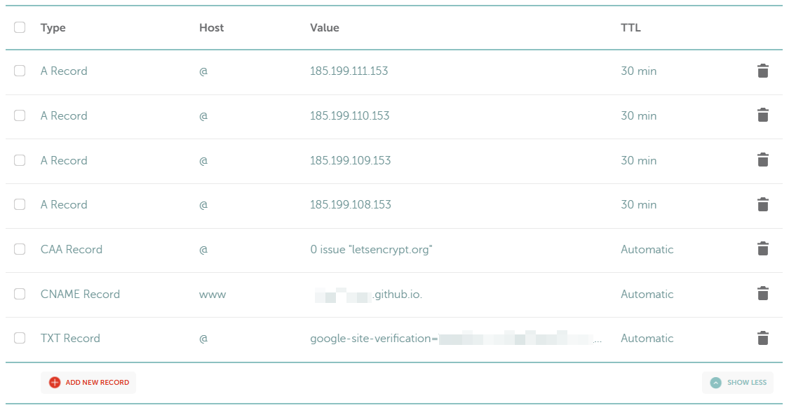
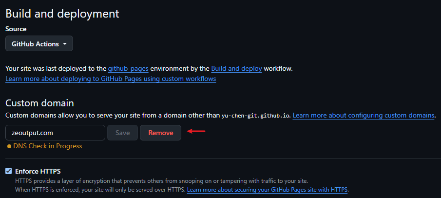

雖然我在之前的文章[《Bluehost 折扣價續約經驗分享》]()裡面提過自己還算滿意 Bluehost 的服務，但由於這次續約 Bluehost 漲了個天價，考量到自己使用部落格的頻率不高（去年發文只有個位數……），加上也沒有外掛電商之類非 WordPress 不可的服務；所以權衡之後，還是決定找找看有沒有更低成本的替代方案。

<!-- more -->

## 搬家過程

### 靜態網站的抉擇：Hexo & Hugo

一開始 AI 推薦我的方案是 Hexo，原因是它在華文圈普及率比較高，遇到問題有很多中文文件可以直接參考。所以我一開始有先在本機嘗試把 Hexo run 起來，過程也確實不難。

但在開始搜尋擴充可能性時（例如我想看有沒有辦法用外掛達到顯示熱門文章的功能），突然發現一件事：因為華文圈很多開發者使用的是百度或其他來自中國的服務，因此外掛很多是針對這類服務去開發的。我對於百度體系沒有特別好惡，純粹只是自己沒有使用（我比較多是使用 Google 體系或歐美廠商的服務），加上我不是開發人員，要自己去寫 code 對我來說太困難了。

因為有這層考量，後來我還是選擇了在國際間普及率比較高的 Hugo。（備註一下，這不代表 Hexo 完全沒有針對 Google 這類體系去開發的服務，我相信一定還是有，只是我後來就沒有很認真地繼續研究）

### 在本機執行 Hugo 

安裝 Hugo 這部分好像沒什麼好分享的，反正 AI 叫我做什麼我就做什麼。不過這是我第一次使用 SSG（靜態網站架構），也是在過程中才知道，原來 Hugo 原生的設計跟 Hugo Theme 的設計，在資料夾、檔案與文章排列上好像還是會有點不一樣。所以在詢問 AI 問題時，最好要特別備註使用的是哪一個 Theme。

花比較多時間的是在整理 md 檔。因為這是初次把 WordPress 下載下來的檔案轉成 md 檔，包括圖片路徑還有 Frontmatter 這些都需要調整設定，還有很多雜七雜八格式跑掉的問題。原本我想說大概 50 篇文章沒有很多吧，還一度想要手動整理；但整理完一篇後，想一想要做 50 次就發懶了。最後還是去蹭了 Claude Code 來幫我做這件事，只能說擁有一個高級工讀生的感覺真是太舒爽了，有機會再寫篇文來分享這一段。

### 把 Hugo 推上 GitHub Pages

另一個花比較多時間的就是 DNS 的設定。GitHub Pages 綁定自訂域名，除了域名供應商那邊要做設定之外，還需要在 Hugo 資料夾裡面放一個包含域名、檔名為 `CNAME` 的檔案（這是 Gemini 告訴我的，猜測來源是[這篇文章](https://ithelp.ithome.com.tw/articles/10246099?sc=rss.iron)，我沒有去查證在 2026 年的現在到底還需不需要，但總之我放了）。

再來就是，我原本以為域名解析正常情況下都不會超過一小時，但不知道為什麼我的解析花了超過一天。也可能是我聽信了 Gemini 的讒言，一直去 GitHub Pages 的 Settings 按 Remove 再重新加我的域名，導致它一直在驗證佇列裡重新排隊。總之最好的方式就是等待 GitHub Pages 自己去驗證，如果 unsuccessful 的話，過一段時間重新去 recheck 就好，千萬不要一直去 remove 它。

### 其他設定

* **GA**：參考[這篇文章](https://www.flashspace.org/hugo-google-analytics/)進行設定。
* **GSC**：直接沿用原本舊網站的資源重新驗證（選擇 TXT，在域名供應商設定），然後重新提交 Sitemap。

### 搬家步驟概要

簡單記錄一下：

1. 從 WP 下載 XML 和圖片檔
2. 本機安裝 Hugo 與主題
3. 文章初步轉檔成 md 檔
4. 根據 Hugo 主題將 md 檔進一步整理成對應格式（使用 Claude Code 輔助整理半結構化資料）
5. 其他設定檔調整 & 本機測試
6. 推上 GitHub Pages
7. 自訂域名設定 & HTTPS 勾選
8. GA & GSC 設定

不過目前也只是讓網站先上線、舊網址都能正常抓到文章而已。像留言系統這些都還沒弄，有時間再慢慢整理吧。啊然後因為文章摘要（description）好像沒辦法一起匯出，目前的摘要都是 AI 生成的看起來非常機（機）但因為好懶可能暫時就先這樣。

---

## 目前使用心得

由於剛開始使用 Hugo 基本上還在習慣中，目前要用 VS Code 寫文章跟用 cmd 發布文章對我來說依然有點新鮮。但還是簡單分享目前感覺到的優缺點：

### Hugo 優點

* **有表格！** 之前有開始在 [Vocus](https://vocus.cc/salon/zeoutput) 備份文章，但 Vocus 沒表格這件事就讓我十分痛苦。
* **可以直接嵌入 HTML**：我覺得這點超棒，像 Hugo 內建了 YouTube 的嵌入樣式但沒有 Spotify 的，但可以直接使用 HTML 就解決這個問題，讓靈活度變得很高。
* **外觀和閱讀性**：我覺得它的 Theme 甚至比 WP 更漂亮、閱讀性也更好（但也有可能因為這個 Theme 的開發者本身就是用中文寫作，所以對中文部落格的支援度比較好）。
* **MD 格式不太會跑掉**：WP 的編輯器有時在文章格式比較複雜時（例如文字清單下面又有符號清單之類的），版面呈現就會變得非常奇怪。
* **低成本**：目前只有域名費用，但這本來就是無論網站 host 在哪裡都必須付的。

### Hugo 缺點

* **編輯文章較不直覺**：主要是對 Markdown 太不熟了，寫文章的時候要一直開著 cheatsheet 確認適合的格式。
* **缺乏後台介面**：不像 WP 有後台介面，對非開發者來說要 customize 網站的門檻比較高。
* **動態功能需要外掛**：就像前面提到的，想顯示熱門文章就要去找外掛，沒辦法直接在原生框架實現（不過其實 WP 很多功能也是要靠外掛）。

因為搬家過程也是費了不少功夫，希望能在 Hugo 寫作愉快，不要太快發布下一篇終有一劫…