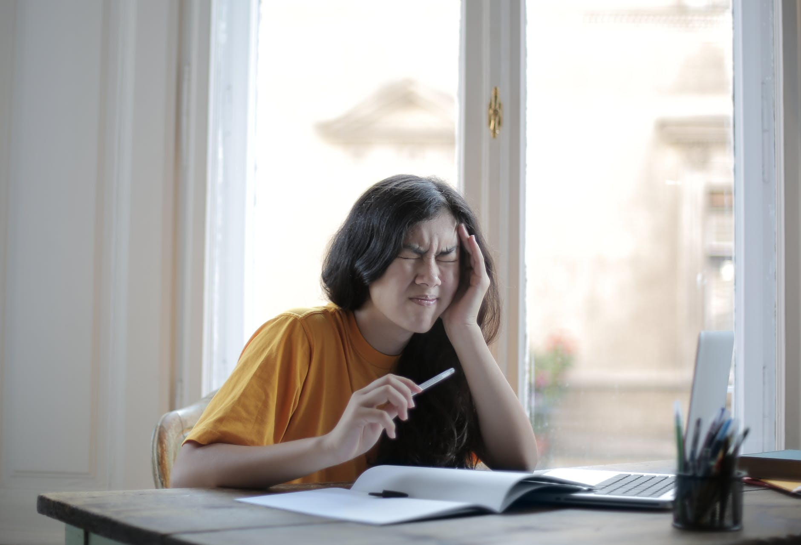
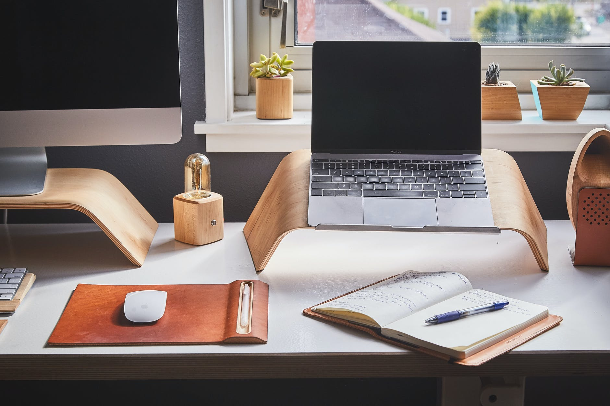

從 5 月中開始因為疫情關係在家遠端工作3週了，記錄一下這段時間的工作情況和一些想法。

## Day1: Chaos

第一天使用自己的電腦工作，完全是一團糟。工作到一半就會不自覺地想切去看Youtube、SNS或是做其他的事，但又拿捏不好時間，就會看得很有罪惡感，而且只要有工作來就必須立刻中斷，其實也沒辦法好好看完；一邊休閒時想著要趕快回去工作，一邊工作時要忍著不點開廢片，導致既沒休息到也很難專注工作。第一天結束的時候覺得：嗯？怎麼會這樣？一切都跟我想的完全不一樣…

Photo by Andrea Piacquadio on [Pexels.com](https://www.pexels.com/zh-tw/photo/3808016/)
<!-- more -->
## Day2 - Day3: Synchronization

第二天開始採用了我在網路上看到的作法：[〈給在家工作或在家學習者的建議〉](https://www.plurk.com/p/ocz4f4)，在上班時使用公司電腦，下班才換回自己的電腦，用電腦區分出上下班環境。雖然很麻煩，但效率明顯提升，這兩天的作息跟平時在辦公室的時候是最接近的，上班時間就是上好上滿，休息時間也只有喝水、上廁所、稍微活動身體跟讓眼睛休息；因為工作電腦跟私人電腦帳號完全分開，所以也不太會想要用公司電腦做個人的事情。這兩天結束的時候對自己的效率十分滿意。

Photo by Ken Tomita on [Pexels.com](https://www.pexels.com/zh-tw/photo/389818/)

## Day4 - Present: Hmmm...

本以為D2D3的好狀態可以一直延續下去，沒想到很快就校正回歸了。

接下來的日子進入了新的平衡：沒有D1的混亂，也沒有再出現D2D3的緊湊步調。如果D1的情況畫出來是波動超大的折線圖，D2D3接近直線，那D4之後就是一長串的小波浪，偶爾穿插一個大幅的波動。

沒什麼特別好或不好，完成重要工作沒有太大問題（應該說會面對到的問題和在辦公室時一樣，跟辦公地點比較沒有關係），上下班時間因為會換電腦也還算好切割（當然偶爾還是會失序一下）；但可能因為家中環境畢竟不如辦公室容易集中以及適合辦公，多少還是讓人有點煩躁吧。

不過在家工作也有一些好處，想要離開座位活動或伸展時比較自由，就算沒事想走到窗邊看一下外頭也不會覺得不自在，休息時間比較能好好放鬆休息。

Photo by Felipe Cespedes on [Pexels.com](https://www.pexels.com/zh-tw/photo/3029699/)

幾天前在[廣播](https://youtu.be/ufcy1ifZsRs)中聽到的建議：

> 好好把自己以往一直很想做，被日常瑣事拖著，重要但不急迫的事做一做吧。

也許這一段在家工作的時間也是一個很好的契機，讓人有機會停下來想想，過往因為工作繁重等各種理由一直逃避去認真思考的問題：

1.  我在工作中追求的到底是什麼
2.  人生的優先順序

另外針對 WFH 還需要改善的：

1.  掌握工作步調，適當調配 On / Off 時間
2.  建立更容易專注的環境，排除空間中降低注意力的因子